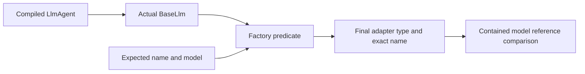

# T4-01 Agent Flow compiled model identity specification

| Field | Value |
| --- | --- |
| Document | docs/egon/spec/2026-11-11-15-57-compiled-model-identity.md |
| Template Version | 9 |
| Archetype Cleanup | Not applicable |
| Status | Review |
| Type | Feature |
| Complexity | Simple |
| Complexity Drivers | Additive local type, exact name and object-reference check |
| Created | 2026-11-11 15:57 Asia/Shanghai |
| Updated | 2026-11-11 15:57 Asia/Shanghai |
| Owner | Stellar Enclosure Components |
| Repository | Stellar-Enclosure-Components |
| Scope | Agent Flow adapter identity and owning finite fixture |
| Change Surface | Two existing production classes and one existing Component test |
| Affected Chapters | §7, §8, §9, §13, §14, §15, §16 |
| Source Requirement | [Master T4-01](../../../../docs/plans/agent-framework-upgrade-plan.md) |
| Baseline Revision | 6d26bf8724e8993b631db68c95b7238d7a93fb8c |
| Amends | None |
| Supersedes | None |
| Depends On | None |
| Related Specs | None |
| Related Plans | [Component plan](../plan/2026-11-11-15-58-compiled-model-identity.md) |

## 1. Summary

Give a local host a narrow way to verify the actual model chosen by a compiled Agent Flow leaf. Keep the underlying Spring AI model encapsulated. The result is one boolean derived from the adapter type, exact ADK model name and object identity.

## 2. Background and Current State

| Evidence ID | Exact source | Observed fact |
| --- | --- | --- |
| EVD-001 | `AgentFlowFactory#compileRoot` | Resolves the named ChatModel from the existing host map and uses the existing factory to construct the LlmAgent model. |
| EVD-002 | `SpringAiModelAdapterFactory#create` | Creates the final component adapter with the selected ChatModel and normalized model name. |
| EVD-003 | `SpringAiModelAdapter` and ADK 1.13.0 `BaseLlm#model` | The adapter stores the ChatModel privately. The pinned native model name is available through a typed accessor. |
| EVD-004 | `AgentFlowAutoConfiguration` | Both Flow and adapter factories can be replaced by a host. A same-name custom BaseLlm cannot establish which ChatModel is used. |
| EVD-005 | `AgentFlowFactoryTest` and module POM | Existing finite fixtures compile roots with the pinned SDKs and fake providers. |

### 2.4 Evidence and current-chain map

| Entry/trigger | Current path | Required extension |
| --- | --- | --- |
| Compile | Flow config → host model map → factory → LlmAgent | Preserve the compiled output and inspect it locally. |
| Inspect | Native LlmAgent model → BaseLlm | Verify known adapter, exact ADK name and exact captured ChatModel reference. |

### 2.5 Archetype example cleanup

Cleanup disposition: Not applicable

Reason: Extend the existing Component starter; no scaffolding or Example inventory is involved.

## 3. Goals and Non-goals

The component provides the adapter identity predicate and the finite proof. AS policy checks, provider reachability, artifact identity, deployment and release activation have separate owners.

### 3.3 Change Surface and Design Depth

| Area/layer | Disposition | Exact repository evidence | Changed or preserved behavior/contract | Required Spec treatment | Chapter(s) |
| --- | --- | --- | --- | --- | --- |
| Component factory and adapter | Affected | EVD-001–004 | Add an exact local predicate | Typed interface and failure semantics | §7, §8, §9, §13, §15 |
| Existing Component fixture | Affected | EVD-005 | Prove exact true/false outcomes | Finite tests and package inspection | §14, §16 |
| Tianji and external host consumers | Context-only | Existing source reactor | Product integration uses a separate source change | Compatibility and artifact provenance | §16, §18 |

## 4. Requirements and Acceptance Criteria

| ID | Requirement | Observable acceptance |
| --- | --- | --- |
| REQ-001 | Identify the existing compiled Spring AI adapter. | Only the final component adapter can produce a positive result. A different BaseLlm with the same name returns false. |
| REQ-002 | Compare the exact name and ChatModel object. | Same exact name and instance returns true. Distinct value-equal model, differing names, appended whitespace and nulls return false. |
| REQ-003 | Keep the predicate pure and additive. | It accesses no options or provider, allocates no runner, adds no dependency and changes no existing creation or invocation behavior. |
| REQ-004 | Provide reproducible Component evidence. | Exact mutation tests, owner finite reactor, actual package inspection and six-path scoped evidence. |

### 4.1 Scenario matrix

| Scenario | Input | Result |
| --- | --- | --- |
| Exact assembly | Compiled known adapter, exact name and same ChatModel reference | true |
| Equivalent model | Distinct model with the same class, name and options and value equality | false |
| Other adapter | Different BaseLlm implementation with the same name | false |
| Inexact input | Wrong name, trailing whitespace or null | false |

### 4.2 Use-case analysis

| Actor ID | Actor |
| --- | --- |
| ACTOR-001 | Trusted in-process host with a compiled BaseLlm and expected ChatModel. |

| ID | Use case/goal | Actor | Trigger | Result |
| --- | --- | --- | --- | --- |
| UC-001 | Check compiled adapter identity | ACTOR-001 | Prepare local readiness evidence | Boolean exact match. |

## 5. Constraints, Assumptions, and Decisions

Use the pinned ADK 1.13.0 and Spring AI 2.0.2 interfaces. Compare the supplied expected name as-is to the compiled adapter name. Constructor normalization applies at existing model creation. The predicate introduces no input normalization, wrappers, reflection or configurable behavior.

## 6. Project Technology Context

Existing Agent Flow runtime package, Java 25, pinned ADK/Spring AI, Lombok, JUnit and AssertJ. Maven coordinate remains `top.egon:stellar-enclosure-component-agent-flow-starter:0.0.2-SNAPSHOT`.

### 6.2 User-mandated Java rule compliance

```text
1 类名规范，必须以 java的pojo规范命名。以dao po bo vo dto query command event等结尾
2 每层之间必须被 springboot-validation 校验，复用对象使用分组校验；基于原生和自定义约束注解、@Valid、@Validated 及 ConstraintValidator 扩展实现。ValidationUtils 只承担通用手工校验，不承载全部业务校验；电话号码复用 libphonenumber。
3 Java POJO 默认使用 class，注解为 @Data @NoArgsConstructor @AllArgsConstructor @Accessors(chain = true)，按构造目标选择 @Builder 或 @SuperBuilder；父类状态参与相等性时使用 @EqualsAndHashCode(callSuper = true)。只有不可变 value object 可以使用 record，并豁免 class 的 Lombok 规范；普通实体不能因简单而使用 record。使用 MapStruct、MapStructPlus 和 egon-cola-component-common-core 的 BaseConverter（双向）或 BaseForwardConverter（不可逆投影）进行转换。
4业务类必须使用@Slf4j注解注入log对象。如果业务类被spring管理，必须指定名称，如果是单例的情况下，参考@Service("userService")。如果需要依赖注入，必须@RequiredArgsConstructor进行修饰，不要代码中写。且属性必须被@qualify修饰。
5 工具类只允许使用jdk原生、Apache Commons(commons-lang3、commons-collections4、commons-io、commons-text、commons-codec、commons-beanutils)、Guava。针对Tika按需引入。
6 JSON 使用 Spring Boot Jackson；持久化枚举值使用 @EnumValue，向前端输出的枚举值使用 @JsonValue，禁止 ordinal 作为业务编码。
7 springboot 多环境配置文件，必须保持配置一致，但值不一定一致。
9 复杂业务必须引入设计模式，不允许硬编码
10 日期相关的必须使用java.time下的实体类，不允许使用java.util下的
11 只允许现有三层结构或当前 egon-cola-archetypes 的 DDD 结构，三层结构保持现状。必须尽量复用 egon-cola-components；持久化模块必须使用 Egon COLA MP Starter，DDL 统一由 egon-mp-sdj-ext-starter 分布式管理。业务唯一键必须组合业务列与 deletedAt（数据库 deleted_at），并验证 NULL、租户及重复软删除语义。采用 CQE（Command Query Event）；Event 必须经 egon-cola-component-transactional-outbox-starter 或 MQ 中间件投递。
```

| Literal rule | Affected? | Repository evidence | Exact design decision | Files/types/interfaces | Validation/test evidence | Status/blocker |
| --- | --- | --- | --- | --- | --- | --- |
| Rule 1 | Yes | EVD-001–005 | Reuse named component runtime types and a semantic predicate. | §7/8/9 | TEST-001–004 | PASS |
| Rule 2 | Yes | EVD-001–005 | The unproxied typed predicate returns false for null, different type, name or reference. | §7/8/9 | TEST-001–004 | PASS |
| Rule 3 | No | EVD-001–005 | No production carrier is introduced. The test-only record is immutable with value semantics. | §7/8/9 | TEST-001–004 | N/A |
| Rule 4 | No | EVD-001–005 | Existing adapter/factory creation, Bean and logging annotations stay outside the predicate. | §7/8/9 | TEST-001–004 | N/A |
| Rule 5 | Yes | EVD-001–005 | Reuse Java identity and the pinned ADK typed accessor. | §7/8/9 | TEST-001–004 | PASS |
| Rule 6 | No | EVD-001–005 | No JSON or enumeration changes. | §7/8/9 | TEST-001–004 | N/A |
| Rule 7 | No | EVD-001–005 | No application properties or YAML. | §7/8/9 | TEST-001–004 | N/A |
| Rule 9 | Yes | EVD-001–005 | Reuse existing factory and adapter encapsulation. | §7/8/9 | TEST-001–004 | PASS |
| Rule 10 | No | EVD-001–005 | No time fields, deadline or calendar logic. | §7/8/9 | TEST-001–004 | N/A |
| Rule 11 | Yes | EVD-001–005 | Extend the existing Component runtime module without persistence, Event or API layers. | §7/8/9 | TEST-001–004 | PASS |

### 6.3 Time semantics and conversion contract

Time contract: Not applicable

Reason: The predicate checks immutable adapter identity and performs no I/O, clock read, lease or time conversion.

## 7. Architecture Design

### 7.0 Minimum-design baseline and element-necessity audit

| Proposed element | Change | Requirements | Need |
| --- | --- | --- | --- |
| Static factory predicate | Add | REQ-001–003 | Owns recognition of the compiled component adapter and exact name check. |
| Package-private adapter comparison | Add | REQ-002/003 | Compares private backing field by reference without exposing it. |
| Existing finite test | Extend | REQ-004 | Actual compiled leaf and adversarial identity controls. |

| Path | Network calls | Client states | Decision |
| --- | --- | --- | --- |
| Local identity predicate | Zero | True or false | Reuse typed runtime objects. |
| Expose underlying model or reflect on private fields | Zero | More state or brittle introspection | Retain private ownership and typed predicate. |

### 7.1 System Architecture Design

Keep the lookup in the existing Component package that owns the concrete adapter. Consumers supply the native BaseLlm extracted from their compiled root.

### 7.2 High-Level Design

The static predicate recognizes the final SpringAiModelAdapter type, compares the native name, then delegates one reference comparison to the adapter.

### 7.3 Detailed Design



`SpringAiModelAdapter#usesChatModel` compares the private field using Java `==`. The positive path requires a non-null expected model. The predicate does not examine semantic options; the product caller must verify those independently.

### 7.3.6 Conclusion evidence chain

EVD-001/002 identify the actual compiled path. EVD-003 allows the owning package to check the model reference. EVD-004 explains why the check must inspect the actual compiled object. EVD-005 supports a finite fixture that exercises the native compiler.

## 8. Package Structure and Code File Tree

| Operation | Exact path | Responsibility |
| --- | --- | --- |
| MODIFY | `stellar-enclosure-component-agent-flow-starter/src/test/java/top/egon/cola/component/agentflow/runtime/AgentFlowFactoryTest.java` | Compile the actual leaf and assert exact model identity. |
| MODIFY | `stellar-enclosure-component-agent-flow-starter/src/main/java/top/egon/cola/component/agentflow/runtime/SpringAiModelAdapter.java` | Compare the contained ChatModel by object identity. |
| MODIFY | `stellar-enclosure-component-agent-flow-starter/src/main/java/top/egon/cola/component/agentflow/runtime/SpringAiModelAdapterFactory.java` | Expose the typed, side-effect-free predicate. |
| CREATE | `docs/egon/spec/2026-11-11-15-57-compiled-model-identity.md` | Freeze the API and proof boundary. |
| CREATE | `docs/egon/plan/2026-11-11-15-58-compiled-model-identity.md` | Freeze source hashes, test selectors and packaging gates. |
| CREATE | `docs/egon/evidence/2026-11-11-compiled-model-identity.md` | Record observed checks and outstanding owner Maven gates. |

## 9. Interface Definitions

### 9.1 Interface Inventory

| ID | Interface | Style | Scope |
| --- | --- | --- | --- |
| INT-001 | `SpringAiModelAdapterFactory.matchesCompiledModel` | In-process Java predicate | Component consumers with a compiled adapter and expected model. |

### 9.2 Per-interface Detailed Contracts

`public static boolean matchesCompiledModel(BaseLlm adapter, String expectedModelName, ChatModel expectedModel)`. Inputs are the compiled model object, exact case-sensitive native name and expected object instance. Returns true only for the known final component adapter, exact native name and same non-null ChatModel reference. Returns false for null, different type, different name or different object. The backing model and runtime options stay encapsulated. No HTTP or SDK contract is added.

## 10. POJO and Data Model Design

Reuse `BaseLlm`, `String`, `ChatModel` and a primitive boolean. There is no new production data carrier. The fixture uses a private immutable value-equal ChatModel record to distinguish object identity from equality.

## 11. Database Design

Relational model change: No. The operation is entirely local to the compiled object.

## 12. Frontend Page Design

No UI entry point.

## 13. Design Patterns and Architecture Principles

Reuse the existing factory and keep the adapter private to its package. Use a static predicate with package-private delegation so a factory override cannot provide a fabricated match.

## 14. Test Design

| Test ID | Design |
| --- | --- |
| TEST-001 | Use actual `compileRoot` and pinned `LlmAgent.model().flatMap(Model::model)`; assert true only for same instance and exact name. |
| TEST-002 | Use a value-equal model with the same options and a different BaseLlm with the same name; assert false. Fake model and adapter reject generation and connection if accidentally invoked. |
| TEST-003 | Exact mutation tests separately replace identity with equality, omit name check and accept an unknown same-name adapter. Each selected test must fail one false assertion. |
| TEST-004 | Owning Component finite reactor and actual JAR class/method inspection, followed by exact staged-path and SHA verification. |

## 15. Non-functional and Cross-cutting Design

Constant-size comparison in process. The predicate returns a boolean without reflecting on model fields, collecting credentials, calling options getters or opening a model connection.

## 16. Compatibility, Migration, Rollout, and Rollback

Existing creation APIs and Maven coordinates remain usable. The verified source reactor can compile the downstream project against a source checkout containing this change. An independently resolved snapshot JAR must contain the same API; source reactor evidence does not show distribution. Rollback is a single Component commit after dependent source is removed or reverted.

## 17. Alternatives and Decisions

Checking only a name or options would accept different objects. Private-field reflection would couple the consumer to implementation internals. The existing owner can answer the direct identity question without returning either runtime object.

## 18. Risks and Open Questions

A true result establishes only the compiled adapter and model object. Live options drift, provider availability, policy, tenant permissions and deployment scope need separate checks in downstream steps. Scratch JDK and finite tests are available; owning Maven and package gates run at execution. Snapshot installation and publication are separate operations.

## 19. Traceability Matrix

| Requirement | Use case | Design | Tests |
| --- | --- | --- | --- |
| REQ-001 | UC-001 | §7/9 | TEST-001/002/003 |
| REQ-002 | UC-001 | §7/9 | TEST-001/002/003 |
| REQ-003 | UC-001 | §7/13/15 | TEST-001/002/004 |
| REQ-004 | UC-001 | §8/14/16 | TEST-003/004 |

## 20. Review and Acceptance

### 20.5 Blocking Manual Check

| Check ID | Applicability | Status | Evidence | Finding | Required action/exception |
| --- | --- | --- | --- | --- | --- |
| MC-ARCH-001 | Applicable | PASS | §7/8 | Extend the existing Component runtime owner. | None |
| MC-REUSE-001 | Applicable | PASS | EVD-001–005 | Use the actual compiled adapter, native model accessor and existing tests. | None |
| MC-DEP-001 | Applicable | PASS | §6/16 | Pinned ADK, Spring AI and test dependencies already supply every type. | None |
| MC-NAME-001 | Applicable | PASS | §7/9 | matchesCompiledModel and usesChatModel describe exact checks. | None |
| MC-VALID-001 | Applicable | PASS | §7/9/14 | Fail closed for nulls and type, name or reference mismatch. | None |
| MC-MODEL-001 | Not applicable | N/A | §10 | Reuse pinned SDK interfaces. Only the immutable test model uses a record. | None |
| MC-CONVERT-001 | Not applicable | N/A | §10 | No mapping, conversion or DTO handoff. | None |
| MC-LOG-001 | Not applicable | N/A | §15 | The predicate produces a boolean and uses no logging or error payload. | None |
| MC-BEAN-001 | Not applicable | N/A | §6/7 | The existing factory gains a static predicate without injection changes. | None |
| MC-UTIL-001 | Applicable | PASS | §6/7 | Use Java object identity and the existing model accessor. | None |
| MC-JSON-001 | Not applicable | N/A | §10 | No serialized contract or enum. | None |
| MC-TIME-001 | Not applicable | N/A | §6.3 | Identity comparison reads no clock and uses no temporal input. | None |
| MC-CONFIG-001 | Not applicable | N/A | §5/16 | No host properties or config files are touched. | None |
| MC-PATTERN-001 | Applicable | PASS | §7/13 | Continue encapsulating the model in the existing factory/adapter. | None |
| MC-SCOPE-001 | Applicable | PASS | §8/16 | Exactly three Java and three Component documentation files. | None |
| MC-TEST-001 | Applicable | PASS | §14 | Exact R1, owner G1/P1 and bytecode/scoped S1 verification are specified. | None |
| MC-BLOCKER-001 | Applicable | PASS | §18 | Owner Maven and artifact verification are execution gates. Product use and distribution remain separate. | None |

### 20.6 Final verdict

PASS — Ready for user review
