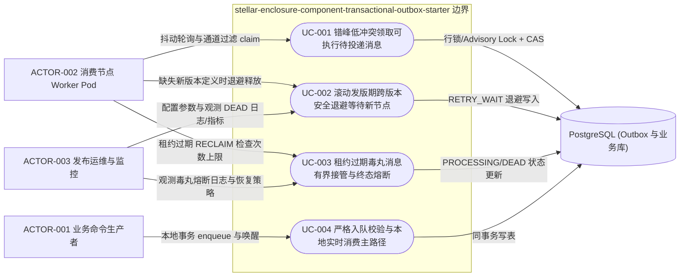
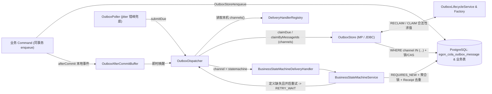
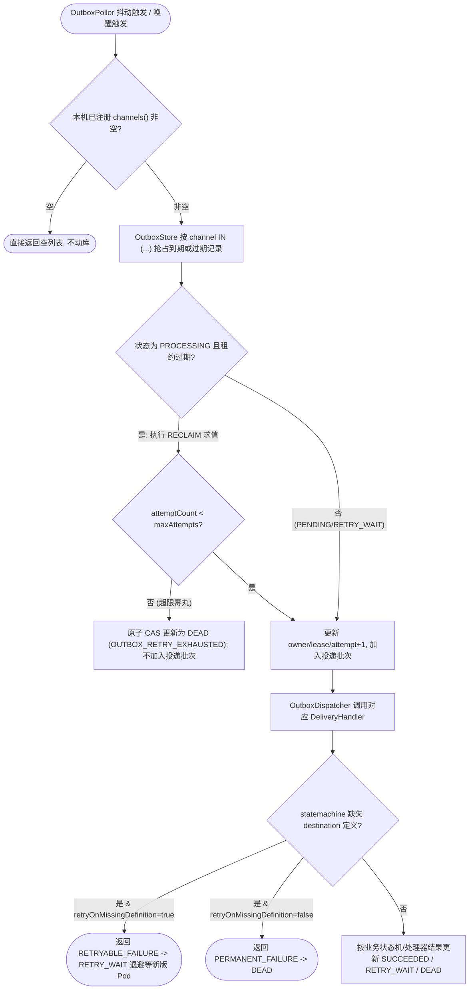
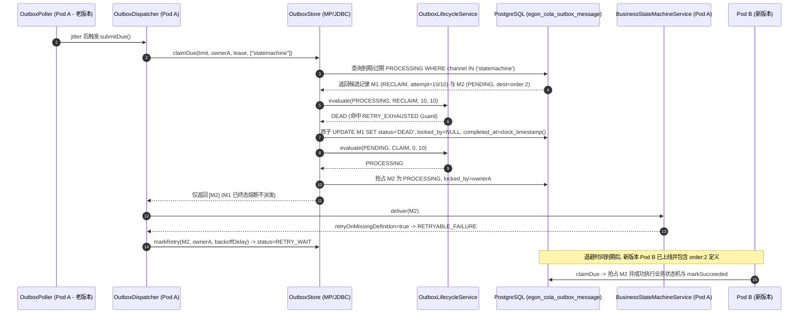

# Transactional Outbox 服务内分布式事务事件韧性与防误杀设计规格

| Field | Value |
| --- | --- |
| Document | [2026-11-16-08-11-outbox-in-service-distributed-resilience.md](./2026-11-16-08-11-outbox-in-service-distributed-resilience.md) |
| Template Version | `9` |
| Archetype Cleanup | `Not applicable` |
| Status | `Review` |
| Type | `Feature` |
| Complexity | `Complex` |
| Complexity Drivers | 多实例并发抢锁与轮询惊群、跨版本滚动发布异构消费、技术生命周期状态机 `RECLAIM` 守卫修订、MP 与 JDBC 双存储实现一致性、时间抖动与租约边界 |
| Created | `2026-11-16 08:11 AST` |
| Updated | `2026-11-16 08:11 AST` |
| Owner | `mario` |
| Repository | `Stellar-Enclosure-Components` |
| Scope | `stellar-enclosure-component-transactional-outbox-starter`（轮询调度、存储抢占与能力过滤、技术生命周期 `RECLAIM` 守卫、业务状态机缺失定义退避策略、配置与组件文档/测试） |
| Change Surface | `TransactionalOutboxProperties`、`OutboxStateMachineProperties`、`OutboxConfigurationValidator`、`OutboxPoller`、`DeliveryHandlerRegistry`、`OutboxStore`、`JdbcOutboxStore`、`MybatisPlusOutboxStore`、`OutboxMessageDAO`、`OutboxMessageMapper.xml`、`OutboxDispatcher`、`OutboxLifecycleStateMachineFactory`、`BusinessStateMachineDeliveryHandler`、`BusinessStateMachineService`、`README.md`、`README.zh-CN.md` 及对应单测/集成测试 |
| Affected Chapters | `§7, §8, §9, §11, §13, §14, §15, §16` |
| Source Requirement | 用户确认审计通过“服务内分布式事务事件 3 点轻量优化方案”（轮询调慢/随机抖动、Claim 过滤本机能力及缺失定义可重试防滚动发版误杀、`RECLAIM` 加尝试次数上限防毒丸死循环）并要求使用 `stellar-enclosure-coding-writing-spec` 编写 Spec |
| Baseline Revision | `Stellar-Enclosure-Components` `main` @ `c88fd8912c9f1a80caec3bf6baa2bae0df97870b`（工作区干净） |
| Amends | [双层 Spring Statemachine 与 CQE 适配设计](../../../../Stellar-Enclosure-Parent/docs/history/egon/spec/2026-09-24-12-00-outbox-statemachine-cqe-integration.md) §7.3.1（`RECLAIM` 边增加 `RETRY_WITH_BUDGET` / `RETRY_EXHAUSTED` 预算守卫）、§7.3.2 / §15（允许缺失业务状态机定义按配置退避重试，并在 Claim 阶段按本地已注册 `channel` 过滤） |
| Supersedes | `None` |
| Depends On | [双层 Spring Statemachine 与 CQE 适配设计](../../../../Stellar-Enclosure-Parent/docs/history/egon/spec/2026-09-24-12-00-outbox-statemachine-cqe-integration.md) §7、§9、§11、§15（技术生命周期五态模型、MP/Advisory Lock 抢占、业务消费事务与 Receipt 幂等边界） |
| Related Specs | `None` |
| Related Plans | [2026-11-16-08-19-outbox-in-service-distributed-resilience.md](../plan/2026-11-16-08-19-outbox-in-service-distributed-resilience.md) |

## 1. Summary

`stellar-enclosure-component-transactional-outbox-starter` 已在本地事务提交后采用“内存唤醒事件为主、内置 `OutboxPoller` 兜底轮询为辅”的可靠投递模型，并通过无状态 Spring Statemachine 与 PostgreSQL 行锁/租约保障服务内分布式场景下的至少一次（at-least-once）投递与聚合状态安全迁移。但在同服务多实例并发部署与滚动升级场景下，现有实现仍存在三处具体的分布式韧性缺口：（1）所有实例以固定节拍同时轮询易产生空跑与锁冲突放大，MP 模式下尤为明显；（2）老版本或异构实例抢到自己尚未注册的 `channel` 或滚动发布新增的 `statemachine` `destination` 时，会直接判为永久失败打入 `DEAD`，导致新版本实例无法接管消费；（3）`OutboxLifecycleStateMachineFactory` 的 `RECLAIM`（租约过期接管）无尝试次数上限守卫，毒丸消息反复打崩 Worker 时会引发多实例无限循环接管。

本规格在不引入 Redis、XXL-Job 或数据库 DDL 变更的前提下，设计三项最小化且向后兼容的增强：（1）在 `OutboxPoller` 增加可配置抖动（`polling.jitter`）与 MP 抢占冲突退让上限（`polling.max-claim-contention-retries`）；（2）在 `OutboxStore` 领取阶段按本机 `DeliveryHandlerRegistry.channels()` 进行 `channel IN (...)` 过滤，并增加 `state-machine.business.retry-on-missing-definition` 使滚动发版期间缺失业务状态机定义的投递默认可退避重试；（3）修订 `OutboxLifecycleStateMachineFactory` 的 `RECLAIM` 边，复用既有 `RETRY_WITH_BUDGET` / `RETRY_EXHAUSTED` Guard，使持续崩溃超限的毒丸记录原子转入 `DEAD`。实施完成后，多实例服务内事务事件在滚动发布、并发抢锁和节点崩溃场景下可实现零误杀、有界恢复与低冲突运行。

## 2. Background and Current State

### 2.1 Business and user context

对于跨服务集成，业务系统后续将通过本组件的 `rabbitmq` 或 `http` 通道投递事件；而当前重点聚焦**单一微服务多实例（Multi-Pod）水平扩展部署下的服务内 Transactional Event**（典型为通过 `channel = "statemachine"` 驱动同服务内聚合状态流转，或同库本地 `DeliveryHandler`）。用户已明确确认：保留现有的“本地事务落库 + 提交后唤醒 + 组件内置 `OutboxPoller` 兜底”架构，不引入外部定时任务系统；在此基础上，要求围绕服务内多实例的防无人消费、防误杀死信、降冲突与防毒丸死循环编写可执行的设计规格。

### 2.2 Repository evidence

| Evidence ID | Classification | Exact path/symbol/decision/command | Observed fact | Design significance | Verification limit/freshness |
| --- | --- | --- | --- | --- | --- |
| `EVD-001` | Static repository | `Stellar-Enclosure-Components/stellar-enclosure-component-transactional-outbox-starter/src/main/java/top/egon/cola/component/outbox/transaction/OutboxAfterCommitBuffer.java#OutboxSynchronization#afterCommit` | 事务提交后发布进程内 `OutboxCommittedEvent`，捕获异常只记指标与告警；`OutboxCommittedEventListener` 调用 `OutboxDispatcher.submitMessageIds` | 实时路径已存在且不依赖外部调度；`OutboxPoller` 仅承担漏唤醒/失败重试/租约过期兜底 | 2026-11-16 静态源码检查 |
| `EVD-002` | Static repository | `.../dispatch/OutboxPoller.java#start`、`.../autoconfigure/TransactionalOutboxProperties.java#Polling` | `OutboxPoller` 使用 `taskScheduler.scheduleWithFixedDelay(this::submitDueWhenRunning, fixedDelay)`（默认 `1s`），无启动或周期随机抖动 | 所有 Pod 固定节拍同频扫描，容易在整秒同步惊群与并发撞锁 | 2026-11-16 静态源码检查 |
| `EVD-003` | Static repository | `.../store/MybatisPlusOutboxStore.java#claimDue`、`#inWorkerTransactionSkippingLocked`、`.../mapper/outbox/OutboxMessageMapper.xml#selectDueCandidates` | MP 模式先无锁按 `next_attempt_at, id` 查 `4 * limit` 候选，再逐条 `pg_try_advisory_xact_lock(id) ... FOR UPDATE NOWAIT`；冲突即回滚整批并仅剔除当前冲突 `id` 后在 `while (!remaining.isEmpty())` 中无限重试 | 高竞争下多个 Pod 查到相同头部行，可能连续回滚重开最多 `4 * limit` 次事务 | 2026-11-16 静态源码检查 |
| `EVD-004` | Static repository | `.../store/JdbcOutboxStore.java#claim`、`.../store/MybatisPlusOutboxStore.java#claimDue`、`.../delivery/DeliveryHandlerRegistry.java` | `DeliveryHandlerRegistry` 仅提供 `required(channel)`，未暴露本机已注册 `channels()`；`claimDue`/`claimByMessageIds` 不过滤 `channel` | 异构实例或未开启某通道的实例会抢占自己无法投递的记录 | 2026-11-16 静态源码检查 |
| `EVD-005` | Static repository | `.../dispatch/OutboxDispatcher.java#deliver`、`.../delivery/statemachine/BusinessStateMachineDeliveryHandler.java#deliver`、`.../statemachine/BusinessStateMachineService.java#process` | 未找到 `DeliveryHandler` 返 `HANDLER_MISSING`（`PERMANENT_FAILURE`）；未找到业务状态机定义返 `OUTBOX_SM_DEFINITION_MISSING`（`PERMANENT_FAILURE`） | 滚动发布新增 `destination`（如 `order-payment:2`）时，老 Pod 抢到消息会立即打死进 `DEAD` | 2026-11-16 静态源码检查 |
| `EVD-006` | Static repository | `.../statemachine/OutboxLifecycleStateMachineFactory.java#create` | `RECLAIM` 边配置为 `PROCESSING -> PROCESSING` 且 `guard = null`，未复用 `RETRY_WITH_BUDGET` / `RETRY_EXHAUSTED` | 若消息每次投递都导致进程崩溃或超时未落库，会无限循环 `RECLAIM`（修订历史 Spec §7.3.1） | 2026-11-16 静态源码检查 |
| `EVD-007` | Static repository | `.../resources/db/egon-outbox-mp/V20260924_001__initialize_outbox_mp_schema.sql`、`.../resources/db/transactional-outbox/postgresql/V1__create_transactional_outbox_schema.sql` | 已有局部索引 `idx_outbox_claim (next_attempt_at, id) WHERE status IN ('PENDING', 'RETRY_WAIT')` 与 `idx_outbox_reclaim (locked_until, id) WHERE status = 'PROCESSING'`；`egon_cola_outbox_message` 包含 `channel varchar(64) NOT NULL` | 追加 `AND channel IN (...)` 无需变更表结构与索引 DDL，可继续命中现有索引回表过滤 | 2026-11-16 静态源码检查，实际执行计划仍需 PG 集成测试验证 |
| `EVD-008` | Static repository | `.../test/java/top/egon/cola/component/outbox/contract/ComponentContractGovernanceTest.java#englishAndChineseReadmesDocumentTheSameCqeMpAndMigrationKeys` | 契约治理测试严格校验 `README.md` 与 `README.zh-CN.md` 中 `egon.cola.component.transactional-outbox.*` 反引号配置键集合必须精确等于 `requiredKeys` | 若在 README 中新增反引号配置键，必须同步更新两份 README 与 `ComponentContractGovernanceTest` | 2026-11-16 静态源码检查 |
| `EVD-009` | User decision | 本轮对话用户确认 | 用户审计通过 3 点轻量优化方案并要求产出 `stellar-enclosure-coding-writing-spec` 规格 | 授权对 `RECLAIM` 守卫、能力过滤与轮询抖动进行 Spec 设计 | 2026-11-16 用户确认 |

### 2.3 Problem statement and gap

| 维度 | 现状行为 | 目标行为 | 差距与影响 |
| --- | --- | --- | --- |
| 轮询与 MP 抢锁 | 所有实例以固定周期同频 `claimDue`；MP 模式冲突时无限回滚剔除单行重试 | `OutboxPoller` 带可配置随机抖动错峰扫描；MP 模式单批冲突重试有上限 | 降低多 Pod 空轮询撞车与极端竞争下的事务回滚放大 |
| 能力匹配与滚动升级 | Claim 不区分 `channel`；缺失 `DeliveryHandler` 或业务状态机定义直接 `PERMANENT_FAILURE -> DEAD` | Claim 仅领取本机已注册 `channel` 的消息；`statemachine` 缺失定义默认走 `retryableFailure` 退避等待新版本接管 | 消除异构节点与 K8s 滚动升级期误杀有效业务事件进入死信的风险 |
| 毒丸消息 `RECLAIM` | `RECLAIM` 无 `maxAttempts` 守卫，进程崩溃导致租约过期后无限重领 | `RECLAIM` 与 `DELIVERY_RETRYABLE` 一致受 `maxAttempts` 预算约束，超限由 Store 原子转入 `DEAD` | 阻断毒丸消息引起全集群节点轮流崩溃或超时空耗 |

### 2.4 Evidence and current-chain map

| Entry/trigger | Current call chain | Data read/written | External dependency | Consumers | Evidence |
| --- | --- | --- | --- | --- | --- |
| 业务 `Command` 提交 | `DefaultTransactionalOutbox#enqueue` -> `OutboxStore#enqueue` -> `OutboxAfterCommitBuffer` -> `OutboxCommittedEventListener` -> `OutboxDispatcher#submitMessageIds` | 同事务写业务表与 `egon_cola_outbox_message`（`PENDING`） | 当前本地数据源 | 同实例异步投递线程 | `EVD-001` |
| 兜底定时轮询 | `OutboxPoller#submitDueWhenRunning` -> `OutboxDispatcher#submitDue` -> `OutboxStore#claimDue` -> `OutboxLifecycleService#evaluate(CLAIM/RECLAIM)` | 扫描 `PENDING`/`RETRY_WAIT`/过期 `PROCESSING`，写入 `locked_by`、`locked_until`、`attempt_count+1` | PostgreSQL（JDBC 或 MP+ShardingSphere） | 集群所有开启轮询的 Pod | `EVD-002`, `EVD-003`, `EVD-006` |
| 服务内事件消费 | `OutboxDispatcher#deliver` -> `DeliveryHandlerRegistry#required` -> `BusinessStateMachineDeliveryHandler#deliver` -> `BusinessStateMachineService#process` -> `BusinessStateMachineRepository#lockAndLoad` / `saveTransition` | `REQUIRES_NEW` 业务事务锁聚合行、校验指纹去重、写入新状态与 `eventId` receipt | PostgreSQL 业务数据源 | 本服务业务聚合与下游读模型 | `EVD-004`, `EVD-005` |

### 2.5 Archetype example cleanup

Cleanup disposition: `Not applicable`

Reason: 本次变更对象为基础设施可复用组件 `stellar-enclosure-component-transactional-outbox-starter`（非业务工程或 `stellar-enclosure-archetypes` 生成工程），无业务示例域、示例 Controller 或待清理样本代码。

## 3. Goals and Non-goals

### 3.1 Goals

1. 保持“事务落库 + 提交后实时唤醒 + 内置 `OutboxPoller` 兜底”模型不变，为 `OutboxPoller` 增加可配置随机抖动与 MP 冲突重试上限，降低多实例并发抢占摩擦。
2. 在 `OutboxStore` 领取（`claimDue` / `claimByMessageIds`）阶段按本机 `DeliveryHandlerRegistry` 已注册的 `channel` 过滤，防止无对应处理器实例误领消息。
3. 为 `statemachine` 通道增加缺失业务定义的退避重试策略（默认开启、可配置关闭），防止滚动升级期间老实例把新版本消息直接标为 `DEAD`。
4. 修订技术生命周期状态机 `RECLAIM` 边，接入 `RETRY_WITH_BUDGET` / `RETRY_EXHAUSTED` Guard，使超出 `maxAttempts` 的过期租约记录原子转入 `DEAD` 而不再循环投递。

### 3.2 Non-goals

1. 不引入 Redis、ZooKeeper、XXL-Job、Quartz 或任何新第三方依赖与分布式协调中间件。
2. 不修改 PostgreSQL 数据库表结构（不新增列、不新增索引、不编写或修改 DDL SQL 脚本与 `manifest.json`）。
3. 不改变 `OutboxMessage` / `OutboxReceipt` / `BusinessStateMachineEvent` 外部或 Wire 协议载荷字段，不改变 HTTP/RabbitMQ 通道的既有投递逻辑。
4. 不实现跨进程业务状态机上下文复制、全局有序队列保证或自动死信重放后台 UI。

### 3.3 Change Surface and Design Depth

| Area/layer | Disposition | Exact repository evidence | Changed or preserved behavior/contract | Required Spec treatment | Chapter(s) |
| --- | --- | --- | --- | --- | --- |
| 配置属性与校验 | Affected | `TransactionalOutboxProperties.java#Polling`、`OutboxStateMachineProperties.java#BusinessProperties`、`OutboxConfigurationValidator.java` | 新增 `polling.jitter`、`polling.max-claim-contention-retries`、`state-machine.business.retry-on-missing-definition` 及边界校验 | 完整配置定义、默认值、校验规则与键一致性 | `§7, §8, §9, §14, §15, §16` |
| 轮询调度与分发协调 | Affected | `OutboxPoller.java`、`OutboxDispatcher.java`、`DeliveryHandlerRegistry.java` | `OutboxPoller` 支持抖动自调度（`jitter=0` 保留原定频）；`DeliveryHandlerRegistry` 暴露 `channels()`；`OutboxDispatcher` 传 `channels()` 给 Store | 详细协作流程、状态影响、日志与单测 | `§7, §8, §9, §14, §15` |
| 存储层 Claim 与冲突控制 | Affected | `OutboxStore.java`、`JdbcOutboxStore.java`、`MybatisPlusOutboxStore.java`、`OutboxMessageDAO.java`、`OutboxMessageMapper.xml` | `OutboxStore` 增加 `channels` 重载并保留旧签名兼容；过滤 `channel IN (...)`；`RECLAIM -> DEAD` 终态写回；MP 冲突重试上限 | 内部接口契约、SQL 谓词与访问路径、事务/锁不变量 | `§7, §8, §9, §11, §14, §15, §16` |
| 技术生命周期状态机 | Affected | `OutboxLifecycleStateMachineFactory.java`、`OutboxLifecycleService.java` | `RECLAIM` 边增加 `RETRY_WITH_BUDGET` / `RETRY_EXHAUSTED` Guard；兼容原 `OutboxLifecycleService` 调用入口 | 修订 §7.3.1 状态转移表与策略复用说明 | `§7, §8, §9, §13, §14` |
| 业务状态机消费者适配 | Affected | `BusinessStateMachineDeliveryHandler.java`、`BusinessStateMachineService.java` | 缺失定义时按 `retryOnMissingDefinition` 决定返回 `retryableFailure` 或 `permanentFailure`；保留生产者 `validateDestination` 严格拒绝 | 分支策略、升级窗口行为与单测/集成测试 | `§7, §8, §9, §13, §14, §16` |
| 数据载体 PO/BO/Record/Event | Unchanged | `OutboxMessagePO.java`、`OutboxRecord.java`、`NewOutboxRecord.java`、`BusinessStateMachineEvent.java`、`BusinessStateMachineSnapshotBO.java` | 不增删任何持久化或传输载体字段，保留全部构造、校验与转换规则 | 仅记录不变式及无改动边界 | `§10` |
| 数据库 Schema 与受管 DDL | Unchanged | `V20260924_001__initialize_outbox_mp_schema.sql`、`V20261027_001__add_outbox_shard_slot.sql`、`V1__create_transactional_outbox_schema.sql`、`manifest.json` | 不修改表结构、约束、索引与受管 DDL 历史 | 在 §11 声明 `Relational model change: No` 并验证索引兼容性 | `§11` |
| 生产者与事务唤醒链路 | Context-only | `DefaultTransactionalOutbox.java`、`OutboxAfterCommitBuffer.java`、`OutboxTransactionGuard.java`、`OutboxCommittedEventListener.java` | 依赖其同事务落库与提交后事件唤醒能力；`validateDestination` 维持强校验 | 记录已验证不变式与回归点 | `§7, §14` |
| HTTP / RabbitMQ 通道投递器 | Unchanged | `HttpDeliveryHandler.java`、`RabbitDeliveryHandler.java` | 通道投递逻辑与失败分类保持不变；仅受益于 Claim 阶段按 `channel` 过滤与 `RECLAIM` 上限 | 仅声明不变边界 | `§7` |
| 文档与治理契约测试 | Affected | `README.md`、`README.zh-CN.md`、`ComponentContractGovernanceTest.java` | 同步补充/核对配置键文档并更新 `ComponentContractGovernanceTest` `requiredKeys` 与相关断言 | 配置一致性与治理测试覆盖 | `§8, §14, §16` |
| 前端页面 | Not applicable | `stellar-enclosure-component-transactional-outbox-starter/pom.xml` | 纯后端 Spring Boot Starter，无任何前端代码或页面 | 明确标注 `N/A` 及证据 | `§12` |

## 4. Requirements and Acceptance Criteria

| ID | Atomic requirement | Priority | Observable acceptance criteria | Source |
| --- | --- | --- | --- | --- |
| `REQ-001` | `OutboxPoller` 必须支持可配置轮询抖动 `polling.jitter`（默认 `0.2`，范围 `[0.0, 1.0]`），`jitter > 0` 时对首轮及后续调度间隔施加 `[0, fixedDelay * jitter]` 的非负抖动；`jitter = 0.0` 时保持原 `scheduleWithFixedDelay` 行为。 | Must | 单测验证：`jitter = 0.2` 时通过 `TaskScheduler.schedule(..., Instant)` 调度且延时落入 `[fixedDelay, fixedDelay * 1.2]`（首轮 `[0, fixedDelay * 0.2]`）；`jitter = 0.0` 时走 `scheduleWithFixedDelay`；非法 `jitter`（`< 0`、`> 1`、`NaN`）在启动校验时抛 `OutboxConfigurationException`。 | 用户确认“轮询调慢 + 加抖动” |
| `REQ-002` | `MybatisPlusOutboxStore` 在多实例锁冲突重试（`inWorkerTransactionSkippingLocked`）中必须设置单次 `claimDue`/`claimByMessageIds` 的最大冲突重开事务次数上限 `polling.max-claim-contention-retries`（默认 `8`，最小 `1`），达到上限后停止本轮重试并返回已领取记录（允许部分或空批次）。 | Must | 单测/Mock 测试验证：模拟连续 `55P03`/advisory lock 冲突超过 `maxClaimContentionRetries` 次时，事务重开次数严格等于 `1 + maxClaimContentionRetries`（或受限于配置上限）后安全返回，不再无限重试直至耗尽候选集。 | 用户确认“缓解 MP 抢锁冲突” |
| `REQ-003` | `OutboxDispatcher` 在调用 `store.claimDue` 与 `store.claimByMessageIds` 时必须传入 `DeliveryHandlerRegistry.channels()`；`JdbcOutboxStore` 与 `MybatisPlusOutboxStore` 必须仅领取 `channel IN (...)` 匹配本地已注册通道的记录，当 `channels` 为空集合时直接返回空列表而不查询或修改任何消息。 | Must | 集成测试与单测验证：存在 `channel='http'` 与 `channel='statemachine'` 两条到期记录时，仅注册了 `statemachine` Handler 的实例执行 `claimDue` 仅领取 `statemachine` 记录，未受支持的 `http` 记录保持 `PENDING` 不进 `DEAD`；`channels` 为空时不触发任何 DB 更新。 | 用户确认“Claim 过滤本机能力防误杀” |
| `REQ-004` | 在 `OutboxStateMachineProperties.BusinessProperties` 新增 `retryOnMissingDefinition`（默认 `true`）；当 `true` 时，[BusinessStateMachineDeliveryHandler](file:///Users/mario/SelfProject/Stellar-Enclosure/Stellar-Enclosure-Components/stellar-enclosure-component-transactional-outbox-starter/src/main/java/top/egon/cola/component/outbox/delivery/statemachine/BusinessStateMachineDeliveryHandler.java) 与 [BusinessStateMachineService](file:///Users/mario/SelfProject/Stellar-Enclosure/Stellar-Enclosure-Components/stellar-enclosure-component-transactional-outbox-starter/src/main/java/top/egon/cola/component/outbox/statemachine/BusinessStateMachineService.java) 遇到未注册的 `destination` 时必须返回 `DeliveryResult.retryableFailure("OUTBOX_SM_DEFINITION_MISSING", ...)`；当 `false` 时返回 `permanentFailure`；生产者 `validateDestination` 始终严格校验并拒绝未知 `destination`。 | Must | 单测与集成测试验证：老实例未注册 `order-payment:2` 且 `retryOnMissingDefinition=true` 时，投递返回 `RETRYABLE_FAILURE` 使消息进入 `RETRY_WAIT`，随后新实例启动后成功消费为 `SUCCEEDED`；设 `false` 时直接进 `DEAD`；入队校验仍拒绝未知 `destination`。 | 用户确认“滚动发版防老节点误杀” |
| `REQ-005` | `OutboxLifecycleStateMachineFactory` 的 `RECLAIM` 边必须配置 `RETRY_WITH_BUDGET`（`attemptCount < maxAttempts -> PROCESSING`）与 `RETRY_EXHAUSTED`（`attemptCount >= maxAttempts -> DEAD`）Guard；`JdbcOutboxStore` 与 `MybatisPlusOutboxStore` 在 `RECLAIM` 评估目标为 `DEAD` 时，必须原子将其更新为 `status='DEAD'`、`locked_by=NULL`、`locked_until=NULL`、`last_error_code='OUTBOX_RETRY_EXHAUSTED'`、`completed_at=clock_timestamp()`，且不将该记录返回给 `OutboxDispatcher` 投递。 | Must | 状态机单测与 PG 集成测试验证：`evaluate(PROCESSING, RECLAIM, 2, 3)` 返 `PROCESSING`，`evaluate(PROCESSING, RECLAIM, 3, 3)` 返 `DEAD`；当租约过期的记录已达 `attempt_count >= max_attempts` 时，`claimDue` 将其直接落库为 `DEAD` 并返回空投递列表，防止毒丸无限循环。 | 用户确认“`RECLAIM` 加次数上限防毒丸死循环” |
| `REQ-006` | 必须保留对原有 `OutboxStore` 3/4 参方法签名的向后兼容（通过 `default` 方法委托），保持现有表结构/DDL 零变更，并在 `README.md`、`README.zh-CN.md` 与 `ComponentContractGovernanceTest` 中保持新增配置键的双向一致性。 | Must | 既有全部回归测试（含 `ComponentContractGovernanceTest`、现有 `OutboxStore` mock 调用方及 PostgreSQL 查询计划索引断言 `idx_outbox_claim`/`idx_outbox_reclaim`）全部通过。 | 仓库契约治理与向后兼容约束 |

### 4.1 Scenario matrix

| Scenario | Actor/trigger | Preconditions | Main path | Alternative/failure path | Data/state change | Observable result | Requirements |
| --- | --- | --- | --- | --- | --- | --- | --- |
| 多实例同库错峰兜底轮询 | `ACTOR-002`（多 Pod `OutboxPoller`） | 集群启动 N 个同构 Pod，`polling.jitter=0.2`，存在待兜底 `PENDING` 消息 | 各 Pod 按不同随机抖动时间片调用 `dispatchDue` -> `claimDue` | MP 模式下若干 Pod 同时扫描遇到行锁冲突，重试达到 `maxClaimContentionRetries` 后退让，不阻塞线程池 | 仅抢占成功的 Pod 将各自批次改写为 `PROCESSING` 并消费为 `SUCCEEDED` | 无全局锁争用风暴，单批锁冲突事务重开有界 | `REQ-001`, `REQ-002` |
| 异构实例共存（部分 Pod 无对应 `channel`） | `ACTOR-002`（无 `http` Handler 的 Pod A + 有 `http` Handler 的 Pod B） | 表中有 `channel='http'` 与 `channel='statemachine'` 到期记录 | Pod A 传入 `channels=['statemachine']` 仅抢占 `statemachine`；Pod B 抢占 `http` | 若某 Pod 未注册任何 `DeliveryHandler`（`channels` 为空），直接短路返回空列表 | 未支持的记录保持 `PENDING`，不被 Pod A 误标 `DEAD` | 各记录由具备能力的目标 Pod 正常投递完成 | `REQ-003` |
| 滚动发版新老 Pod 共存消费新版业务状态机 | `ACTOR-001`（新 Pod 入队 `order-payment:2`）、`ACTOR-002`（老 Pod 仅注册 `order-payment:1`） | `retryOnMissingDefinition=true`，老 Pod 先于新 Pod 执行 `claimDue` | 老 Pod 领到后发现本地无 `order-payment:2` 定义，返回 `RETRYABLE_FAILURE` -> `RETRY_WAIT` | 若老 Pod 重复抢满 `maxAttempts` 仍无新 Pod 上线，则按标准重试耗尽进入 `DEAD`（可由 `recoverExhausted` 恢复） | 记录进入 `RETRY_WAIT` 并释放租约；新 Pod 在冷却后领走并成功完成业务迁移与 `SUCCEEDED` | 滚动发布期零误杀进死信，业务状态与 Receipt 一致 | `REQ-004` |
| 毒丸消息反复打崩 Worker 导致租约超时 | `ACTOR-002`（存活 Pod 接管崩溃 Pod 的过期 `PROCESSING` 记录） | 记录 `status='PROCESSING'`、`locked_until < now`、`attempt_count = max_attempts` | `claimDue` 评估 `RECLAIM` 命中 `RETRY_EXHAUSTED` Guard 得目标 `DEAD`，原子更新为 `DEAD`（`OUTBOX_RETRY_EXHAUSTED`） | 若 CAS 更新时已被另一实例并发改写（affected=0），本实例跳过不报错 | 记录终态落库 `DEAD`，`locked_by`/`locked_until` 清空，`completed_at` 记录 UTC 时间 | 毒丸消息不再被反复投递，后续可经监控发现或人工/冷却重放 | `REQ-005` |

### 4.2 Use-case analysis

#### 4.2.1 Actor inventory

| Actor ID | Actor/role | Goal and responsibility | Entry/channel | Permission/tenant context | Evidence |
| --- | --- | --- | --- | --- | --- |
| `ACTOR-001` | 服务内业务命令生产者（Command 线程） | 在本地事务中原子落库业务变更与事件，尽量实时触发消费 | `TransactionalOutbox#enqueue` + 事务后本地事件 | 业务租户上下文；Outbox 表技术租户固定 `0` | `DefaultTransactionalOutbox.java`, `OutboxAfterCommitBuffer.java` |
| `ACTOR-002` | 同服务多实例消费节点（Outbox Worker Pod） | 安全接管本机可处理的漏唤醒/到期/过期租约事件并推进业务状态机或投递器 | `OutboxPoller` 定时器 / `OutboxDispatcher` | 独立 `OutboxWorkerIdentity`（`nodeId:uuid`）；业务消费时由 `BusinessStateMachineContextExecutor` 校验并绑定租户 | `OutboxPoller.java`, `OutboxDispatcher.java`, `OutboxWorkerIdentity.java` |
| `ACTOR-003` | 运维/发布操作员与可观测系统 | 滚动发版新旧版本状态机定义，并监控/恢复异常积压与毒丸 `DEAD` 记录 | Spring Boot 配置 / Micrometer 指标与日志 | 部署/配置权限 | `TransactionalOutboxProperties.java`, `OutboxStateMachineProperties.java`, `OutboxDispatcher.java` |

#### 4.2.2 Use-case artifact



| ID | Use case/goal | Primary actor | Supporting actors/systems | Trigger | Preconditions | Main success outcome | Alternatives/failures | Postconditions | Requirements | Interfaces/pages | Tests |
| --- | --- | --- | --- | --- | --- | --- | --- | --- | --- | --- | --- |
| `UC-001` | 错峰低冲突领取可执行待投递消息 | `ACTOR-002` | PostgreSQL | `OutboxPoller` 抖动定时触发 | 节点未处于 `migrationMode` 且已注册至少一个 `DeliveryHandler` | 仅领取本机支持的 `channel` 记录并进入投递 | `channels` 为空则短路；MP 冲突达上限后安全结束本轮 | 成功领取行变为 `PROCESSING` 并绑定本机租约 | `REQ-001`, `REQ-002`, `REQ-003` | `INTERNAL-001`, `INTERNAL-002` | `TEST-001`–`TEST-005` |
| `UC-002` | 滚动发版期跨版本安全退避等待新节点 | `ACTOR-002` | `ACTOR-001`, `ACTOR-003`, PostgreSQL | 老版本 Pod 领到新版本 `destination` 事件 | `state-machine.business.enabled=true` 且 `retryOnMissingDefinition=true` | 老 Pod 返回 `RETRYABLE_FAILURE` 释放租约，新 Pod 重试时成功完成业务迁移 | 关闭开关则立即 `DEAD`；耗尽 `maxAttempts` 进入 `DEAD` 等待冷却重放 | 业务聚合未受损，最终由新版 Pod 成功消费 | `REQ-004` | `INTERNAL-004` | `TEST-006`, `TEST-007` |
| `UC-003` | 租约过期毒丸消息有界接管与终态熔断 | `ACTOR-002` | `ACTOR-003`, PostgreSQL | `claimDue` 扫描到 `locked_until < now` 的 `PROCESSING` 记录 | 记录处于 `PROCESSING` 且租约已过期 | 未超限则 `RECLAIM` 接管投递；超限则原子标 `DEAD` 停止继续投递 | 并发已被其他节点改写时 CAS 为 0 安全跳过 | 未超限者继续投递；超限毒丸终态停在 `DEAD` | `REQ-005` | `INTERNAL-001`, `INTERNAL-003` | `TEST-008`, `TEST-009` |
| `UC-004` | 严格入队校验与本地实时消费主路径 | `ACTOR-001` | PostgreSQL | 业务方法调用 `enqueue` | 存在活动本地事务及有效 `DeliveryHandler` | 入队立即校验 `destination`，提交后本地异步快速消费 | 若本机提交后崩溃，由存活 Pod 通过 `UC-001` 兜底接管 | 业务与 outbox 原子提交；消费端凭行锁与 Receipt 去重 | `REQ-004`, `REQ-006` | `INTERNAL-004`（`Context-only` 入队路径） | `TEST-010` |

## 5. Constraints, Assumptions, and Decisions

### 5.1 Confirmed constraints

1. **零外部中间件引入**：组件禁止依赖 Redis、ZooKeeper 或外部调度器（见 [README.zh-CN.md](file:///Users/mario/SelfProject/Stellar-Enclosure/Stellar-Enclosure-Components/stellar-enclosure-component-transactional-outbox-starter/README.zh-CN.md#L211)）；`MC-DEP-001` 保持无新增依赖。
2. **零表结构与 DDL 变更**：严禁修改已应用的 `V20260924_001`、`V20261027_001` 或 `V1` SQL 脚本及 `manifest.json` checksum；本次不新增 DDL 版本。
3. **双存储实现保持语义一致**：`MybatisPlusOutboxStore`（默认）与 `JdbcOutboxStore` 必须实现完全一致的 `channel` 过滤与 `RECLAIM -> DEAD` 语义。
4. **Java/Egon 规范严格约束**：新增/修改类、字段校验、日志、Bean 命名、构造器注入（`@RequiredArgsConstructor(onConstructor_ = @Autowired)` 与 `@Qualifier`）、`java.time`、配置一致性必须遵守 `references/user-mandated-java-rules.md` 与 `references/egon-java-cqe-contract.md`。

### 5.2 Small-gap assumptions

| ID | Inference | Repository evidence | Why locally reversible | Impact if wrong |
| --- | --- | --- | --- | --- |
| `ASM-001` | `OutboxPoller` 抖动仅应用于业务消息轮询（`polling`），`OutboxCleanupJob`（`cleanup`）维持原 `scheduleWithFixedDelay` 不变。 | `OutboxPoller.java#L38-L49` 已将 polling 与 cleanup 拆分为独立调度任务；清理为低频长周期（默认 1h）且已通过 `SKIP LOCKED`/`NOWAIT` 互斥。 | 仅影响 `OutboxPoller` 内部调度逻辑，后续若需给 cleanup 加抖动可独立追加属性，不改接口。 | 若集群极多实例同时清理仅多做一次空删查，不影响正确性。 |
| `ASM-002` | `OutboxStateMachineProperties.BusinessProperties.retryOnMissingDefinition` 默认设为 `true`（仅影响消费侧 `deliver`/`process`，生产者 `validateDestination` 仍严格抛异常）。 | 服务内多实例滚动升级期间新旧版本定义共存是常态；错误配置的非法 `destination` 在生产者 `enqueue` 阶段已被 `validateDestination` 拦下。 | 通过单个 YAML 配置项即可切回 `false`，向后可立即退回原严格失败模式。 | 若遗留脏数据在开启 `statemachine` 前已绕过入队校验落库，会最多重试 `maxAttempts` 次后进 `DEAD`（而非 1 次进 `DEAD`）。 |
| `ASM-003` | `RECLAIM` 触发转 `DEAD` 时由 Store 原子落库 `DEAD` 并记录结构化 warn 日志，不返回值给 `OutboxDispatcher` 去派发，避免改变 `OutboxStore#claimDue`“仅返回可投递 `PROCESSING` 租约行”的既有返回值契约。 | `OutboxStore#claimDue` 所有调用方与集成测试均假定返回记录均由当前 `leaseOwner` 持有；`recoverExhausted` 依赖 `status='DEAD' AND last_error_code='OUTBOX_RETRY_EXHAUSTED' AND attempt_count >= max_attempts`。 | 如未来需要触发 `OutboxDeadLetterNotifier`，可在 `OutboxStore` 增加可选回调或独立统计接口，无需改动表结构。 | 毒丸在 `RECLAIM` 阶段熔断进 `DEAD` 时不触发 `OutboxDeadLetterListener` 进程内事件（仍记录 `log.warn` 并可在数据库观测）。 |

### 5.3 Resolved decisions

| ID | Decision | Decision owner | Evidence and rationale | Requirements |
| --- | --- | --- | --- | --- |
| `DEC-001` | 保留“实时唤醒 + 内置 `OutboxPoller` 兜底”，不引入外部定时任务框架；通过 `polling.jitter` 与 `polling.max-claim-contention-retries` 优化并发表现。 | User & Spec | `EVD-001`、`EVD-002`、`EVD-003`、`EVD-009`；满足零新依赖且解决惊群与无界回滚。 | `REQ-001`, `REQ-002` |
| `DEC-002` | Claim 阶段过滤本机 `DeliveryHandlerRegistry.channels()`，并对 `statemachine` 缺失业务定义增加 `retryOnMissingDefinition`（默认 `true`）。 | User & Spec | `EVD-004`、`EVD-005`、`EVD-009`；既解决异构节点误领，又避免滚动发版老节点误杀新版本事件。 | `REQ-003`, `REQ-004` |
| `DEC-003` | 修订 2026-09-24 历史 Spec §7.3.1，在 `OutboxLifecycleStateMachineFactory` 为 `RECLAIM` 增加 `RETRY_WITH_BUDGET` / `RETRY_EXHAUSTED` Guard。 | User & Spec | `EVD-006`、`EVD-009`；彻底封堵毒丸消息导致的跨节点无限崩溃重启接管循环。 | `REQ-005` |

### 5.4 Open major decisions

无未决重大决策。所有影响并发、状态机语义、配置兼容与存储行为的方案均已由用户审计确认（`EVD-009`）。

## 6. Project Technology Context

| Concern | Current choice | Repository evidence | Constraint on design |
| --- | --- | --- | --- |
| Java / Spring Boot | Java 25, Spring Boot 4.1.x（`spring-boot-starter`, `spring-boot-starter-validation`, `spring-jdbc`, `spring-tx`） | `Stellar-Enclosure-Components/pom.xml`, `.../stellar-enclosure-component-transactional-outbox-starter/pom.xml` | 必须使用 Jakarta Bean Validation、`java.time.*` 与 Spring `TaskScheduler` |
| 状态机引擎 | `org.springframework.statemachine:spring-statemachine-core:4.0.2`（BOM 管理） | `stellar-enclosure-components-bom/pom.xml#L56,L162-L164` | 每次转换新建无状态、单 region、非缓存实例，Guard 为纯内存条件判断 |
| 持久化与分片 | MyBatis-Plus 3.5.17 + ShardingSphere-JDBC 5.5.3（`MYBATIS_PLUS` 默认）及单库 `JDBC` 存储 | `Stellar-Enclosure-Components/pom.xml#L79-L80`, `OutboxMessageMapper.xml`, `JdbcOutboxStore.java` | MP SQL 必须兼容 `EgonColaOriginalSqlGuardInterceptor` 与 `SINGLE`/分片路由规则，禁止在 MP Mapper 中使用 `FOR UPDATE SKIP LOCKED` |
| DI / Lombok | `lombok.config` 启用 `lombok.copyableAnnotations += org.springframework.beans.factory.annotation.Qualifier` | `Stellar-Enclosure-Components/lombok.config` | DI 业务 Bean 使用 `@Slf4j`、`@RequiredArgsConstructor(onConstructor_ = @Autowired)` 与 `@Qualifier`（`@ConfigurationProperties` POJO 不加 `@Autowired`） |
| 测试体系 | JUnit 5 + AssertJ + Mockito + Failsafe PostgreSQL Testcontainers（`EGON_OUTBOX_TEST_POSTGRES_ENABLED=true`） | `.../pom.xml`, `ComponentContractGovernanceTest.java`, `PostgresqlOutbox*IntegrationTest.java` | 单测（Surefire）与 PG 集成测试（Failsafe）分离；`ComponentContractGovernanceTest` 校验 README 配置键一致 |

### 6.1 Java architecture profile and capability baseline

| Architecture profile | Archetype/template or base package | Exact evidence and verifier | Existing deviations | Design action |
| --- | --- | --- | --- | --- |
| Egon-COLA 基础设施复用组件 Starter（Flat Starter Module） | `top.egon.cola.component.outbox`（`stellar-enclosure-component-transactional-outbox-starter`） | `Stellar-Enclosure-Components/egon-cola-components-architecture.md#L100,L185`、`ComponentContractGovernanceTest.java` | 非业务三层/业务应用工程；按 `api/autoconfigure/delivery/dispatch/persistence/statemachine/store` 分包 | 严格保留现有 Starter 分包边界与 `ComponentContractGovernanceTest` 契约，不引入业务层或第二调度框架 |

能力复用台账（Reuse Ledger）：

| Need | Spring/JDK candidate | Spring Boot Starter candidate | Egon-COLA/module candidate | Proven gap | Decision/dependency impact |
| --- | --- | --- | --- | --- | --- |
| 轮询带抖动调度 | `java.util.concurrent.ThreadLocalRandom`、`java.time.Instant`、`Duration` | Spring `TaskScheduler#schedule(Runnable, Instant)`（已有依赖） | `OutboxPoller`、`ExponentialJitterRetryPolicy`（已有抖动模式） | `OutboxPoller` 当前仅调用固定周期 `scheduleWithFixedDelay` | 复用现有 `TaskScheduler` + `ThreadLocalRandom`，零新增依赖 |
| 通道能力发现 | `java.util.Set` | Spring `ObjectProvider<DeliveryHandler>`（已注入） | `DeliveryHandlerRegistry`（已持有 `Map<String, DeliveryHandler>`） | 缺少只读 `channels()` 访问方法 | 在 `DeliveryHandlerRegistry` 暴露 `channels()`，零新增依赖 |
| `RECLAIM` 尝试次数守卫 | — | `spring-statemachine-core` `Guard` | `OutboxLifecycleStateMachineFactory.RETRY_WITH_BUDGET` / `RETRY_EXHAUSTED` | `RECLAIM` 边未绑定这两个既有 Guard | 直接复用既有 Guard 常量，零新增类 |
| 配置校验与上下文 | `jakarta.validation.constraints.*` | `spring-boot-starter-validation` | `OutboxConfigurationValidator`、`ValidationUtils` | 缺少新配置项约束 | 在既有 Validator 中补充校验，零新增依赖 |

### 6.2 User-mandated Java rule compliance

```text
1 类名规范，必须以 java的pojo规范命名。以dao po bo vo dto query command event等结尾
2 每层之间必须被 springboot-validation 校验，复用对象使用分组校验；基于原生和自定义约束注解、@Valid、@Validated 及 ConstraintValidator 扩展实现。ValidationUtils 只承担通用手工校验，不承载全部业务校验；电话号码复用 libphonenumber。
3 Java POJO 默认使用 class，注解为 @Data @NoArgsConstructor @AllArgsConstructor @Accessors(chain = true)，按构造目标选择 @Builder 或 @SuperBuilder；父类状态参与相等性时使用 @EqualsAndHashCode(callSuper = true)。只有不可变 value object 可以使用 record，并豁免 class 的 Lombok 规范；普通实体不能因简单而使用 record。使用 MapStruct、MapStructPlus 和 egon-cola-component-common-core 的 BaseConverter（双向）或 BaseForwardConverter（不可逆投影）进行转换。
4业务类必须使用@Slf4j注解注入log对象。如果业务类被spring管理，必须指定名称，如果是单例的情况下，参考@Service("userService")。如果需要依赖注入，必须@RequiredArgsConstructor进行修饰，不要代码中写。且属性必须被@qualify修饰。
5 工具类只允许使用jdk原生、Apache Commons(commons-lang3、commons-collections4、commons-io、commons-text、commons-codec、commons-beanutils)、Guava。针对Tika按需引入。
6 JSON 使用 Spring Boot Jackson；持久化枚举值使用 @EnumValue，向前端输出的枚举值使用 @JsonValue，禁止 ordinal 作为业务编码。
7 springboot 多环境配置文件，必须保持配置一致，但值不一定一致。
9 复杂业务必须引入设计模式，不允许硬编码
10 日期相关的必须使用java.time下的实体类，不允许使用java.util下的
11 只允许现有三层结构或当前 egon-cola-archetypes 的 DDD 结构，三层结构保持现状。必须尽量复用 egon-cola-components；持久化模块必须使用 Egon COLA MP Starter，DDL 统一由 egon-mp-sdj-ext-starter 分布式管理。业务唯一键必须组合业务列与 deletedAt（数据库 deleted_at），并验证 NULL、租户及重复软删除语义。采用 CQE（Command Query Event）；Event 必须经 egon-cola-component-transactional-outbox-starter 或 MQ 中间件投递。
```

| Literal rule | Affected? | Repository evidence | Exact design decision | Files/types/interfaces | Validation/test evidence | Status/blocker |
| --- | --- | --- | --- | --- | --- | --- |
| Rule 1 | Yes | 现有行为类均使用 `*Poller`/`*Dispatcher`/`*Store`/`*DAO`/`*Service`/`*Registry`/`*Properties` | 仅修改既有语义清晰的类型，不新增任何类或 `Data`/`Info`/`Param`/`Bean` 载体 | `OutboxPoller`, `OutboxStore`, `DeliveryHandlerRegistry`, `TransactionalOutboxProperties`, `OutboxStateMachineProperties` | 静态类型命名检查 | PASS |
| Rule 2 | Yes | `OutboxConfigurationValidator.java`、`OutboxStateMachineProperties.java`、`OutboxMessageDAO.java`、`OutboxStore.java` | 新增配置项加入 Bean Validation / `OutboxConfigurationValidator` 校验；`OutboxStore` / `OutboxMessageDAO` 新增 `channels` 参数校验（非空集合元素 `@NotBlank` / 合法格式检查） | `OutboxConfigurationValidator`, `OutboxStateMachineProperties`, `OutboxStore`, `OutboxMessageDAO` | `OutboxConfigurationValidatorTest`, `OutboxStateMachineAutoConfigurationTest` | PASS |
| Rule 3 | No | `OutboxRecord`（既有 immutable record）、`OutboxMessagePO`（既有 PO）、`BusinessStateMachineEvent`（既有 Event）均不修改 | 无新增或变更 POJO/VO/Record/Converter；`@ConfigurationProperties` 维持既有 POJO 结构仅增属性 | `OutboxRecord`, `OutboxMessagePO`, `BusinessStateMachineEvent`（`Unchanged`） | `ComponentContractGovernanceTest` | N/A |
| Rule 4 | Yes | `OutboxDispatcher.java`、`BusinessStateMachineService.java`、`OutboxPoller.java`、`JdbcOutboxStore.java` | 所有修改的业务类（`OutboxDispatcher`、`BusinessStateMachineService`、`BusinessStateMachineDeliveryHandler`、`OutboxPoller`、`JdbcOutboxStore`、`MybatisPlusOutboxStore`）使用 `@Slf4j` 记录关键安全/熔断日志；保留既有显式 `@Bean` 名与 `@Qualifier` 注入契约；若对既有手写构造器改动需保持公开构造器向后兼容或按 2026-10-13 修订注解 | `OutboxPoller`, `JdbcOutboxStore`, `MybatisPlusOutboxStore`, `OutboxDispatcher`, `BusinessStateMachineService`, `TransactionalOutboxAutoConfiguration` | 编译与上下文装配测试 | PASS |
| Rule 5 | Yes | `pom.xml`、`ExponentialJitterRetryPolicy.java` | 仅使用 JDK 原生 `ThreadLocalRandom`、`java.time.*`、`java.util.*`，不引入任何外部工具类或新建 `*Utils` | `OutboxPoller`, `MybatisPlusOutboxStore`, `JdbcOutboxStore` | import 与依赖检查 | PASS |
| Rule 6 | No | 本次不修改任何外部 JSON 契约、`BusinessStateMachineEvent` JSON 字段或枚举序列码 | `OutboxStatus` 与 `OutboxLifecycleSignalEnum` 均保留既有 `@EnumValue`/`getCode()`/`getMessage()` 不变 | `OutboxStatus`, `OutboxLifecycleSignalEnum` | `ComponentContractGovernanceTest` | N/A |
| Rule 7 | Yes | `TransactionalOutboxProperties`, `OutboxStateMachineProperties`, `README.md`, `README.zh-CN.md` | 所有新配置项通过 `@ConfigurationProperties` 提供安全默认值（无需每个环境必填），中英文 README 与 `ComponentContractGovernanceTest` 保持键一致 | `TransactionalOutboxProperties`, `OutboxStateMachineProperties`, `README.md`, `README.zh-CN.md`, `ComponentContractGovernanceTest` | `ComponentContractGovernanceTest`, `TransactionalOutboxPropertiesTest` | PASS |
| Rule 9 | Yes | `OutboxLifecycleStateMachineFactory`, `BusinessStateMachineService`, `DeliveryHandler` | 状态决策复用 State 模式（Spring Statemachine Guard）；缺失定义与通道路由复用既有 Strategy/Registry 模式，不硬编码状态分支 | `OutboxLifecycleStateMachineFactory`, `DeliveryHandlerRegistry`, `BusinessStateMachineService` | `OutboxLifecycleServiceTest`, `BusinessStateMachineServiceTest` | PASS |
| Rule 10 | Yes | `OutboxPoller.java`, `JdbcOutboxStore.java`, `MybatisPlusOutboxStore.java` | 所有新增延时、时间戳与调度计算均使用 `java.time.Duration`、`java.time.Instant`、`java.time.Clock` 与 PG `clock_timestamp()` | `OutboxPoller`, `OutboxStore` 实现 | §6.3 与单测验证 | PASS |
| Rule 11 | Yes | `egon-cola-components-architecture.md`、`pom.xml` | 保持既有基础设施复用组件 Starter 分包架构与 Common MP 扩展契约，不新建业务架构层或偏离 Starter 边界 | `stellar-enclosure-component-transactional-outbox-starter` 现有包树 | `ComponentContractGovernanceTest` | PASS |

### 6.3 Time semantics and conversion contract

Time contract: `Required`

| Time ID | Fields/symbols | Semantics | Java/runtime type | Storage policy | Wire policy | Business zone source | Display zone source | Boundary / DST rules | Precision / Clock | Compatibility | Verification |
| --- | --- | --- | --- | --- | --- | --- | --- | --- | --- | --- | --- |
| `TIME-001` | `TransactionalOutboxProperties.Polling#fixedDelay`、`OutboxPoller` 抖动调度间隔 | Duration | `java.time.Duration` | Not persisted | Internal | Not applicable: 纯相对延时计算，不涉日历与业务时区 | Not applicable: 无前端展示 | 基于 `fixedDelay` 与 `jitter` 计算 `[fixedDelay, fixedDelay * (1 + jitter)]`（首轮 `[0, fixedDelay * jitter]`），下限钳制 `>= 1ms` 防零延迟死循环 | 毫秒级相对时长；调度时通过 `Instant.now(clock).plus(delay)` 计算下一次触发瞬间 | `jitter = 0.0` 时严格等价于原固定延时调度 | `TEST-001`, `TEST-002` |
| `TIME-002` | `egon_cola_outbox_message.completed_at`、`updated_at`、`locked_until`（`RECLAIM -> DEAD` 分支） | Occurred instant | `java.time.Instant`（Mapper/JDBC 转 PG `timestamptz(6)`） | UTC instant | Internal | Not applicable: 技术基础设施表统一 UTC 绝对时刻 | Not applicable: 无前端展示 | PostgreSQL `clock_timestamp()` 比较与写入均基于服务器事务时钟瞬间，不受应用与 DB 会话展示时区或 DST 切换影响 | 微秒级 `timestamptz(6)`；`MybatisPlusOutboxStore` 使用注入的 `egonColaMybatisPlusClock`，`JdbcOutboxStore` 使用 PG `clock_timestamp()` | 与既有 `markDead` / `markSucceeded` 写入语义完全一致 | `TEST-008`, `TEST-009` |

## 7. Architecture Design

### 7.0 Minimum-design baseline and element-necessity audit

| Proposed element | Change | Requirements | Existing/direct alternative | Concrete inadequacy of alternative | Added calls/state/coupling/failures/migration/operations | Verdict |
| --- | --- | --- | --- | --- | --- | --- |
| `TransactionalOutboxProperties.Polling.jitter` 与 `maxClaimContentionRetries` | Expand | `REQ-001`, `REQ-002` | 硬编码固定抖动与无限次重试 | 无法在 `OutboxPollerTest` 或特殊环境关闭抖动（`jitter=0`），也无法限制 MP 极端冲突重开事务次数 | 仅新增 2 个基础数值配置字段，无新类、无外部调用 | Keep |
| `DeliveryHandlerRegistry#channels()` | Expand | `REQ-003` | 在 `OutboxDispatcher` 反射或重复注入 `List<DeliveryHandler>` | 破坏 `DeliveryHandlerRegistry` 单一注册中心职责且产生两份集合校验 | 1 个只读 getter，零额外状态 | Keep |
| `OutboxStore#claimDue(..., channels)` / `claimByMessageIds(..., channels)` | Expand | `REQ-003`, `REQ-006` | 在 `OutboxDispatcher` 领取后再抛弃未注册 channel | 在内存丢弃前记录已被改写为 `PROCESSING` 并占用租约与 `attempt_count` | 保留原方法签名作 `default` 兼容，仅在 SQL `WHERE` 追加静态 `channel IN (...)` | Keep |
| `OutboxStateMachineProperties.BusinessProperties.retryOnMissingDefinition` | Expand | `REQ-004` | 在 `claimDue` SQL 中过滤 `destination`（按 `machineKey:version`） | 会导致普通通道（`http`/`rabbitmq`）与业务状态机通道在 `claim` SQL 中耦合解析 `destination`，且跨实例无界膨胀 `IN (...)` | 仅 1 个布尔属性及局部失败分类分支，无 SQL 复杂化，滚动发布结束自动收敛 | Keep |
| `OutboxLifecycleStateMachineFactory` `RECLAIM` 边 Guard | Expand | `REQ-005` | 不加 Guard 或在 Store 中硬编码 `if (attemptCount >= maxAttempts)` | 硬编码会绕过 Spring Statemachine 统一图规则（违反设计约束） | 复用已有 `RETRY_WITH_BUDGET`/`RETRY_EXHAUSTED`，零新类、零新依赖 | Keep |
| 外部分布式协调器 / Redis 选主 / 独立定时框架 | — | `REQ-001`–`REQ-005` | 复用现有 `OutboxPoller` + PostgreSQL 锁 | 引入 Redis/XXL-Job 违反非目标约束且大幅提升运维与脑裂复杂度 | 无需引入 | Remove |

关键路径交互成本对比：

| Path | Network calls | Client states | Server contracts/state | Failure and TOCTOU points | Additional user/business value |
| --- | --- | --- | --- | --- | --- |
| Direct baseline（现状） | 0 外部新增 | N/A | 固定轮询、无过滤 `claimDue`、无界 `RECLAIM`、缺失定义直接 `DEAD` | 同频撞锁回滚、滚动发布老节点误杀进 `DEAD`、毒丸无限重启 | — |
| Selected design（本方案） | 0 外部新增 | N/A | 增加局部配置、只读 `channels()`、`RECLAIM` Guard | 单批冲突次数受控；`channel` 过滤与 `RECLAIM` 在同一数据库行锁/CAS 内原子完成，无新增 TOCTOU | 彻底解决服务内多实例滚动升级误杀、惊群撞锁与毒丸死循环，同时零新基础设施 |

### 7.1 System Architecture Design

#### 7.1.1 Architecture Mermaid view



#### 7.1.2 Boundary and responsibility table

| Module/component | Capability and data owned | Inputs/outputs | Allowed dependencies | Forbidden responsibility | Requirements |
| --- | --- | --- | --- | --- | --- |
| `OutboxPoller` | 调度生命周期、轮询周期及随机抖动计算 | 依赖 `TransactionalOutboxProperties.Polling` -> 触发 `OutboxDispatcher#submitDue` | `OutboxDispatcher`, `OutboxCleanupJob`, `TaskScheduler`, `Clock` | 不直接访问数据库或持有业务状态 | `REQ-001` |
| `DeliveryHandlerRegistry` | 本机已注册 `DeliveryHandler` 与通道集合权威索引 | `List<DeliveryHandler>` -> `required(channel)`, `channels()` | `DeliveryHandler` | 不决定业务状态机版本路由，不直接过滤 `destination` | `REQ-003` |
| `OutboxDispatcher` | 协调本地唤醒与兜底领取，分发投递并落库状态机结果 | `channels()` + `claimDue` -> `DeliveryResult` -> `markSucceeded`/`Retry`/`Dead` | `OutboxStore`, `DeliveryHandlerRegistry`, `OutboxLifecycleService` | 不绕过 `OutboxLifecycleService` 直接写死目标状态 | `REQ-003`, `REQ-005` |
| `OutboxStore`（MP / JDBC） | 技术表原子读写、按通道过滤领取、租约 CAS 与 `RECLAIM` 超限终态关闭 | `channels`, `limit`, `leaseOwner`, `leaseDuration` -> `List<OutboxRecord>` | `OutboxLifecycleService`, `OutboxMessageDAO` / `JdbcTemplate` | 不在锁内执行外部投递；不向调用方返回已标 `DEAD` 的记录 | `REQ-002`, `REQ-003`, `REQ-005` |
| `OutboxLifecycleStateMachineFactory` | 定义不可变的五态+`__NEW__` 生命周期迁移图与预算 Guard | `source`, `signal`, `attemptCount`, `maxAttempts` -> `OutboxStatus` | `spring-statemachine-core`, `OutboxStatus` | 不访问数据库或保存长期运行的状态机实例 | `REQ-005` |
| `BusinessStateMachineDeliveryHandler` / `Service` | 校验业务事件包络与配置开关，执行事务内聚合状态机与 Receipt 幂等 | `DeliveryContext` -> `DeliveryResult` | `BusinessStateMachineDefinitionStrategy`, `OutboxStateMachineProperties` | 不承担跨实例集群路由；不忽略生产者入队 `validateDestination` 校验 | `REQ-004` |

### 7.2 High-Level Design

#### 7.2.1 Critical business/control flowchart



#### 7.2.2 High-level decision and quality matrix

| Concern/use case | Required behavior | Selected mechanism | Failure/degradation behavior | Trade-off | Verification | Requirements |
| --- | --- | --- | --- | --- | --- | --- |
| 轮询抖动与锁冲突控制 | 多 Pod 错峰扫描，MP 模式高冲突时不拖死事务线程 | `OutboxPoller` 自调度随机延时 + MP 单次冲突重试上限 `maxClaimContentionRetries` | 达到重试上限后提前返回部分/空批次，由下一抖动周期或他节点接力 | 增加少量调度代码复杂度；`jitter=0` 可一键回退 | `TEST-001`–`TEST-005` | `REQ-001`, `REQ-002` |
| 异构实例防误杀 | 本机未注册的通道绝对不领走 | `claimDue` / `claimByMessageIds` 增加 `channel IN (...)` 与空集合短路 | `channels` 为空不产生 SQL；不存在的 channel 留待目标 Pod 消费 | 略微增加 SQL `IN` 谓词，无需改表与新增索引 | `TEST-004`, `TEST-005` | `REQ-003` |
| 滚动升级跨版本兼容 | 老节点偶发抢到新版 `statemachine` 事件时不标死 | `retryOnMissingDefinition=true` 返回 `RETRYABLE_FAILURE` | 老节点放回 `RETRY_WAIT`，耗尽 `maxAttempts` 才进 `DEAD` | 真正的配置漏注册错误会延迟 `maxAttempts` 次后才进 `DEAD`（可通过设为 `false` 恢复立即失败） | `TEST-006`, `TEST-007` | `REQ-004` |
| 毒丸无限重领阻断 | 连续导致节点崩溃/超时的消息达上限即熔断 | `RECLAIM` 复用 `RETRY_WITH_BUDGET` / `RETRY_EXHAUSTED` Guard | 达限后在 Store 原子置 `DEAD`，不再被任何节点投递 | 需保证 `maxAttempts` 足够覆盖正常长尾重启/重试次数（默认 10 次） | `TEST-008`, `TEST-009` | `REQ-005` |

### 7.3 Detailed Design

#### 7.3.1 Detailed component collaboration

| Step | Caller -> callee | Contract/symbol | Input/output mapping | State/data effect | Failure behavior | Requirements |
| --- | --- | --- | --- | --- | --- | --- |
| `1` | `OutboxPoller#scheduleNextPoll` | `TaskScheduler#schedule(Runnable, Instant)` | 基于 `fixedDelay`、`jitter` 计算下一次触发 `Instant` | 仅内存中保存单次 `ScheduledFuture<?>` | `stop()` 取消调度，未执行完任务靠 `running` 标志短路 | `REQ-001` |
| `2` | `OutboxDispatcher#dispatchDue` / `#dispatchMessageIds` | `DeliveryHandlerRegistry#channels()` -> `OutboxStore#claimDue(..., channels)` | 传入不可变 `Set<String>` 通道白名单 | 无数据写入 | 无 `DeliveryHandler` 时 `channels` 为空直接短路 | `REQ-003` |
| `3` | `MybatisPlusOutboxStore#claim` / `JdbcOutboxStore#claim` | `OutboxLifecycleService#evaluate(status, CLAIM/RECLAIM, attemptCount, maxAttempts)` | `RECLAIM` 超限时评估返回 `OutboxStatus.DEAD` | 未超限写入 `PROCESSING` 与新租约；超限原子 CAS 写入 `DEAD`、`completed_at=clock_timestamp()`、`last_error_code='OUTBOX_RETRY_EXHAUSTED'` | `RECLAIM -> DEAD` CAS 返回 0 行（被并发处理）则跳过；MP 撞锁达 `maxClaimContentionRetries` 次退出循环 | `REQ-002`, `REQ-003`, `REQ-005` |
| `4` | `BusinessStateMachineDeliveryHandler#deliver` / `BusinessStateMachineService#process` | `OutboxStateMachineProperties.BusinessProperties#isRetryOnMissingDefinition()` | `definitions.get(destination) == null` 时依据开关决定失败类型 | `true` 时不开启业务事务，直接交 `OutboxDispatcher` 转入 `RETRY_WAIT` | `false` 时维持原 `PERMANENT_FAILURE` 进 `DEAD` | `REQ-004` |

#### 7.3.2 Critical-path Mermaid swimlane



#### 7.3.3 Transactions, consistency, concurrency, and idempotency

| Concern/state change | Owner and boundary | Mechanism/isolation/lock | Concurrent or duplicate behavior | Commit/visibility point | Failure result | Requirements/tests |
| --- | --- | --- | --- | --- | --- | --- |
| 按通道过滤抢占 | `OutboxStore` `REQUIRES_NEW` worker 事务 | JDBC `FOR UPDATE SKIP LOCKED`；MP `pg_try_advisory_xact_lock(id) ... FOR UPDATE NOWAIT` + `version` CAS | 多 Pod 各自获取不相交候选，冲突达 `maxClaimContentionRetries` 次退让 | Worker 事务提交后行锁释放、租约对集群可见 | MP 撞锁回滚当前子事务并跳过冲突行 | `REQ-002`, `REQ-003` / `TEST-003`–`TEST-005` |
| `RECLAIM -> DEAD` 终态转换 | `OutboxStore` `REQUIRES_NEW` worker 事务 | 带原状态 `PROCESSING`、租约过期条件 `locked_until < clock_timestamp()` 及（MP）`version` 条件的单行原子 `UPDATE` | 若在并发间隙另一节点已成功 `markSucceeded` 或先一步修改，受影响行数为 0，当前节点直接跳过不覆盖 | Worker 事务提交后终态 `DEAD` 立即可见 | DB 瞬时异常回滚本次事务，记录保持原 `PROCESSING` 由下一轮处理 | `REQ-005` / `TEST-008`, `TEST-009` |
| 滚动升级缺失定义退避 | `BusinessStateMachineDeliveryHandler` / `Service`（事务外短路）-> `OutboxDispatcher` -> `OutboxStore#markRetry` | 校验 `locked_by = owner` + `locked_until > clock_timestamp()`（Fencing） | 若老节点卡顿导致租约先被新节点抢走并消费成功，老节点写回 `markRetry` 影响行数为 0（`leaseLost`） | `markRetry` 提交后记录变为 `RETRY_WAIT`，`next_attempt_at` 延后 | 不会回写覆盖已成功消费的记录，业务侧亦有 Receipt 幂等兜底 | `REQ-004` / `TEST-006`, `TEST-007` |

#### 7.3.4 Failure semantics, recovery, and reconciliation

| Failure point | Detection | Immediate control flow | Data/transaction state | Retry and idempotency | Caller/frontend result | Recovery/reconciliation owner | Verification |
| --- | --- | --- | --- | --- | --- | --- | --- |
| `OutboxPoller` 调度时突发异常 | `Runnable` 内 `try/catch`（记录 warn 日志，确保继续 `scheduleNextPoll`） | 不中断后续周期自调度 | 无事务开启 | 下一抖动周期自动恢复轮询 | 无业务调用方感知 | 自动恢复 + 日志排查 | `TEST-002` |
| MP 抢锁持续冲突超上限 | 冲突计数器达到 `maxClaimContentionRetries` | 跳出 `inWorkerTransactionSkippingLocked` 循环，返回已锁定集合（可为空） | 冲突子事务已回滚，未造成脏写 | 剩余行由竞争成功的 Pod 处理或下一周期再捞 | 无数据丢失 | 自动协调 | `TEST-003` |
| `RECLAIM -> DEAD` 毒丸熔断 | `attemptCount >= maxAttempts` 且 `locked_until < now` | 更新为 `DEAD` 并记 `log.warn`，不投递 | 单行原子提交为 `DEAD`，`locked_by=NULL` | 不再自动投递；若配置 `recover-exhausted=true`，冷却后按 `REDRIVE_EXHAUSTED` 重放 | 无下游再次被毒丸崩溃 | 运维排查告警日志 / 数据库 `DEAD` 状态 | `TEST-008`, `TEST-009` |
| 老 Pod 缺业务定义（`retryOnMissingDefinition=true`） | `definitions.get(destination) == null` | 直接返回 `RETRYABLE_FAILURE` | 尚未开启业务事务；outbox 行退避转 `RETRY_WAIT` | 按指数退避重试，最多 `maxAttempts` 次 | 待新版 Pod 上线后正常完成业务转换 | 自动收敛；超限转 `DEAD` 后人工介入 | `TEST-006`, `TEST-007` |

#### 7.3.5 Observability and operational boundaries

| Signal/runbook | Emitting owner and point | Fields/dimensions | Sensitive-data rule | Success/failure threshold | Alert/dashboard/operator action | Verification boundary |
| --- | --- | --- | --- | --- | --- | --- |
| `RECLAIM -> DEAD` 熔断告警日志 | `JdbcOutboxStore` / `MybatisPlusOutboxStore` 在 `RECLAIM` 触发转 `DEAD` 且更新成功时 | `record.id()`, `messageId`, `channel`, `attemptCount`, `maxAttempts` | 严禁打印 `payload` 与敏感 `headers` | 正常应为 0；出现即说明存在反复致崩的毒丸记录 | 触发日志告警排查对应 `messageId` 的崩溃堆栈 | 单测日志断言 + PG 集成测试可观测 |
| `OUTBOX_SM_DEFINITION_MISSING` 退避日志 | `BusinessStateMachineDeliveryHandler` / `BusinessStateMachineService` | `destination`, `messageId` | 不打印事件体内容 | 发版窗口期允许短暂出现并在新版全部就绪后归零 | 若发版后持续超过退避周期仍触发，说明新版本漏注册定义 | 单测验证日志与返回值 |
| `OutboxPoller` 调度异常告警 | `OutboxPoller#submitDueWhenRunning` | 异常类名与简明消息 | 无敏感业务信息 | 应为 0 | 检查连接池或线程池健康状态 | 单测验证异常后持续续约调度 |

#### 7.3.6 Conclusion evidence chain

| Conclusion | Repository/user evidence | Constraint or requirement | Design decision | Consequence and trade-off | Verification and acceptance evidence |
| --- | --- | --- | --- | --- | --- |
| 保留内置轮询并加抖动/冲突上限，不引外部调度器 | `EVD-001`, `EVD-002`, `EVD-003`, `EVD-009` | 零新依赖、`REQ-001`, `REQ-002` | `OutboxPoller` 增加 `jitter` 自调度；MP 抢占增加 `maxClaimContentionRetries` 上限 | 彻底消除同频惊群与无界冲突回滚；`jitter=0` 完全兼容旧行为 | `TEST-001`–`TEST-003` |
| Claim 过滤本机通道 + 缺失定义可配置退避 | `EVD-004`, `EVD-005`, `EVD-007`, `EVD-009` | 零 DDL 改动、`REQ-003`, `REQ-004` | `DeliveryHandlerRegistry` 暴露 `channels()` 传入 SQL；新增 `retryOnMissingDefinition=true` | 阻止异构节点与滚动发版老节点误杀消息；仅在真实漏配时多等待重试预算后进 `DEAD` | `TEST-004`–`TEST-007` |
| 毒丸 `RECLAIM` 受 `maxAttempts` 守卫熔断 | `EVD-006`, `EVD-009` | 状态机规则统一、`REQ-005`（修订原 Spec §7.3.1） | `RECLAIM` 边复用 `RETRY_WITH_BUDGET`/`RETRY_EXHAUSTED`；Store 原子置 `DEAD` 不返回值 | 阻断崩溃死循环，且复用既有 `recoverExhausted` 恢复路径 | `TEST-008`, `TEST-009` |

## 8. Package Structure and Code File Tree

### 8.1 Current relevant tree

```text
Stellar-Enclosure-Components/stellar-enclosure-component-transactional-outbox-starter
├── README.md
├── README.zh-CN.md
├── src/main/java/top/egon/cola/component/outbox
│   ├── autoconfigure
│   │   ├── OutboxConfigurationValidator.java
│   │   ├── OutboxStateMachineProperties.java
│   │   └── TransactionalOutboxProperties.java
│   ├── delivery
│   │   ├── DeliveryHandlerRegistry.java
│   │   └── statemachine/BusinessStateMachineDeliveryHandler.java
│   ├── dispatch
│   │   ├── OutboxDispatcher.java
│   │   └── OutboxPoller.java
│   ├── persistence
│   │   └── dao/OutboxMessageDAO.java
│   ├── statemachine
│   │   ├── BusinessStateMachineService.java
│   │   └── OutboxLifecycleStateMachineFactory.java
│   └── store
│       ├── JdbcOutboxStore.java
│       ├── MybatisPlusOutboxStore.java
│       └── OutboxStore.java
├── src/main/resources/mapper/outbox/OutboxMessageMapper.xml
└── src/test/java/top/egon/cola/component/outbox/...
```

### 8.2 Target tree

仅列出受影响并发生实际修改的文件（无新建生产类，无文件删除）：

```text
Stellar-Enclosure-Components/stellar-enclosure-component-transactional-outbox-starter
├── README.md                                                                 [MODIFY]
├── README.zh-CN.md                                                           [MODIFY]
├── src/main/java/top/egon/cola/component/outbox
│   ├── autoconfigure
│   │   ├── OutboxConfigurationValidator.java                                 [MODIFY]
│   │   ├── OutboxStateMachineProperties.java                                 [MODIFY]
│   │   └── TransactionalOutboxProperties.java                                [MODIFY]
│   ├── delivery
│   │   ├── DeliveryHandlerRegistry.java                                      [MODIFY]
│   │   └── statemachine/BusinessStateMachineDeliveryHandler.java             [MODIFY]
│   ├── dispatch
│   │   ├── OutboxDispatcher.java                                             [MODIFY]
│   │   └── OutboxPoller.java                                                 [MODIFY]
│   ├── persistence
│   │   └── dao/OutboxMessageDAO.java                                         [MODIFY]
│   ├── statemachine
│   │   ├── BusinessStateMachineService.java                                  [MODIFY]
│   │   └── OutboxLifecycleStateMachineFactory.java                           [MODIFY]
│   └── store
│       ├── JdbcOutboxStore.java                                              [MODIFY]
│       ├── MybatisPlusOutboxStore.java                                       [MODIFY]
│       └── OutboxStore.java                                                  [MODIFY]
├── src/main/resources/mapper/outbox/OutboxMessageMapper.xml                  [MODIFY]
└── src/test/java/top/egon/cola/component/outbox
    ├── autoconfigure/OutboxConfigurationValidatorTest.java                   [MODIFY]
    ├── contract/ComponentContractGovernanceTest.java                         [MODIFY]
    ├── delivery/DeliveryHandlerRegistryTest.java                             [MODIFY]
    ├── delivery/statemachine/BusinessStateMachineDeliveryHandlerTest.java    [MODIFY]
    ├── dispatch/OutboxDispatcherTest.java                                    [MODIFY]
    ├── dispatch/OutboxPollerTest.java                                        [MODIFY]
    ├── integration/BusinessStateMachineIntegrationTest.java                  [MODIFY]
    ├── integration/PostgresqlOutboxRecoveryIntegrationTest.java              [MODIFY]
    ├── statemachine/BusinessStateMachineServiceTest.java                     [MODIFY]
    └── statemachine/OutboxLifecycleServiceTest.java                          [MODIFY]
```

### 8.3 Package and file responsibilities

| Operation | Path/package | Symbols | Responsibility | Dependencies | Requirements |
| --- | --- | --- | --- | --- | --- |
| Modify | `.../autoconfigure/TransactionalOutboxProperties.java` | `Polling#jitter`, `Polling#maxClaimContentionRetries` | 声明轮询抖动与 MP 抢占冲突最大重试次数默认配置 | 无新依赖 | `REQ-001`, `REQ-002` |
| Modify | `.../autoconfigure/OutboxConfigurationValidator.java` | `validateCore(...)` | 校验 `polling.jitter` `[0.0, 1.0]` 且有限、`polling.max-claim-contention-retries >= 1` | `TransactionalOutboxProperties` | `REQ-001`, `REQ-002` |
| Modify | `.../autoconfigure/OutboxStateMachineProperties.java` | `BusinessProperties#retryOnMissingDefinition` | 控制业务状态机缺失定义是否可重试（默认 `true`） | 无新依赖 | `REQ-004` |
| Modify | `.../dispatch/OutboxPoller.java` | `OutboxPoller#start`, `#scheduleNextPoll`, `#computeNextDelay` | 支持随机抖动自调度与异常保护续约；`jitter=0` 保持固定间隔；保留 4 参公有构造器并增设含 `DoubleSupplier`/`Clock` 重载供单测确定性验证 | `TaskScheduler`, `TransactionalOutboxProperties`, `java.time.*` | `REQ-001` |
| Modify | `.../delivery/DeliveryHandlerRegistry.java` | `DeliveryHandlerRegistry#channels()` | 暴露不可变已注册通道名集合 | `Collections` | `REQ-003` |
| Modify | `.../dispatch/OutboxDispatcher.java` | `#dispatchDue`, `#dispatchMessageIds` | 传 `handlerRegistry.channels()` 调用 `OutboxStore` 抢占接口 | `DeliveryHandlerRegistry`, `OutboxStore` | `REQ-003` |
| Modify | `.../store/OutboxStore.java` | `claimDue(..., channels)`, `claimByMessageIds(..., channels)` | 提供带 `channels` 过滤能力的 `default` 扩展接口，兼容老实现 | `java.util.Collection` | `REQ-003`, `REQ-006` |
| Modify | `.../store/JdbcOutboxStore.java` | `#claim`, `#markReclaimDead` | 支持 `channels` SQL 过滤与空集合短路；在 `RECLAIM` 目标为 `DEAD` 时执行原子更新并跳过派发 | `OutboxLifecycleService`, `JdbcTemplate` | `REQ-003`, `REQ-005` |
| Modify | `.../store/MybatisPlusOutboxStore.java` | `#claimDue`, `#claimByMessageIds`, `#claim`, `#inWorkerTransactionSkippingLocked` | 支持 `channels` 过滤与空集合短路；限制单批冲突回滚重试次数上限；在 `RECLAIM` 目标为 `DEAD` 时执行原子终态更新 | `OutboxMessageDAO`, `OutboxLifecycleService` | `REQ-002`, `REQ-003`, `REQ-005` |
| Modify | `.../persistence/dao/OutboxMessageDAO.java` & `OutboxMessageMapper.xml` | `selectDueCandidates`, `selectByMessageIdsCandidates`, `updateReclaimDead` | 增加可选 `channels` `IN (...)` 动态 SQL；新增原子 `RECLAIM -> DEAD` 条件更新 SQL | MyBatis XML, `OutboxStatus` | `REQ-003`, `REQ-005` |
| Modify | `.../statemachine/OutboxLifecycleStateMachineFactory.java` | `create()` | 为 `RECLAIM` 边挂载 `RETRY_WITH_BUDGET` 与 `RETRY_EXHAUSTED` Guard | `spring-statemachine-core` | `REQ-005` |
| Modify | `.../delivery/statemachine/BusinessStateMachineDeliveryHandler.java` & `.../statemachine/BusinessStateMachineService.java` | `#deliver`, `#process` | 注入或读取 `OutboxStateMachineProperties`，缺失定义按 `retryOnMissingDefinition` 决定返回可重试或永久失败 | `OutboxStateMachineProperties` | `REQ-004` |
| Modify | `README.md`, `README.zh-CN.md`, `ComponentContractGovernanceTest.java` | 文档与配置键契约测试 | 同步记录 `retry-on-missing-definition`（如以反引号记录新键需更新 `requiredKeys`）与相关行为说明 | `ComponentContractGovernanceTest` | `REQ-006` |

## 9. Interface Definitions

本模块为后端基础设施 Starter，**无外部 REST 或 GraphQL API**（仅内部 SPI 与配置属性契约发生扩展，故无 §9.0 / §9.3 / §9.4）。

### 9.1 Interface Inventory

| ID | Change/necessity verdict | Name/purpose | Kind | API style/CQE role | Consumer | Owner | Symbol | Schema source | Input | Output | Auth/tenant | Error model | Idempotency/version | Requirements |
| --- | --- | --- | --- | --- | --- | --- | --- | --- | --- | --- | --- | --- | --- | --- |
| `INTERNAL-001` | Modify/Add after necessity audit | 带通道能力过滤的 Outbox 领取契约 | Internal SPI | Internal Store | `OutboxDispatcher` | `OutboxStore` | `OutboxStore#claimDue(..., Collection<String> channels)` & `claimByMessageIds(..., Collection<String> channels)` | Java Interface + Bean Validation | `limit`, `channels`, `leaseOwner`, `leaseDuration` | `List<OutboxRecord>`（仅 `PROCESSING`） | 技术租户 `0`；`leaseOwner` 标识 | `IllegalArgumentException` / `OutboxStorageException` | 行锁 + 租约；旧 3/4 参方法保留 `default` 兼容 | `REQ-002`, `REQ-003`, `REQ-005`, `REQ-006` |
| `INTERNAL-002` | New/Add after necessity audit | 已注册投递通道列表查询 | Internal SPI | Internal Registry | `OutboxDispatcher` | `DeliveryHandlerRegistry` | `DeliveryHandlerRegistry#channels()` | Java Class | None | 不可变 `Set<String>` | 本地进程配置 | 无异常（启动期已校验格式） | 不可变集合，安全复用 | `REQ-003` |
| `INTERNAL-003` | Modify/Keep | `RECLAIM` 生命周期状态求值契约 | Internal SPI | Internal FSM | `JdbcOutboxStore`, `MybatisPlusOutboxStore` | `OutboxLifecycleService` | `OutboxLifecycleService#evaluate(source, RECLAIM, attemptCount, maxAttempts)` | Java Class + SSM Graph | `source="PROCESSING"`, `RECLAIM`, `attemptCount`, `maxAttempts` | `OutboxStatus`（`PROCESSING` 或 `DEAD`） | 技术内部调用 | `OutboxStateMachineException` | 纯函数内存求值，无持久化副作用 | `REQ-005` |
| `INTERNAL-004` | Modify/Keep | 业务状态机缺失定义投递返回契约 | Internal SPI | Event Consumer (`statemachine`) | `OutboxDispatcher` | `BusinessStateMachineDeliveryHandler` / `Service` | `deliver(DeliveryContext)` / `process(BusinessStateMachineEvent, DeliveryContext)` | Java Class + `OutboxStateMachineProperties` | `DeliveryContext` / `BusinessStateMachineEvent` | `DeliveryResult`（缺失定义时依据配置返 `RETRYABLE_FAILURE` 或 `PERMANENT_FAILURE`） | 校验 `egon-tenant-id` 与 Body `tenantId` 一致 | `DeliveryResult` 分类码 `OUTBOX_SM_DEFINITION_MISSING` | 消费方幂等去重语义不变 | `REQ-004` |

### 9.2 Per-interface Detailed Contracts

#### 9.2.1 INTERNAL-001 — OutboxStore 通道能力过滤领取契约

##### Necessity and interaction-cost decision

| Concern | Decision |
| --- | --- |
| Change classification | Modify（新增 `default` 重载方法，保留旧签名兼容） |
| Independent consumer goal | `OutboxDispatcher` 仅从数据库领取本节点能够投递的通道消息，避免无权或异构节点抢走后误标 `DEAD` |
| Parameter ownership and derivation | `channels` 由本机 `DeliveryHandlerRegistry` 在 Spring 启动期根据注册的 `DeliveryHandler` Bean 确定，不可能由数据库推导 |
| Direct/no-new-interface alternative | 若在 `OutboxDispatcher` 领取后过滤丢弃，行已被修改为 `PROCESSING` 并耗尽租约与重试次数 |
| Caller use of result | 仅提交到 `taskExecutor` 投递，保证所有返回记录均可被本地 `DeliveryHandler` 处理 |
| Round trips and failure points | 维持单次抢占数据库交互，不增加网络往返 |
| Verdict | `Add`（作为向后兼容的 `default` 重载方法），满足 `REQ-003`, `REQ-006` |

##### Identity and purpose
- 符号：`top.egon.cola.component.outbox.store.OutboxStore#claimDue(int limit, String leaseOwner, Duration leaseDuration, Collection<String> channels)` 与 `#claimByMessageIds(Collection<String> messageIds, int limit, String leaseOwner, Duration leaseDuration, Collection<String> channels)`。
- 所有者：`OutboxStore`（由 `JdbcOutboxStore` 与 `MybatisPlusOutboxStore` 实现）。
- 调用方：`OutboxDispatcher`（`dispatchDue` 与 `dispatchMessageIds`）。
- 幂等与并发：每条返回记录必定已进入 `PROCESSING` 且 `locked_by = leaseOwner`，同一时刻至多归属一个活跃租约持有者；若 `RECLAIM` 触发超限则直接在数据库落库 `DEAD` 且不出现在返回列表中。

##### Request parameters
- `limit`：`@Positive @Max(10_000)`，必须为 `1..10_000`。
- `leaseOwner`：`@NotNull` 且非空白，长度 `<= 128`。
- `leaseDuration`：`@NotNull` 且正数时长。
- `channels`：`Collection<String>`，允许为空集合（返回空列表 `List.of()`）；若为 `null` 抛 `IllegalArgumentException("OUTBOX_CHANNELS_REQUIRED")`，非空元素均须非空白且长度 `<= 64`。

##### Success response
- 返回不可变 `List<OutboxRecord>`，最大长度 `<= limit`；集合内每条记录的 `status == OutboxStatus.PROCESSING`、`channel` 均包含于传入 `channels` 且 `lockedBy == leaseOwner`。

##### Error responses
- 非法参数抛 `IllegalArgumentException`（`OUTBOX_BATCH_INVALID`、`OUTBOX_LEASE_INVALID`、`OUTBOX_CHANNELS_INVALID`）；数据库访问错误包装为 `OutboxStorageException`；在 MP 模式下若 `maxClaimContentionRetries` 用尽则直接返回截至当前已成功提交的记录（或空列表）而不抛异常。

##### Interface logic for frontend and consumers
1. 检查 `channels` 非 null；若为空集合直接返回 `List.of()`，不开启数据库事务。
2. 对输入 `channels` 去重并校验每个通道名合法性。
3. 在 `REQUIRES_NEW` 事务中查询到期（`PENDING`/`RETRY_WAIT`）或租约过期（`PROCESSING`）且 `channel IN (...)` 的候选集。
4. 逐条评估 `CLAIM` / `RECLAIM` 目标状态：
   - 目标为 `PROCESSING`：原子更新租约、状态与 `attempt_count + 1` 并重载入结果列表；
   - 目标为 `DEAD`（仅可能由 `RECLAIM` 触发）：执行 `PROCESSING -> DEAD` 终态 CAS 更新（置空 `locked_by`、`locked_until`，写 `OUTBOX_RETRY_EXHAUSTED` 与 `completed_at`），记 `log.warn` 并跳过返回。
5. 提交事务释放数据库行锁后返回结果列表。

##### Compatibility and verification
- 旧 3 参 `claimDue` 与 4 参 `claimByMessageIds` 保留原有签名且标记为 `default` 实现（`JdbcOutboxStore`/`MybatisPlusOutboxStore` 内部传全通道/无 `channel` 过滤模式以兼容既有直接调用 `store.claimDue(limit, owner, lease)` 的大量单元测试与集成测试）。
- 验证：`TEST-003`, `TEST-004`, `TEST-005`, `TEST-008`, `TEST-009`。

#### 9.2.2 INTERNAL-002 — DeliveryHandlerRegistry#channels()

##### Necessity and interaction-cost decision

| Concern | Decision |
| --- | --- |
| Change classification | New（在既有 Registry 新增只读方法） |
| Independent consumer goal | `OutboxDispatcher` 获取本机已注册的全部投递通道名称集合用于 Store Claim 过滤 |
| Parameter ownership and derivation | `DeliveryHandlerRegistry` 构造期聚合所有 `DeliveryHandler` Bean，是通道集合唯一权威来源 |
| Direct/no-new-interface alternative | 若在 `OutboxDispatcher` 重新注入 `List<DeliveryHandler>` 并提取 `channel()`，会造成两份独立通道映射且重复校验 |
| Caller use of result | 每次 `dispatchDue`/`dispatchMessageIds` 传入 `OutboxStore` 过滤 SQL |
| Round trips and failure points | 内存只读 O(1) 返回不可变集合，零外部调用 |
| Verdict | `Add`，满足 `REQ-003` |

##### Identity and purpose
- 符号：`public Set<String> channels()`（`top.egon.cola.component.outbox.delivery.DeliveryHandlerRegistry`）。
- 所有者：`DeliveryHandlerRegistry`；调用方：`OutboxDispatcher`。

##### Request parameters
- 无入参（`channels()` 为零参数只读查询方法；所有通道名在 `DeliveryHandlerRegistry` 构造阶段已通过 `CHANNEL_PATTERN` 与去重校验）。

##### Success response
- 返回构造期缓存的不可变 `Set<String>`，包含当前实例全部合法且去重后的 `DeliveryHandler.channel()`。

##### Error responses
- 运行期无异常抛出；当容器未注册任何 `DeliveryHandler` 时返回空不可变集合 `Set.of()`，由 `OutboxDispatcher` 与 `OutboxStore` 安全短路。

##### Interface logic for frontend and consumers
1. `DeliveryHandlerRegistry` 在构造函数校验所有 `DeliveryHandler` 后保存不可变 `Map<String, DeliveryHandler>`。
2. `channels()` 返回不可变键集合 `Collections.unmodifiableSet(handlers.keySet())`（或缓存不可变 `Set.copyOf(registered.keySet())`）。
3. `OutboxDispatcher` 在调度领取前直接读取并传给 `OutboxStore`。

##### Compatibility and verification
- 纯增量方法，对现有 `required(String)` 调用方 100% 兼容。
- 验证：`TEST-004`（`DeliveryHandlerRegistryTest`, `OutboxDispatcherTest`）。

#### 9.2.3 INTERNAL-003 — OutboxLifecycleService#evaluate (RECLAIM 守卫修订)

##### Necessity and interaction-cost decision

| Concern | Decision |
| --- | --- |
| Change classification | Modify（保留方法签名不变，扩展内部 `RECLAIM` 边 Guard 规则） |
| Independent consumer goal | `OutboxStore` 在租约过期接管时依据尝试次数决定继续 `PROCESSING` 还是终态熔断为 `DEAD` |
| Parameter ownership and derivation | `source`、`attemptCount`、`maxAttempts` 均源自数据库持久化的当前 `OutboxRecord` 行 |
| Direct/no-new-interface alternative | 若在两个 Store 类内分别用 `if (attemptCount >= maxAttempts)` 硬编码，会绕过 Spring Statemachine 统一图治理 |
| Caller use of result | Store 依据返回的目标状态决定执行租约抢占 `UPDATE` 还是 `RECLAIM -> DEAD` 终态 `UPDATE` |
| Round trips and failure points | 延续单次纯内存状态机求值，无额外耗时与外部失败点 |
| Verdict | `Keep`（复用既有接口扩展 Guard 语义），满足 `REQ-005` |

##### Identity and purpose
- 符号：`OutboxStatus evaluate(@NotNull String source, @NotNull OutboxLifecycleSignalEnum signal, @Min(0) int attemptCount, @Min(1) int maxAttempts)`（`OutboxLifecycleService`）。
- 所有者：`OutboxLifecycleService` + `OutboxLifecycleStateMachineFactory`；调用方：`JdbcOutboxStore`, `MybatisPlusOutboxStore`。

##### Request parameters
- `source`：`@NotNull`，`RECLAIM` 场景固定为 `"PROCESSING"`。
- `signal`：`@NotNull`，`OutboxLifecycleSignalEnum.RECLAIM`。
- `attemptCount`：`@Min(0)`，当前记录已尝试次数。
- `maxAttempts`：`@Min(1)`，当前记录最大尝试预算。

##### Success response
- 返回 `OutboxStatus`：`attemptCount < maxAttempts` 时返回 `OutboxStatus.PROCESSING`；`attemptCount >= maxAttempts` 时返回 `OutboxStatus.DEAD`。

##### Error responses
- 输入非法抛 `OUTBOX_FSM_INPUT_INVALID`；超时或执行异常抛可重试 `OutboxStateMachineException`。

##### Interface logic for frontend and consumers
1. `OutboxLifecycleService#evaluate` 校验参数并创建全新单 region 内存状态机实例。
2. 状态机以 `source = "PROCESSING"` 初始化，触发 `RECLAIM` 事件并携带 `attemptCount`、`maxAttempts` headers。
3. 复用 `RETRY_WITH_BUDGET` 与 `RETRY_EXHAUSTED` Guard 计算唯一允许目标状态（`PROCESSING` 或 `DEAD`）后停止并销毁状态机实例。

##### Compatibility and verification
- 方法签名零改动；`attemptCount < maxAttempts` 的既有行为完全不变；仅 `attemptCount >= maxAttempts` 修订原 Spec §7.3.1 改为返回 `DEAD`。
- 验证：`TEST-008`, `TEST-009`（`OutboxLifecycleServiceTest`, `PostgresqlOutboxRecoveryIntegrationTest`）。

#### 9.2.4 INTERNAL-004 — BusinessStateMachineDeliveryHandler / Service 缺失定义策略

##### Necessity and interaction-cost decision

| Concern | Decision |
| --- | --- |
| Change classification | Modify（保留 `DeliveryHandler` SPI 签名，按配置调整缺失定义返回语义） |
| Independent consumer goal | 滚动发布期间老版本 Pod 误领新版业务状态机事件时能安全退避释放，留待新版 Pod 成功消费 |
| Parameter ownership and derivation | `destination` 由事件 `machineKey + ":" + definitionVersion` 构造；策略开关由本地 `OutboxStateMachineProperties.BusinessProperties` 提供 |
| Direct/no-new-interface alternative | 若直接在 `claimDue` SQL 拼接本机全部 `destination` 列表，会使技术存储层耦合业务状态机版本并可能生成超长 `IN (...)` |
| Caller use of result | `OutboxDispatcher` 根据 `DeliveryResult.Kind` 决定调用 `markRetry`（`RETRY_WAIT`）还是 `markDead`（`DEAD`） |
| Round trips and failure points | 老节点未开启业务事务即短路返回，零业务表写入与零状态污染 |
| Verdict | `Keep`（复用既有 `DeliveryResult` 分类机制），满足 `REQ-004` |

##### Identity and purpose
- 符号：`BusinessStateMachineDeliveryHandler#deliver(DeliveryContext)` 与 `BusinessStateMachineService#process(BusinessStateMachineEvent, DeliveryContext)`。
- 所有者：`BusinessStateMachineDeliveryHandler` / `BusinessStateMachineService`；调用方：`OutboxDispatcher`。

##### Request parameters
- `context`：`@NotNull @Valid DeliveryContext`（含 `channel="statemachine"`、`destination="<machineKey>:<definitionVersion>"`、`payload`、`headers`）。
- `event`：`@NotNull @Valid BusinessStateMachineEvent`。

##### Success response
- 正常匹配定义并完成状态流转时返回 `DeliveryResult.success()`。

##### Error responses
- 当 `definitions.get(destination) == null` 时：
  - `retryOnMissingDefinition == true`（默认）：返回 `DeliveryResult.retryableFailure("OUTBOX_SM_DEFINITION_MISSING", "Business state-machine definition is not registered on this node")`；
  - `retryOnMissingDefinition == false`：返回 `DeliveryResult.permanentFailure("OUTBOX_SM_DEFINITION_MISSING", "Business state-machine definition is not registered")`。

##### Interface logic for frontend and consumers
1. 先执行包络格式、Header 一致性与租户匹配校验（均不合法仍立即返回 `permanentFailure`）。
2. 查找本地 `definitions.get(destination)`。
3. 若为 `null`，按 `properties.getBusiness().isRetryOnMissingDefinition()` 返回 `retryableFailure`（写 `RETRY_WAIT` 退避）或 `permanentFailure`（写 `DEAD`）。
4. 生产者入队校验 `validateDestination(destination)` 始终保持严格抛 `IllegalArgumentException("OUTBOX_SM_DEFINITION_MISSING")`。
5. 已匹配定义但聚合 `snapshot.getDefinitionVersion()` 不符时仍保留 `permanentFailure`。

##### Compatibility and verification
- 无任何 `DeliveryResult` 新类型；通过 `egon.cola.component.transactional-outbox.state-machine.business.retry-on-missing-definition=false` 可一键恢复原有严格失败行为。
- 验证：`TEST-006`, `TEST-007`, `TEST-010`。

## 10. POJO and Data Model Design

Scope disposition: `Unchanged`

- **Repository evidence**：持久化实体 [OutboxMessagePO](file:///Users/mario/SelfProject/Stellar-Enclosure/Stellar-Enclosure-Components/stellar-enclosure-component-transactional-outbox-starter/src/main/java/top/egon/cola/component/outbox/persistence/po/OutboxMessagePO.java)、只读记录 `OutboxRecord` / `NewOutboxRecord`、业务事件 `BusinessStateMachineEvent` 及快照 `BusinessStateMachineSnapshotBO` 均无需新增或变更任何字段、注解或 MapStruct 转换器。
- **Preserved invariant**：`OutboxMessagePO` 继续继承 `EgonModel<OutboxMessagePO>` 与固定技术租户 `0`、软删除约束 `deletedAt == null` 及乐观锁 `version`；`OutboxRecord` 继续保持不可变 `record`；配置载体 `TransactionalOutboxProperties` 与 `OutboxStateMachineProperties` 仅在配置绑定层新增 3 个带默认值的属性字段，不跨越业务转换边界。
- **Verification**：依赖既有 `OutboxMessageConverterTest` 与 `ComponentContractGovernanceTest` 回归证明载体与枚举无破坏性修改。

## 11. Database Design

不修改表结构、字段、约束、索引、分片拓扑与受管 DDL manifest（既有 `V20260924_001__initialize_outbox_mp_schema.sql`、`V20261027_001__add_outbox_shard_slot.sql`、`V1__create_transactional_outbox_schema.sql` 及 `manifest.json` 保持绝对不可变）。本次仅调整 **DAO / JDBC 查询谓词与 `RECLAIM -> DEAD` 条件更新语句**。

### 11.1 Table Inventory

| Table | Existing/new | Purpose and owner | Read/write paths | Change | DDL script | Requirements |
| --- | --- | --- | --- | --- | --- | --- |
| `egon_outbox.egon_cola_outbox_message` | Existing | 技术 Outbox 消息主表（`stellar-enclosure-component-transactional-outbox-starter` 独占读写） | `OutboxMessageDAO#selectDueCandidates`, `#selectByMessageIdsCandidates`, `#updateReclaimDead`；`JdbcOutboxStore#claim` | 查询谓词追加 `channel IN (...)` 与新增 `RECLAIM -> DEAD` 条件更新（零 DDL 变动） | None | `REQ-003`, `REQ-005` |

### 11.2 Per-table Detailed Design

#### 11.2.1 egon_outbox.egon_cola_outbox_message

##### Purpose, ownership, and lifecycle
- 现有技术 Outbox 消息表，由 `stellar-enclosure-component-transactional-outbox-starter` 独占读写；保留 `SINGLE` / 分组 `shard_slot` 路由、技术租户固定 `0` 与 `deleted_at IS NULL` 不变量，生命周期（`PENDING` / `PROCESSING` / `RETRY_WAIT` / `SUCCEEDED` / `DEAD`）及清理保留策略均不变。

##### Complete column design
本次零表结构与零列变更，仅列出查询过滤与 `RECLAIM -> DEAD` 条件更新直接涉及的既有字段：

| Column | Native type | Length/precision | Null | Default | Generated | PK/FK/unique/check | Meaning | Source/mapping | Example |
| --- | --- | --- | --- | --- | --- | --- | --- | --- | --- |
| `channel` | `varchar` | `64` | No | None | 入队方指定 | 非空 | 投递通道名（用于 Claim `IN (...)` 过滤） | `OutboxMessagePO.channel` | `statemachine` |
| `status` | `varchar` | `32` | No | None | 生命周期状态机 | `ck_outbox_status` | 消息当前技术状态 | `OutboxStatus` | `PROCESSING` |
| `attempt_count` | `integer` | 32-bit | No | `0` | Store 累加 | `ck_outbox_attempt_count` (`>=0`) | 已发起领取/重试次数 | `OutboxMessagePO.attemptCount` | `3` |
| `max_attempts` | `integer` | 32-bit | No | None | 入队配置快照 | `ck_outbox_max_attempts` (`>=1`) | 允许最大尝试预算 | `OutboxMessagePO.maxAttempts` | `10` |
| `locked_by` | `varchar` | `128` | Yes | None | Worker 租约 token | 无 | 当前租约持有者；`DEAD` 时置 `NULL` | `OutboxMessagePO.lockedBy` | `pod-1:uuid` |
| `locked_until` | `timestamptz` | `(6)` | Yes | None | `clock_timestamp() + lease` | 无 | 租约过期 UTC 瞬间；`DEAD` 时置 `NULL` | `OutboxMessagePO.lockedUntil` | `2026-11-16T12:10:00Z` |
| `completed_at` | `timestamptz` | `(6)` | Yes | None | `clock_timestamp()` | 无 | 终态（`SUCCEEDED`/`DEAD`）完成 UTC 瞬间 | `OutboxMessagePO.completedAt` | `2026-11-16T12:11:00Z` |
| `version` | `bigint` | 64-bit | No | `0` | 乐观锁自增 | `ck_outbox_version` (`>=0`) | MP Store CAS 乐观锁版本号 | `EgonModel.version` | `4` |

##### Keys, relationships, and constraints
- 全部保留既有 `pk_outbox_message(id)`、`uk_outbox_message_id(message_id)`、`uk_outbox_idempotency_key(idempotency_key)` 与既有 `CHECK` 约束（`ck_outbox_status`、`ck_outbox_attempt_count`、`ck_outbox_max_attempts`、`ck_outbox_technical_tenant`、`ck_outbox_not_soft_deleted`），无外键、无新增约束。

##### Index inventory and per-index justification

| Index | Type/unique | Ordered columns/expressions | Predicate/include | Query and operation | Cardinality/selectivity | Sort/coverage role | Write/storage cost | Decision |
| --- | --- | --- | --- | --- | --- | --- | --- | --- |
| `idx_outbox_claim` | btree | `(next_attempt_at, id)` | `WHERE status IN ('PENDING', 'RETRY_WAIT')` | `selectDueCandidates` / `JdbcOutboxStore#claim`（追加 `AND channel IN (...)`） | 按到期时间高度选择；单服务仅 1–3 个 `channel`，索引扫描后过滤即可 | 维持有序扫描 `ORDER BY next_attempt_at, id` | 无额外写入放大 | Retain |
| `idx_outbox_reclaim` | btree | `(locked_until, id)` | `WHERE status = 'PROCESSING'` | `selectDueCandidates` / `JdbcOutboxStore#claim`（追加 `AND channel IN (...)`）与 `RECLAIM -> DEAD` 候选定位 | 仅覆盖活跃处理中租约集合，基数极小 | 维持按租约过期扫描 | 无额外写入放大 | Retain |
| `uk_outbox_message_id` | btree unique | `(message_id)` | None | `selectByMessageIdsCandidates`（追加 `AND channel IN (...)`） | 全局唯一 | 主键级点查覆盖 | 无变化 | Retain |

##### Access patterns and SQL shape

| Operation | Caller | Predicate/join/order | Expected rows | Index/constraint | Lock/isolation | Failure/idempotency |
| --- | --- | --- | --- | --- | --- | --- |
| `selectDueCandidates` / `Jdbc claim` | `MybatisPlusOutboxStore`, `JdbcOutboxStore` | 在既有到期/租约过期条件外追加 `AND channel IN (...)`，`ORDER BY next_attempt_at, id LIMIT ?` | `0..4*limit` (MP) / `0..limit` (JDBC) | `idx_outbox_claim`, `idx_outbox_reclaim` | `READ_COMMITTED`；JDBC 用 `FOR UPDATE SKIP LOCKED`；MP 用无锁候选+事务内 `pg_try_advisory_xact_lock(id) ... FOR UPDATE NOWAIT` | `channels` 为空集合时短路不发 SQL |
| `selectByMessageIdsCandidates` | `MybatisPlusOutboxStore`, `JdbcOutboxStore` | `WHERE message_id IN (...) AND ((...) OR (...))` 追加 `AND channel IN (...)` | `0..limit` | `uk_outbox_message_id` | 同上 | 同上 |
| `updateReclaimDead` / JDBC 终态更新 | `MybatisPlusOutboxStore#claim`, `JdbcOutboxStore#claim` | `WHERE id = ? AND status = 'PROCESSING' AND locked_until < clock_timestamp() AND attempt_count >= max_attempts`（MP 含 `shard_slot`、`version`、`tenant_id = 0`、`deleted_at IS NULL`） | `0` 或 `1` | `pk_outbox_message` | 同事务已持行锁 + 乐观锁 `version` CAS | 影响 `0` 行视为并发已被他节点完成/接管而跳过 |

##### Migration and historical-data handling
- 本次不新增、不修改任何 DDL SQL 脚本或 `manifest.json`（`V20260924_001`、`V20261027_001` 与 `V1` 保持绝对不可变）；不存在历史数据回填、停写切换或 DDL 回滚窗口；`RECLAIM -> DEAD` 写入的 `last_error_code = 'OUTBOX_RETRY_EXHAUSTED'` 与既有 `recoverExhausted` 查询完全兼容。

##### Transaction, consistency, and recovery
- MP 抢占与 `updateReclaimDead` 处于同一个 `REQUIRES_NEW` 事务中，先获得 `pg_try_advisory_xact_lock(id) ... FOR UPDATE NOWAIT` 再核验 `version`；JDBC 处于 `REQUIRES_NEW` 事务中并持有 `FOR UPDATE SKIP LOCKED` 行锁；所有时间戳使用 `clock_timestamp()` UTC `timestamptz(6)`；需通过 `PostgresqlOutboxQueryPlanIntegrationTest` 与 `PostgresqlOutboxRecoveryIntegrationTest` 在真实 PG 容器中验证索引计划与并发更新正确性。

### 11.3 Entity-relationship diagram

Relational model change: No — 本次零 DDL 变更，不新增或修改任何表、字段、约束与表间关系，故不重绘 ER 图。

## 12. Frontend Page Design

`Not applicable` — Repository evidence: `Stellar-Enclosure-Components/stellar-enclosure-component-transactional-outbox-starter/pom.xml` 为纯后端 Spring Boot Starter 库模块，不包含前端页面、路由或 Web UI 资产。

## 13. Design Patterns and Architecture Principles

### 13.1 Selected patterns and justification

| Pattern/principle | Concrete variation point or problem | Placement | Why direct code is insufficient | Repository alignment |
| --- | --- | --- | --- | --- |
| State + Guard 模式（既有 Spring Statemachine 复用） | 区分租约过期接管（`RECLAIM`）仍在预算内还是已达重试上限成为毒丸 | `OutboxLifecycleStateMachineFactory` | 若在 `JdbcOutboxStore` 与 `MybatisPlusOutboxStore` 分别用 `if/else` 判 `attemptCount >= maxAttempts`，会导致两套 Store 与状态机图语义分裂 | 复用既有 `RETRY_WITH_BUDGET` 与 `RETRY_EXHAUSTED` Guard 常量 |
| Registry / Capability 过滤 | 不同节点或配置组合注册不同的 `DeliveryHandler` 通道集合 | `DeliveryHandlerRegistry#channels()` + `OutboxDispatcher` | 不应在 `OutboxStore` 硬编码枚举 `"http"/"rabbitmq"/"statemachine"`，必须动态反映本机装配结果 | 复用现有 `DeliveryHandlerRegistry` 注册表 |

### 13.2 Rejected patterns and simpler alternative
- 拒绝引入分布式选主接口（如 `LeaderElectionStrategy`）或分片协调器：违背组件不依赖 Redis/外部协调中心的基本约束，且当前 PostgreSQL 锁模型配合抖动与退让即可满足需求。
- 拒绝新建 `MissingDefinitionPolicy` 策略接口：目前只有“返回可重试”或“返回永久失败”两种布尔行为，使用简单属性 `retryOnMissingDefinition` 最直接，避免过度抽象（YAGNI）。

### 13.3 Architecture principles
- **单一职责与依赖倒置**：`OutboxPoller` 仅管调度时机，`OutboxDispatcher` 仅管协调与分发，`OutboxStore` 仅管原子存储与过滤，`OutboxLifecycleService` 仅管状态转移求值，无越层依赖。
- **开闭原则与向后兼容**：`OutboxStore` 通过 `default` 重载扩展 `channels` 参数，不破坏既有单测及外部 mock 实现。

## 14. Test Design

### 14.1 Unit tests
- 在 `OutboxPollerTest` 验证 `jitter > 0` 的延迟区间边界、异常不中断后续调度、以及 `jitter = 0.0` 保持 `scheduleWithFixedDelay` 行为。
- 在 `OutboxConfigurationValidatorTest` 验证 `polling.jitter` 与 `polling.max-claim-contention-retries` 的合法区间与非法报错。
- 在 `DeliveryHandlerRegistryTest` 验证 `channels()` 返回不可变集合及空处理器列表行为。
- 在 `OutboxDispatcherTest` 验证调用 `claimDue`/`claimByMessageIds` 精确传递 `handlerRegistry.channels()`。
- 在 `OutboxLifecycleServiceTest` 验证 `RECLAIM` 在 `attemptCount < maxAttempts` 时返 `PROCESSING`，在 `attemptCount >= maxAttempts` 时返 `DEAD`。
- 在 `BusinessStateMachineDeliveryHandlerTest` 与 `BusinessStateMachineServiceTest` 验证 `retryOnMissingDefinition = true` 时返 `RETRYABLE_FAILURE`、`false` 时返 `PERMANENT_FAILURE`，且 `validateDestination` 仍抛 `IllegalArgumentException`。
- 在 `OutboxMultiShardStoreTest`（或新增单测）使用 mock DAO 验证 `MybatisPlusOutboxStore` 在连续 `55P03`/advisory lock 冲突时达到 `maxClaimContentionRetries` 后停止重开事务。
- 在 `ComponentContractGovernanceTest` 同步更新并保持中英文 README 配置键一致性通过。

### 14.2 Integration, contract, persistence, component, and end-to-end tests
- 在隔离 PostgreSQL Testcontainers（`EGON_OUTBOX_TEST_POSTGRES_ENABLED=true`）扩展：
  - `PostgresqlOutboxRecoveryIntegrationTest`：覆盖“异构通道节点只领本机注册 `channel`（不误杀未注册记录）”及“`RECLAIM` 达 `maxAttempts` 上限原子置 `DEAD` 不再被派发”；
  - `BusinessStateMachineIntegrationTest`：模拟老实例（仅注册 `:1`）先抢到 `:2` 事件退避进入 `RETRY_WAIT`，随后新实例（含 `:2`）成功消费为 `SUCCEEDED` 并完成业务状态与 Receipt 落库；
  - `PostgresqlOutboxQueryPlanIntegrationTest`：验证带 `channel IN (...)` 过滤条件的 `claim` 与 `reclaim` SQL 依然使用 `idx_outbox_claim` 与 `idx_outbox_reclaim` 索引。

### 14.3 Test cases and data

| ID | Level | Target | Scenario/input | Expected assertion | Test double/data | Tool/path | Requirements |
| --- | --- | --- | --- | --- | --- | --- | --- |
| `TEST-001` | Unit | `OutboxConfigurationValidator` | `polling.jitter` 为 `-0.1`/`1.1`/`NaN`；`maxClaimContentionRetries` 为 `0`/`-1` | 抛出 `OutboxConfigurationException`；合法边界值 `0.0`、`1.0`、`1` 通过 | `TransactionalOutboxProperties` 实例 | Surefire `OutboxConfigurationValidatorTest` | `REQ-001`, `REQ-002` |
| `TEST-002` | Unit | `OutboxPoller` | (a) `jitter=0.2` 连续触发（含某次抛异常）；(b) `jitter=0.0` | (a) 使用 `schedule(..., Instant)` 且延迟在 `[fixedDelay, fixedDelay*1.2]`（首轮 `[0, fixedDelay*0.2]`），异常后仍调度下一轮；(b) 走 `scheduleWithFixedDelay` | Mock `TaskScheduler`, `OutboxDispatcher`（注确定性随机源与 `Clock`） | Surefire `OutboxPollerTest` | `REQ-001` |
| `TEST-003` | Unit | `MybatisPlusOutboxStore` | 20 个候选行每次均触发 `tryAcquireTransactionLock=false` 或 `55P03`，配置 `maxClaimContentionRetries=3` | `workerTransaction` 最多执行有限轮（`1 + 3` 次）即停止并返回已获得或空列表 | Mock `OutboxMessageDAO` 与 `TransactionTemplate` | Surefire `OutboxMultiShardStoreTest` | `REQ-002` |
| `TEST-004` | Unit | `DeliveryHandlerRegistry`, `OutboxDispatcher` | 注册 `statemachine` 与 `http`；以及空注册表 | `channels()` 返回不可变 `{"statemachine", "http"}`；`Dispatcher` 调用 `claimDue`/`claimByMessageIds` 精确传入该集合 | Recording `OutboxStore` | Surefire `DeliveryHandlerRegistryTest`, `OutboxDispatcherTest` | `REQ-003` |
| `TEST-005` | Integration (PG) | `MybatisPlusOutboxStore`, `JdbcOutboxStore` | 库内有 `http` 与 `statemachine` 到期消息各 1 条，分别以 `["statemachine"]` 与 `[]` 调 `claimDue` | 传 `["statemachine"]` 仅返回 `statemachine` 记录且 `http` 保持 `PENDING`；传 `[]` 返回空且未查改库；`EXPLAIN` 仍走 `idx_outbox_claim` | Testcontainers PG + MP & JDBC Store | Failsafe `PostgresqlOutboxRecoveryIntegrationTest`, `PostgresqlOutboxQueryPlanIntegrationTest` | `REQ-003`, `REQ-006` |
| `TEST-006` | Unit | `BusinessStateMachineDeliveryHandler`, `BusinessStateMachineService` | 未知 `destination="order-payment:2"`，分别置 `retryOnMissingDefinition=true/false` | `true` 返 `RETRYABLE_FAILURE`（`OUTBOX_SM_DEFINITION_MISSING`）；`false` 返 `PERMANENT_FAILURE`；`validateDestination` 仍抛 `IllegalArgumentException` | Mock `BusinessStateMachineDefinitionStrategy` | Surefire `BusinessStateMachineDeliveryHandlerTest`, `BusinessStateMachineServiceTest` | `REQ-004` |
| `TEST-007` | Integration (PG) | `BusinessStateMachineService` + `OutboxDispatcher` | Pod A（仅 `:1`）抢占 `:2` 消息并投递，之后 Pod B（含 `:1,:2`）运行 | Pod A 投递后消息进 `RETRY_WAIT`；到期后 Pod B 领走完成状态机迁移且消息置 `SUCCEEDED` | Testcontainers PG + 真实状态机工厂与 JDBC 业务表 | Failsafe `BusinessStateMachineIntegrationTest` | `REQ-004` |
| `TEST-008` | Unit | `OutboxLifecycleService` | `evaluate("PROCESSING", RECLAIM, attempt, 3)`，`attempt` 分别传 `1, 2, 3, 4` | `1, 2` 返回 `PROCESSING`；`3, 4` 返回 `DEAD` | 真实 `OutboxLifecycleStateMachineFactory` | Surefire `OutboxLifecycleServiceTest` | `REQ-005` |
| `TEST-009` | Integration (PG) | `MybatisPlusOutboxStore`, `JdbcOutboxStore` | `PROCESSING` 行 `locked_until < now`，`attempt_count=3, max_attempts=3` | `claimDue` 返回空列表，数据库中该行更新为 `status='DEAD'`、`locked_by=NULL`、`last_error_code='OUTBOX_RETRY_EXHAUSTED'`、`completed_at IS NOT NULL`；且 `RECLAIM` 索引可用 | Testcontainers PG + MP & JDBC Store | Failsafe `PostgresqlOutboxRecoveryIntegrationTest` | `REQ-005`, `REQ-006` |
| `TEST-010` | Contract / Regression | `ComponentContractGovernanceTest` | 校验 README 文档与代码所有约束、配置键一致性、既有事务/并发测试 | 治理测试与既有 `TransactionalOutboxTransactionIntegrationTest`、`PostgresqlOutboxConcurrencyIntegrationTest` 全通过 | 本地仓库源码与 PG Testcontainers | Surefire `ComponentContractGovernanceTest` + Failsafe | `REQ-006` |

## 15. Non-functional and Cross-cutting Design

- **并发与性能**：默认 `polling.jitter=0.2` 避免所有节点固定节拍同时扫描；MP 模式 `maxClaimContentionRetries=8` 限制极端锁竞争下事务重开次数（防止数据库连接池被单批冲突打满）。单库部署若无 ShardingSphere 需求仍建议配置 `storage.type=JDBC` 以利用原生 `FOR UPDATE SKIP LOCKED`。
- **可观测性**：新增 `RECLAIM -> DEAD`、`OUTBOX_SM_DEFINITION_MISSING` 退避及 `OutboxPoller` 调度异常的结构化 `log.warn` 日志（只输出 `messageId`/`id`/`channel`/`destination`/`attemptCount`，禁止输出 `payload`/`headers`）。既有 `OutboxMetrics` 接口与 `countBacklog()` 不修改。
- **安全性与租户隔离**：所有技术库 SQL 继续硬编码约束 `tenant_id = 0 AND deleted_at IS NULL`；业务状态机通道继续在 `BusinessStateMachineService` 中先校验 `egon-tenant-id` header 与 body 一致并委托 `BusinessStateMachineContextExecutor` 校验可信租户上下文。

## 16. Compatibility, Migration, Rollout, and Rollback

- **API/SPI 兼容性**：`OutboxStore` 原有的 `claimDue(int, String, Duration)` 与 `claimByMessageIds(Collection<String>, int, String, Duration)` 保留为 `default` 方法；`OutboxPoller` 保留原有 4 参公有构造器；所有新增配置均有向后安全默认值。
- **Schema 与迁移**：零 DDL 改动，不涉及数据库迁移或停机窗口。
- **滚动升级与开关回退**：
  - 建议先将携带本变更的 Starter 随新版服务滚动发布；老版本节点若尚未包含本变更，在新版完全接替之前即使抢到新版 `destination` 仍可能触发旧行为，因此生产发布跨版本 `statemachine` 定义时，先升级消费实例再放量产生新版事件仍然是最佳实践；
  - 若运行期需回退特定行为，无需回滚代码即可通过配置关闭：`egon.cola.component.transactional-outbox.polling.jitter=0`、`egon.cola.component.transactional-outbox.state-machine.business.retry-on-missing-definition=false`；或按常规回退 Starter 版本，数据库完全向前向后兼容。
- **文档同步**：更新 `README.md` 与 `README.zh-CN.md`，同步说明新增配置项与滚动升级行为，并确保符合 `ComponentContractGovernanceTest` 对配置键集合的校验。

## 17. Alternatives and Decisions

| Option | New elements and interactions | Advantages | Disadvantages/risks | Repository fit | Decision and rationale |
| --- | --- | --- | --- | --- | --- |
| A — 轻量增强（本方案） | 扩展既有 `OutboxPoller`/`OutboxStore`/`DeliveryHandlerRegistry`/状态机 Guard 及 3 个配置属性 | 零新依赖、零 DDL 变更、兼容原有接口、可灰度配置开关关闭 | 不做跨节点全局选主，各实例仍定期轻量轮询；跨版本定义完全依赖退避重试收敛 | 完美契合现有无 Redis 架构与 `ComponentContractGovernanceTest` | **Selected** — 以最小复杂度闭环解决服务内分布式三个实际痛点 |
| B — 基于 Redis 选主或外部调度器（XXL-Job） | 引入 Redisson / XXL-Job 依赖，重构调度入口为集中单点派发 | 彻底消除多实例并发抢锁与空轮询 | 破坏“不依赖 Redis”的核心架构边界，引入调度单点延迟与额外运维组件 | 与组件定位及 `ComponentContractGovernanceTest`（禁止 RedisTemplate 等）冲突 | **Rejected** |
| C — 在 `claimDue` SQL 中同时按 `statemachine` `destination` 列表过滤 | `OutboxStore` 需区分 `channel='statemachine'` 拼接额外 `destination IN (...)` | 滚动发布期老节点连“尝试领走再放回”都不会发生 | `OutboxStore` 耦合业务通道细节；若一个服务有数十上百个状态机版本，`SQL IN (...)` 过长且污染既有 `idx_outbox_claim` 访问路径 | 违反分层解耦原则 | **Rejected**（`retryOnMissingDefinition=true` 更轻量且通用） |

## 18. Risks and Open Questions

| ID | Risk/question | Probability | Impact | Mitigation or decision owner | Status |
| --- | --- | --- | --- | --- | --- |
| `RISK-001` | 若生产长期误配置不存在的 `statemachine` `destination` 且绕过了入队校验（如手工插库），开启 `retryOnMissingDefinition=true` 后该消息会在重试 `maxAttempts` 次之后才进 `DEAD`（而非第 1 次进 `DEAD`）。 | Low | Low | 正常入队由 `validateDestination` 拦截；真发生漏配时会输出明确 warn 日志，且最多 `maxAttempts` 后止损；也可显式设该开关为 `false`。 | Closed |
| `RISK-002` | `RECLAIM` 引入 `maxAttempts` 守卫后，若某个长耗时任务连续在多台机器发生非业务性宿主被杀（如 Spot 实例抢占或 OOM）达 `maxAttempts` 次，消息会转入 `DEAD` 而不再自动重投。 | Low | Medium | 默认 `maxAttempts=10` 足够覆盖常规节点故障；需自动兜底恢复时可开启 `retry.recover-exhausted=true`（冷却后重新分配预算）。 | Closed |
| `RISK-003` | PostgreSQL `channel IN (...)` 与 `RECLAIM -> DEAD` 在真实 ShardingSphere 5.5.3 SQL 解析器与执行计划下的实际表现尚未经本轮运行时验证。 | Medium | Medium | 在实施阶段必须执行开启 `EGON_OUTBOX_TEST_POSTGRES_ENABLED=true` 的 Failsafe PG 集成测试（含 `PostgresqlOutboxQueryPlanIntegrationTest`）实测闭环。 | Closed（验证边界已明确归入 §14） |

## 19. Traceability Matrix

| Requirement | Use case | Affected area/chapter | Context-only or unchanged boundary | Interface/model/database/frontend | Tests | Acceptance evidence |
| --- | --- | --- | --- | --- | --- | --- |
| `REQ-001` | `UC-001` | `OutboxPoller`、配置与校验 / §7, §8, §14, §15, §16 | `OutboxCleanupJob` 调度频率保持不变 | `TransactionalOutboxProperties.Polling` / POJO `Unchanged` / DB `Unchanged` / FE `N/A` | `TEST-001`, `TEST-002` | §4 `REQ-001` 验收标准 |
| `REQ-002` | `UC-001` | `MybatisPlusOutboxStore` / §7, §8, §9, §14, §15 | `JdbcOutboxStore` 使用 `SKIP LOCKED` 无需冲突循环退让 | `INTERNAL-001` / `TransactionalOutboxProperties` / DB 查询退让逻辑 / FE `N/A` | `TEST-001`, `TEST-003` | §4 `REQ-002` 验收标准 |
| `REQ-003` | `UC-001` | `DeliveryHandlerRegistry`, `OutboxDispatcher`, `OutboxStore`, DAO/Mapper / §7, §8, §9, §11, §14 | `DefaultTransactionalOutbox` 入队与唤醒保持不变；旧 3/4 参 Store 签名保留 | `INTERNAL-001`, `INTERNAL-002` / DB `channel IN (...)` 查询（不改 DDL）/ FE `N/A` | `TEST-004`, `TEST-005` | §4 `REQ-003` 验收标准 |
| `REQ-004` | `UC-002`, `UC-004` | `OutboxStateMachineProperties`, `BusinessStateMachineDeliveryHandler/Service` / §7, §8, §9, §14, §16 | 入队阶段 `validateDestination` 强校验不变；已有 `definition` 的版本不一致仍为永久失败 | `INTERNAL-004` / `OutboxStateMachineProperties` / DB `Unchanged` / FE `N/A` | `TEST-006`, `TEST-007` | §4 `REQ-004` 验收标准 |
| `REQ-005` | `UC-003` | `OutboxLifecycleStateMachineFactory`, `JdbcOutboxStore`, `MybatisPlusOutboxStore`, Mapper / §7, §8, §9, §11, §13, §14 | `CLAIM` 与正常 `DELIVERY_*` 状态流转与原 `recoverExhausted` 语义保持不变 | `INTERNAL-001`, `INTERNAL-003` / DB `updateReclaimDead` 条件更新 / FE `N/A` | `TEST-008`, `TEST-009` | §4 `REQ-005` 验收标准 |
| `REQ-006` | `UC-004` | `OutboxStore` default 兼容、README 与契约治理测试 / §8, §9, §14, §16 | 既有 HTTP/RabbitMQ Handler、表结构与 DDL manifest 保持不变 | `INTERNAL-001` 兼容签名 / POJO & DB Schema `Unchanged` / FE `N/A` | `TEST-005`, `TEST-009`, `TEST-010` | §4 `REQ-006` 验收标准 |

## 20. Review and Acceptance

### 20.1 Original-request fidelity
本规格完整覆盖用户审计确认后的服务内分布式事务事件 3 项优化需求（`REQ-001`–`REQ-005`），清晰阐明了“不引入外部定时任务、保留提交后唤醒 + 内置轮询兜底”的设计选型，且严格限定在跨服务通道（RabbitMQ/HTTP）之外的服务内分布式韧性范围内。

### 20.2 Repository and technical fidelity
所有文件路径、类名、方法名、SQL 索引名、依赖版本（Java 25、Spring Boot 4.1.x、Spring Statemachine 4.0.2、MyBatis-Plus 3.5.17、ShardingSphere 5.5.3）、`lombok.config` 配置以及 `ComponentContractGovernanceTest` 约束均经过当前工作区源码核对，静态检查未替代真实 PostgreSQL 运行时验证（Failsafe PG 测试作为实施阶段必须验证的边界已明确记录于 §14 与 §18）。

### 20.3 Cross-section consistency
Header 中的 `Affected Chapters`（`§7, §8, §9, §11, §13, §14, §15, §16`）与 §3.3 `Affected` 行完全一致；`Unchanged`（§10、数据库表结构、HTTP/RabbitMQ Handler）和 `Not applicable`（§2.5、§12）均有明确依据；§4 `REQ-*`/`UC-*`、§7 架构/流程/泳道三图、§8 文件清单、§9 四个 `INTERNAL-*` 契约、§11 SQL 访问路径、§14 十项测试用例及 §19 追踪矩阵一一对齐无矛盾。

### 20.4 Relationship and effective-design review
本规格明确通过 `Amends` 关系链接至前置规格 `2026-09-24-12-00-outbox-statemachine-cqe-integration.md` 的 §7.3.1、§7.3.2 与 §15，未改写历史规格原文；当前状态为 `Review`，等待用户/决策者审阅批准后方可进入实施规划（`/stellar-enclosure-coding-writing-plan`）。

### 20.5 Blocking Manual Check

| Check ID | Applicability | Status | Evidence | Finding | Required action/exception |
| --- | --- | --- | --- | --- | --- |
| `MC-ARCH-001` | Applicable | PASS | `Stellar-Enclosure-Components/egon-cola-components-architecture.md`、`.../pom.xml`、`ComponentContractGovernanceTest` | 保持既有扁平基础设施 Starter 分包架构，未混入业务三层或新增模块 | None |
| `MC-REUSE-001` | Applicable | PASS | §6.1 Reuse Ledger（复用 Spring `TaskScheduler`、`DeliveryHandlerRegistry`、`OutboxLifecycleStateMachineFactory` 既有 Guard 与 `ValidationUtils`） | 已穷尽既有 Spring/JDK 与模块能力复用，无重复造轮子 | None |
| `MC-DEP-001` | Applicable | PASS | `.../pom.xml`、`stellar-enclosure-components-bom/pom.xml`、§3.2 & §5.1 | 零新增、零升级任何外部或内部 Maven 依赖（不引 Redis/Quartz/XXL-Job） | None |
| `MC-NAME-001` | Applicable | PASS | §8.2 & §8.3 仅修改既有语义清晰的类型 | 无任何新增模糊载体名（`Data`/`Info`/`Param`/`Bean`/`Request`/`Response`） | None |
| `MC-VALID-001` | Applicable | PASS | `OutboxConfigurationValidator.java`、`OutboxStateMachineProperties.java`、`OutboxStore.java`、`OutboxMessageDAO.java`、§14 `TEST-001` | 新增配置参数与内部 `channels` 边界均有 Jakarta/显式参数校验与单测覆盖 | None |
| `MC-MODEL-001` | Applicable | PASS | §10（`OutboxMessagePO`/`OutboxRecord`/`BusinessStateMachineEvent` 均为 `Unchanged`；`@ConfigurationProperties` POJO 按既有规则扩展） | 既有 PO/Record/Event 建模不变，未滥用 record | None |
| `MC-CONVERT-001` | Not applicable | N/A | §10（本次不新增或修改任何跨层数据对象映射与 `Converter`） | 无新增/变更对象转换边界，既有 `OutboxMessageConverter` 保持不变 | None |
| `MC-LOG-001` | Applicable | PASS | §7.3.5、`OutboxDispatcher.java`、`BusinessStateMachineService.java`、`OutboxPoller.java`、`JdbcOutboxStore.java`、`MybatisPlusOutboxStore.java` | 新增/修改行为类使用 `@Slf4j` 并输出含 `messageId`/`id`/`channel` 的安全告警日志，无敏感 payload 泄漏 | None |
| `MC-BEAN-001` | Applicable | PASS | `Stellar-Enclosure-Components/lombok.config`（含 `Qualifier` 传播配置）、`TransactionalOutboxAutoConfiguration.java`、`OutboxBusinessStateMachineAutoConfiguration.java` | 保持显式 Bean 名与 `@Qualifier` 装配契约；`OutboxPoller` 新增重载保留原构造器向后兼容 | None |
| `MC-UTIL-001` | Applicable | PASS | §6.2 Rule 5（仅用 JDK 原生 `ThreadLocalRandom`/`java.time`/`Collections`） | 无新增 `*Utils` 类，无允许清单外工具库 | None |
| `MC-JSON-001` | Not applicable | N/A | §6.2 Rule 6 & §10（本次不改动任何 JSON 序列化契约、事件 payload 格式或 Jackson 配置） | 既有 Jackson 契约完全保持不变 | None |
| `MC-TIME-001` | Applicable | PASS | §6.3 `TIME-001`（`Duration`/`Instant` 抖动计算）、`TIME-002`（`clock_timestamp()` UTC `timestamptz(6)` 写 `completed_at`）、§14 `TEST-002`/`TEST-009` | 全部使用 `java.time` 与数据库 UTC 时间语义，无 `java.util.Date` | None |
| `MC-CONFIG-001` | Applicable | PASS | `TransactionalOutboxProperties.java`、`OutboxStateMachineProperties.java`、`README.md`、`README.zh-CN.md`、`ComponentContractGovernanceTest`、§16 | 新增配置均有安全默认值，中英文 README 与治理测试键集合规划同步更新 | None |
| `MC-PATTERN-001` | Applicable | PASS | §13.1 & §13.2（`RECLAIM` 复用 State+Guard；通道发现复用 Registry；简单开关拒绝过度策略类） | 复杂状态逻辑落实到 State+Guard 模式，简单开关保持直接 | None |
| `MC-SCOPE-001` | Applicable | PASS | §3.2 & §3.3（零 DDL 变动、零业务模块改动、零跨服务传输变更） | 变更严格收敛在 `transactional-outbox-starter` 目标痛点内 | None |
| `MC-TEST-001` | Applicable | PASS | §14.1–§14.3 `TEST-001`–`TEST-010`（覆盖单测、PG 并发/恢复/状态机/查询计划 Failsafe 集成测试及契约治理测试） | 每项变更与保留边界均配有明确独立测试设计与验收断言 | None |
| `MC-BLOCKER-001` | Applicable | PASS | §5.4（无未决重大决策）、§20.5 全部适用 `MC-*` 均为 PASS 或有据 `N/A` | 无未关闭阻断项；静态规格完成，待用户审阅授权进入 Plan 阶段 | None |

### 20.6 Final verdict

`PASS — Ready for user review`
