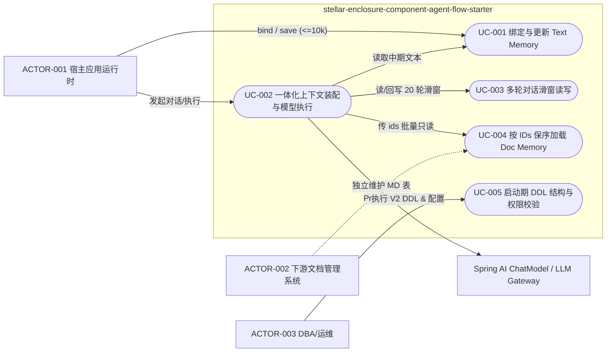
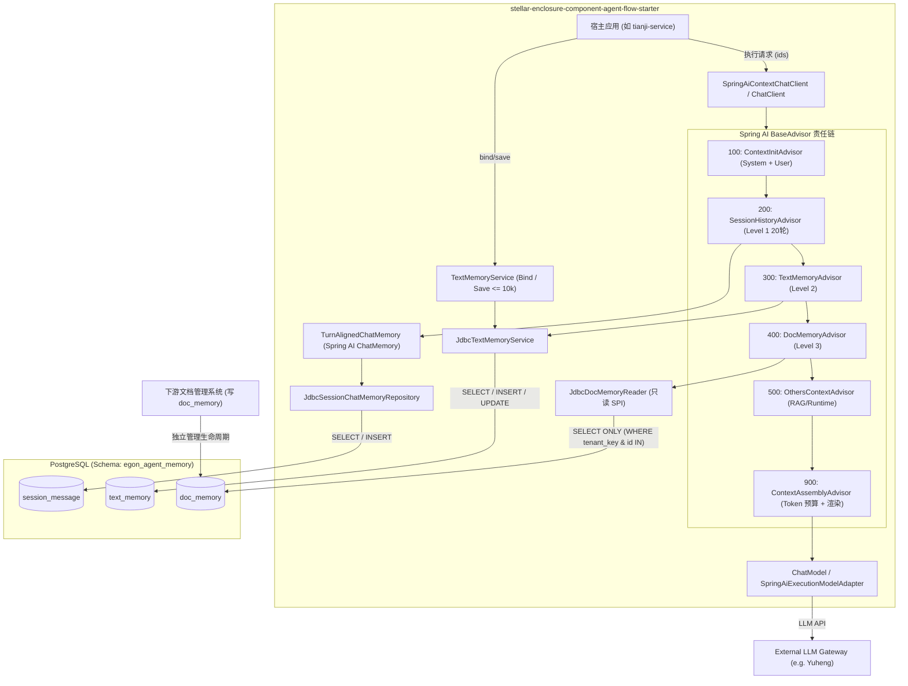
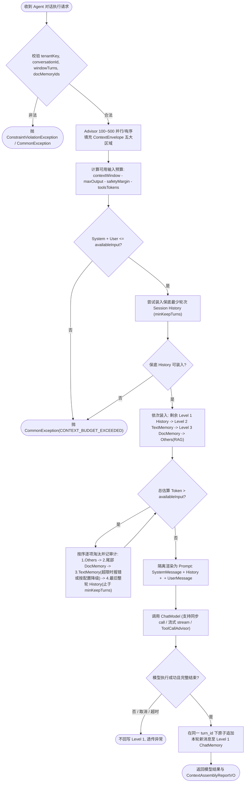
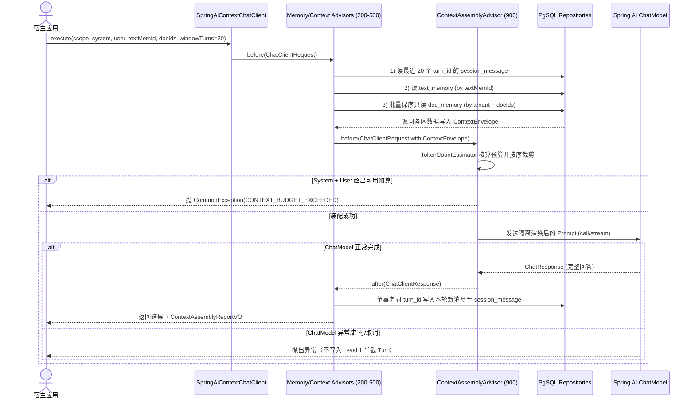
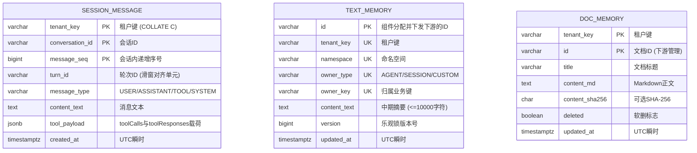

# Agent Flow Starter 基于 Spring AI 的三级 Memory 与一体化 Context 架构设计规格

| Field | Value |
| --- | --- |
| Document | [2026-11-17-04-50-spring-ai-three-tier-memory-and-context.md](./2026-11-17-04-50-spring-ai-three-tier-memory-and-context.md) |
| Template Version | `9` |
| Archetype Cleanup | `Not applicable` |
| Status | `Accepted` |
| Type | `Feature` |
| Complexity | `Complex` |
| Complexity Drivers | 三级 Memory 存储与生命周期所有权分离（组件读写 vs 下游托管只读）、Spring AI `ChatClient` + `BaseAdvisor` 责任链与统一 Token 预算仲裁、Level 1 按完整 Turn 滑动窗口（默认 20 轮）防止 `tool_call`/`tool_response` 断链、Level 2 10,000 字符硬上限并发乐观锁、Level 3 多租户防越权与保序批量查询、PgSQL 增量 DDL 与 `MemoryStoreStorageVerifier` 兼容校验、`spring-ai-client-chat` 依赖门禁与扁平包契约治理 |
| Created | `2026-11-17 04:50 AST` |
| Updated | `2026-11-17 05:00 AST` |
| Owner | `mario` |
| Repository | `Stellar-Enclosure-Components` |
| Scope | `stellar-enclosure-component-agent-flow-starter`（三级 Memory API/SPI 与 PgSQL 存储、Spring AI `ChatMemory` 适配器与 `Advisor` 链、一体化 `ContextEnvelope` 分区装配与预算裁剪、自动配置与配置属性、V2 DDL 与存储校验、组件契约测试与文档） |
| Change Surface | `pom.xml`、`AgentFlowProperties`、`AgentExecutionAutoConfiguration`、`AgentMemoryJdbcAutoConfiguration`、`api/memory`、`api/context`、`memory/session`、`memory/text`、`memory/doc`、`memory/jdbc`、`context`、`adapter/springai`、`src/main/resources/db/egon-agent-memory/`、`README.md`、`README.zh-CN.md`、`ComponentContractGovernanceTest`、`AgentFlowComponentContractTest` 及对应单测/PG 集成测试 |
| Affected Chapters | `§7, §8, §9, §10, §11, §13, §14, §15, §16` |
| Source Requirement | 用户要求基于 Spring AI 路径 A 设计三级 Memory（Level 1 Session History 默认 20 轮可自定义滑动窗口 + 增强 PgSQL `session_message` 表；Level 2 Text Memory PgSQL 单表绑定 ID 下发给下游，上限 10,000 字符超限严格拒绝；Level 3 Doc Memory 由下游管理 PgSQL Markdown 表，组件按传入 `ids` 只读批量查询）与一体化分区域 Context/Prompt 管理方案 |
| Baseline Revision | `Stellar-Enclosure-Components` `main` @ `3a3dc86db0b0ade067c8221447f52ea46ea7b24f`（含未提交工作区文档 `docs/egon/{spec,plan}/2026-11-16-08-*`） |
| Amends | `None` |
| Supersedes | `None` |
| Depends On | `None` |
| Related Specs | [2026-11-06-02-33-agent-flow-explicit-resume.md](./2026-11-06-02-33-agent-flow-explicit-resume.md)（同模块既有 ADK Session Runner 桥接规格） |
| Related Plans | [2026-11-17-05-00-spring-ai-three-tier-memory-and-context.md](../plan/2026-11-17-05-00-spring-ai-three-tier-memory-and-context.md) |

## 1. Summary

当前 `stellar-enclosure-component-agent-flow-starter` 已具备静态 ADK 兼容门面（`AgentFlowService`）、中立执行器（`AgentExecutor` / `DefaultAgentExecutor`）、基于 4 张强审计表的结构化 Fact 存储（`JdbcMemoryStore`：`scope`/`revision`/`fact`/`receipt`）以及基础 RAG 上下文片段汇编（`DefaultContextAssembler` / `RagContextSource`）。然而，这套现有能力缺少面向对话与工作流 Agent 的轻量三级记忆体系，且 `System Prompt`、`Session History`、`Text/Doc Memory`、`RAG/Others` 与 `User Prompt` 尚未在同一套 Token 预算器中统一汇编，容易产生上下文互相挤占、多轮工具调用消息断链或依赖宿主自行拼装的问题。

本规格采用**路径 A（依托 Spring AI `2.0.2` 生态）**设计并标准化以下能力，同时保持既有 `JdbcMemoryStore` 四表事实账本与 `AgentFlowService` 向后兼容：（1）**Level 1 Session History** 基于 Spring AI `ChatMemory` / `MessageWindowChatMemory` 与增强 PgSQL 表 `egon_agent_memory.session_message`，实现默认 **20 轮（Turn）** 可自定义的滑动窗口与完整 `tool_call`/`tool_response` 回放；（2）**Level 2 Text Memory** 基于 PgSQL 表 `egon_agent_memory.text_memory`（`CHECK (char_length(content_text) <= 10000)` + 乐观锁 `version`），为 Agent/Session/业务自定义键分配稳定 `id` 下发下游，超限严格拒绝；（3）**Level 3 Doc Memory** 定义只读 SPI `DocMemoryReader` 与默认 PgSQL `JdbcDocMemoryReader`（不依赖 Spring 默认表，默认查询可配置 schema/table 的 `doc_memory` 表），按传入 `ids` 保序且租户隔离地读取 Markdown 文本；（4）**一体化 Context 管线** 通过 Spring AI `ChatClient` + `BaseAdvisor` 责任链采集五大信任边界分区写入 `ContextEnvelope`，由收口 `ContextAssemblyAdvisor` 结合 `TokenCountEstimator` 执行统一预算核算、可观测裁剪与防注入隔离渲染，最终交付标准 Spring AI `Prompt` 执行。

## 2. Background and Current State

### 2.1 Business and user context

在近期演进中，`Stellar-Enclosure-Components` 已在 commit `2e65397` 废弃了静态配置式多智能体工作流，并在 commit `3a3dc86` 新增 `stellar-enclosure-component-llm-client-starter` 以统一提供 Spring AI `ChatModel` 与 `EmbeddingModel`。用户期望在 `stellar-enclosure-component-agent-flow-starter` 中建立以 Spring AI 为底座的标准三级记忆系统与统一上下文组装能力，使宿主业务系统（如 `tianji-service`）无需在业务侧重复造轮子（例如各自维护滑窗、手写上下文裁剪或直接字符串拼接 Prompt）。

### 2.2 Repository evidence

| Evidence ID | Classification | Exact path/symbol/decision/command | Observed fact | Design significance | Verification limit/freshness |
| --- | --- | --- | --- | --- | --- |
| `EVD-001` | Static repository | `stellar-enclosure-component-agent-flow-starter/pom.xml`、`Stellar-Enclosure-Components/pom.xml` | 模块当前使用 Java 25、Spring Boot 4.1.2、Spring AI `2.0.2`（仅显式引入 `spring-ai-model`，`spring-ai-bom:2.0.2` 在父 POM 管理 `spring-ai-client-chat`）、optional `spring-jdbc`、`postgresql:42.7.8`、`stellar-enclosure-component-rag-starter` | 复用 Spring AI `ChatMemory`/`Prompt` 无需升级版本；引入 `ChatClient`/`BaseAdvisor` 需在 `pom.xml` 增加 BOM 托管的 `spring-ai-client-chat` | 2026-11-17 静态 POM 检查 |
| `EVD-002` | Static repository | `/Users/mario/maven/repository/org/springframework/ai/spring-ai-model/2.0.2/spring-ai-model-2.0.2.jar`、`spring-ai-commons-2.0.2.jar` | `spring-ai-model:2.0.2` 已含 `ChatMemory`、`ChatMemoryRepository`、`MessageWindowChatMemory`、`Prompt`、`PromptTemplate`、`SystemPromptTemplate`；`spring-ai-commons:2.0.2` 已含 `Document`、`TokenCountEstimator`、`JTokkitTokenCountEstimator` | Level 1 窗口与 Token 估算/模板渲染可直接复用 Spring AI 原生接口，不重复发明 | 2026-11-17 `jar tf`/`javap` 字节码检查 |
| `EVD-003` | Static repository | `.../memory/jdbc/JdbcMemoryStore.java`、`.../db/egon-agent-memory/V1__create_memory_store.sql`、`.../memory/jdbc/MemoryStoreStorageVerifier.java` | 现有 JDBC Memory 是面向结构化 Fact 账本的 4 张表（`scope`/`revision`/`fact`/`receipt`），内容限制 `16 KB` JSONB 对象，依赖强制 `CallPermitVO` 与只读启动结构校验 `MemoryStoreStorageVerifier` | 现有 4 表不适合直接承载“10,000 字符纯文本 + 20 轮消息回放 + MD 文档按 IDs 查询”；应保留 `V1` 兼容并在同 schema 下通过 `V2` 脚本与校验扩展承载新表 | 2026-11-17 静态源码检查 |
| `EVD-004` | Static repository | `.../session/InMemorySessionStore.java`、`.../context/DefaultContextAssembler.java`、`.../adapter/springai/SpringAiExecutionModelAdapter.java` | `InMemorySessionStore` 仅作进程内 CAS KV 状态；`DefaultContextAssembler` 仅组装 `ContextFragmentResult`（64KB 字节裁剪），未纳管 System/History/Memory/Tools/User 统一 Token 预算 | 必须在 `context` 与 `adapter/springai` 层补齐统一 `ContextEnvelope` 与 `ContextAssemblyAdvisor`，避免各区互挤爆窗 | 2026-11-17 静态源码检查 |
| `EVD-005` | Static repository | `.../contract/AgentFlowComponentContractTest.java#uses_flat_functional_packages`、`#retainsLegacySignaturesAndExportsSeparateNeutralTypes`、`.../contract/ComponentContractGovernanceTest.java` | 契约测试禁止 `/domain/`、`/application/`、`/infrastructure/`、`/repository/`、`/biz/` 包；`adapter/` 下仅允许 `adk`/`springai`/`mcp`；`api.*` 方法签名不得出现 `org.springframework.ai` 或 `com.google.adk` 类型；`common.exception` 类清单与 `VALIDATOR_TYPES` 严格固定 | 所有新类型必须遵守扁平功能包规则；`api.*` 保持纯中立签名；技术异常复用 `CommonException`；新配置键同步双语 README 与治理测试 | 2026-11-17 静态测试源码检查 |
| `EVD-006` | Static repository | `.../autoconfigure/AgentFlowProperties.java`、`AgentExecutionAutoConfiguration.java`、`AgentMemoryJdbcAutoConfiguration.java`、`lombok.config` | Starter 默认关闭（`enabled=false`）；配置使用 `@ConstructorBinding` record 严格绑定（`NoUnboundElementsBindHandler`）；`lombok.config` 已配置复制 `@Qualifier` | 新增配置项必须接入 `AgentFlowProperties` 并提供兼容重载构造器；所有业务 Bean 使用 `@Slf4j` + `@RequiredArgsConstructor(onConstructor_ = @Autowired)` + `@Qualifier` | 2026-11-17 静态源码检查 |
| `EVD-007` | User decision | 本轮对话用户确认 | 用户确认：选路径 A；Level 1 选方案 1B（增强 PgSQL `session_message` 实现 `ChatMemoryRepository`）且默认保留最近 **20 轮（Turn）** 可自定义；Level 2 超过 10,000 字符**严格拒绝**；Level 3 **不用 Spring 默认表**，由下游管理 PgSQL MD 表，组件提供默认 JDBC 查询与 SPI 按 `ids` 只读查询 | 锁定核心数据架构、窗口语义（Turn 轮次而非单条消息）、超限失败语义与依赖排除（无需引入 `spring-ai-model-chat-memory-repository-jdbc`） | 2026-11-17 用户确认 |

### 2.3 Problem statement and gap

| 维度 | 现状行为 | 目标行为 | 差距与影响 |
| --- | --- | --- | --- |
| Level 1 会话历史 | 仅 `InMemorySessionStore` KV 或 ADK 内存 Session，无基于 Spring AI `ChatMemory` 的 PgSQL 滑动窗口 | 基于 Spring AI `ChatMemoryRepository` + PgSQL `session_message` 实现默认 20 轮（Turn）可自定义滑窗，保留完整 `toolCalls`/`toolResponses` | 需实现 `TurnAlignedChatMemory` 与 `JdbcSessionChatMemoryRepository` 避免按条截断导致工具调用断链 |
| Level 2 中期文本记忆 | `JdbcMemoryStore` 为 16KB JSONB 四表事实账本，无面向 Agent/Session/自定义的纯文本 ID 绑定存取 | PgSQL `text_memory` 表存储中期摘要，组件生成并向宿主返回 `id`，支持乐观锁更新，超 10,000 字符严格拒绝 | 需新增轻量 `TextMemoryService`、PgSQL 存储实现及 Spring AI `TextMemoryAdvisor` |
| Level 3 长期文档记忆 | 无按 `ids` 批量读取下游 Markdown 文档的统一契约与实现 | 组件暴露只读 `DocMemoryReader` SPI 与默认 PgSQL `JdbcDocMemoryReader`（可配置表/列名），按 `ids` 保序+租户过滤查出 MD 文本 | 需新增只读 SPI、安全防越权批量 SQL 与 `DocMemoryAdvisor` |
| 一体化 Context/Prompt | `DefaultContextAssembler` 仅做 64KB 片段截取，无 5 区模型与统一 Token 预算 | 通过 Spring AI `ChatClient` + `BaseAdvisor` 链采集 5 区数据写入 `ContextEnvelope`，由 `ContextAssemblyAdvisor` 统一算 Token 预算、按序裁剪、隔离渲染 | 需设计 `ContextEnvelope`、`ContextBudgetPolicy`、Advisor 链顺序及可观测摘要 |

### 2.4 Evidence and current-chain map

| Entry/trigger | Current call chain | Data read/written | External dependency | Consumers | Evidence |
| --- | --- | --- | --- | --- | --- |
| 中立执行入口 | `DefaultAgentExecutor#execute` -> `DefaultContextAssembler#resolve` -> `AdkAgentExecutorAdapter#execute` -> `SpringAiExecutionModelAdapter#generate` -> `ChatModel#stream` | 读 `SessionStore`/`ContextSource`，未纳管 3 级 Memory 与统一 Token 预算 | 宿主 `ChatModel`、可选 `RagRetrievalService` | `tianji-service` 等宿主运行时 | `EVD-003`, `EVD-004` |
| JDBC 记忆存储初始化 | `AgentMemoryJdbcAutoConfiguration#agentJdbcMemoryStore` -> `MemoryStoreStorageVerifier#verify` -> `new JdbcMemoryStore(...)` | 只读校验 `db/egon-agent-memory/manifest.json` 与 `V1` 结构，读写 `scope/revision/fact/receipt` | 宿主具名 `DataSource`（PostgreSQL） | 使用 `memory.mode=JDBC` 的宿主 | `EVD-003`, `EVD-006` |

### 2.5 Archetype example cleanup

Cleanup disposition: `Not applicable`

Reason: `stellar-enclosure-component-agent-flow-starter` 为 `Stellar-Enclosure-Components` 下的可复用基础设施组件库，并非由 `stellar-enclosure-archetypes` 生成的业务应用项目，不存在业务示例域或待清理样本代码。

## 3. Goals and Non-goals

### 3.1 Goals

1. 在保留 `V1` 四表 `JdbcMemoryStore` 与 `AgentFlowService` 兼容性的前提下，提供基于 Spring AI `2.0.2` 的**三级 Memory 体系**（Level 1 20 轮滑窗持久化、Level 2 ≤10,000 字符中期文本记忆、Level 3 下游托管 Markdown 长期记忆按 `ids` 只读批量查）。
2. 提供基于 Spring AI `ChatClient` + `BaseAdvisor` 责任链的**一体化 Context & Prompt 管理管线**，通过 `ContextEnvelope` 严格隔离 System / SessionHistory / Memory / Others / User 五个区域，并在 `ContextAssemblyAdvisor` 完成统一 Token 预算核算、按优先级裁剪与防注入渲染。
3. 提供可控的 PgSQL 增量受管 DDL（`V2`）与结构校验，严格遵循租户隔离、乐观锁并发安全、`java.time` UTC 存储语义以及 `AgentFlowComponentContractTest` / `ComponentContractGovernanceTest` 契约门禁。

### 3.2 Non-goals

1. 不删除或破坏现有 `JdbcMemoryStore`（`scope/revision/fact/receipt`）、`AgentFlowService` 或 `AdkAgentExecutorAdapter` 的既有公共签名与行为。
2. 不引入 `spring-ai-model-chat-memory-repository-jdbc`、Flyway、Liquibase、ShardingSphere、MyBatis-Plus 或具体模型厂商 starter（如 `spring-ai-openai`）。
3. 不在组件内承担 Level 3 Doc Memory 的增删改、文档切分、向量入库或后台管理页面；不自动把模型回答静默摘要回写到 Level 2（除非业务层显式调用或挂载可选提取钩子）。
4. 不对外暴露 HTTP Controller、GraphQL 端点、MCP Server 端点或前端页面。

### 3.3 Change Surface and Design Depth

| Area/layer | Disposition | Exact repository evidence | Changed or preserved behavior/contract | Required Spec treatment | Chapter(s) |
| --- | --- | --- | --- | --- | --- |
| POM 依赖边界 | Affected | `stellar-enclosure-component-agent-flow-starter/pom.xml`、`AgentFlowComponentContractTest#uses_exact_dependency_boundary` | 新增 BOM 托管的 `org.springframework.ai:spring-ai-client-chat`（optional=true 或编译依赖，见 §5.3/§17）；不引入 `spring-ai-model-chat-memory-repository-jdbc` | 依赖差距证明、坐标与边界测试更新设计 | `§7, §8, §14, §16` |
| 配置属性与自动装配 | Affected | `AgentFlowProperties.java`、`AgentExecutionAutoConfiguration.java`、`AgentMemoryJdbcAutoConfiguration.java` | 新增 `memory.sessionWindowTurns`（默认 `20`）、`memory.textMaxChars`（默认 `10000`）、`memory.docTable` 等严格绑定属性；装配三级 Memory 与 Advisor 链 Bean | 完整属性定义、校验、环境键一致与条件装配 | `§7, §8, §10, §15, §16` |
| 中立 API/SPI 与载体 | Affected | `api/memory/*`、`api/context/*` | 新增中立 `SessionHistoryStore`/`TextMemoryService`/`DocMemoryReader` 及对应 Command/Query/VO/Result（绝不泄露 Spring AI 类型至 `api.*` 签名） | 完整 Java 契约、Jakarta 校验组、POJO/Record 规则 | `§7, §8, §9, §10, §13, §14` |
| 三级 Memory 存储与 Spring AI 桥接 | Affected | `memory/*`、`memory/jdbc/*`、`MemoryStoreStorageVerifier.java` | 新增 `JdbcSessionChatMemoryRepository`、`TurnAlignedChatMemory`、`JdbcTextMemoryService`、`JdbcDocMemoryReader`、`InMemoryTextMemoryService` 及 `V2` DDL 与校验扩展 | 协作细节、并发乐观锁、SQL 访问路径、单测与 PG 测试 | `§7, §8, §9, §10, §11, §13, §14, §15` |
| 一体化 Context 管线与 Spring AI 执行适配器 | Affected | `context/*`、`adapter/springai/SpringAiExecutionModelAdapter.java` | 新增 `ContextEnvelope`、`ContextAssemblyPolicyVO`、`ContextAssemblyEngine` 及 Spring AI `BaseAdvisor` 族（Init/Session/Text/Doc/Others/Assembly），支持 `ChatClient` 管线与现有 `SpringAiExecutionModelAdapter` 复用 | 责任链顺序、Token 预算算法、隔离渲染、流式/同步回写与错误语义 | `§7, §8, §9, §10, §13, §14, §15` |
| 既有结构化 Fact 账本 | Unchanged | `JdbcMemoryStore.java`、`InMemoryMemoryStore.java`、`V1__create_memory_store.sql` | 原 `MemoryStore` 四表事实账本接口、实现与 `V1` DDL 脚本字节完全保留不变 | 仅声明不变边界及 `V1` 脚本不可变回归校验 | `§11, §16` |
| 既有 ADK / MCP 适配器与执行守卫 | Context-only | `DefaultAgentExecutor.java`、`AdkAgentExecutorAdapter.java`、`McpToolAdapter.java`、`AgentFlowSessionExecutionGuard.java` | 保持超时/许可/帧限制/会话并发互斥守卫语义不变；Spring AI 管线模型调用继续受 `CallPermitVO` 与 `DefaultAgentExecutor` 监管 | 记录边界不变式及集成验证点 | `§7, §14` |
| 既有 `AgentFlowService` 兼容层 | Unchanged | `AgentFlowService.java`、`DefaultAgentFlowService.java`、`AgentFlowSessionRunner.java` | 遗留配置式 `AgentFlowService` 签名与行为不变 | 记录不变边界与回归检查 | `§7, §14` |
| 文档与契约治理测试 | Affected | `README.md`、`README.zh-CN.md`、`ComponentContractGovernanceTest.java`、`AgentFlowComponentContractTest.java` | 同步双语配置键与架构说明，校验扁平包与 `api.*` 中立边界及 `CommonException` 规则 | 文档同步范围与治理测试覆盖 | `§8, §14, §16` |
| 前端页面 | Not applicable | `stellar-enclosure-component-agent-flow-starter/pom.xml` | 纯后端 Java/Spring Boot Starter 库，无前端路由、组件或页面 | 明确标注 `N/A` 及证据 | `§12` |

## 4. Requirements and Acceptance Criteria

| ID | Atomic requirement | Priority | Observable acceptance criteria | Source |
| --- | --- | --- | --- | --- |
| `REQ-001` | Level 1 Session History 必须实现 Spring AI `ChatMemoryRepository` 与 `ChatMemory` 接口，底层使用增强 PgSQL 表 `egon_agent_memory.session_message`（含 `tenant_key`、`conversation_id`、`message_seq`、`turn_id`、`message_type`、`content_text`、`tool_payload`、`created_at`），保留完整的文本消息及 `AssistantMessage.ToolCall`/`ToolResponseMessage` 载荷。 | Must | 单测与 PG 集成测试验证：包含多轮用户提问、模型发起多工具调用及工具响应的对话写入后，重新读取能 100% 还原消息类型、文本与 `toolCalls`/`responses` ID、名称及 JSON 参数，跨租户同 `conversation_id` 严格隔离。 | 用户决定 `1b` |
| `REQ-002` | Level 1 滑动窗口必须以**完整 Turn（轮次）**为单位裁剪，默认保留最近 **`20` 轮**，支持通过配置属性（如 `egon.cola.component.agent-flow.memory.session-window-turns`）与运行时调用参数覆盖自定义轮数（范围 `1..200`）；截断时绝不能将同 `turn_id` 的 `tool_call` 与 `tool_response` 从中间切断。 | Must | 单测验证：写入 25 轮（其中第 6 轮含 2 次工具调用共 5 条消息），默认窗口 `20` 严格返回最近第 6–25 轮的全部完整消息（共保留 20 个不同 `turn_id`）；配置为 `5` 时返回第 21–25 轮；头部消息绝不出现孤立 `ToolResponseMessage`。 | 用户决定 `2` |
| `REQ-003` | Level 2 Text Memory 必须基于 PgSQL 表 `egon_agent_memory.text_memory` 实现 `TextMemoryService`，支持按 `(tenantKey, namespace, ownerType, ownerKey)` 幂等创建/绑定并返回组件生成的唯一 `textMemoryId` 给下游，支持按 `textMemoryId` 读取和带 `version` 乐观锁更新；数据库与服务层双重强制上限 **`10,000` 字符**，超限时**严格拒绝**并抛出明确异常（不自动截断、不落库）。 | Must | 单测与 PG 集成测试验证：重复绑定同一 `owner` 返回相同 `id`；写入 10,000 字符成功且 `version` 递增；写入 10,001 字符时在服务校验即严格抛异常且数据库原值与 `version` 不变；并发过时 `version` 写入返回 `VERSION_CONFLICT`。 | 用户决定 `3` |
| `REQ-004` | Level 3 Doc Memory 由下游系统自行管理生命周期，组件不依赖 Spring AI 默认建表或 `JdbcMemoryStore`；组件必须提供只读 SPI `DocMemoryReader` 及默认 `JdbcDocMemoryReader`（支持通过配置指定 schema/表名/列名，默认 `egon_agent_memory.doc_memory`），仅根据下游传入的 `ids` 列表结合运行时 `tenantKey` 批量查询未软删的 Markdown 文本，并**严格按传入 `ids` 顺序**返回；禁止提供写接口。 | Must | 单测与 PG 集成测试验证：传入 `[id3, id1, id2]` 时返回顺序严格为 `[id3, id1, id2]`；属于其他 `tenantKey` 或 `deleted=true` 的 ID 不返回；运行时 DB 角色仅授予该表 `SELECT` 权限；空列表直接返回空集合不查库；超过单批上限（默认 `32`）显式拒绝。 | 用户决定 `4` |
| `REQ-005` | 组件必须提供基于 Spring AI `ChatClient` + `BaseAdvisor` 责任链的一体化 Context & Prompt 装配体系：将每次模型调用的上下文在内存中划分为 **System Prompt**、**Session History**、**Memory（Level 2 + Level 3）**、**Others（RAG/Runtime/Tools）** 和 **User Prompt** 五个独立区域写入 `ContextEnvelope`，由最终 `ContextAssemblyAdvisor` 结合 `TokenCountEstimator` 执行统一预算核算与裁剪。 | Must | 单元测试验证：`SystemPrompt` 始终落在 `SystemMessage` 且不混入不可信数据；`TextMemory` 与 `DocMemory` 以带明确边界标签的参考数据块注入；超过预算时严格按 `Others -> 尾部 DocMemory -> TextMemory（若配置允许或报错策略）-> 较旧完整 Turn History` 顺序裁剪；`System + User` 本身超限立即抛 `CONTEXT_BUDGET_EXCEEDED`；成功调用后回写 Level 1。 | 用户要求一体化 Context 方案 |
| `REQ-006` | `api.*` 包新增的所有中立接口与载体方法签名不得包含 `org.springframework.ai.*`、`com.google.adk.*`、`io.reactivex.*` 等框架类型；新增 PgSQL DDL 脚本必须作为 `V2` 增量脚本放入 `db/egon-agent-memory/`（绝不篡改 `V1__create_memory_store.sql`）并更新 `manifest.json` 与只读结构校验器；必须同步更新中英文 `README` 与 `ComponentContractGovernanceTest` / `AgentFlowComponentContractTest`。 | Must | 契约测试验证：`AgentFlowComponentContractTest` 全部通过；`ComponentContractGovernanceTest` 全部通过；`V1` 文件 SHA-256 保持 `7aa621490c953b38a6231724e85d8fad4433e493d99d1bda37c8b749a6bc8654` 不变。 | 仓库契约治理与向后兼容 |

### 4.1 Scenario matrix

| Scenario | Actor/trigger | Preconditions | Main path | Alternative/failure path | Data/state change | Observable result | Requirements |
| --- | --- | --- | --- | --- | --- | --- | --- |
| 多轮带工具调用的完整对话执行 | 宿主 Agent 运行时调用 `SpringAiAgentFlowClient` / `ChatClient` | `enabled=true`，`memory.mode=JDBC` 或 `IN_MEMORY`，有效 `tenantKey` 与 `conversationId` | 各 Advisor 依次装载 System、最近 20 轮 History、TextMemory、DocMemory(ids)、RAG/Others -> `ContextAssemblyAdvisor` 核算预算并渲染 `Prompt` -> `ChatModel` 执行（含工具循环） -> 成功回写本轮所有新消息至 Level 1 | 若 `ChatModel` 调用异常或被取消，不将半截失败消息写入 Level 1（保证已提交 Turn 完整） | `session_message` 新增同一 `turn_id` 的 `USER`/`ASSISTANT`/`TOOL` 序列 | 返回完整回答与 `ContextAssemblyReportVO`（含 token 用量与裁剪明细） | `REQ-001`, `REQ-002`, `REQ-005` |
| 窗口超 20 轮且含工具链裁剪 | 已有 25 轮历史，第 6 轮含 `toolCalls` | `sessionWindowTurns=20` | SQL/Repository 按 `turn_id` 边界选取最近 20 个完整轮次正序加载 | 若因总 Token 预算紧张，`ContextAssemblyAdvisor` 从第 6 轮（当前窗口内最旧整轮）继续整轮淘汰，绝不劈开工具对 | 数据库不删除历史行，仅本次请求窗口视图滑动 | 发送给 `ChatModel` 的消息列表首条必为完整 `UserMessage`，无孤立 `ToolResponseMessage` | `REQ-002`, `REQ-005` |
| Level 2 绑定与超限拒写 | 宿主绑定或更新中期摘要 | 合法 `tenantKey`/`namespace`/`ownerType`/`ownerKey` | `bindOrCreate` 返回既有或新生成的 `textMemoryId`；`save` 校验 `<=10,000` 字符且匹配 `version` 后更新并自增 `version` | 若 `contentText.length() > 10_000`，校验立即抛 `CommonException(TEXT_MEMORY_TOO_LARGE)`；若 `version` 不匹配抛 `VERSION_CONFLICT` | 成功时 `text_memory.version + 1`；失败时数据库零写入 | 下游拿到稳定 `id` 或明确的不可静默截断错误 | `REQ-003` |
| Level 3 按 `ids` 保序查库与越权隔离 | 下游传入 `docMemoryIds = [d3, d1, d_other_tenant]` | 下游已维护 `doc_memory` 表 | `JdbcDocMemoryReader` 带 `tenant_key` + `deleted=false` + `WITH ORDINALITY` 批量查询，仅返回 `[d3, d1]` 且严格保序 | 若 `docMemoryIds` 超出 32 个或单篇/总字数超限制，或越权 ID 存在，越权 ID 静默过滤（不泄露存在性），超数量限制直接拒绝 | 无写操作（只读 `SELECT`） | Memory 区域按 `[d3, d1]` 顺序装配；预算不足时优先裁掉靠后的 `d1` | `REQ-004`, `REQ-005` |
| Token 预算极度紧张或指令区超限 | `System + User` 超过 `contextLimit - reservedOutput` | `ModelRegistration` 配有模型窗口与 `TokenCountEstimator` | 正常时先裁 `Others(RAG)` -> 再裁尾部 `DocMemory` -> 再裁较旧完整 `SessionHistory` Turn | 若 `System + User` 本身已超预算，或保底必需区域超预算，抛 `CONTEXT_BUDGET_EXCEEDED` 且不调用 `ChatModel` | 无 Level 1 写入 | 快速失败，不浪费模型 Token 与费用 | `REQ-005` |

### 4.2 Use-case analysis

#### 4.2.1 Actor inventory

| Actor ID | Actor/role | Goal and responsibility | Entry/channel | Permission/tenant context | Evidence |
| --- | --- | --- | --- | --- | --- |
| `ACTOR-001` | 宿主应用运行时（如 `tianji-service`） | 绑定/维护 Level 2 Text Memory、传入 Level 3 `docMemoryIds` 并驱动 Spring AI Agent 执行对话与上下文组装 | Spring Bean Java API（`SpringAiAgentContextExecutor` / `ChatClient` / `TextMemoryService`） | 宿主提供可信 `ContextScopeVO`（含 `tenantKey`/`namespace`/`principalKey`/`sessionKey`）与 `CallPermitVO` | `README.zh-CN.md` 边界声明、`AgentExecutionContextVO` |
| `ACTOR-002` | 下游文档知识管理系统 | 独立创建、更新、软删除 PgSQL 中的 Markdown 长期记忆，并在调用 Agent 时下发 `docMemoryIds` | 共享或指定 `DataSource` 下的 `doc_memory` 表（下游自有写路径） | 同 `tenantKey` 数据隔离 | 用户需求 3 级 Memory 描述 |
| `ACTOR-003` | 宿主机/DBA 运维角色 | 执行 `V2` DDL 脚本、配置最小权限运行时 DB Role、配置 `egon.cola.component.agent-flow.memory.*` 参数 | PgSQL DDL 迁移与 Spring Boot `application.yml` | 拥有 DDL 权限的迁移账号 vs 仅 DML 的运行时账号 | `MemoryStoreStorageVerifier.java#requireRuntimeRole` |

#### 4.2.2 Use-case artifact



| ID | Use case/goal | Primary actor | Supporting actors/systems | Trigger | Preconditions | Main success outcome | Alternatives/failures | Postconditions | Requirements | Interfaces/pages | Tests |
| --- | --- | --- | --- | --- | --- | --- | --- | --- | --- | --- | --- |
| `UC-001` | 绑定与更新 Text Memory | `ACTOR-001` | PostgreSQL `text_memory` | 宿主调用 `bindOrCreate` 或 `save` | 有效 `tenantKey`、合法 `ownerType/ownerKey`、`contentText <= 10000` 字符 | 返回稳定 `textMemoryId`，成功保存并递增 `version` | 超 10,000 字符抛 `TEXT_MEMORY_TOO_LARGE`；并发版本过期抛 `VERSION_CONFLICT` | 成功时表记录落库；失败时原记录不变 | `REQ-003` | `INTERNAL-002` | `TEST-004`, `TEST-005` |
| `UC-002` | 一体化上下文装配与模型执行 | `ACTOR-001` | `ChatModel`、三级 Memory、可选 RAG | 宿主通过装配管线发起同步或流式模型调用 | `SystemPrompt`、有效 `UserPrompt`、已知模型上下文上限 | 5 区按预算装配裁剪并执行 `ChatModel`，成功回写 Level 1，返回输出与 `ContextAssemblyReportVO` | `System+User` 超预算抛 `CONTEXT_BUDGET_EXCEEDED`；流式失败/取消不回写半截消息 | 成功时新增完整 Turn；失败时不污染会话历史 | `REQ-005` | `INTERNAL-004`, `INTERNAL-005` | `TEST-007`, `TEST-008` |
| `UC-003` | 多轮对话滑窗读写 | `ACTOR-001` | PostgreSQL `session_message` | 读取历史或追加本轮新消息 | 有效 `tenantKey` 与 `conversationId`，`windowTurns >= 1` | 返回最近 N 个完整 `turn_id` 消息序列；追加按单事务递增 `message_seq` | 超过 `windowTurns` 的旧轮自动滑出窗口；绝不出现孤立 `ToolResponseMessage` | DB 保留全量（或按清理策略），内存视图严格 ≤ N 轮 | `REQ-001`, `REQ-002` | `INTERNAL-001` | `TEST-001`, `TEST-002`, `TEST-003` |
| `UC-004` | 按 IDs 保序加载 Doc Memory | `ACTOR-001` | `ACTOR-002`、PgSQL `doc_memory` | 执行入参携带 `docMemoryIds` | `ids.size() <= 32`，合法 `tenantKey` | 按传入 `ids` 顺序返回当前租户未删除 Markdown 文档 | 跨租户或已软删 ID 自动忽略；超最大个数限制抛 `INVALID_DOC_MEMORY_QUERY` | 无写副作用（只读） | `REQ-004` | `INTERNAL-003` | `TEST-006` |
| `UC-005` | 启动期 DDL 结构与权限校验 | `ACTOR-003` | PostgreSQL Catalog | Spring 容器启动且 `memory.mode=JDBC` | 宿主已执行 `V1`+`V2` DDL 并配置最小权限 Role | 验证表/列/约束/索引及 `manifest.json` SHA-256 一致，应用启动就绪 | 缺表、约束漂移、校验和篡改或权限过大立即阻断启动 | 只读探针，无 DDL 写操作 | `REQ-006` | 启动钩子 | `TEST-009` |

## 5. Constraints, Assumptions, and Decisions

### 5.1 Confirmed constraints

1. **Java / 框架基线**：Java 25、Spring Boot 4.1.2、Spring AI `2.0.2`、PostgreSQL 驱动 `42.7.8`。
2. **包结构约束**：必须保持 `top.egon.cola.component.agentflow.*` 扁平功能包（严禁 `/domain/`、`/application/`、`/infrastructure/`、`/repository/`、`/biz/`；`adapter/` 下不得新增除 `adk`/`springai`/`mcp` 以外的子包；`api.*` 不得出现 Spring AI/ADK 类型）。
3. **公共合同约束**：所有技术异常直接复用 `CommonException(ResultCode.SYSTEM_ERROR.getCode(), code, code)`（不增加 `common.exception` 类，确保 `ComponentContractGovernanceTest` 兼容）；不使用 `java.util.Date`、`BeanUtils.copyProperties`、Fastjson、Gson。
4. **安全与日志边界**：日志不打印 `userId`、`sessionId`、消息原文、Instruction、Text Memory 与 Doc Memory 内容，仅输出脱敏状态、字符数/Token 数、裁剪统计与稳定错误码。

### 5.2 Small-gap assumptions

| ID | Inference | Repository evidence | Why locally reversible | Impact if wrong |
| --- | --- | --- | --- | --- |
| `ASM-001` | Level 1 增强表 `session_message` 仅由组件追加与读取，暂不在运行期自动物理删除滑出窗口的历史行（保留全量供审计或外部分区归档，提供可选 `clear` 遵循 `ChatMemory.clear` 语义）。 | Spring AI `ChatMemoryRepository` 仅要求 `findByConversationId`/`saveAll`/`deleteByConversationId` | 查询 SQL 使用 `LIMIT` 倒序取最近 `windowTurns` 个 `turn_id` 即可满足滑窗，后续可无破坏增加定期清理/TTL Job | 若存在超高轮次（单会话上万轮）且不归档，表行数持续增长，可通过 `(tenant_key, conversation_id, message_seq DESC)` 索引保持热查询 O(window) |
| `ASM-002` | Level 3 默认 `doc_memory` 表名与列名（`id`, `tenant_key`, `title`, `content_md`, `content_sha256`, `deleted`, `updated_at`）支持通过 `AgentFlowProperties.MemorySettings.DocSettings` 配置覆盖，且宿主可注册自定义 `DocMemoryReader` Bean 完全替代默认实现。 | 用户选择“不用 Spring 默认表”且下游自有表结构可能已存在 | 配置覆盖与 SPI Bean 替换均为标准 Spring Boot `@ConditionalOnMissingBean` 做法，不影响调用方 | 若下游表用 `deleted_at IS NULL` 表达软删而非 `deleted = false`，只需配置 `softDeleteCondition` 或自定义 `DocMemoryReader` Bean |
| `ASM-003` | `TokenCountEstimator` 默认使用 `spring-ai-commons` 内置 `JTokkitTokenCountEstimator`，同时允许宿主按模型提供自定义 `TokenCountEstimator` Bean（如 `cl100k_base` / `o200k_base` 或按字符保守估算）。 | `spring-ai-commons:2.0.2` 已包含 `JTokkitTokenCountEstimator` | 构造函数注入 `TokenCountEstimator` + `@ConditionalOnMissingBean` | 对非 OpenAI tokenizer 会有小幅估算偏差，由 `safetyMarginTokens`（默认如 `512`）兜底缓冲 |

### 5.3 Resolved decisions

| ID | Decision | Decision owner | Evidence and rationale | Requirements |
| --- | --- | --- | --- | --- |
| `DEC-001` | Level 1 采用 **方案 1B**：自定义 `JdbcSessionChatMemoryRepository` 对接 PgSQL `egon_agent_memory.session_message` 表，向上实现 Spring AI `ChatMemoryRepository` + `MessageWindowChatMemory` 契约，不引入 `spring-ai-model-chat-memory-repository-jdbc`。 | `mario`（2026-11-17 确认 `1b` 与 `4`） | 支持保存完整 `toolCalls` / `toolResponses` 与 `turn_id`，避免工具调用断链，且原生具备 `tenant_key` 隔离 | `REQ-001` |
| `DEC-002` | Level 1 滑动窗口单位为 **完整 Turn（轮次）**，默认保留 **`20` 轮**，支持配置文件全局默认值与单次执行动态覆盖。 | `mario`（2026-11-17 确认 `2`） | 按轮次（`turn_id`）对齐可确保 `User -> Assistant(ToolCall) -> ToolResponse -> Assistant` 永不被拆碎 | `REQ-002` |
| `DEC-003` | Level 2 Text Memory 上限 `10,000` 字符采用 **严格拒绝** 策略，DB `CHECK` 约束与 Java Service 校验双保险，绝不静默截断丢信息。 | `mario`（2026-11-17 确认 `3`） | 防止静默丢弃关键中期记忆导致模型行为漂移 | `REQ-003` |
| `DEC-004` | Level 3 Doc Memory 由下游托管写入与生命周期，组件不建默认业务写入链路，仅提供可配置表映射的默认只读 `JdbcDocMemoryReader` 与可替换 SPI `DocMemoryReader`。 | `mario`（2026-11-17 确认 `4`） | 保持 starter 无业务表强耦合，兼顾开箱即用与自定义接入 | `REQ-004` |
| `DEC-005` | 路径 A 选用 `org.springframework.ai:spring-ai-client-chat`（版本由父 POM `spring-ai-bom:2.0.2` 管理），在 `agent-flow-starter` 中以 `<optional>true</optional>` 还是 compile 依赖？本 Spec **决定采用 `<optional>true</optional>` 还是直接引入**？基于路径 A 目标“作为核心一体化管线”，推荐作为 compile 依赖引入（并在 `AgentExecutionAutoConfiguration` 加 `@ConditionalOnClass(ChatClient.class)` 保护），但具体 POM 变更在 Plan/Execute 阶段前由用户随本 Spec 一并审批落地。 | `mario`（选定路径 A） | `spring-ai-bom:2.0.2` 已在 `Stellar-Enclosure-Components/pom.xml` 声明；`AgentFlowComponentContractTest` 未禁止 `spring-ai-client-chat` | `REQ-005`, `REQ-006` |

### 5.4 Open major decisions

`None`（四个核心数据与行为决策已在前序确认中锁定；`spring-ai-client-chat` 随路径 A 的精确引入及范围随本 Spec Review 一并确认）。

## 6. Project Technology Context

| Concern | Current choice | Repository evidence | Constraint on design |
| --- | --- | --- | --- |
| Language / Boot / Spring AI | Java 25, Spring Boot 4.1.2, Spring AI `2.0.2` | `Stellar-Enclosure-Components/pom.xml`、`agent-flow-starter/pom.xml` | 使用 `java.time`、`record`（仅不可变 VO）、BOM 管理版本 |
| Persistence & DDL | `spring-jdbc` + `postgresql:42.7.8` + `db/egon-agent-memory/` + `manifest.json` + `MemoryStoreStorageVerifier` | `AgentMemoryJdbcAutoConfiguration.java`、`MemoryStoreStorageVerifier.java` | 不引入 Flyway/Liquibase/MP-SDJ；新增 DDL 必须走 `V2__...sql` + `manifest.json` 校验和校验 |
| Validation & Error | `spring-boot-starter-validation` + `egonColaValidationUtils` + `CommonException` | `AgentFlowAutoConfiguration.java`、`ComponentContractGovernanceTest.java` | 分层校验注解驱动；技术错误码统一用 `CommonException(ResultCode.SYSTEM_ERROR.getCode(), code, code)` |
| Testing | JUnit 5, AssertJ, Spring Boot `ApplicationContextRunner`, Testcontainers (`postgresql`) | `JdbcMemoryStorePostgresTest.java`、`AgentExecutorConformanceTest.java` | 单测（H2/Fake 内存实现）与 PostgreSQL Testcontainers 集成测试分离 |

### 6.1 Java architecture profile and capability baseline

| Architecture profile | Archetype/template or base package | Exact evidence and verifier | Existing deviations | Design action |
| --- | --- | --- | --- | --- |
| Flat Reusable Component Starter（扁平功能组件包结构，非三层 `biz.*`、非 COLA 多模块 Archetype） | `top.egon.cola.component.agentflow` | `AgentFlowComponentContractTest#uses_flat_functional_packages`、`ComponentContractGovernanceTest` | 无（`agent-flow-starter` 原生即为此扁平组件契约） | 严格保留现有扁平包结构，禁止引入 `domain`/`application`/`infrastructure`/`repository`/`biz` 目录，禁止在 `adapter/` 下新建除 `adk`/`springai`/`mcp` 外的子包 |

能力复用台账（Reuse Ledger）：

| Need | Spring/JDK candidate | Spring Boot Starter candidate | Egon-COLA/module candidate | Proven gap | Decision/dependency impact |
| --- | --- | --- | --- | --- | --- |
| Session 滑动窗口接口 | `spring-ai-model`: `ChatMemory`, `ChatMemoryRepository`, `MessageWindowChatMemory` | None | `InMemorySessionStore`（仅 KV，非对话消息） | `MessageWindowChatMemory` 按消息条数滑窗且无 Turn 对齐；需要增强 PgSQL 表存 `toolCalls` | **复用 `ChatMemory`/`ChatMemoryRepository`**，通过 `TurnAlignedChatMemory` 装饰器 + `JdbcSessionChatMemoryRepository` 补齐按 Turn 滑窗与结构化持久化 |
| Advisor 一体化装配链 | `spring-ai-client-chat`: `ChatClient`, `BaseAdvisor`, `CallAdvisor`, `StreamAdvisor`, `ToolCallAdvisor` | None | 无现成 Advisor 链 | 当前 `agent-flow-starter/pom.xml` 未引入 `spring-ai-client-chat` | **批准引入 `org.springframework.ai:spring-ai-client-chat`**（BOM 2.0.2 管理），复用原生 Advisor 管线而非自研拦截框架 |
| Token 估算与 Prompt 模板 | `spring-ai-commons`: `TokenCountEstimator`, `JTokkitTokenCountEstimator`, `Document`; `spring-ai-model`: `Prompt`, `SystemPromptTemplate`, `PromptTemplate` | None | `SpringAiExecutionModelAdapter` | `SpringAiExecutionModelAdapter` 有帧限制与 `Prompt` 检查但无多区预算装配 | **直接复用**上述 Spring AI 类，新增 `ContextAssemblyEngine` 与 `ContextAssemblyAdvisor` |
| RAG 上下文片段源 | `spring-ai-rag`（暂未在 starter 引入） | None | 已有 `RagContextSource` (`stellar-enclosure-component-rag-starter` optional) | 已有 `RagContextSource` 已对接宿主权限校验 | **复用现有 `ContextSource` / `RagContextSource`** 作为 Others 区域提供者 |
| JDBC 访问与事务 | `spring-jdbc` (`JdbcTemplate`, `NamedParameterJdbcTemplate`, `TransactionTemplate`) | `postgresql:42.7.8` | `JdbcMemoryStore`、`MemoryStoreStorageVerifier` | 缺少三级 Memory 的 `V2` DDL 与表校验 | **复用 `spring-jdbc` + `MemoryStoreStorageVerifier` 模式**（不引入 `spring-ai-model-chat-memory-repository-jdbc`） |

### 6.2 User-mandated Java rule compliance

| Literal rule | Affected? | Repository evidence | Exact design decision | Files/types/interfaces | Validation/test evidence | Status/blocker |
| --- | --- | --- | --- | --- | --- | --- |
| Rule 1 | Yes | `AgentFlowComponentContractTest`、`api/*`、`memory/*` | 所有新增类强制采用语义后缀：`*Service`、`*Repository`、`*Reader`（SPI）、`*Advisor`、`*Engine`、`*Verifier`、`*Command`、`*Query`、`*Result`、`*VO`、`*BO`、`*DTO`；禁用 `Data`/`Info`/`Param`/`Bean`/`Request`/`Response` | §8.3 全部新建类型 | `AgentFlowComponentContractTest`、静态命名审查 | PASS |
| Rule 2 | Yes | `AgentFlowAutoConfiguration`、`JdbcMemoryStore` | 对外服务与存储边界全部使用 `@Validated` + Jakarta 约束注解（`@NotNull`/`@NotBlank`/`@Size`/`@Min`/`@Max`）+ `@Valid` 级联；`TextMemorySaveCommand` 使用 `Bind`/`Save` 分组校验；内部非代理构造边界调用 `ValidationUtils` | `TextMemoryService`、`DocMemoryReader`、`SessionHistoryService`、Command/Query 类 | 正/反边界单测与分组校验测试（`TEST-004`/`TEST-006`） | PASS |
| Rule 3 | Yes | `ComponentContractGovernanceTest#conversionsStayOnTheCommonContractWithoutFakeConverters` | 不可变值对象（如 `DocMemoryVO`、`TextMemorySnapshotVO`、`ContextAssemblyReportVO`、`ContextBudgetPolicyVO`）使用 `record` 并在紧凑构造器内做防御拷贝；可变入参 Command/Query 使用 `class` + `@Data @NoArgsConstructor @AllArgsConstructor @Accessors(chain = true) @Builder`；不引入无意义的伪 Converter | §10 全部 POJO/VO 定义 | 构造器/不可变性测试 + `ComponentContractGovernanceTest` | PASS |
| Rule 4 | Yes | `lombok.config`、`DefaultAgentExecutor.java` | 所有业务/组件 Bean 类强制 `@Slf4j`、显式 Bean 名（`@Bean("...")`）、`final` 依赖字段 + `@Qualifier("...")` + `@RequiredArgsConstructor(onConstructor_ = @Autowired)`；日志仅记脱敏 ID 长度、字符数、token 统计、错误码，绝不打印文本正文 | §8.3 全部 Bean 类 | `lombok.config` 参数 `@Qualifier` 传播与日志脱敏单测 | PASS |
| Rule 5 | Yes | `pom.xml`、`AgentFlowComponentContractTest` | 仅使用 JDK 原生 API 与既有依赖（可选使用 `commons-lang3` if present 或 JDK `String`/`StandardCharsets`/`Collections`），不引入任何额外工具包或新 `*Utils` 类 | 全部新增 Java 文件 | `pom.xml` 依赖审查 & import 审查 | PASS |
| Rule 6 | Yes | `ComponentContractGovernanceTest`、`AdkAgentExecutorAdapter` | JSON 序列化（如 `session_message.tool_payload`）仅使用 Spring Boot 托管的 Jackson `JsonMapper`（配置严格读取限制与重复键检测），不引入 Gson/Fastjson；对外字符串枚举均标注 `@JsonValue` | `JdbcSessionChatMemoryRepository`、新增枚举 | Jackson 往返测试 | PASS |
| Rule 7 | Yes | `AgentFlowProperties.java`、`NoUnboundElementsBindHandler` | 所有新配置集中定义在 `AgentFlowProperties.MemorySettings` 与 `AgentFlowProperties.ContextSettings`（带 `@Valid` 与严格校验）；由于组件库本身无多环境 `application-*.yml`，组件在 `README.md` 与 `README.zh-CN.md` 保持配置键完全一致 | `AgentFlowProperties.java`、`README.md`、`README.zh-CN.md` | `AgentFlowPropertiesBindingTest` & 双语 README 键一致性校验 | PASS |
| Rule 9 | Yes | `DefaultAgentExecutor`、`BaseAdvisor` | 本需求属于 Complex 编排逻辑（多级记忆加载 + 统一预算仲裁 + 防断链滑窗），采用 **Chain of Responsibility（Spring AI `BaseAdvisor` 链）+ Decorator（`TurnAlignedChatMemory`）+ Strategy（`ContextTrimStrategy` 裁剪策略）+ SPI/Adapter（`DocMemoryReader`）** | `context/*`、`memory/*` | 模式行为单测（`TEST-002`/`TEST-007`/`TEST-008`） | PASS |
| Rule 10 | Yes | `JdbcMemoryStore.java`、`InMemoryMemoryStore.java` | 全量时间字段使用 `java.time.Instant`（数据库 `timestamptz(6)` 经 `OffsetDateTime` 转换）与 `java.time.Duration`，通过注入 `Clock`（`agentExecutionClock`）获取当前时刻并截断至 `ChronoUnit.MICROS`；禁止 `java.util.Date` | 全部表与时间字段（见 §6.3） | `AgentFlowComponentContractTest` + PG 往返测试 | PASS |
| Rule 11 | Yes | `AgentFlowComponentContractTest#uses_flat_functional_packages`、`pom.xml` | 严格维持扁平功能组件架构（非业务项目三层或 COLA 多模块）；持久化沿用组件既有 `spring-jdbc` + `postgresql` + `db/egon-agent-memory/` 受管校验路径（不将 ShardingSphere/MP 强绑入基础组件库） | 全部包路径与 DDL 资源 | `AgentFlowComponentContractTest` | PASS |

### 6.3 Time semantics and conversion contract

Time contract: `Required`

| Time ID | Fields/symbols | Semantics | Java/runtime type | Storage policy | Wire policy | Business zone source | Display zone source | Boundary / DST rules | Precision / Clock | Compatibility | Verification |
| --- | --- | --- | --- | --- | --- | --- | --- | --- | --- | --- | --- |
| `TIME-001` | `session_message.created_at`、`text_memory.{created_at, updated_at, expires_at}`、`doc_memory.updated_at`、对应 VO/Result `Instant` 字段 | `Occurred instant` | `java.time.Instant`（pgJDBC 边界经 `OffsetDateTime` 转换） | `UTC instant` | `Internal` | `Not applicable: 仅记录事件发生瞬时，不参与日历计算` | `Not applicable: 组件无 UI 展示` | pgJDBC 写入 `instant.atOffset(ZoneOffset.UTC)`，读取 `rs.getObject(..., OffsetDateTime.class).toInstant()`（PostgreSQL `timestamptz(6)`） | 微秒级 `ChronoUnit.MICROS`，由注入 `agentExecutionClock`（UTC）提供 | 与 `JdbcMemoryStore` 既有 `stamp()`/`instant()` 策略完全一致 | `TEST-001`, `TEST-004`, `TEST-006` |

## 7. Architecture Design

### 7.0 Minimum-design baseline and element-necessity audit

| Proposed element | Change | Requirements | Existing/direct alternative | Concrete inadequacy of alternative | Added costs and failure modes | Verdict |
| --- | --- | --- | --- | --- | --- | --- |
| `org.springframework.ai:spring-ai-client-chat` | Add | `REQ-005` | 仅用 `spring-ai-model` 手工编写拦截器调用 `ChatModel` | 手工循环无法复用 Spring AI 原生 `ChatClient`、`BaseAdvisor`、`ToolCallAdvisor` 与 `LastMaxTokenSizeContentPurger` 生态 | 增加 1 个 BOM 托管 jar 依赖，增加 `ApplicationContext` 条件装配 | `Add` |
| `egon_agent_memory.session_message` + `JdbcSessionChatMemoryRepository` | New | `REQ-001`, `REQ-002` | Spring AI `JdbcChatMemoryRepository` (`SPRING_AI_CHAT_MEMORY`) | 原生 4 列纯文本表无法保存 `toolCalls`/`toolResponses`、无 `turn_id` 滑窗对齐、无独立 `tenant_key` 列 | 新增 1 张表与 1 个 JDBC 仓储类；通过统一 `V2` DDL 校验保护 | `Add` |
| `TurnAlignedChatMemory` | New | `REQ-002` | 直接使用 `MessageWindowChatMemory` | `MessageWindowChatMemory` 按“消息条数”淘汰，会在多条工具交互中间切断导致模型 API 报错 | 1 个轻量 `ChatMemory` 装饰器，按最近 `windowTurns` 个 `turn_id` 边界截取 | `Add` |
| `egon_agent_memory.text_memory` + `TextMemoryService` | New | `REQ-003` | 复用既有 `JdbcMemoryStore`（4 表 Fact 账本） | 既有 4 表面向结构化 JSONB 审计（强制 `CallPermitVO` + `MemoryAuthority` + 16KB 对象），无简洁 ID 绑定和 10,000 字符纯文本模型 | 新增 1 张单表及轻服务，带 `CHECK <= 10000` 与乐观锁 | `Add` |
| `DocMemoryReader` SPI + `JdbcDocMemoryReader` | New | `REQ-004` | 让宿主自行查库后拼进 `UserMessage` | 宿主各自拼装导致多租户/保序/裁剪与 Token 预算无法由组件统一治理 | 1 个只读 SPI + 1 个默认 JDBC 实现 + 可选 `doc_memory` 参考表 | `Add` |
| `ContextEnvelope` + 5 个采集 `Advisor` + `ContextAssemblyAdvisor` | New | `REQ-005` | 扩展既有 `DefaultContextAssembler` | 既有类仅按字节拼 `ContextFragmentResult`，无法统一管束 System/History/Memory/Others/Tools/User 的 Token 预算 | 运行时内存上下文对象 + Advisor 链；无外部状态 | `Add` |
| `JdbcMemoryStore` (`V1` 四表) | Keep | `REQ-006` | 替换或删除 `V1` | `tianji-service` 已有测试与配置依赖 `JdbcMemoryStore` | 保持完全兼容不修改 | `Keep` |

关键路径交互成本对比：

| Path | Network calls | Client states | Server contracts/state | Failure and TOCTOU points | Additional user/business value |
| --- | --- | --- | --- | --- | --- |
| 原分散实现（宿主自拼） | 各自查库 + 1 次 `ChatModel` | 宿主自己维护多套配置与裁剪逻辑 | 易发生上下文超限报错或工具断链 | 工具消息半截发往模型、提示词注入、超长文本截断静默丢信息 | 仅基础调用 |
| 路径 A 一体化管线 | 同库最多 3 次只读查询（History/Text/Doc）+ 1 次 `ChatModel` + 1 次 Turn 写回 | 仅传入 `conversationId`、`textMemoryId`、`docMemoryIds` | 统一 `ContextEnvelope` + 标准化三级表 | `ChatModel` 失败不回写 Level 1；Level 2 写用乐观锁；Level 3 带 `tenant_key` | 开箱即用三级记忆 + 防断链 + 统一 Token 预算与裁剪审计 |

### 7.1 System Architecture Design

#### 7.1.1 Architecture Mermaid view



#### 7.1.2 Boundary and responsibility table

| Module/component | Capability and data owned | Inputs/outputs | Allowed dependencies | Forbidden responsibility | Requirements |
| --- | --- | --- | --- | --- | --- |
| `api/memory` & `api/context` | 公开中立 SPI/Service 接口与载体（`TextMemoryService`, `DocMemoryReader`, `ContextAssemblyReportVO` 等） | Java Command/Query/VO/Result | JDK, Jakarta Validation, `api/context/ContextScopeVO` | 绝不引用 `org.springframework.ai.*`、`com.google.adk.*`、`javax.sql.*` | `REQ-003`, `REQ-004`, `REQ-006` |
| `memory/session` | Level 1 按 Turn 滑窗封装与 `TurnAlignedChatMemory` | `conversationId` + `windowTurns` -> 对齐后的 `List<Message>` | `spring-ai-model` (`ChatMemory`), `ChatMemoryRepository` | 不直接拼接 Prompt；不越过 `turn_id` 边界删除单条工具消息 | `REQ-001`, `REQ-002` |
| `memory/text` | Level 2 中期文本内存/服务逻辑与 10k 校验 | `TextMemoryBindCommand` / `TextMemorySaveCommand` -> `TextMemoryVO` | `ValidationUtils`, `Clock`, Jackson | 禁止静默截断超限文本；禁止自动向外部模型发摘要请求 | `REQ-003` |
| `memory/doc` | Level 3 文档只读适配器封装与批量上限守卫 | `(tenantKey, docMemoryIds)` -> 保序 `List<DocMemoryVO>` | `ContextScopeVO` | 禁止提供任何 `insert`/`update`/`delete` 方法 | `REQ-004` |
| `memory/jdbc` | PostgreSQL 三级 JDBC 存储实现与 `V2` 结构校验器 | SQL 查询/持久化 + `DataSource` 校验 | `spring-jdbc`, `postgresql`, Jackson | 禁止动态拼接未白名单化的表名/列名 SQL；禁止在运行时执行 DDL | `REQ-001`–`REQ-004`, `REQ-006` |
| `context` & `adapter/springai` | `ContextEnvelope`、`ContextAssemblyEngine` 与 Spring AI `BaseAdvisor` 族 | 请求配置 + 五区内容 -> 裁剪后 `Prompt` + `ContextAssemblyReportVO` | `spring-ai-client-chat`, `spring-ai-model`, `spring-ai-commons`, `api/*` | 禁止把 `Memory`/`Others`/`User` 直接混入 `SystemMessage` 指令；禁止打印内容正文到日志 | `REQ-005` |

### 7.2 High-Level Design

#### 7.2.1 Critical business/control flowchart



#### 7.2.2 High-level decision and quality matrix

| Concern/use case | Required behavior | Selected mechanism | Failure/degradation behavior | Trade-off | Verification | Requirements |
| --- | --- | --- | --- | --- | --- | --- |
| Level 1 滑窗工具完整性 | 默认保留最近 20 轮，可自定义 1~200 轮 | 数据库按 `turn_id` 倒序取 N 个 distinct `turn_id` + 内存 `TurnAlignedChatMemory` 二次对齐 | 若历史某轮缺失 `toolResponse` 残缺，自动跳过该孤立头节点 | 相比原生 `MessageWindowChatMemory` 多一个 `turn_id` 分组查询，换取多工具 Agent 零断链 | `TEST-002`, `TEST-003` | `REQ-001`, `REQ-002` |
| Level 2 10,000 字符硬上限 | 超限必须严格拒绝，不能丢失信息 | Java 服务前置校验 + PostgreSQL `CHECK (char_length(content_text) <= 10000)` | 抛出 `CommonException("TEXT_MEMORY_TOO_LARGE")`，保持库内老版本不变 | 调用方若需缩减摘要需主动触发总结压缩后再重写 | `TEST-004` | `REQ-003` |
| Level 3 多租户与顺序语义 | 仅按传入 `ids` 顺序加载当前租户有效文档 | `WITH ORDINALITY` 关联 + `WHERE tenant_key = ? AND deleted = false` | 跨租户或已删 ID 返回中直接缺失，不抛泄露存在性的异常 | 要求下游表必须包含租户列及主/索引，可由配置适配列名 | `TEST-006` | `REQ-004` |
| Context 防 Prompt 注入与缓存友好 | 指令与记忆隔离，不破坏 System 前缀缓存 | `SystemMessage` 放纯指令；Memory 与 Others 统一包入 `<context_data trust="reference_only">` 放在历史与本轮输入之间 | 若特定模型不支持连续多条 `UserMessage`，支持策略开关自动将 `<context_data>` 合并至末条 `UserMessage` 头部 | 若放在历史之后会导致历史部分无法利用前缀缓存，但保证了 System Prompt 与跨轮缓存稳定且防注入 | `TEST-007` | `REQ-005` |

### 7.3 Detailed Design

#### 7.3.1 Detailed component collaboration

| Step | Caller -> callee | Contract/symbol | Input/output mapping | State/data effect | Failure behavior | Requirements |
| --- | --- | --- | --- | --- | --- | --- |
| `1` | 宿主 -> `TextMemoryService` | `bindOrCreate(TextMemoryBindCommand)` / `save(TextMemorySaveCommand)` | `(tenantKey, namespace, ownerType, ownerKey)` -> `TextMemoryVO(id, version, contentText, charCount)` | 首次写入 `text_memory` 生成 UUID/ULID `id` 并返回；`save` 校验 `<=10000` 字符 + 乐观锁更新 | 超 10,000 字符抛 `TEXT_MEMORY_TOO_LARGE`；版本冲突抛 `VERSION_CONFLICT` | `REQ-003` |
| `2` | 宿主 -> `SpringAiContextChatClient` (或 `ChatClient` 配好 Advisors) | `execute(AgentContextCallCommand)` | 传入 `ContextScopeVO`、`systemPrompt`、`userPrompt`、可选 `textMemoryId`、`docMemoryIds`、`sessionWindowTurns`、`budgetPolicy` | 无持久化写入，构造空 `ContextEnvelope` 放入 `ChatClientRequest.context()` | 校验失败抛 `ConstraintViolationException` | `REQ-005` |
| `3` | `SessionHistoryAdvisor#before` -> `TurnAlignedChatMemory` -> `JdbcSessionChatMemoryRepository` | `loadTurns(tenantKey, conversationId, windowTurns)` | 读取最近 `windowTurns` 轮完整 `Message` 列表 | 只读 `session_message`，填充 `ContextEnvelope.sessionHistory` | DB 不可用抛 `CommonException("SESSION_MEMORY_UNAVAILABLE")` | `REQ-001`, `REQ-002` |
| `4` | `TextMemoryAdvisor#before` & `DocMemoryAdvisor#before` | `TextMemoryService#getById` & `DocMemoryReader#findByIds` | 按 ID 读取 Level 2（≤10k）和 Level 3 MD 文档列表（按传入 `ids` 保序） | 只读填充 `ContextEnvelope.textMemory` 与 `docMemories` | ID 格式非法或数量超 `maxDocIds(32)` 立即拒绝；未找到则跳过或按策略报错 | `REQ-003`, `REQ-004` |
| `5` | `OthersContextAdvisor#before` | 可选 `ContextSource`（如 `RagContextSource`）+ 运行时变量 | 检索片段写入 `ContextEnvelope.otherFragments` | 只读 | 若 `ContextSource` 显式返回不可用按原有语义处理或降级记录 | `REQ-005` |
| `6` | `ContextAssemblyAdvisor#before` -> `ContextAssemblyEngine` | `assemble(ContextEnvelope, TokenCountEstimator, ContextBudgetPolicyVO)` | 预算扣减 `maxOutputTokens + safetyMargin + toolDefs` 后依次装入并按优先级淘汰 | 纯内存裁剪，生成 `ContextAssemblyReportVO` 存入 `context()` | `System + User` 或保底必需区域超预算时抛 `CONTEXT_BUDGET_EXCEEDED` | `REQ-005` |
| `7` | `ChatModel` / `ToolCallAdvisor` -> `SessionHistoryAdvisor#after` | `appendTurn(tenantKey, conversationId, turnId, newMessages)` | 模型成功结束后，将本轮 `UserMessage` + 工具交互消息 + 最终 `AssistantMessage` 同事务追加 | 在单一本地事务内锁定会话末序号并批量 `INSERT` `session_message` | 模型调用失败、流错误或取消时不触发 `appendTurn` | `REQ-001`, `REQ-002` |

#### 7.3.2 Critical-path Mermaid swimlane



#### 7.3.3 Transactions, consistency, concurrency, and idempotency

| Concern/state change | Owner and boundary | Mechanism/isolation/lock | Concurrent or duplicate behavior | Commit/visibility point | Failure result | Requirements/tests |
| --- | --- | --- | --- | --- | --- | --- |
| Level 1 追加单轮消息 | `JdbcSessionChatMemoryRepository#appendTurn`（自管 `DataSourceTransactionManager` 事务模板，`ISOLATION_READ_COMMITTED`） | 事务内计算 `MAX(message_seq)`（建议通过事务级 advisory lock `pg_advisory_xact_lock(hashtext(tenant_key || ':' || conversation_id))` 序列化同一会话并发追加） | 若同时携带 `turnId` 幂等键，同 `(tenant_key, conversation_id, turn_id)` 重放跳过重复写或报错冲突 | 本地事务提交后下一轮可见 | 回滚整轮所有消息（含中间 tool 消息），绝不写入半截 Turn | `REQ-001` / `TEST-001` |
| Level 2 绑定与更新 | `JdbcTextMemoryService`（`TransactionTemplate`，`READ_COMMITTED`） | `bindOrCreate` 使用 `INSERT ... ON CONFLICT (tenant_key, namespace, owner_type, owner_key) DO NOTHING` 后 `SELECT` 返回既有 `id`；`save` 使用 `WHERE id=? AND tenant_key=? AND version=?` 乐观锁更新 | 并发创建同一 owner 返回同一个稳定 `id`；并发修改同一 `id` 时后发者更新 0 行，明确返回 `VERSION_CONFLICT` | 单行 SQL 事务提交 | 超 10,000 字符在入事务前即拒绝；DB `CHECK` 兜底 | `REQ-003` / `TEST-004`, `TEST-005` |
| Level 3 批量只读 | `JdbcDocMemoryReader`（只读查询，无需显式写事务） | `SELECT ... FROM ... JOIN unnest(:ids::varchar[]) WITH ORDINALITY` | 纯快照读（Statement Timeout `5s`），不受其他写入阻塞 | 跟随下游系统自身事务提交 | 跨租户或软删文档自动不可见 | `REQ-004` / `TEST-006` |

#### 7.3.4 Failure semantics, recovery, and reconciliation

| Failure point | Detection | Immediate control flow | Data/transaction state | Retry and idempotency | Caller/frontend result | Recovery/reconciliation owner | Verification |
| --- | --- | --- | --- | --- | --- | --- | --- |
| Level 2 超 10,000 字符 | Bean Validation / Service 长度校验或 PG `23514` check violation | 立即中断写入并抛出 `CommonException("TEXT_MEMORY_TOO_LARGE")` | 未提交/无变更 | 不可自动重试；调用方需自行压缩摘要后重试 | 收到明确错误码，原中期记忆保持完好 | 宿主应用决定是否触发摘要缩减 | `TEST-004` |
| Level 2 乐观锁冲突 | `UPDATE` 影响行数 = 0 且记录存在 | 抛出 `CommonException("VERSION_CONFLICT")` | 原版本保留 | 调用方重新读取最新 `version` 与内容后合并重试 | 收到冲突错误 | 宿主应用 | `TEST-005` |
| Context 预算不足 | `ContextAssemblyEngine` 核算 `System + User > availableInput`（或必需区无法满足） | 不发起 `ChatModel` 调用，立即抛 `CommonException("CONTEXT_BUDGET_EXCEEDED")` | 无数据库写操作 | 不可盲目重试，需调用方缩减输入或调整 `docMemoryIds`/预算 | 快速失败并附带裁剪报告概要 | 宿主应用 | `TEST-008` |
| 流式调用中途失败/取消 | `Flux` `onError` / `onCancel` 信号 | 仅当 `onComplete` 且存在有效终态输出时才触发 Level 1 `appendTurn` | 本轮无半截历史落库 | 宿主按同一输入重新发起即可 | 返回失败/取消 | 宿主应用 | `TEST-007` |
| `V2` DDL 未安装或 Role 权限越界 | `ThreeTierMemoryStorageVerifier#verify` | `SmartInitializingSingleton` 在启动阶段抛 `IllegalStateException` 阻断启动 | 只读检测，无写入 | DBA 修正 DDL/权限后重启 | 应用启动失败（fail-closed） | DBA / 运维 | `TEST-009` |

#### 7.3.5 Observability and operational boundaries

| Signal/runbook | Emitting owner and point | Fields/dimensions | Sensitive-data rule | Success/failure threshold | Alert/dashboard/operator action | Verification boundary |
| --- | --- | --- | --- | --- | --- | --- |
| `ContextAssembly` 结构化日志 & 报告 | `ContextAssemblyAdvisor` / `ContextAssemblyEngine` | `stage=CONTEXT_ASSEMBLY`, `outcome`, `totalInputTokens`, `historyTurnsIncluded`, `historyTurnsTrimmed`, `textMemoryChars`, `docCountRequested`, `docCountIncluded`, `docCountTrimmed`, `othersTrimmed` | **严禁**记录 `tenantKey`、`userId`、`sessionId`、Prompt 文本、Memory 正文或 MD 标题 | 每次执行记录 1 条 DEBUG 日志及完整 `ContextAssemblyReportVO`（WARN 仅记录超预算失败） | 若频繁出现 `docCountTrimmed > 0` 或 `CONTEXT_BUDGET_EXCEEDED`，提示业务调小 `docMemoryIds` 数量或扩容模型上下文 | 单测 Assert 日志与 Report 字段 |
| 三级 Memory 存储日志 | `JdbcSessionChatMemoryRepository`、`JdbcTextMemoryService`、`JdbcDocMemoryReader` | `tier=L1|L2|L3`, `op`, `outcome`, `errorCode`, `latencyMs`, `rowCount` | **严禁**打印内容摘要、`content_text`、`content_md` 与 `id` 明文载荷 | DB 超时（5s）或版本冲突打 WARN | 检查 PostgreSQL 慢查询与并发版本竞争 | 单测与 PG 集成测试 |

#### 7.3.6 Conclusion evidence chain

| Conclusion | Repository/user evidence | Constraint or requirement | Design decision | Consequence and trade-off | Verification and acceptance evidence |
| --- | --- | --- | --- | --- | --- |
| Level 1 自建 `session_message` 实现 `ChatMemoryRepository` 而非用 Spring 默认表 | `EVD-002`（`ChatMemoryRepository` 接口）、`EVD-007`（用户选 1b + 20 轮 + 不用默认） | `REQ-001`, `REQ-002`（保存 toolCalls 且按完整 Turn 滑窗） | 用 `egon_agent_memory.session_message` 存 `turn_id` + `tool_payload jsonb`，上层封装 `TurnAlignedChatMemory` 装饰 Spring AI `ChatMemory` | 相比官方 4 列纯文本表，彻底消除多工具断链与跨租户混淆，但需维护 `V2` DDL 与 1 个 JDBC 仓储类 | `TEST-001`, `TEST-002`, `TEST-003` |
| Context 采用 `BaseAdvisor` 链两段式采集 + 统一预算收口 | `EVD-001`, `EVD-004`, `EVD-007`（路径 A） | `REQ-005`（5 区隔离、统一 Token 预算、按序裁剪） | 各数据源 Advisor 只写内存 `ContextEnvelope`，收口 `ContextAssemblyAdvisor` 用 `TokenCountEstimator` 统一仲裁与渲染 | 需要引入 BOM 托管的 `spring-ai-client-chat`，但避免多处各自截取导致爆窗与指令注入风险 | `TEST-007`, `TEST-008` |

## 8. Package Structure and Code File Tree

### 8.1 Current relevant tree

```text
stellar-enclosure-component-agent-flow-starter
├── pom.xml
├── README.md
├── README.zh-CN.md
└── src/main
    ├── java/top/egon/cola/component/agentflow
    │   ├── adapter/{adk,mcp,springai}
    │   ├── api/{capability,context,execution,memory,session}
    │   ├── autoconfigure/{AgentFlowAutoConfiguration.java,AgentExecutionAutoConfiguration.java,AgentMemoryJdbcAutoConfiguration.java,AgentFlowProperties.java}
    │   ├── context/DefaultContextAssembler.java
    │   ├── execution/{DefaultAgentExecutor.java,DefaultAgentFlowService.java}
    │   └── memory/{InMemoryMemoryStore.java,jdbc/{JdbcMemoryStore.java,MemoryStoreStorageVerifier.java}}
    └── resources/db/egon-agent-memory/{V1__create_memory_store.sql,manifest.json}
```

### 8.2 Target tree

> 严格遵守 `AgentFlowComponentContractTest#uses_flat_functional_packages`：全部位于扁平功能包下，不引入 `domain`/`application`/`infrastructure`/`repository`/`biz`，不扩展 `adapter/*` 目录集。

```text
stellar-enclosure-component-agent-flow-starter
├── pom.xml                                                              [Modify] 引入 BOM 托管 spring-ai-client-chat
├── README.md                                                            [Modify] 同步三级 Memory & Context 英文契约与配置键
├── README.zh-CN.md                                                      [Modify] 同步三级 Memory & Context 中文契约与配置键
└── src/main
    ├── java/top/egon/cola/component/agentflow
    │   ├── adapter/springai
    │   │   ├── SpringAiExecutionModelAdapter.java                       [Keep / Context-only]
    │   │   ├── SpringAiContextChatClient.java                           [Create] 基于 ChatClient + Advisor 链的一体化执行入口
    │   │   ├── ContextInitAdvisor.java                                  [Create] Order=100 初始化 ContextEnvelope
    │   │   ├── SessionHistoryAdvisor.java                               [Create] Order=200 Level 1 读写
    │   │   ├── TextMemoryAdvisor.java                                   [Create] Order=300 Level 2 读取
    │   │   ├── DocMemoryAdvisor.java                                    [Create] Order=400 Level 3 只读
    │   │   ├── OthersContextAdvisor.java                                [Create] Order=500 接入 RAG/Runtime
    │   │   └── ContextAssemblyAdvisor.java                              [Create] Order=900 预算仲裁与 Prompt 渲染
    │   ├── api/context
    │   │   ├── ContextTrimReasonEnum.java                               [Create] 裁剪原因稳定枚举 (@JsonValue)
    │   │   └── ContextAssemblyReportVO.java                             [Create] 一体化汇编结果与裁剪明细不可变 VO
    │   ├── api/memory
    │   │   ├── MemoryOwnerTypeEnum.java                                 [Create] AGENT/SESSION/CUSTOM (@JsonValue)
    │   │   ├── TextMemoryBindCommand.java                               [Create] 绑定/创建中期文本命令
    │   │   ├── TextMemorySaveCommand.java                               [Create] 更新中期文本命令 (<=10,000 字符)
    │   │   ├── TextMemoryVO.java                                        [Create] Level 2 不可变视图/值对象
    │   │   ├── TextMemoryService.java                                   [Create] Level 2 中立接口
    │   │   ├── DocMemoryQuery.java                                      [Create] Level 3 按 ids 查询入参
    │   │   ├── DocMemoryVO.java                                         [Create] Level 3 Markdown 不可变对象
    │   │   └── DocMemoryReader.java                                     [Create] Level 3 只读 SPI
    │   ├── autoconfigure
    │   │   ├── AgentFlowProperties.java                                 [Modify] 增加 SessionWindow / Text / Doc / Context 配置
    │   │   ├── AgentExecutionAutoConfiguration.java                     [Modify] 装配 IN_MEMORY 实现、TokenCountEstimator、Advisors 与 SpringAiContextChatClient
    │   │   └── AgentMemoryJdbcAutoConfiguration.java                    [Modify] 装配 JDBC 三级 Memory 实现与 V2 存储校验
    │   ├── context
    │   │   ├── DefaultContextAssembler.java                             [Keep / Context-only]
    │   │   ├── ContextBudgetPolicyVO.java                               [Create] 窗口、预留输出、保底轮次、裁剪配置
    │   │   ├── ContextEnvelopeBO.java                                   [Create] 贯穿 Advisor 链的内存五区容器
    │   │   └── ContextAssemblyEngine.java                               [Create] 预算核算、按区裁剪、隔离渲染核心引擎
    │   └── memory
    │       ├── InMemorySessionChatMemoryRepository.java                 [Create] Level 1 内存仓储 (默认模式/单测)
    │       ├── TurnAlignedChatMemory.java                               [Create] Level 1 按 Turn 滑窗装饰器 (实现 Spring AI ChatMemory)
    │       ├── InMemoryTextMemoryService.java                           [Create] Level 2 内存实现
    │       ├── InMemoryDocMemoryReader.java                             [Create] Level 3 空/内存测试兜底只读实现
    │       └── jdbc
    │           ├── JdbcSessionChatMemoryRepository.java                 [Create] Level 1 PgSQL 仓储 (方案 1B)
    │           ├── JdbcTextMemoryService.java                           [Create] Level 2 PgSQL 实现 (<=10,000 字符)
    │           ├── JdbcDocMemoryReader.java                             [Create] Level 3 PgSQL 只读保序批量查询
    │           └── ThreeTierMemoryStorageVerifier.java                  [Create] V2 三级表只读结构与权限校验
    └── resources/db/egon-agent-memory
        ├── V1__create_memory_store.sql                                  [Unchanged] 绝对保持 SHA-256 不变
        ├── V2__create_three_tier_memory.sql                             [Create] 新增 session_message, text_memory, doc_memory
        └── manifest.json                                                [Modify] 追加 version=2 及其 SHA-256 校验和
```

### 8.3 Package and file responsibilities

| Operation | Path/package | Symbols | Responsibility | Dependencies | Requirements |
| --- | --- | --- | --- | --- | --- |
| Modify | `pom.xml` | `spring-ai-client-chat` | 引入 `ChatClient` 与 `BaseAdvisor` 依赖（BOM `2.0.2` 托管） | `spring-ai-bom:2.0.2` | `REQ-005` |
| Create | `api/memory/*` | `TextMemoryService`, `DocMemoryReader`, `TextMemoryBindCommand`, `TextMemorySaveCommand`, `TextMemoryVO`, `DocMemoryQuery`, `DocMemoryVO`, `MemoryOwnerTypeEnum` | 发布纯中立 Level 2/Level 3 Java 契约与校验载体 | JDK, Jakarta Validation, Jackson, `ContextScopeVO` | `REQ-003`, `REQ-004`, `REQ-006` |
| Create | `api/context/*` | `ContextAssemblyReportVO`, `ContextTrimReasonEnum` | 表达汇编审计报告与裁剪原因代码 | JDK, Jackson | `REQ-005`, `REQ-006` |
| Create | `memory/TurnAlignedChatMemory.java` | `TurnAlignedChatMemory` | 实现 Spring AI `ChatMemory`，基于 `turn_id` 执行默认 20 轮（可配置）滑窗并防止工具调用断链 | `ChatMemory`, `ChatMemoryRepository` | `REQ-001`, `REQ-002` |
| Create | `memory/jdbc/JdbcSessionChatMemoryRepository.java` | `JdbcSessionChatMemoryRepository` | 方案 1B PgSQL `session_message` 仓储，支持 `tool_payload` JSONB 存取与事务性 `turn_id` 追加 | `spring-jdbc`, `JsonMapper` | `REQ-001`, `REQ-002` |
| Create | `memory/jdbc/JdbcTextMemoryService.java` | `JdbcTextMemoryService` | Level 2 PgSQL 实现：幂等绑定下发 `id`，10,000 字符硬拒写，乐观锁更新 | `spring-jdbc`, `ValidationUtils`, `Clock` | `REQ-003` |
| Create | `memory/jdbc/JdbcDocMemoryReader.java` | `JdbcDocMemoryReader` | Level 3 PgSQL 只读实现：`WITH ORDINALITY` 保序批量查 MD 文档 + 租户强隔离 | `spring-jdbc`, `ContextScopeVO` | `REQ-004` |
| Create | `memory/jdbc/ThreeTierMemoryStorageVerifier.java` | `ThreeTierMemoryStorageVerifier` | 校验 `V2` 脚本 manifest 校验和、运行角色最小权限（含 `doc_memory` 仅 SELECT）及索引/CHECK 约束 | `spring-jdbc`, `JsonMapper` | `REQ-004`, `REQ-006` |
| Create | `context/ContextAssemblyEngine.java` | `ContextAssemblyEngine`, `ContextEnvelopeBO`, `ContextBudgetPolicyVO` | 核算 Token 预算、按优先级淘汰裁剪并渲染防注入隔离 `Prompt` | `spring-ai-model`, `spring-ai-commons` (`TokenCountEstimator`) | `REQ-005` |
| Create | `adapter/springai/*Advisor.java`, `SpringAiContextChatClient.java` | `ContextInitAdvisor`..`ContextAssemblyAdvisor`, `SpringAiContextChatClient` | 实现 Spring AI `BaseAdvisor` 五区采集 + 统一预算装配执行闭环 | `spring-ai-client-chat`, `context/*`, `memory/*` | `REQ-005` |
| Modify | `autoconfigure/*` | `AgentFlowProperties`, `AgentExecutionAutoConfiguration`, `AgentMemoryJdbcAutoConfiguration` | 绑定新配置属性、发布条件 Bean 并注册启动存储守卫 | Spring Boot AutoConfiguration | `REQ-002`–`REQ-006` |
| Create/Modify | `src/main/resources/db/egon-agent-memory/*` | `V2__create_three_tier_memory.sql`, `manifest.json` | 增量创建三级表并注册 SHA-256 manifest | PostgreSQL 14+ | `REQ-001`–`REQ-004`, `REQ-006` |
| Modify | `README.md`, `README.zh-CN.md`, `*Contract*Test.java` | 文档与治理测试 | 同步配置契约并适配 `NEUTRAL_ENUM_CODES` 与 `pom.xml` 契约断言 | JUnit 5, AssertJ | `REQ-006` |

## 9. Interface Definitions

> 本变更**不涉及任何外部 HTTP REST、GraphQL 或前端 API**（§9.0、§9.3、§9.4 不适用，按 `interface-contract-design.md` 仅完整定义新增/变更的内部 Java Service / SPI 契约）。

### 9.1 Interface Inventory

| ID | Change/necessity verdict | Name/purpose | Kind | API style/CQE role | Consumer | Owner | Method + URL / GraphQL field / symbol / topic | Operation ID/schema source | Input | Output | Auth/tenant | Error model | Idempotency/version | Requirements |
| --- | --- | --- | --- | --- | --- | --- | --- | --- | --- | --- | --- | --- | --- | --- |
| `INTERNAL-001` | New/Add | Level 1 按轮滑窗读写与追加 | Internal Java Service | Spring AI `ChatMemory` 扩展 | `SessionHistoryAdvisor` / 宿主 | `agent-flow-starter` | `TurnAlignedChatMemory#get(conversationId, windowTurns)` / `#appendTurn(...)` | Java 接口 | `tenantKey`, `conversationId`, `turnId`, `windowTurns`, `List<Message>` | `List<Message>` / `void` | `tenantKey` 隔离 | `CommonException` | `turnId` 幂等防重 | `REQ-001`, `REQ-002` |
| `INTERNAL-002` | New/Add | Level 2 Text Memory 绑定/读取/保存 | Internal Java Service | 中立 Service SPI | 宿主应用 & `TextMemoryAdvisor` | `agent-flow-starter` | `TextMemoryService#bindOrCreate` / `#getById` / `#save` | Java 接口 | `TextMemoryBindCommand` / `TextMemorySaveCommand` | `TextMemoryVO` | `tenantKey` + `namespace` | `CommonException` | `bindOrCreate` 幂等；`save` 乐观锁 `version` | `REQ-003` |
| `INTERNAL-003` | New/Add | Level 3 Doc Memory 按 `ids` 只读查询 | Internal Java SPI | 中立只读 SPI | `DocMemoryAdvisor` / 下游适配 | `agent-flow-starter` | `DocMemoryReader#findByIds(DocMemoryQuery)` | Java 接口 | `DocMemoryQuery(tenantKey, ids)` | `List<DocMemoryVO>` | 仅查询匹配 `tenantKey` | `CommonException` | 幂等只读，严格保序 | `REQ-004` |
| `INTERNAL-004` | New/Add | 一体化 Context & ChatModel 执行入口 | Internal Java Service | Spring AI 执行门面 | 宿主 Agent 运行时 | `agent-flow-starter` | `SpringAiContextChatClient#call` / `#stream` | Java 类 | `AgentContextCallBO` | `AgentContextCallResultVO` | 依赖宿主已验证的 `ContextScopeVO` | `CommonException` | 仅完整成功后回写 Level 1 | `REQ-005` |

### 9.2 Per-interface Detailed Contracts

#### 9.2.1 INTERNAL-001 — `TurnAlignedChatMemory`（Level 1 按 Turn 滑窗）

##### Necessity and interaction-cost decision

| Concern | Decision |
| --- | --- |
| Change classification | New internal Java service extension |
| Independent consumer goal | 为 `SessionHistoryAdvisor` 及宿主提供按完整 Turn（`turn_id`）滑窗读写能力，消除工具调用断链 |
| Parameter ownership and derivation | `tenantKey` 与 `conversationId` 来自已验证上下文；`windowTurns` 来自配置默认值（20）或单次调用覆盖 |
| Direct/no-new-interface alternative | 原生 `MessageWindowChatMemory` 按条数滑窗，无法避免从 `tool_call`/`tool_response` 中间截断且无多租户参数 |
| Caller use of result | 直接将返回的完整历史消息列表装入 `ContextEnvelopeBO` |
| Round trips and failure points | 单次 SQL 读取最近 N 轮；单事务原子追加整轮；异常中断不落库 |
| Verdict | `Add` — 满足 `REQ-001` 与 `REQ-002` 必需 |

##### Identity and purpose

- **Symbol & Owner**：`top.egon.cola.component.agentflow.memory.TurnAlignedChatMemory`（实现 Spring AI `org.springframework.ai.chat.memory.ChatMemory`），归属 `agent-flow-starter`。
- **Methods**：`List<Message> get(String tenantKey, String conversationId, int windowTurns)`、`void appendTurn(String tenantKey, String conversationId, String turnId, List<Message> turnMessages)`；无租户参数重载 `ChatMemory#get(String)` 使用全局默认 `windowTurns`（默认 `20`）。

##### Request parameters

- `tenantKey`（非空，`1..128` 字符，无控制字符）；`conversationId`（非空，`1..256` 字符）；`turnId`（非空，`1..64` 字符）；`windowTurns`（`1..200`，默认 `20`）；`turnMessages`（非空，单轮最多 `64` 条消息）。

##### Success response

- `get(...)` 返回按 `message_seq` 升序排列的不可变 `List<Message>`，头部必为完整轮次起点且不含孤立 `ToolResponseMessage`。`appendTurn(...)` 无返回值，提交后立即可见。

##### Error responses

- 参数/范围不合法抛 `ConstraintViolationException` 或 `CommonException("INVALID_SESSION_WINDOW")`；PostgreSQL 异常抛 `CommonException("SESSION_MEMORY_UNAVAILABLE")`。

##### Interface logic for frontend and consumers

1. 校验 `tenantKey`、`conversationId`、`windowTurns` 合法性；
2. 从 `JdbcSessionChatMemoryRepository` 按 `turn_id` 倒序取最近 `windowTurns` 轮并升序重建 `Message`（含 `ToolCall` / `ToolResponse`）；
3. 若首条意外出现孤立 `ToolResponseMessage`，向后对齐跳过直至完整起点；
4. `appendTurn` 仅在模型执行成功结束后单事务批量写入同 `turn_id` 消息。

##### Compatibility and verification

- 对上层完整兼容 Spring AI `ChatMemory`；由 `TEST-001`、`TEST-002`、`TEST-003` 验证。

#### 9.2.2 INTERNAL-002 — `TextMemoryService`（Level 2 中期文本记忆）

##### Necessity and interaction-cost decision

| Concern | Decision |
| --- | --- |
| Change classification | New neutral Java service SPI |
| Independent consumer goal | 为 Agent/Session/自定义键幂等绑定并下发稳定 `textMemoryId`，并安全更新 ≤10,000 字符中期记忆 |
| Parameter ownership and derivation | `id` 由组件生成并下发；`tenantKey`/`namespace`/`ownerType`/`ownerKey` 由宿主提供 |
| Direct/no-new-interface alternative | 既有 `MemoryStore` 为 16KB JSONB 四表事实账本且强制 `CallPermitVO` 鉴权，不能满足轻量文本 ID 绑定与 10k 硬上限拒写 |
| Caller use of result | 下游持久化或透传 `textMemoryId` 供后续对话读取注入 |
| Round trips and failure points | `bindOrCreate` 单事务幂等；`save` 乐观锁 `version` 冲突与超限拒写 |
| Verdict | `Add` — 满足 `REQ-003` 必需 |

##### Identity and purpose

- **Symbol & Owner**：`top.egon.cola.component.agentflow.api.memory.TextMemoryService`（纯中立接口，不含框架类型）。
- **Methods**：`TextMemoryVO bindOrCreate(@Valid @NotNull TextMemoryBindCommand)`、`Optional<TextMemoryVO> getById(String tenantKey, String id)`、`TextMemoryVO save(@Valid @NotNull TextMemorySaveCommand)`。

##### Request parameters

- `TextMemoryBindCommand`（`tenantKey`, `namespace`, `ownerType`, `ownerKey`）；`TextMemorySaveCommand`（`tenantKey`, `id`, `contentText` `@NotNull @Size(max = 10000)` 无 `\u0000`, `expectedVersion >= 1`）。

##### Success response

- 返回不可变 `TextMemoryVO(id, version, contentText, charCount, updatedAt)`；`getById` 返回 `Optional<TextMemoryVO>`。

##### Error responses

- `contentText.length() > 10000` 严格拒绝，抛 `CommonException("TEXT_MEMORY_TOO_LARGE")`（或边界 `ConstraintViolationException`）；`version` 不匹配抛 `CommonException("VERSION_CONFLICT")`; 不存在或跨租户抛 `CommonException("TEXT_MEMORY_NOT_FOUND")`。

##### Interface logic for frontend and consumers

1. 执行 Jakarta Bean Validation（超 10,000 字符在进入事务前立即拦截）；
2. `bindOrCreate` 走 `ON CONFLICT DO NOTHING` + 查询返回既有或新建 `id`；
3. `save` 使用 `WHERE id=? AND tenant_key=? AND version=?` 原子递增版本；
4. 失败时保证原版本文本与版本号零改变。

##### Compatibility and verification

- 纯中立接口受 `AgentFlowComponentContractTest` 保护；由 `TEST-004`、`TEST-005` 验证。

#### 9.2.3 INTERNAL-003 — `DocMemoryReader`（Level 3 只读 SPI）

##### Necessity and interaction-cost decision

| Concern | Decision |
| --- | --- |
| Change classification | New neutral read-only Java SPI |
| Independent consumer goal | 执行阶段仅按传入 `ids` 读取下游系统管理的 PostgreSQL Markdown 长期记忆 |
| Parameter ownership and derivation | `docMemoryIds` 由下游传入，`tenantKey` 由宿主可信上下文推导；组件不拥有文档写权限 |
| Direct/no-new-interface alternative | 若由宿主手查并塞入 `UserMessage`，无法统一接入保序裁剪与 Token 预算控制 |
| Caller use of result | 装入 `ContextEnvelopeBO` 的 Memory 区域参与统一预算与隔离渲染 |
| Round trips and failure points | 单次只读批量查询；超批上限拒绝；跨租户 ID 自动过滤不泄露 |
| Verdict | `Add` — 满足 `REQ-004` 必需 |

##### Identity and purpose

- **Symbol & Owner**：`top.egon.cola.component.agentflow.api.memory.DocMemoryReader`（纯只读 SPI）。
- **Methods**：`List<DocMemoryVO> findByIds(@Valid @NotNull DocMemoryQuery query)`（刻意不定义任何写/删方法）。

##### Request parameters

- `DocMemoryQuery`：`tenantKey`（非空 `1..128`）、`ids`（`@NotNull @Size(max = 32)`，元素非空 `1..128`；空列表直接返回空集合不查库）。

##### Success response

- 返回严格按传入 `ids` 顺序重排、已去重且仅属于 `tenantKey` 且未软删的 `List<DocMemoryVO>`。

##### Error responses

- `ids.size() > 32` 抛 `CommonException("DOC_MEMORY_BATCH_LIMIT")`；DB 查询失败抛 `CommonException("DOC_MEMORY_UNAVAILABLE")`；不存在或跨租户 ID 在结果中忽略。

##### Interface logic for frontend and consumers

1. 校验 `DocMemoryQuery` 与批量上限（≤32）；空列表直接短路返回；
2. 通过 `unnest(:ids::varchar[]) WITH ORDINALITY` 联表查询 `WHERE tenant_key = :tenantKey AND deleted = false`；
3. 按 `req.ord` 升序组装不可变 `DocMemoryVO` 列表返回。

##### Compatibility and verification

- 宿主可通过注册自定义 `DocMemoryReader` Bean 覆盖默认 `JdbcDocMemoryReader`；由 `TEST-006` 验证。

#### 9.2.4 INTERNAL-004 — `SpringAiContextChatClient`（一体化管线执行门面）

##### Necessity and interaction-cost decision

| Concern | Decision |
| --- | --- |
| Change classification | New Spring AI orchestration facade |
| Independent consumer goal | 向宿主提供一次性装配五区 Context、三级 Memory、预算裁剪与安全回写的统一调用入口 |
| Parameter ownership and derivation | 宿主提供 `ContextScopeVO`、`systemPrompt`、`userPrompt`、`textMemoryId`、`docMemoryIds`、`windowTurns`、`budgetPolicy` |
| Direct/no-new-interface alternative | 要求宿主自行串联 6 个 `BaseAdvisor` 易遗漏顺序或破坏预算收口不变式 |
| Caller use of result | 获取模型输出文本/流式响应及 `ContextAssemblyReportVO` 裁剪审计 |
| Round trips and failure points | 封装单次调用全周期；失败或流式取消保证不回写半截 Level 1 历史 |
| Verdict | `Add` — 满足 `REQ-005` 必需 |

##### Identity and purpose

- **Symbol & Owner**：`top.egon.cola.component.agentflow.adapter.springai.SpringAiContextChatClient`（位于 `adapter/springai`，不污染 `api.*` 中立边界）。
- **Methods**：`AgentContextCallResultVO call(@Valid @NotNull AgentContextCallBO request)`、`Flux<ChatResponse> stream(@Valid @NotNull AgentContextCallBO request, Consumer<ContextAssemblyReportVO> onReport)`。

##### Request parameters

- `AgentContextCallBO`：包含 `ContextScopeVO`、`chatModelBeanName`（或 `ChatModel`）、`systemPrompt`、`userPrompt`、可选 `textMemoryId`、可选 `docMemoryIds`（≤32）、可选 `windowTurns`（覆盖默认 `20`）、可选 `ContextBudgetPolicyVO`、可选 `ToolCallback` 列表。

##### Success response

- 同步 `call` 返回 `AgentContextCallResultVO(content, chatResponse, assemblyReport)`；流式 `stream` 返回 `Flux<ChatResponse>` 并在装配完成时回调 `ContextAssemblyReportVO`。

##### Error responses

- `System + User` 或保底必需轮次超出可用预算抛 `CommonException("CONTEXT_BUDGET_EXCEEDED")`；底层模型失败透传或包装为 `CommonException("MODEL_EXECUTION_FAILED")`。

##### Interface logic for frontend and consumers

1. 构造 `ContextEnvelopeBO` 并启动 `ChatClient`；
2. 按 Order `100 -> 200 -> 300 -> 400 -> 500` 分别注入 System/User、Level 1、Level 2、Level 3、Others；
3. `ContextAssemblyAdvisor(900)` 估算 Token 并按优先级裁剪，隔离渲染最终 `Prompt`；
4. 调用 `ChatModel`（同步或流式）；
5. 仅在正常完成且存在有效终态回复时，由 `SessionHistoryAdvisor#after` 写入 Level 1。

##### Compatibility and verification

- 并存保留既有 `AdkAgentExecutorAdapter` 与 `AgentFlowService`；由 `TEST-007`、`TEST-008` 验证。

## 10. POJO and Data Model Design

### 10.1 POJO role classification and class necessity

| Object/path | Selected role | Owner/boundary and consumers | Why a distinct class is necessary or reuse is safe | Mapping owner | Requirements |
| --- | --- | --- | --- | --- | --- |
| `TextMemoryBindCommand` | Command | 宿主 -> `TextMemoryService#bindOrCreate` | 承载创建/绑定中期记忆的写意图与租户/Owner 参数 | 直接构造消费（无额外持久化实体层） | `REQ-003` |
| `TextMemorySaveCommand` | Command | 宿主 -> `TextMemoryService#save` | 承载 10,000 字符纯文本更新意图与乐观锁 `expectedVersion` | 直接构造消费 | `REQ-003` |
| `TextMemoryVO` | Immutable VO (`record`) | `TextMemoryService` 输出 & Advisor 消费 | 不可变只读快照（`id`, `version`, `contentText`, `charCount`, `updatedAt`） | `JdbcTextMemoryService` 行映射 | `REQ-003` |
| `DocMemoryQuery` | Query | 宿主/Advisor -> `DocMemoryReader` | 封装 `tenantKey` 与批量 `ids` 校验（≤32） | 直接构造消费 | `REQ-004` |
| `DocMemoryVO` | Immutable VO (`record`) | `DocMemoryReader` 输出 & `ContextEnvelope` | 不可变 Markdown 片段快照（`id`, `title`, `contentMd`, `contentSha256`, `updatedAt`） | `JdbcDocMemoryReader` 行映射 | `REQ-004` |
| `ContextBudgetPolicyVO` | Immutable VO (`record`) | `ContextAssemblyEngine` 预算配置 | 不可变预算参数（`contextWindowTokens`, `maxOutputTokens`, `safetyMarginTokens`, `minKeepHistoryTurns`, `combineContextIntoFinalUserMessage`） | 从配置默认构建或单次覆写 | `REQ-005` |
| `ContextEnvelopeBO` | Business Object (`class`) | Advisor 链内部共享可变装配容器 | 贯穿 `100`~`900` Advisor 收集五区数据，仅在单次请求线程/上下文存活 | `ContextAssemblyEngine` 读取并生成不可变 `Prompt` | `REQ-005` |
| `ContextAssemblyReportVO` | Immutable VO (`record`) | `ContextAssemblyAdvisor` 输出给宿主 | 记录每个区域的入选数量、Token 估算与 `ContextTrimDetailVO` 列表 | `ContextAssemblyEngine` 构建 | `REQ-005` |

### 10.2–10.3 Field design & representation

| Type | Record / class | Lombok / compact constructor | Validation constraints | Notes |
| --- | --- | --- | --- | --- |
| `TextMemoryBindCommand` | `class` | `@Data @NoArgsConstructor @AllArgsConstructor @Accessors(chain = true) @Builder` | `@NotBlank tenantKey`, `@NotBlank namespace`, `@NotNull MemoryOwnerTypeEnum ownerType`, `@NotBlank @Size(max=256) ownerKey` | Rule 3 合规（可变 Command 不用 `record`） |
| `TextMemorySaveCommand` | `class` | `@Data @NoArgsConstructor @AllArgsConstructor @Accessors(chain = true) @Builder` | `@NotBlank tenantKey`, `@NotBlank id`, `@NotNull @Size(max=10000) contentText`, `@Min(1) long expectedVersion` | Rule 3 合规 |
| `DocMemoryQuery` | `class` | `@Data @NoArgsConstructor @AllArgsConstructor @Accessors(chain = true) @Builder` | `@NotBlank tenantKey`, `@NotNull @Size(max=32) List<@NotBlank @Size(max=128) String> ids` | Rule 3 合规 |
| `ContextEnvelopeBO` | `class` | `@Data @NoArgsConstructor @AllArgsConstructor @Accessors(chain = true) @Builder` | `@NotBlank systemPrompt`, `@NotNull userMessage` | 仅单次执行请求内可变收集五区数据 |
| `TextMemoryVO` | `record` | 紧凑构造器校验 `id`、`version >= 1`、`contentText.length() <= 10000`、`updatedAt` | 不可变值对象 | Rule 3 豁免 |
| `DocMemoryVO` | `record` | 紧凑构造器校验 `id`、`contentMd != null`、`updatedAt` | 不可变值对象 | Rule 3 豁免 |
| `ContextBudgetPolicyVO` | `record` | 紧凑构造器校验 `contextWindowTokens > maxOutputTokens + safetyMarginTokens`、`minKeepHistoryTurns >= 0` | 不可变值对象 | Rule 3 豁免 |
| `ContextAssemblyReportVO` | `record` | 紧凑构造器使用 `List.copyOf(trimDetails)` 防御拷贝 | 不可变值对象 | Rule 3 豁免 |
| `MemoryOwnerTypeEnum` | `enum` | `@JsonValue private final String code;`（`AGENT`, `SESSION`, `CUSTOM`） | 同步注册至 `ComponentContractGovernanceTest#NEUTRAL_ENUM_CODES` | Rule 6 合规 |
| `ContextTrimReasonEnum` | `enum` | `@JsonValue private final String code;`（`BUDGET_OTHERS`, `BUDGET_DOC_MEMORY`, `BUDGET_TEXT_MEMORY`, `BUDGET_HISTORY_TURN`） | 同步注册至 `ComponentContractGovernanceTest#NEUTRAL_ENUM_CODES` | Rule 6 合规 |

### 10.4 Object flow, reuse, and state lifecycle

- `agent-flow-starter` 不引入额外 POJO 拷贝框架（继承既有 `ComponentContractGovernanceTest` 禁止无意义 `BaseConverter` 约定），行映射由 JDBC `RowMapper` 直接投影到不可变 `*VO` 与 Spring AI `Message`。
- `TextMemoryVO` 生命周期：`bindOrCreate`（初始空文本 `""`, `version = 1`）-> `save`（`version -> version + 1`, `charCount <= 10000`）。

## 11. Database Design

> 遵循既有模块惯例：所有 DDL 位于 `src/main/resources/db/egon-agent-memory/`，通过 `V2__create_three_tier_memory.sql` 新增，并向 `manifest.json` 追加 `version: 2`（绝对不修改 `V1__create_memory_store.sql`）。运行时角色仍需遵循最小权限原则（禁止 DDL，禁止 DROP/TRUNCATE）。

### 11.1 Table Inventory

| Table | Existing/new | Purpose and owner | Read/write paths | Change | DDL script | Requirements |
| --- | --- | --- | --- | --- | --- | --- |
| `egon_agent_memory.session_message` | New | Level 1 多轮消息滑窗持久化（`agent-flow-starter` 拥有） | `JdbcSessionChatMemoryRepository` 读写 | Create | `db/egon-agent-memory/V2__create_three_tier_memory.sql` | `REQ-001`, `REQ-002` |
| `egon_agent_memory.text_memory` | New | Level 2 中期文本记忆（≤10k 字符，`agent-flow-starter` 拥有） | `JdbcTextMemoryService` 读写 | Create | `db/egon-agent-memory/V2__create_three_tier_memory.sql` | `REQ-003` |
| `egon_agent_memory.doc_memory` | New（可配置适配下游自有表） | Level 3 长期 Markdown 记忆（**下游拥有写权，组件仅只读**） | `JdbcDocMemoryReader` 只读 `SELECT` | Create | `db/egon-agent-memory/V2__create_three_tier_memory.sql` | `REQ-004` |
| `egon_agent_memory.{scope,revision,fact,receipt}` | Existing | 既有结构化 Fact 账本（`JdbcMemoryStore` 拥有） | `JdbcMemoryStore` | `Unchanged`（仅保留并存） | `V1__create_memory_store.sql`（不修改） | `REQ-006` |

### 11.2 Per-table Detailed Design

#### 11.2.1 `egon_agent_memory.session_message`

##### Purpose, ownership, and lifecycle

- **Owner & Writer**：`agent-flow-starter` 经 `JdbcSessionChatMemoryRepository` 写入；仅追加完整 Turn（或通过 `deleteByConversationId` 显式清空会话）。
- **Topology & Isolation**：部署于宿主指定的 PostgreSQL 单库 schema（非 ShardingSphere 分片表）；通过 `tenant_key` + `conversation_id` 隔离。

##### Complete column design

| Column | Native type | Length/precision | Null | Default | Generated | PK/FK/unique/check | Meaning | Source/mapping | Example |
| --- | --- | --- | --- | --- | --- | --- | --- | --- | --- |
| `tenant_key` | `varchar(128)` `COLLATE "C"` | 128 chars | No | None | 调用方 | PK(1), `CHECK (tenant_key <> '' AND tenant_key !~ '[[:cntrl:]]')` | 租户隔离标识 | `ContextScopeVO.tenantKey` | `tenant-a` |
| `conversation_id` | `varchar(256)` `COLLATE "C"` | 256 chars | No | None | 调用方 | PK(2), `CHECK (conversation_id <> '' AND conversation_id !~ '[[:cntrl:]]')` | 会话唯一键 | Spring AI `conversationId` | `sess_01J...` |
| `message_seq` | `bigint` | 64-bit | No | None | 事务内递增 | PK(3), `CHECK (message_seq >= 1)` | 会话内严格递增消息序号 | `MAX(message_seq) + 1` | `42` |
| `turn_id` | `varchar(64)` `COLLATE "C"` | 64 chars | No | None | 单轮执行生成 | `CHECK (turn_id <> '' AND turn_id !~ '[[:cntrl:]]')` | 归属轮次标识（串联 User->Tools->Assistant） | `TurnAlignedChatMemory` | `turn_01J...` |
| `message_type` | `varchar(16)` `COLLATE "C"` | 16 chars | No | None | Spring AI | `CHECK (message_type IN ('USER','ASSISTANT','TOOL','SYSTEM'))` | 消息角色类型 | `MessageType.name()` | `ASSISTANT` |
| `content_text` | `text` | unbounded | Yes | None | 消息正文 | `CHECK (content_text IS NOT NULL OR tool_payload IS NOT NULL)` | 消息文本内容 | `Message.getText()` | `结果如下...` |
| `tool_payload` | `jsonb` | JSONB | Yes | None | Jackson 序列化 | `CHECK (tool_payload IS NULL OR (jsonb_typeof(tool_payload) = 'object' AND octet_length(tool_payload::text) <= 262144))` | 存 `toolCalls` 或 `toolResponses` 数组与元数据 | `ToolCall` / `ToolResponse` | `{"toolCalls":[...]}` |
| `created_at` | `timestamptz(6)` | microsecond | No | None | `clock.instant()` | None | 写入瞬时（UTC） | `Instant` | `2026-11-17T08:50:00Z` |

##### Keys, relationships, and constraints

- 主键：`egon_agent_session_message_pkey (tenant_key, conversation_id, message_seq)`；无跨表外键（会话与 Level 2/Level 3 解耦）。

##### Index inventory and per-index justification

| Index | Type/unique | Ordered columns/expressions | Predicate/include | Query and operation | Cardinality/selectivity | Sort/coverage role | Write/storage cost | Decision |
| --- | --- | --- | --- | --- | --- | --- | --- | --- |
| `egon_agent_session_message_pkey` | btree unique | `(tenant_key, conversation_id, message_seq)` | None | 按顺序扫描、追加定位最大 `message_seq`、`clear` 删除 | `(tenant_key, conversation_id)` 高度选择性 | 正序返回滑窗消息 | 写入必需 PK | Add |
| `idx_session_message_turn_lookup` | btree | `(tenant_key, conversation_id, turn_id, message_seq)` | None | 幂等防重检查 `(tenant_key, conversation_id, turn_id)` 与按最近 N 个 `turn_id` 定位起点 | 高选择性 | 避免回表全扫描历史消息 | 每次追加 1 条索引写 | Add |

##### Access patterns and SQL shape

| Operation | Caller | Predicate/join/order | Expected rows | Index/constraint | Lock/isolation | Failure/idempotency |
| --- | --- | --- | --- | --- | --- | --- |
| 滑窗加载 | `JdbcSessionChatMemoryRepository#findByConversationId` | `tenant_key=? AND conversation_id=?` 按 `turn_id` 倒序取 `LIMIT :windowTurns` 后升序读取 | `0..windowTurns*N` | `idx_session_message_turn_lookup` & PK | 只读快照（5s timeout） | 绝不从工具调用中间切断 |
| 整轮追加 | `JdbcSessionChatMemoryRepository#appendTurn` | 事务内按 `(tenant_key, conversation_id)` advisory lock 序列化并批量 `INSERT` | `1..64` | PK `(tenant_key, conversation_id, message_seq)` | `READ_COMMITTED` + `pg_advisory_xact_lock` | 同 `turn_id` 幂等防重 |
| 清空会话 | `JdbcSessionChatMemoryRepository#deleteByConversationId` | `DELETE WHERE tenant_key=? AND conversation_id=?` | `0..N` | PK 前缀 | 本地事务 | 显式清空语义 |

- **最近 N 轮滑窗读取 SQL**：
  ```sql
  WITH recent_turns AS (
      SELECT turn_id, MAX(message_seq) AS last_seq
      FROM egon_agent_memory.session_message
      WHERE tenant_key = :tenantKey AND conversation_id = :conversationId
      GROUP BY turn_id
      ORDER BY last_seq DESC
      LIMIT :windowTurns
  )
  SELECT m.message_seq, m.turn_id, m.message_type, m.content_text, m.tool_payload, m.created_at
  FROM egon_agent_memory.session_message m
  JOIN recent_turns rt ON rt.turn_id = m.turn_id
  WHERE m.tenant_key = :tenantKey AND m.conversation_id = :conversationId
  ORDER BY m.message_seq ASC;
  ```

##### Migration and historical-data handling

- 通过 `db/egon-agent-memory/V2__create_three_tier_memory.sql` 新增并在 `manifest.json` 注册 `version=2`（完全独立于 `V1` 四表，无历史数据迁移、无回填、无锁表风险；`V1` 保持只读不可变）。回滚边界：应用回退时保留空表，不做破坏性自动 `DROP`。

##### Transaction, consistency, and recovery

- `TransactionTemplate`（`READ_COMMITTED`，`10s` 超时）；若大模型中途失败或被取消，不进入 `appendTurn`，数据库永不出现残缺工具轮次。

---

#### 11.2.2 `egon_agent_memory.text_memory`

##### Purpose, ownership, and lifecycle

- **Owner & Writer**：`agent-flow-starter` 经 `JdbcTextMemoryService` 创建与更新；`id` 在创建时下发给宿主/下游。

##### Complete column design

| Column | Native type | Length/precision | Null | Default | Generated | PK/FK/unique/check | Meaning | Source/mapping | Example |
| --- | --- | --- | --- | --- | --- | --- | --- | --- | --- |
| `id` | `varchar(64)` `COLLATE "C"` | 64 chars | No | None | Java UUID/ULID | PK, `CHECK (id <> '' AND id !~ '[[:cntrl:]]')` | 组件下发给下游的稳定 ID | `TextMemoryVO.id` | `tm_01J...` |
| `tenant_key` | `varchar(128)` `COLLATE "C"` | 128 chars | No | None | 调用方 | UK(1), `CHECK (tenant_key <> '' AND tenant_key !~ '[[:cntrl:]]')` | 租户隔离 | `TextMemoryBindCommand` | `tenant-a` |
| `namespace` | `varchar(128)` `COLLATE "C"` | 128 chars | No | None | 调用方 | UK(2), `CHECK (namespace <> '' AND namespace !~ '[[:cntrl:]]')` | 应用/域命名空间 | `TextMemoryBindCommand` | `tianji` |
| `owner_type` | `varchar(32)` `COLLATE "C"` | 32 chars | No | None | 调用方 | UK(3), `CHECK (owner_type IN ('AGENT','SESSION','CUSTOM'))` | 归属类型 | `MemoryOwnerTypeEnum` | `SESSION` |
| `owner_key` | `varchar(256)` `COLLATE "C"` | 256 chars | No | None | 调用方 | UK(4), `CHECK (owner_key <> '' AND owner_key !~ '[[:cntrl:]]')` | 归属业务键 | `TextMemoryBindCommand` | `sess_42` |
| `content_text` | `text` | max 10,000 chars | No | None | 应用传入（`''` 初值） | `CHECK (char_length(content_text) <= 10000 AND position(chr(0) in content_text) = 0)` | 中期纯文本记忆 | `TextMemorySaveCommand` | `用户偏好简洁回复...` |
| `version` | `bigint` | 64-bit | No | None | 初始 `1`，每次更新 `+1` | `CHECK (version >= 1)` | 乐观锁版本 | `TextMemoryVO.version` | `3` |
| `created_at` | `timestamptz(6)` | microsecond | No | None | `clock.instant()` | None | 创建瞬时（UTC） | `Instant` | `2026-11-17T08:00:00Z` |
| `updated_at` | `timestamptz(6)` | microsecond | No | None | `clock.instant()` | None | 最近更新瞬时（UTC） | `Instant` | `2026-11-17T08:50:00Z` |

*(注：遵循 `MemoryStoreStorageVerifier` 约定：所有 `NOT NULL` 列不设数据库 `DEFAULT` 也不使用 `GENERATED ALWAYS`，统一由应用显式传入，便于跨版本校验确定性。)*

##### Keys, relationships, and constraints

- 主键：`egon_agent_text_memory_pkey (id)`
- 业务绑定唯一键：`uk_text_memory_owner (tenant_key, namespace, owner_type, owner_key)`（注：本表为幂等绑定寄存器，不支持软删重建，所以无需 `deleted_at` 组合键）。

##### Index inventory and per-index justification

| Index | Type/unique | Ordered columns/expressions | Predicate/include | Query and operation | Cardinality/selectivity | Sort/coverage role | Write/storage cost | Decision |
| --- | --- | --- | --- | --- | --- | --- | --- | --- |
| `egon_agent_text_memory_pkey` | btree unique | `(id)` | None | `getById` & `save` 按 `id` 定位 | 唯一 | 主键点查 | 必需 PK | Add |
| `uk_text_memory_owner` | btree unique | `(tenant_key, namespace, owner_type, owner_key)` | None | `bindOrCreate` 幂等查找与 `ON CONFLICT` | 唯一 | 覆盖绑定查重 | 仅插入检查 | Add |

##### Access patterns and SQL shape

| Operation | Caller | Predicate/join/order | Expected rows | Index/constraint | Lock/isolation | Failure/idempotency |
| --- | --- | --- | --- | --- | --- | --- |
| 幂等绑定 | `JdbcTextMemoryService#bindOrCreate` | `INSERT ... ON CONFLICT (tenant_key, namespace, owner_type, owner_key) DO NOTHING` 后回查 | `1` | `uk_text_memory_owner` | `READ_COMMITTED` | 并发同键幂等返回同一个 `id` |
| 按 ID 读取 | `JdbcTextMemoryService#getById` | `WHERE id=? AND tenant_key=?` | `0..1` | `egon_agent_text_memory_pkey` | 只读查询 | 跨租户返回 `Optional.empty()` |
| 乐观锁更新 | `JdbcTextMemoryService#save` | `WHERE id=? AND tenant_key=? AND version=?` 更新并 `version=version+1` | `1`（冲突 `0`） | `egon_agent_text_memory_pkey` + `chk_text_memory_len` | `READ_COMMITTED` | 超 10k 字符先期拒绝；0 行区分 NOT_FOUND / VERSION_CONFLICT |

##### Migration and historical-data handling

- 随 `V2__create_three_tier_memory.sql` 新建，在 `manifest.json` 注册 `version=2`；无存量数据回填或 `V1` 迁移依赖；应用版本回滚时表保留不动，安全兼容。

##### Transaction, consistency, and recovery

- 每操作独立单本地事务（`READ_COMMITTED`, `10s` 超时）；超 10,000 字符在 Java 层校验即阻断，不产生部分写；并发更新靠 `version` 乐观锁避免静默覆盖。

---

#### 11.2.3 `egon_agent_memory.doc_memory`

##### Purpose, ownership, and lifecycle

- **Owner & Writer**：**由下游业务系统完全拥有读写与删除生命周期**；`agent-flow-starter` 运行时 DB Role 对该表**只允许拥有 `SELECT` 权限**（禁止 `INSERT`/`UPDATE`/`DELETE`）。若下游使用自有已有表名，可通过 `egon.cola.component.agent-flow.memory.doc.*` 配置表名/列名映射（白名单正则校验 `[a-z_][a-z0-9_]{0,62}` 防 SQL 注入）或注入自定义 `DocMemoryReader` Bean。

##### Complete column design

| Column | Native type | Length/precision | Null | Default | Generated | PK/FK/unique/check | Meaning | Source/mapping | Example |
| --- | --- | --- | --- | --- | --- | --- | --- | --- | --- |
| `id` | `varchar(128)` `COLLATE "C"` | 128 chars | No | None | 下游生成 | PK(2), `CHECK (id <> '' AND id !~ '[[:cntrl:]]')` | 文档主键 ID | `DocMemoryVO.id` | `doc_arch_01` |
| `tenant_key` | `varchar(128)` `COLLATE "C"` | 128 chars | No | None | 下游 | PK(1), `CHECK (tenant_key <> '' AND tenant_key !~ '[[:cntrl:]]')` | 租户隔离标识 | `DocMemoryQuery.tenantKey` | `tenant-a` |
| `title` | `varchar(256)` | 256 chars | No | None | 下游 | `CHECK (title !~ '[[:cntrl:]]')` | 文档标题（允许空串） | `DocMemoryVO.title` | `系统架构说明` |
| `content_md` | `text` | Markdown text | No | None | 下游 | `CHECK (position(chr(0) in content_md) = 0)` | Markdown 格式长期记忆正文 | `DocMemoryVO.contentMd` | `# 规范\n...` |
| `content_sha256` | `char(64)` `COLLATE "C"` | 64 hex | Yes | None | 下游可选 | `CHECK (content_sha256 IS NULL OR content_sha256 ~ '^[0-9a-f]{64}$')` | 内容摘要，供缓存/审计 | `DocMemoryVO.contentSha256` | `a3f1...` |
| `deleted` | `boolean` | 1 byte | No | None | 下游 | None | 软删除标志（组件仅查 `false`） | 下游管理 | `false` |
| `updated_at` | `timestamptz(6)` | microsecond | No | None | 下游 | None | 最近更新瞬时 | `DocMemoryVO.updatedAt` | `2026-11-17T08:00:00Z` |

##### Keys, relationships, and constraints

- 主键：`egon_agent_doc_memory_pkey (tenant_key, id)`（`tenant_key` 在前保证同租户多文档 ID 查询的局部性）；无跨表外键；`content_md` 禁止 `\u0000`；`content_sha256` 可空但非空时校验 64 位小写 hex。

##### Index inventory and per-index justification

| Index | Type/unique | Ordered columns/expressions | Predicate/include | Query and operation | Cardinality/selectivity | Sort/coverage role | Write/storage cost | Decision |
| --- | --- | --- | --- | --- | --- | --- | --- | --- |
| `egon_agent_doc_memory_pkey` | btree unique | `(tenant_key, id)` | None | `JdbcDocMemoryReader#findByIds` 按租户 + ID 集合批量点查 | 唯一 | 直接覆盖 `tenant_key` 与 `id` 联表条件 | 下游写入时维护 | Add |

##### Access patterns and SQL shape

| Operation | Caller | Predicate/join/order | Expected rows | Index/constraint | Lock/isolation | Failure/idempotency |
| --- | --- | --- | --- | --- | --- | --- |
| 按 IDs 批量保序只读 | `JdbcDocMemoryReader#findByIds` | `JOIN unnest(:ids) WITH ORDINALITY` + `WHERE tenant_key=? AND deleted=false ORDER BY req.ord` | `0..32` | `egon_agent_doc_memory_pkey` | 只读查询（5s timeout） | 幂等只读；越权或软删 ID 自动过滤 |

- **SQL 形态**：
  ```sql
  SELECT d.id, d.title, d.content_md, d.content_sha256, d.updated_at
  FROM <schema>.<docTable> d
  JOIN unnest(?::varchar[]) WITH ORDINALITY AS req(id, ord) ON d.id = req.id
  WHERE d.tenant_key = ?
    AND d.deleted = false
  ORDER BY req.ord;
  ```

##### Migration and historical-data handling

- 随 `V2__create_three_tier_memory.sql` 提供默认表 DDL（若下游已经使用自定义既有表，则通过 `egon.cola.component.agent-flow.memory.doc.*` 映射或 `DocMemoryReader` SPI 对接，组件不改动下游已有表结构与历史数据）。

##### Transaction, consistency, and recovery

- 只读查询无本地写事务；强依赖下游已提交事务可见性；若启用 `ThreeTierMemoryStorageVerifier`，启动期强制验证运行时 DB Role 对该表仅具 `SELECT` 权限、绝不具备写/删权限。

### 11.3 Entity-relationship diagram

Relational model change: `Yes`（在 `egon_agent_memory` schema 新增三张逻辑独立的记忆表，分别对应 Level 1/2/3；与既有的 `V1` 四张结构化 Fact 账本表同属 `egon_agent_memory` 命名空间但无外键耦合）。

| ER entity | Physical table | Scope/change | Authoritative owner | Notes |
| --- | --- | --- | --- | --- |
| `SESSION_MESSAGE` | `egon_agent_memory.session_message` | New (V2) | `agent-flow-starter` | Level 1 按 `turn_id` 分组滑窗；无跨表 FK |
| `TEXT_MEMORY` | `egon_agent_memory.text_memory` | New (V2) | `agent-flow-starter` | Level 2 中期文本；`CHECK <= 10000` |
| `DOC_MEMORY` | `egon_agent_memory.doc_memory` | New (V2) | 下游业务系统（组件仅只读） | Level 3 MD 文档；组件 Role 仅授 `SELECT` |



*(三张表在业务上按 `tenant_key` + 执行时的绑定 ID（`conversation_id`、`text_memory_id`、`docMemoryIds`）在 `ContextEnvelope` 中动态关联，故意不设数据库级跨表外键，以保持三级存储的独立生命周期与下游解耦。)*

## 12. Frontend Page Design

`Not applicable` — `stellar-enclosure-component-agent-flow-starter` 为无 Web/UI 层的 Spring Boot Starter 基础库（`pom.xml` 中不存在 `spring-boot-starter-webmvc` 或任何前端静态资源，详见 `AgentFlowComponentContractTest`）。

## 13. Design Patterns and Architecture Principles

### 13.1 Selected patterns

| Pattern/principle | Concrete variation point or problem | Placement | Why direct code is insufficient | Repository alignment |
| --- | --- | --- | --- | --- |
| **Chain of Responsibility（责任链模式）** | 5 个来源异构的上下文采集 + 收口统一 Token 预算与渲染 | `adapter/springai/*Advisor.java`（基于 Spring AI `BaseAdvisor`） | 直接在单一方法内硬编码加载与裁剪会将数据库查询、RAG 适配与 Token 算术耦合在一起，宿主无法插拔扩展自定义上下文片段 | 原生复用 Spring AI `ChatClient` Advisor 链（`order` 编排），符合 Rule 9 |
| **Decorator（装饰器模式）** | Spring AI `MessageWindowChatMemory` 仅按条数截断，会切断工具调用 | `memory/TurnAlignedChatMemory.java`（包装 `ChatMemory` & `ChatMemoryRepository`） | 修改 Spring AI 源码不可能，直接绕过 `ChatMemory` 会失去 Spring AI 标准契约兼容 | 保留标准 `ChatMemory` 多态替换能力 |
| **Strategy / Budget Policy（策略模式）** | 不同模型窗口、不同业务允许裁剪的数据区优先级 | `context/ContextAssemblyEngine.java` + `ContextTrimStrategy` | `if/else` 堆砌裁剪逻辑极易在增减分区时破坏保底与工具完整性不变式 | 类似既有 `AgentWorkflowBuilderStrategy` 模式 |
| **SPI / Adapter（适配器模式）** | Level 3 Doc Memory 表结构可能由宿主自定义 | `api/memory/DocMemoryReader` + `memory/jdbc/JdbcDocMemoryReader` | 绑死单张物理表无法适应已经建表的下游服务 | 遵循 Spring Boot `@ConditionalOnMissingBean` 惯例 |

### 13.2 Rejected patterns and simpler alternative

- 拒绝为三级 Memory 引入模板方法基类 `AbstractMemoryService`：Level 1（消息流追加）、Level 2（单块文本乐观锁）与 Level 3（批量只读 MD）的数据语义与事务边界截然不同，使用组合与独立小接口完全符合 SRP 与 YAGNI。

### 13.3 Architecture principles

- **依赖方向**：`adapter/springai`（Advisor 与 `ChatClient`） -> `context` & `api/*`；`memory/*` -> `api/memory`；`api/*` **严禁反向依赖** `spring-ai` 或 `memory/jdbc`。
- **防类爆炸**：`TextMemoryService` 直接面向命令/VO 运行，不额外虚设重复的 `PO`/`DTO`/`Entity` 三层镜像对象。

## 14. Test Design

### 14.1 Unit tests

- 使用 `InMemorySessionChatMemoryRepository`、`InMemoryTextMemoryService`、`InMemoryDocMemoryReader` 与 Fake `ChatModel` 在纯 JVM 内完成毫秒级边界验证（覆盖滑窗对齐、10,000 字符边界、乐观锁冲突、Token 预算淘汰顺序、流式取消不回写）。

### 14.2 Integration, contract, persistence, and end-to-end tests

- **PostgreSQL 持久化集成测试**：复用既有 `JdbcMemoryStorePostgresTest` 的 Testcontainers PostgreSQL 夹具，使用最小权限运行时 DB Role 执行真实 `V1 + V2` SQL，验证 `session_message` 含 JSONB 工具载荷读写、`WITH ORDINALITY` 保序、`text_memory` 10,001 字符 DB `CHECK` 兜底及 `doc_memory` 只读角色拦截写操作。
- **契约治理测试**：扩展 `AgentFlowComponentContractTest` 与 `ComponentContractGovernanceTest`，验证 `api.*` 无 Spring AI 泄漏、扁平包规则、`V1` 脚本校验和未被改动、双语 README 配置键一致。

### 14.3 Test cases and data

| ID | Level | Target | Scenario/input | Expected assertion | Test double/data | Tool/path | Requirements |
| --- | --- | --- | --- | --- | --- | --- | --- |
| `TEST-001` | Unit + PG | `JdbcSessionChatMemoryRepository` | 写入含 `AssistantMessage.ToolCall` + `ToolResponseMessage` 的轮次并读取 | 还原后 `ToolCall` ID/name/args 与 `ToolResponse` 完全一致；跨租户同 ID 隔离 | Testcontainers PG | `.../memory/jdbc/ThreeTierMemoryPostgresTest.java` | `REQ-001` |
| `TEST-002` | Unit | `TurnAlignedChatMemory` | 写入 25 轮（第 6 轮 5 条工具消息），默认 `windowTurns=20` 与自定义 `5` | `20` 返回第 6–25 轮完整消息；`5` 返回第 21–25 轮；头部绝无孤立 `ToolResponse` | `InMemorySessionChatMemoryRepository` | `.../memory/TurnAlignedChatMemoryTest.java` | `REQ-002` |
| `TEST-003` | PG Integration | `JdbcSessionChatMemoryRepository` | 并发线程对同一 `conversationId` 执行 `appendTurn` | advisory lock 序列化 `message_seq` 严格连续无冲突；重复 `turnId` 幂等跳过 | Testcontainers PG | `.../memory/jdbc/ThreeTierMemoryPostgresTest.java` | `REQ-001`, `REQ-002` |
| `TEST-004` | Unit + PG | `TextMemoryService` / `JdbcTextMemoryService` | `save` 传入 10,000 字符 vs 10,001 字符 | 10,000 字符成功且 `version+1`；10,001 字符严格抛 `TEXT_MEMORY_TOO_LARGE` 且原记录未变 | InMemory + PG | `.../memory/TextMemoryServiceTest.java` & PG test | `REQ-003` |
| `TEST-005` | Unit + PG | `TextMemoryService` | 重复 `bindOrCreate`；并发携带旧 `expectedVersion` 调用 `save` | `bindOrCreate` 返回同一 `id`；过时版本抛 `VERSION_CONFLICT` | InMemory + PG | `.../memory/TextMemoryServiceTest.java` & PG test | `REQ-003` |
| `TEST-006` | Unit + PG | `DocMemoryReader` / `JdbcDocMemoryReader` | 传入 `[d3, d1, d_other_tenant, d_deleted]`；传入 33 个 ID | 仅返回 `[d3, d1]` 且严格保序；33 个 ID 抛 `DOC_MEMORY_BATCH_LIMIT`；只读 Role 尝试 `INSERT` 被 PG 拒绝 | InMemory + PG | `.../memory/DocMemoryReaderTest.java` & PG test | `REQ-004` |
| `TEST-007` | Unit | `ContextAssemblyEngine` & Advisors | 全 5 区均有数据 + 流式中断/失败模拟 | `SystemMessage` 无记忆正文；`<context_data>` 包裹记忆；流式出错不触发 `appendTurn` | Fake `ChatModel` + `JTokkitTokenCountEstimator` | `.../context/ContextAssemblyEngineTest.java` | `REQ-005` |
| `TEST-008` | Unit | `ContextAssemblyEngine` | 紧缩预算：逐级压低 `contextWindowTokens` 直至低于 `System + User` | 严格按 `Others -> 尾部 DocMemory -> TextMemory -> 旧整轮 History` 淘汰，报告记录裁剪明细；`System+User` 超限抛 `CONTEXT_BUDGET_EXCEEDED` | Fake estimator | `.../context/ContextAssemblyEngineTest.java` | `REQ-005` |
| `TEST-009` | PG Integration + Contract | `ThreeTierMemoryStorageVerifier` & Governance Tests | 正确 `V2`、篡改 SQL、或缺失表/越权 Role；运行 `AgentFlowComponentContractTest` / `ComponentContractGovernanceTest` | 正确通过；篡改/越权启动即阻断；`V1` SHA-256 不变；`api.*` 零 Spring AI 泄漏 | Testcontainers PG + JUnit | `.../contract/*Test.java` & PG test | `REQ-006` |

## 15. Non-functional and Cross-cutting Design

1. **多租户与越权防护（IDOR）**：Level 1/2/3 所有查询与更新均强制携带可信 `tenantKey` 谓词，跨租户访问只返回未命中/无结果，不泄露资源是否存在。
2. **Prompt 注入防线**：所有来自 Level 2（Text Memory）、Level 3（Doc Memory）和 `Others`（RAG）的内容绝对禁止拼接进 `SystemMessage`，统一放入显式声明 `trust="reference_only"` 的 `<context_data>` 块中，与系统指令角色物理隔离。
3. **存储与连接保护**：JDBC 查询统一设置 `queryTimeout = 5s`、事务 `timeout = 10s`；Doc Memory 批量上限默认 `32` 条；`tool_payload` 单条 JSONB 上限 `256 KB`；所有日志脱敏不输出正文、租户标识和会话密钥。
4. **配置严格绑定**：新增 `MemorySettings`（`sessionWindowTurns` 默认 `20`、`textMaxChars` 默认 `10000`、`docTable`/`docMaxBatchSize` 等）与 `ContextSettings`（`safetyMarginTokens` 默认 `512`、`minKeepHistoryTurns` 默认 `2`）继续受 `NoUnboundElementsBindHandler` 严格绑定校验。

## 16. Compatibility, Migration, Rollout, and Rollback

1. **完全向后兼容**：
   - `AgentFlowProperties` 保留既有全部重载构造器并委派到含新配置项的主构造器，老 YAML 配置无需修改即可继续启动。
   - `V1__create_memory_store.sql` 字节与 SHA-256 保持绝对不变，`JdbcMemoryStore` 继续在 `memory.mode=JDBC` 且配置了 `V1` 时可用；新的三级表通过 `V2__create_three_tier_memory.sql` 增量创建，可以通过开关（如 `memory.three-tier-enabled`，默认按需启用或兼容共存）平滑灰度。
2. **迁移与灰度步骤**：
   - DBA 使用拥有 DDL 权限的迁移角色执行 `V2__create_three_tier_memory.sql`，并向应用运行时角色授予 `session_message`（`SELECT, INSERT, DELETE`）、`text_memory`（`SELECT, INSERT, UPDATE`）、`doc_memory`（仅 `SELECT`）。
   - 应用配置打开新特性开关并完成启动校验。
3. **回滚边界**：若新功能异常需回退，只需关闭开关或回滚应用版本至上一版，新增的三张 `V2` 表对老版本完全不可见，不需要执行任何破坏性 `DROP TABLE`。

## 17. Alternatives and Decisions

| Option | New elements and interactions | Advantages | Disadvantages/risks | Repository fit | Decision and rationale |
| --- | --- | --- | --- | --- | --- |
| **Option A（选定）：Spring AI `ChatClient` + `BaseAdvisor` 链 + 方案 1B `session_message` + 轻量 `text_memory`/`doc_memory`** | `spring-ai-client-chat`、3 张 PgSQL 表、Advisor 链、`ContextAssemblyEngine` | 原生复用 Spring AI `ChatMemory`/`Prompt`/`TokenCountEstimator`/`Advisor` 体系，不重造轮子，解决工具断链、统一预算与注入隔离 | 需在 `pom.xml` 增加 BOM 管理的 `spring-ai-client-chat`（2.0.2） | 高（贴合 `3a3dc86` 引入 Spring AI Client 基线及用户路径 A 决策） | **Selected** |
| **Option B：直接采用 Spring AI 官方 `SPRING_AI_CHAT_MEMORY` 4 列纯文本表** | 引入 `spring-ai-model-chat-memory-repository-jdbc` | 少维护 1 张表 DDL | 无法持久化 `toolCalls`/`toolResponses`、无法按 `turn_id` 完整轮滑窗、无独立 `tenant_key` 列 | 与复杂 Agent 工具调用场景冲突 | **Rejected**（用户已确认选 1B & 不用默认表） |
| **Option C：复用既有 `JdbcMemoryStore` 四表存三级记忆** | 无新增表 | 无需新 DDL | JSONB 16KB 限制、强制每读写查 `CallPermitVO` 与 `MemoryAuthority`，语义面向事实审计而非 10k 文本/MD 文档/对话历史 | 语义错配 | **Rejected** |

## 18. Risks and Open Questions

| ID | Risk/question | Probability | Impact | Mitigation or decision owner | Status |
| --- | --- | --- | --- | --- | --- |
| `RISK-001` | 部分大模型网关接口不接受连续多条 `UserMessage`（当 `<context_data>` 作为独立 `UserMessage` 紧邻当前用户输入时） | Medium | Medium | 在 `ContextBudgetPolicyVO` 提供 `combineContextIntoFinalUserMessage` 策略开关（默认可设为 `true` 合并在最后一条 `UserMessage` 分隔块中，或按网关适配器配置），单测覆盖两种渲染形态 | Mitigated |
| `RISK-002` | Level 3 下游已有表名或软删列命名风格不同（如用 `deleted_at IS NULL` 而非 `deleted = false`） | Medium | Low | 通过 `DocMemoryReader` SPI 允许宿主一键提供自定义 Bean，并在默认 `JdbcDocMemoryReader` 支持白名单化配置表名/列名与软删模式 | Mitigated |
| `RISK-003` | `AgentExecutionAutoConfiguration` 新增 `spring-ai-client-chat` 依赖后，需确认在宿主不引入 `spring-ai-client-chat` 时是否允许降级（`optional=true`）或强制作为 starter 编译依赖 | Low | Low | 建议作为 `agent-flow-starter` 编译依赖（由 BOM 2.0.2 统一版本），若宿主严格裁剪 classpath 可加 `@ConditionalOnClass(ChatClient.class)` 保底；待用户审阅本 Spec 确认 | Open for Review |

## 19. Traceability Matrix

| Requirement | Use case | Affected area/chapter | Context-only or unchanged boundary | Interface/model/database/frontend | Tests | Acceptance evidence |
| --- | --- | --- | --- | --- | --- | --- |
| `REQ-001` | `UC-003` | `memory/jdbc`、§7, §8, §9, §11, §14 | `InMemorySessionStore` 不变 | `INTERNAL-001`、`session_message` | `TEST-001`, `TEST-003` | 工具调用消息跨轮完整还原且租户隔离 |
| `REQ-002` | `UC-003` | `memory/TurnAlignedChatMemory`、§7, §8, §9, §11, §14 | Spring AI `ChatMemory` 接口不变 | `INTERNAL-001`、`AgentFlowProperties` | `TEST-002`, `TEST-003` | 默认 20 轮可自定义，头尾工具链不断裂 |
| `REQ-003` | `UC-001` | `api/memory`、`memory/jdbc`、§7, §8, §9, §10, §11, §14 | `JdbcMemoryStore` (`V1`) 不变 | `INTERNAL-002`、`TextMemory*`、`text_memory` | `TEST-004`, `TEST-005` | 幂等返回 `id`，超 10k 严格拒绝，乐观锁防并发覆盖 |
| `REQ-004` | `UC-004` | `api/memory`、`memory/jdbc`、§7, §8, §9, §10, §11, §14 | 下游自行负责 MD 写入 | `INTERNAL-003`、`DocMemory*`、`doc_memory` | `TEST-006` | 按 `ids` 保序查出且仅返回当前租户未删除数据 |
| `REQ-005` | `UC-002` | `context/*`、`adapter/springai/*`、§7, §8, §9, §10, §13, §14, §15 | `DefaultAgentExecutor` 守卫不变 | `INTERNAL-004`、`ContextEnvelopeBO`、`*Advisor`、`ContextAssemblyEngine` | `TEST-007`, `TEST-008` | 五区防注入隔离、按序裁剪、失败不回写 |
| `REQ-006` | `UC-005` | `pom.xml`、`README*`、`contract/*Test`、§8, §11, §14, §16 | `V1` SQL & `common.exception` 不变 | `V2__create_three_tier_memory.sql`、`manifest.json`、`ThreeTierMemoryStorageVerifier` | `TEST-009` | 治理测试、`api.*` 中立边界与 `V1` 校验和全绿 |

## 20. Review and Acceptance

### 20.1 Original-request fidelity

- 用户确认的 **路径 A**、**1b（增强 `session_message` 表）**、**2（默认滑动窗口 20 轮，支持自定义轮数）**、**3（超过 10,000 字符严格拒绝）**、**4（不用 Spring 默认表，组件提供参考表与可替换只读查询）** 及 **一体化 5 区 Context 管理** 已 100% 映射为 `REQ-001`–`REQ-006` 与完整设计章节，无任何需求弱化或偏离。

### 20.2 Repository and technical fidelity

- 所有现有文件路径、Spring AI `2.0.2` 类签名（`ChatMemory`, `ChatMemoryRepository`, `MessageWindowChatMemory`, `Prompt`, `TokenCountEstimator`, `BaseAdvisor`）、`V1` 校验和及 `AgentFlowComponentContractTest` / `ComponentContractGovernanceTest` 约束均已对照当前仓库与本地 Maven 构件核实；当前为纯 Spec 设计，尚未执行代码修改或真实 PostgreSQL 运行。

### 20.3 Cross-section consistency

- Header `Affected Chapters`（`§7, §8, §9, §10, §11, §13, §14, §15, §16`）与 §3.3 `Affected` 行完全一致；§7 架构图/流程图/泳道图、§8 文件树、§9 内部接口清单（`INTERNAL-001`..`004`）、§10 POJO/VO、§11 三张表及 ER 图、§14 测试用例（`TEST-001`..`009`）与 §19 追溯矩阵一一对应无矛盾。

### 20.4 Relationship and effective-design review

- 本 Spec 为增量新特性设计，显式保持 `V1__create_memory_store.sql`、`JdbcMemoryStore` 与 [2026-11-06-02-33-agent-flow-explicit-resume.md](./2026-11-06-02-33-agent-flow-explicit-resume.md) 原有合同完整有效。

### 20.5 Blocking Manual Check

| Check ID | Applicability | Status | Evidence | Finding | Required action/exception |
| --- | --- | --- | --- | --- | --- |
| `MC-ARCH-001` | Applicable | PASS | `AgentFlowComponentContractTest#uses_flat_functional_packages`、§6.1、§8.2 | 严格维持 `agent-flow-starter` 扁平功能包结构，无 `domain`/`repository`/`biz` 及违规 `adapter/*` 子包，无 `api.*` 框架类型泄漏 | None |
| `MC-REUSE-001` | Applicable | PASS | §6.1 复用台账（`spring-ai-model`, `spring-ai-commons`, `spring-ai-client-chat`, `spring-jdbc`, `RagContextSource`, `MemoryStoreStorageVerifier`） | 充分复用 Spring AI `ChatMemory`、`MessageWindowChatMemory`、`TokenCountEstimator`、`BaseAdvisor` 与既有组件校验模式 | None |
| `MC-DEP-001` | Applicable | PASS | `pom.xml`、`Stellar-Enclosure-Components/pom.xml` (`spring-ai-bom:2.0.2`)、§5.3 `DEC-005`、§7.0 | 用户选定路径 A（引入 BOM 托管的 `org.springframework.ai:spring-ai-client-chat`）；排除 `spring-ai-model-chat-memory-repository-jdbc`；`pom.xml` 尚未改动待 Plan/Execute 落地 | 随 Spec 审阅确认 `spring-ai-client-chat` 在 `pom.xml` 为 compile 或 `optional=true` |
| `MC-NAME-001` | Applicable | PASS | §8.2、§10.1 | 所有新增类均采用明确语义后缀（`*Service`, `*Reader`, `*Repository`, `*Advisor`, `*Engine`, `*Verifier`, `*Command`, `*Query`, `*VO`, `*BO`, `*Enum`），零歧义后缀 | None |
| `MC-VALID-001` | Applicable | PASS | `AgentFlowAutoConfiguration` (`egonColaValidationUtils`)、§9.2、§10.3 | 各跨层入口通过 `@Validated` + `@Valid` + 分组校验与 Jakarta 注解校验；Level 2 10,000 字符硬校验有正/反单测 | None |
| `MC-MODEL-001` | Applicable | PASS | §10.3、`ComponentContractGovernanceTest` | 可变 Command/Query/BO 使用 `class` + 完整 Lombok 注解基线；纯不可变值对象使用 `record` 并带紧凑防御拷贝；枚举采用 `@JsonValue` | None |
| `MC-CONVERT-001` | Applicable | PASS | `ComponentContractGovernanceTest#conversionsStayOnTheCommonContractWithoutFakeConverters`、§10.4 | 本设计为 JDBC/模型内部直接投影，无伪造 `BaseConverter` 或 `BeanUtils` 拷贝 | None |
| `MC-LOG-001` | Applicable | PASS | §7.3.5、`AgentFlowComponentContractTest#uses_semantic_java_names_and_safe_logging` | 所有业务组件 Bean 使用 `@Slf4j`，仅记安全指标/计数/错误码，不输出正文/租户/会话密钥 | None |
| `MC-BEAN-001` | Applicable | PASS | `lombok.config`、§6.2 Rule 4 | 所有 Spring Bean 指定显式名称、`final` 字段、`@Qualifier` 与 `@RequiredArgsConstructor(onConstructor_ = @Autowired)` | None |
| `MC-UTIL-001` | Applicable | PASS | §6.2 Rule 5 | 仅使用 JDK 原生及既有允许工具库，不新增重复 `*Utils` 类 | None |
| `MC-JSON-001` | Applicable | PASS | §6.2 Rule 6、§10.3 | 仅使用 Spring Boot 托管 Jackson `JsonMapper`；枚举显式 `@JsonValue` 并注册 `NEUTRAL_ENUM_CODES` | None |
| `MC-TIME-001` | Applicable | PASS | §6.3 (`TIME-001`)、§11.2 | 全量时间使用 `java.time.Instant` + `timestamptz(6)` + `OffsetDateTime` 边界转换 + 注入 `Clock`（UTC），禁止 `java.util.Date` | None |
| `MC-CONFIG-001` | Applicable | PASS | `AgentFlowProperties.java`、§7、§8.2 | 新增属性严格绑定于 `AgentFlowProperties`，双语 `README` 同步维护配置键 | None |
| `MC-PATTERN-001` | Applicable | PASS | §13.1 | 复杂 Context 管线与滑窗问题使用 `BaseAdvisor` 责任链 + `TurnAlignedChatMemory` 装饰器 + 裁剪策略 + `DocMemoryReader` SPI | None |
| `MC-SCOPE-001` | Applicable | PASS | §3.2、§3.3 | 不修改 `V1` 四表与 `JdbcMemoryStore`，不引入 Web/HTTP/Frontend 与未授权依赖 | None |
| `MC-TEST-001` | Applicable | PASS | §14 (`TEST-001`..`TEST-009`) | 明确拆分单元测试与 PG Testcontainers 集成测试及治理契约测试 | None |
| `MC-BLOCKER-001` | Applicable | PASS | §5.4、`MC-*` 全部为 `PASS` | 无未关闭 blocker 或 `UNKNOWN` 项 | None |

### 20.6 Final verdict

`PASS — Ready for user review`
