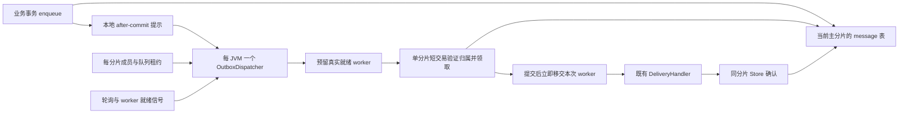
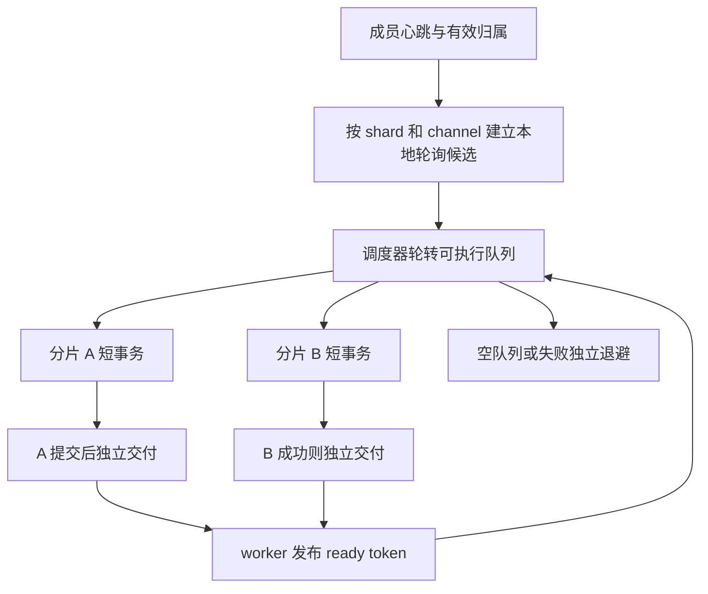
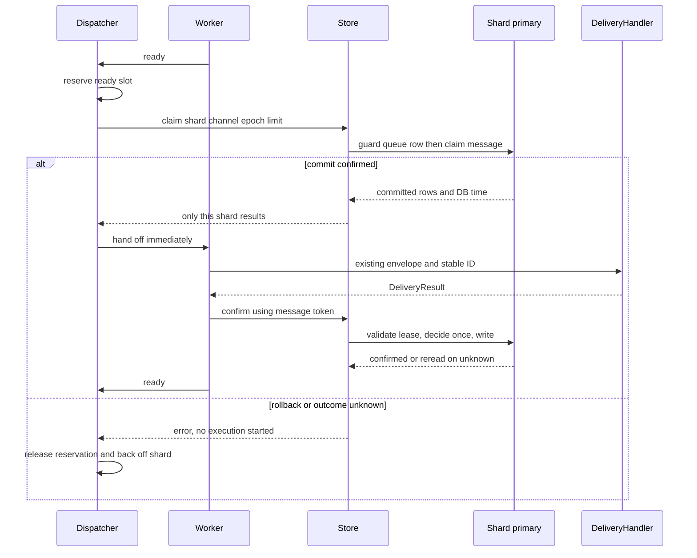
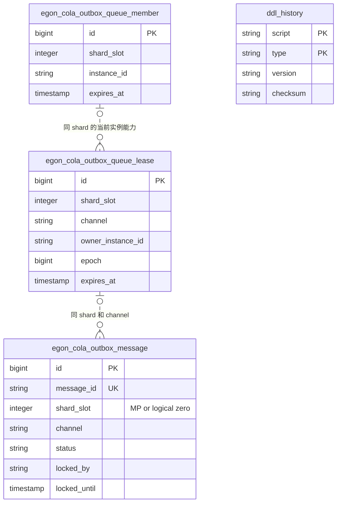

# Transactional Outbox 多实例队列协调与可靠分发规格

| Field | Value |
| --- | --- |
| Document | `2026-11-22-23-41-outbox-coordinated-dispatch.md` |
| Template Version | `9` |
| Archetype Cleanup | `Not applicable` |
| Status | `Review` |
| Type | `Architecture` |
| Complexity | `Complex` |
| Complexity Drivers | 多实例队列所有权、MP 单主分片事务、执行槽位与消息租约、提交结果未知、故障隔离、向后兼容及管理 DDL |
| Created | `2026-11-22 23:41 AST` |
| Updated | `2026-11-22 23:57 AST` |
| Owner | `mario` |
| Repository | `Stellar-Enclosure-Components` |
| Scope | `stellar-enclosure-component-transactional-outbox-starter` 的 Java 调度、队列协调、技术状态回写、JDBC/MP 持久化及其配置、文档和验证 |
| Change Surface | `dispatch`、`store`、`persistence`、`migration`、`autoconfigure`、受影响的技术状态守卫、两种存储的协调 DDL 和监控 |
| Affected Chapters | `§7, §8, §9, §10, §11, §13, §14, §15, §16, §17, §18` |
| Source Requirement | 用户确认按「分片 × channel」自动分工、已就绪 worker 驱动领取、双层租约、单分片提交后立即交付，并明确要求先写 Spec，排除 Rust/JNI，由运维处理 DEAD |
| Baseline Revision | `main` @ `d3f5f9cc989a01e054aed6b3982df9366f1b842a`，写作前工作树干净 |
| Amends | [双层 Spring Statemachine 与 CQE 设计](../../../../Stellar-Enclosure-Parent/docs/history/egon/spec/2026-09-24-12-00-outbox-statemachine-cqe-integration.md) §7.3.1、§9 INTERNAL-001、§11 的技术领取、ACK 有效期和结果决策边界 |
| Supersedes | `None` |
| Depends On | 同一[双层设计](../../../../Stellar-Enclosure-Parent/docs/history/egon/spec/2026-09-24-12-00-outbox-statemachine-cqe-integration.md) §7 技术与业务状态分权、§9 稳定消息与业务事件身份、§11 本地事务及 receipt 边界 |
| Related Specs | [2026-11-16 Outbox 韧性规格](./2026-11-16-08-11-outbox-in-service-distributed-resilience.md) §7.3、§9、§11（抖动、能力过滤、重领预算的实现背景） |
| Related Plans | [Transactional Outbox 多实例队列协调与可靠分发实施计划](../plan/2026-11-23-00-04-outbox-coordinated-dispatch-implementation.md) |

## 1. Summary

本规格将消费端调度分为两层。实例间用 PostgreSQL 主分片上的队列租约分配 `(shard_slot, channel)`，每队列同一时刻最多一个实例有新领取权。实例内由调度器先预留已就绪 worker，再按可以立即开始的容量领取，单分片提交后立即交付。消息自己的租约独立控制执行轮次和结果写回。

业务事务入队、现有消息身份和至少一次投递保持原有语义。方案同时处理重复扫库、领取后排队、跨分片提交结果丢失、旧 owner 恢复及结果写回不确定。SQL 加速按 JDBC 与 MP 分别验证。协调模式为显式启用项。

## 2. Background and Current State

### 2.1 Business and user context

同一个服务可跑多个 Outbox consumer。启用同一 channel 的实例会发现重叠候选。用户要求服务端自动分配各实例负责的任务类型，同时减少 PostgreSQL 扫描冲突，并解决消息进入执行中但 handler 未启动。初版任务分类采用组件已有 channel；队列所有权和消息执行权分别恢复。

### 2.2 Repository evidence

本文路径缩写均以组件仓根为基准。`O` = `stellar-enclosure-component-transactional-outbox-starter`，`J` = `O/src/main/java/top/egon/cola/component/outbox`，`S` = `O/src/main/resources`，`T` = `O/src/test/java/top/egon/cola/component/outbox`。新路径均为目标设计。

| Evidence ID | Classification | Exact path/symbol/decision/command | Observed fact | Design significance | Verification limit/freshness |
| --- | --- | --- | --- | --- | --- |
| EVD-001 | Static repository | `J/transaction/DefaultTransactionalOutbox.java#enqueue`、`OutboxAfterCommitBuffer#afterCommit` | 原连接内入队，提交后事件为本进程提示；生产端也查 handler 并校验 destination | 保留生产 API 和验证；唤醒不得作为可用性的前提 | 2026-11-22 源码，未连库 |
| EVD-002 | Static repository | `J/dispatch/OutboxDispatcher.java#initializeDeliveryPermits,runCoordinator,dispatch,submitDelivery`、`TransactionalOutboxAutoConfiguration#outboxDeliveryExecutor` | 槽位包含线程池队列；协调与投递共用执行器；尝试派发前清空唤醒；提交租约后再排任务 | 领取容量应由实际就绪 worker 决定 | 同上 |
| EVD-003 | Static repository | `J/store/MybatisPlusOutboxStore.java#claimDue,claimByMessageIds,claim`；`S/mapper/outbox/OutboxMessageMapper.xml#selectDueCandidatesByChannels,tryAcquireTransactionLock` | 多主分片分别提交后在外层汇总；读写分离下候选经副本，主库逐行加锁、更新、回读 | 分片提交与交付配对；主库固定访问路径 | 未验证热点规模 |
| EVD-004 | Static repository | `J/store/OutboxStatus.java`、`J/statemachine/OutboxLifecycleStateMachineFactory.java`、`J/dispatch/OutboxDispatcher.java#applyResult,deliver`、`J/store/JdbcOutboxStore.java#finish` | 五态以字符串入库。领取计次数；分发器先判结果，Store 再判；handler deadline 未受原租约约束；完成 SQL 要求未过期 | 结果决策集中，区分领取、开始和确认 | 未复现线上卡单 |
| EVD-005 | Static repository | `J/persistence/OutboxShardRouting.java`、`J/migration/OutboxShardSqlGuard.java`、`OutboxPrimaryReadPolicy.java`、`OutboxManagedDdlInitializer.java` | `SINGLE`/`TECHNICAL_GROUP`；逻辑路由约束阻止嵌套 SQL/跨组，主库 SELECT 为固定白名单；物理数据源访问限元数据 | 仅扩展固定技术访问路径，不能直接将 JDBC CTE 放进 MP 路径 | 实际路由应在 PG 集成验证 |
| EVD-006 | Static repository | `J/persistence/OutboxSchemaMetadataValidator.java#validateHistoryPrefix`（检查 `DDL_HISTORY_PREFIX_MISMATCH` 的分支）；`S/db/egon-outbox-mp/manifest.json` | 每个主库历史要求与制品清单精确相等，已有版本 `20260924_001`、`20261027_001` | 加法 DDL 也需要明确二进制回退边界 | 未执行 DDL |
| EVD-007 | Static repository | `J/dispatch/OutboxWorkerIdentity.java#canClaim`、`TransactionalOutboxAutoConfiguration#outboxWorkerIdentity`；`J/delivery/statemachine/BusinessStateMachineDeliveryHandler.java#validateDestination,deliver` | 管控的发号租约失效可使 worker 失去领取资格；业务状态机缺失定义在 dispatcher 的严格校验处先被永久失败拦截，绕过 delivery 内已有退避判断 | 领取权是额外守卫；将已定义的缺定义退避接回送达链路 | 仅组件源码 |
| EVD-008 | Static repository | `T/dispatch/OutboxDispatcherTest.java`、`T/integration/PostgresqlOutboxRecoveryIntegrationTest.java`、`T/integration/OutboxPostgresqlMultishardIntegrationTest.java`、双语 README 配置治理测试 | 已有旧 token、重领、丢唤醒、channel 和 MP 多分片验证基础；队列 epoch 尚不存在 | 扩展现有测试载体 | 本次未运行 |
| EVD-009 | User decision | 对话中用户接受「分片 × channel、两层租约、服务端分配」、明确运维修复死信、只写规格且不纳入 Rust/JNI | 规范范围明确；组件自身不需要新独立调度服务 | REQ-001 至 REQ-008 | Spec 本身等待审核 |

### 2.3 Problem statement and gap

同 channel 的副本可重复查到相同候选，MP 遇 `NOWAIT` 冲突还可能回滚重试。补扫标记可在无槽位时被消耗。跨分片调用遇后一个分片异常，会隐藏前一个分片已提交结果。`PROCESSING` 表示数据库已授予消息租约，既可能是未交付，也可能是 handler 已完成但 ACK 未落库。这些是源代码可证的路径；发生频率、主库可承受的扫描预算和实际吞吐仍待测。

### 2.4 Evidence and current-chain map

| Entry/trigger | Current call chain | Data read/written | External dependency | Consumers | Evidence |
| --- | --- | --- | --- | --- | --- |
| 命令成功 | `enqueue → Store → afterCommit → submitMessageIds` | 本地业务行与 PENDING；唤醒在进程内 | PostgreSQL 生产事务 | 本地消费者 | EVD-001 |
| 周期或事件唤醒 | `OutboxPoller/Listener → Dispatcher → Store claim` | 候选、租约、尝试次数 | MP 主从或单 JDBC | 当前有对应 handler 的多副本 | EVD-002/003 |
| 处理与确认 | `deliver → handler → applyResult → Store` | 外部调用、owner CAS、状态与时间 | HTTP/RabbitMQ/业务适配 | 现有接收端 | EVD-004/007 |
| 启动及 schema 校验 | `OutboxLogicalDataSourceFactory → OutboxManagedDdlInitializer → OutboxSchemaMetadataValidator` | 路由、历史和物理结构 | PG、Common MP | 所有使用该 schema 的制品 | EVD-005/006 |

### 2.5 Archetype example cleanup

Cleanup disposition: `Not applicable`

Reason: `O/pom.xml` 和注册文件 `S/META-INF/spring/org.springframework.boot.autoconfigure.AutoConfiguration.imports` 表明目标是已有基础设施 Starter。该改造没有创建或接手 Archetype 生成的业务项目。

## 3. Goals and Non-goals

### 3.1 Goals

让同一共享存储的消费者能够按队列分工、自动接管并可证地拒绝旧 owner。让每条已领消息直接交给已就绪的 worker，保障健康分片和慢通道隔离。保证结果写回可诊断、可恢复，在满足正确性的前提下量化 PostgreSQL 开销。

### 3.2 Non-goals

Rust、JNI、FFM、原生库与独立投递进程属于本次范围之外。保持生产调用、事件 envelope、业务 Spring Statemachine 适配和 HTTP/RabbitMQ 扩展接口。首版队列键仅为分片及 channel，destination、task_type、哈希桶按后续容量证据单独评审。保留现有运维修复死信边界，增加的协调模式不自动重驱 DEAD。本次交付限于组件能力；外部服务、外部 API、业务应用和管理工作台都在范围之外。

### 3.3 Change Surface and Design Depth

| Area/layer | Disposition | Exact repository evidence | Changed or preserved behavior/contract | Required Spec treatment | Chapter(s) |
| --- | --- | --- | --- | --- | --- |
| 调度、两层租约、配置 | Affected | EVD-002/007，`OutboxPoller`、`TransactionalOutboxProperties` | 工作槽位、选主、退避及停止边界 | 完整设计和异常验证 | §7, §8, §9, §10, §13, §14, §15, §16, §17, §18 |
| JDBC/MP Store、技术迁移与关系模型 | Affected | EVD-003/004/005/006 | 同分片领取、数据库守卫、结果决策、技术表与接入历史 | 完整契约、字段、锁、索引和回退 | §7, §8, §9, §10, §11, §13, §14, §15, §16, §17, §18 |
| 内置状态机交付校验 | Affected | EVD-007，`BusinessStateMachineDeliveryHandler#deliver` | 合法消息可进入现有缺定义分类，先校验 envelope 与租户 | 完整设计及正反向回归 | §7, §8, §14 |
| 生产、公开交付接口及业务状态机运行 | Context-only | EVD-001/007，`DeliveryHandler`、`DeliveryContext`、`BusinessStateMachineService` | envelope、公开 SPI、业务转换及 receipt 保持 | 记录相关契约及回归 | §7, §9, §14 |
| 外部 API／前端 | Not applicable | `O` 的 Starter 注册和 Java Library 发布契约 | 当前没有 UI 或本次外部操作 | N/A | §12 |

## 4. Requirements and Acceptance Criteria

| ID | Atomic requirement | Priority | Observable acceptance criteria | Source |
| --- | --- | --- | --- | --- |
| REQ-001 | 同一物理队列自动分配唯一领取实例 | Must | 同一时间每个 `shard_slot + channel` 最多一个新领取权；无能力实例不获权；过期后旧 epoch 不能再领 | EVD-009 |
| REQ-002 | 发消息租约前预留实际就绪 worker，保留数据库轮询兜底 | Must | 四个 worker 忙时第五条等待；丢唤醒后仍领取，slot 空出触发补扫 | EVD-002/009 |
| REQ-003 | 领取、结果写回和队列仲裁均单分片；健康分片独立交付 | Must | A 已提交并交付，B 的访问故障不撤销 A；实际 SQL 无广播和无跨组写 | EVD-003/005/009 |
| REQ-004 | 以互不替代的两层租约保证接管与写回 | Must | 过期或换主的队列 token 不能新领；仍有效的原消息 token 可回写；消息过期后旧 token 写回 0 行 | EVD-004/009 |
| REQ-005 | 持久化边界决定唯一技术终结结果及重试预算 | Must | 重试上限无绕过，结果不确定时写回重读或等租约、原消息 ID 重发；DEAD 交运维 | EVD-004/009 |
| REQ-006 | 兼容现有入队、消息身份、投递和业务状态机 | Must | 旧消息无迁移或重发号，现有公开契约回归；缺失定义按现有开关可进入正确分类；任一 shard route 未校验时不启用协调 | EVD-001/005/007/009 |
| REQ-007 | 单独验证和回退协调与 SQL 优化，能观测性能与断点 | Must | 基线、容量 1、容量多条可比较；旧消费者退出后换模式；物理执行证据和指标可区分领取、处理、确认 | EVD-002/003/006/009 |
| REQ-008 | 限定本次运行时与责任范围 | Must | Java Starter 无新外部协调依赖；无原生调用；无业务调度服务、应用 API 或自助死信重驱 | EVD-009 |

### 4.1 Scenario matrix

| Scenario | Actor/trigger | Preconditions | Main path | Alternative/failure path | Data/state change | Observable result | Requirements |
| --- | --- | --- | --- | --- | --- | --- | --- |
| SC-001 | 多实例上线 | 同 shard/channel、合格 | 取得一个队列租约 | 同时竞选仅一个事务成功；空闲实例保留候选资格 | owner/epoch | 只有 owner 进入候选扫描 | REQ-001 |
| SC-002 | 入队提交且通知丢失 | 消费者健康、存在到期消息 | 周期扫描补领取 | 无就绪 worker 则等待槽位 | PENDING 到 PROCESSING | 无无主内存待办 | REQ-002 |
| SC-003 | 两分片部分故障 | A 可用，B 抛异常 | 完成 A 提交与移交 | B 退避并恢复；A 不受影响 | 分片局部事务 | 两组独立进度 | REQ-003 |
| SC-004 | owner 暂停/宕机/恢复 | 已有已领消息 | lease 到期后换主 | 原 pod 恢复以旧 epoch 领取被拒，原有效消息 token 可回写 | 队列 epoch 和消息 token 分别演进 | 无跨层超前回收 | REQ-004 |
| SC-005 | 领取结果未知或处理成功后宕机 | 批量事务或下游可能已提交 | 原 messageId 等原租约后交接 | 有效期内只补写回；接收端按稳定身份去重 | 有界重领或终止 | 可重发，单业务效果由 receipt 保证 | REQ-004, REQ-005 |
| SC-006 | 切换版本或模式 | 共享 schema 各实例可辨 | 旧领取入口停后启协调 | DDL 未对齐保持停领取；同版本回退 | 保留消息和历史 | 不混用越权旧 worker | REQ-006, REQ-007 |

### 4.2 Use-case analysis

#### 4.2.1 Actor inventory

| Actor ID | Actor/role | Goal and responsibility | Entry/channel | Permission/tenant context | Evidence |
| --- | --- | --- | --- | --- | --- |
| ACTOR-001 | 宿主命令生产者 | 原子提交事实 | `TransactionalOutbox.enqueue` | 继承宿主授权与本地事务 | EVD-001 |
| ACTOR-002 | 消费实例 | 接收可执行的有期限工作 | 调度/Store | 实例能力、技术 tenant 0、固定分片 | EVD-002/003 |
| ACTOR-003 | 下游接收方 | 幂等应用事实 | 既有 DeliveryHandler | 现有业务身份及 receipt | EVD-004 |
| ACTOR-004 | 运维 | 接管、灰度和定位积压 | 配置与可观测性 | 宿主运维访问边界 | EVD-006/009 |

#### 4.2.2 Use-case artifact

| ID | Use case/goal | Primary actor | Supporting actors/systems | Trigger | Preconditions | Main success outcome | Alternatives/failures | Postconditions | Requirements | Interfaces/pages | Tests |
| --- | --- | --- | --- | --- | --- | --- | --- | --- | --- | --- | --- |
| UC-001 | 可靠入队并获得投递 | ACTOR-001 | ACTOR-002 | 业务事务提交 | 合法消息和本地事务 | 已就绪 worker 执行到期消息 | 丢唤醒补扫；回滚无消息 | 原 messageId 不变 | REQ-002, REQ-005, REQ-006 | INTERNAL-002, INTERNAL-003, JOB-001 | TEST-001, TEST-004 |
| UC-002 | 分工与故障接管 | ACTOR-002 | ACTOR-004 | 加入、宕机、退避 | 合法能力与分片 | 唯一队列 owner 分发 | 旧 owner 失效；健康分片独立 | 可重复接管无跨组事务 | REQ-001, REQ-003, REQ-004 | INTERNAL-001, INTERNAL-002 | TEST-002, TEST-003, TEST-005 |
| UC-003 | 在重发时保持业务效果 | ACTOR-003 | ACTOR-002 | handler 调用与 ACK | 下游实现稳定身份去重 | 成功确认 | ACK 前宕机后重发、旧 token 拒绝 | 下游最多一次业务效果取决于 receipt | REQ-004, REQ-005, REQ-006 | INTERNAL-003 | TEST-004, TEST-006 |
| UC-004 | 灰度、降压和恢复 | ACTOR-004 | ACTOR-002 | 配置切换或故障 | DDL 校验、排空领取 | 观测分工与成本，可切回同版本本地模式 | 历史不匹配停切换 | 保留消息，运维处置 DEAD | REQ-007, REQ-008 | JOB-001 | TEST-007, TEST-008 |

## 5. Constraints, Assumptions, and Decisions

### 5.1 Confirmed constraints

队列变更以目标主分片为边界。消息技术租约越过截止点后，旧 owner 禁止写回，即使尚无人重新领取。保留 Java Starter 的组装方式、五态 DB 编码和 Spring Statemachine 技术决策职责。下游交付与消息状态写回分属两个提交边界。

### 5.2 Small-gap assumptions

| ID | Inference | Repository evidence | Why locally reversible | Impact if wrong |
| --- | --- | --- | --- | --- |
| ASM-001 | 协调初期 batch 取 1，之后用 1/2/4 在预发测 | 执行槽位和 `polling.batch-size` 已可控制 | 运行参数，可在同一契约内切换 | 仅影响延迟与吞吐 |
| ASM-002 | 默认同一 channel 在启用协调的副本间使用兼容 destination 集 | 当前 registry 粒度为 channel | 通过发布门禁及真实 handler 分类维持；更细队列键需后续设计 | 同 channel 的异构版本可能退避，故逐 channel 检查发布 |
| ASM-003 | 先试 5s 心跳、20s 归属租约、2s 短事务预算 | DB 租约与 worker 事务已有基础 | 不改变消息协议，参数须通过 §15 压测 | 切换速度/心跳成本，不能推断生产 SLO |

### 5.3 Resolved decisions

| ID | Decision | Decision owner | Evidence and rationale | Requirements |
| --- | --- | --- | --- | --- |
| DEC-001 | 首版分片 × channel；主分片租约表与消息租约独立 | mario | 已确认方案；保持 MP 路由与故障隔离 | REQ-001, REQ-003, REQ-004 |
| DEC-002 | 实例内先预留就绪槽位，提交后直接移交；轮询兜底 | mario | 已确认方案；针对 EVD-002/003 | REQ-002, REQ-003 |
| DEC-003 | 组件维持 Java 和既有协议；DEAD 运维，本模式禁自动重驱 | mario | 对话约束及既有传输 | REQ-005, REQ-006, REQ-008 |
| DEC-004 | 先验单条稳定性；JDBC 批量 SQL，MP 先有固定 SQL 安全基线，独立验证主库批量实现 | mario，细节见 ASM-001 | 已确认压测和可回退原则；EVD-005 | REQ-003, REQ-007 |

### 5.4 Open major decisions

无阻塞性需求决策。分片数、流量阈值和 MP 合并 SQL 的实际收益属于上线证据门槛。安全基线不依赖尚未验证的可选快速路径。

## 6. Project Technology Context

| Concern | Current choice | Repository evidence | Constraint on design |
| --- | --- | --- | --- |
| Java / Spring | Java 25、Spring Boot 4.1.x、Spring JDBC/Tx 和 Jakarta Validation | 仓根 `pom.xml`、`O/pom.xml`、两种 Store AutoConfiguration | 保留组件既有 Java 平台与 `REQUIRES_NEW` worker 事务；不新增执行框架 |
| 路由与 schema | MP 3.5.17、ShardingSphere-JDBC 5.5.3、Egon Common MP / DDL 扩展；另有单库 JDBC | 仓根 `pom.xml`、`OutboxLogicalDataSourceFactory`、`OutboxManagedDdlInitializer` | MP 保持受管逻辑路径；JDBC 沿用外部执行建表、启动查验 |
| 技术状态 | Spring Statemachine Core 4.0.2、`OutboxLifecycleService` | BOM、`J/statemachine` | 技术状态转换统一经现有状态机；可并行运行 handler，不跨消息共享状态机实例 |
| 注入、序列化、监控 | 有限定名的 Bean、Jackson、可选 Micrometer | `lombok.config`、`TransactionalOutboxAutoConfiguration`、`JacksonOutboxMessageSerializer`、`OutboxMetricsAutoConfiguration` | 复用现有绑定、序列化与无指标实现 |
| 验证 | Surefire 单测，Failsafe PG Testcontainers | `O/pom.xml`、`T/integration` | 区分静态路由、真实 PostgreSQL 路由及压测 |

### 6.1 Java architecture profile and capability baseline

| Architecture profile | Archetype/template or base package | Exact evidence and verifier | Existing deviations | Design action |
| --- | --- | --- | --- | --- |
| 现有 Egon-COLA 基础设施 Starter，保留现有分包 | `top.egon.cola.component.outbox` | `egon-cola-components-architecture.md`、`O/pom.xml`、`ComponentContractGovernanceTest` | 无生成的业务应用边界；Store 兼容两种存储 | 生产 API/交付 SPI、组件运行时、持久化分别留在既有包；不新建业务三层或 Archetype 项目 |

| Need | Spring/JDK candidate | Spring Boot Starter candidate | Egon-COLA/module candidate | Proven gap | Decision/dependency impact |
| --- | --- | --- | --- | --- | --- |
| 轮询、控制与并发 | `TaskScheduler`、有界 executor、JDK 阻塞队列／信号量 | 已有 Spring 调度、生命周期 | `OutboxPoller`、`OutboxDispatcher`、worker executor | 当前协调调用也占交付线程，线程队列算作可领取 | 重用 Poller/DI，控制和执行隔离，实际就绪槽位驱动 |
| 能力、owner 与路由 | JDK `MessageDigest` SHA-256、UUID、集合 | Spring 生命周期 | `DeliveryHandlerRegistry#channels`、`OutboxWorkerIdentity`、`OutboxShardRouting` | 现有资格不表示跨副本队列所有权 | 主分片记录成员、归属与 epoch；复用已有发号守卫 |
| 技术判定与事务 | `TransactionTemplate`、JDBC | MP、Spring Tx | 生命周期服务、现有两种 Store、MP PrimaryReadPolicy、Schema Validator | 缺少单分片领取契约、双租约和统一写结果入口 | 扩展已有 Store 和声明式规则，零新增 Maven 依赖 |
| 配置、转换与指标 | Jakarta、`java.time` | Properties、Jackson、Micrometer | `OutboxConfigurationValidator`、Common Core converter、`OutboxMetrics` | 新状态需要可验证模型和独立确认指标 | 复用框架与治理测试，详见 §10、§15 |

### 6.2 User-mandated Java rule compliance

```text
1 类名规范，必须以 java的pojo规范命名。以dao po bo vo dto query command event等结尾
2 每层之间必须被 springboot-validation 校验，复用对象使用分组校验；基于原生和自定义约束注解、@Valid、@Validated 及 ConstraintValidator 扩展实现。ValidationUtils 只承担通用手工校验，不承载全部业务校验；电话号码复用 libphonenumber。
3 Java POJO 默认使用 class，注解为 @Data @NoArgsConstructor @AllArgsConstructor @Accessors(chain = true)，按构造目标选择 @Builder 或 @SuperBuilder；父类状态参与相等性时使用 @EqualsAndHashCode(callSuper = true)。只有不可变 value object 可以使用 record，并豁免 class 的 Lombok 规范；普通实体不能因简单而使用 record。使用 MapStruct、MapStructPlus 和 egon-cola-component-common-core 的 BaseConverter（双向）或 BaseForwardConverter（不可逆投影）进行转换。
4业务类必须使用@Slf4j注解注入log对象。如果业务类被spring管理，必须指定名称，如果是单例的情况下，参考@Service("userService")。如果需要依赖注入，必须@RequiredArgsConstructor进行修饰，不要代码中写。且属性必须被@qualify修饰。
5 工具类只允许使用jdk原生、Apache Commons(commons-lang3、commons-collections4、commons-io、commons-text、commons-codec、commons-beanutils)、Guava。针对Tika按需引入。
6 JSON 使用 Spring Boot Jackson；持久化枚举值使用 @EnumValue，向前端输出的枚举值使用 @JsonValue，禁止 ordinal 作为业务编码。
7 springboot 多环境配置文件，必须保持配置一致，但值不一定一致。
9 复杂业务必须引入设计模式，不允许硬编码
10 日期相关的必须使用java.time下的实体类，不允许使用java.util下的
11 只允许现有三层结构或当前 egon-cola-archetypes 的 DDD 结构，三层结构保持现状。必须尽量复用 egon-cola-components；持久化模块必须使用 Egon COLA MP Starter，DDL 统一由 egon-mp-sdj-ext-starter 分布式管理。业务唯一键必须组合业务列与 deletedAt（数据库 deleted_at），并验证 NULL、租户及重复软删除语义。采用 CQE（Command Query Event）；Event 必须经 egon-cola-component-transactional-outbox-starter 或 MQ 中间件投递。
```

| Literal rule | Affected? | Repository evidence | Exact design decision | Files/types/interfaces | Validation/test evidence | Status/blocker |
| --- | --- | --- | --- | --- | --- | --- |
| Rule 1 | Yes | `J/store` 与 `J/persistence` | 数据载体用 PO、BO、Command 等既有命名；资格和 token 为不可变值对象 | §8、§10 | §20.5 MC-NAME-001 | PASS |
| Rule 2 | Yes | `OutboxConfigurationValidator`、现有 Store 的 Jakarta 注解 | 配置及跨层 command 用 `@Valid`/`@Validated`；COORDINATED 专有约束分组及类级校验；路由与数据库守卫另行独立校验 | §9、§10、§16 | TEST-002/003/007 | PASS |
| Rule 3 | Yes | `OutboxMessagePO`、`OutboxMessageConverter` | PO、Properties、BO 用现有 Lombok class 约定；只为不可变值对象用 record；PO 转换使用已有 MapStruct/MapStructPlus 与 Common Core converter 模式 | §8、§10 | TEST-002/007 映射与 round trip | PASS |
| Rule 4 | Yes | `lombok.config`、`TransactionalOutboxAutoConfiguration` | 行为 Bean 用 `@Slf4j`、有明确 Bean 名；依赖注入使用 `@RequiredArgsConstructor` 和适用的 `@Qualifier`，保留原构造器兼容边界 | §8、§15 | TEST-007 应用上下文 | PASS |
| Rule 5 | Yes | `OutboxWorkerIdentity`、`OutboxPoller` | 新计算只用 JDK 标准库；序列化和映射沿用既有组件依赖 | §7.3、§10 | TEST-002 | PASS |
| Rule 6 | Yes | `OutboxStatus#message`、Jackson serializer | capability 文本由 Boot Jackson 编解码；业务及技术消息编码持久化值维持 `@EnumValue` 字符串；无前端枚举 | §7.3、§10 | TEST-002/006 | PASS |
| Rule 7 | Yes | `TransactionalOutboxProperties`、双语 README | 一份强类型配置契约和默认值，验证配置键同步；本组件无新增应用环境文件 | §16 | TEST-007 | PASS |
| Rule 9 | Yes | `OutboxLifecycleStateMachineFactory`、`DeliveryHandlerRegistry` | 状态机守卫与 handler registry 保持一致；JDBC/MP Store 吸收各自 SQL 能力差异 | §7、§13 | TEST-005/006 | PASS |
| Rule 10 | Yes | `JdbcOutboxStore`、Clock 注入点 | 绝对值 `Instant`，相对延时 `Duration`，DB 履约时钟和本地耗时用途分开 | §6.3 | TEST-004/005 | PASS |
| Rule 11 | Yes | `OutboxManagedDdlInitializer`、原事务型 Outbox 和 receipt | 保留现有分包、CQE 事务入队、MP 工具链、业务唯一键及软删除语义；新协调键为不做软删除的技术键 | §7、§11、§16 | TEST-001/003/007 | PASS |

### 6.3 Time semantics and conversion contract

Time contract: `Required`

| Time ID | Fields/symbols | Semantics | Java/runtime type | Storage policy | Wire policy | Business zone source | Display zone source | Boundary / DST rules | Precision / Clock | Compatibility | Verification |
| --- | --- | --- | --- | --- | --- | --- | --- | --- | --- | --- | --- |
| TIME-001 | `last_seen_at`、两表 `expires_at`、`locked_until`、`next_attempt_at`、技术审计时间 | Occurred instant | `Instant`；驱动边界使用 `OffsetDateTime`（UTC offset） | UTC instant | Internal | Not applicable: 技术绝对时间 | Not applicable: 无 UI | `expires_at <= db_now` 到期，`next_attempt_at <= db_now` 可领；无 DST 分支 | PG `timestamptz(6)`；同一目标主库 `clock_timestamp()`；成功 lease 以 DB 回传为准 | 两种 Store 新模式用 DB 时间，既有消息时戳不重写 | TEST-003、TEST-004、TEST-005 |
| TIME-002 | 心跳、dispatcher 轮询退避、claim/handler/ACK budget | Duration | `Duration`；运行耗时 `System.nanoTime()`，测试注入计时器 | Not persisted | Internal | Not applicable: 相对延时 | Not applicable: 无 UI | 预算到零停止新操作；用调用前起点保守扣减领取提交与移交耗时 | 绑定毫秒级；本地单调钟计差 | 原投递 timeout 继续作为上界 | TEST-001、TEST-004、TEST-008 |

MP 新表的 `deleted_at` 复用 Common 技术列，数据库约束固定为 NULL，无本地日期时间转换。

## 7. Architecture Design

### 7.0 Minimum-design baseline and element-necessity audit

最小实现是每实例就绪 worker 单行直领、保持现有到期重领。不加协调时，多实例仍会重复扫描，热点 channel 的竞争留在消息表。加协调后，先以单行证明完整状态及故障行为，再启用容量受限的批量 SQL。

| Proposed element | Change | Requirements | Existing/direct alternative | Concrete inadequacy of alternative | Added calls/state/coupling/failures/migration/operations | Verdict |
| --- | --- | --- | --- | --- | --- | --- |
| 同 shard 成员记录和 Coordinator | New | REQ-001 | 本地 handler registry 和发号资格 | 其他副本不可见 | 每实例每 shard 每心跳一次成员 upsert，各 channel 共用 | Add |
| 队列 lease/epoch | New | REQ-001/004 | 仅靠心跳或本地哈希 | 旧 owner 可与新 owner 同时扫描 | 每队列一行，固定事务读锁，owner 心跳续期 | Add |
| 就绪 worker 与单分片 claim | Expand | REQ-002/003 | 现有 Dispatcher、WorkerIdentity、Store | 线程池队列和跨 shard 汇总会隐藏实际可用槽位及已提交行 | 一个本地调度器；短事务有界，确认后立即移交 | Merge |
| Store 原子 finish | Expand | REQ-004/005 | Dispatcher 和 Store 两次判定 | 快照与权威行可能分歧 | 正常每条一次 ACK；异常时单分片重读 | Merge |
| 固定 SQL 加速 | Expand | REQ-007 | 受控单条 | 高流量下逐条开销可能突出 | JDBC 受限小批；MP 单分片门槛独立 | Add |
| 发布门禁和阶段诊断 | Expand | REQ-006/007 | 原轮询开关与成功指标 | afterCommit 可绕过轮询开关，handler success 未必等于 ACK | 新总开关和有界指标；无新外部接口 | Merge |

| Path | Network calls | Client states | Server contracts/state | Failure and TOCTOU points | Additional user/business value |
| --- | --- | --- | --- | --- | --- |
| 就绪 worker 单行直领 | 每执行一条有 1 次 claim 事务＋1 次确认；各实例空轮仍各查 | ready/handler/ACK | 行锁与消息租约 | 跨实例重复候选、争锁 | 作为最低正确性和降级基线 |
| 所有权和同分片分发 | 每 shard 每轮心跳一次短事务；稳定期只有 owner 查 due；JDBC 实际凑到 B 条时 1 次 claim＋B 次 ACK | 增加已验证 owner 与已预约代次 | 技术两表、单分片 claim/finish | 失权、提交未知；DB 守卫与旧 token 处理 | 自动分工、领取压力可量化、故障不跨 shard 吞任务 |

### 7.1 System Architecture Design



本消息所属主分片同时提供消息表、队列归属、成员视图，没有跨主分片投票。每个可独立消费的分片能力域以物理 message 表和确定性 slot 映射界定。共享物理表的实例必须使用同一 slot 编码和 channel 名。生产端保留当前同业务事务入队；无 broker 或网关参与分配。

### 7.2 High-Level Design

#### 7.2.1 Component view



一个本地 Dispatcher 拥有就绪列表和调度决定。调度、心跳和数据库短调用不占用 delivery worker。每分片最多一个正在进行的本地 claim，多个分片可用有界并发各自领取，单队列每轮最多占一次小批。任何一次 claim 必须先拿到指定 worker 的具体预约。分片先完成先交付，聚合结果只用于指标。

#### 7.2.2 High-level decision and quality matrix

| Concern/use case | Decision | Quality trade-off / guard | Evidence and closure |
| --- | --- | --- | --- |
| 同类任务分工 | channel 能力过滤，按分片队列 rendezvous 排序，主库租约确认 | 分布粗粒度；无能力实例跳过；一个热点队列的上限为一个实例 | EVD-003/007，TEST-002/008 |
| 分片隔离 | 每个队列落等路由主分片，claim 独立提交与移交 | 独立超时；并发小上限，单分片故障无其他事务锁 | EVD-003/005，TEST-003 |
| 正确性及延迟 | 预留即执行；双租约和 DB 时钟；到期重领 | 仍可能重复，要求原消息 ID 幂等；在有可重分配容量时让其他队列也取得轮次；已运行的任务不抢占 | EVD-002/004，TEST-001/004/005 |
| DB 成本 | 轮询按授权队列退避，小批；低 traffic 场景量化心跳增量 | 额外元数据更新，压测 WAL、空查和 autovacuum | EVD-003，TEST-008 |

### 7.3 Detailed Design

#### 7.3.1 队列自动归属

1. 每个进程启动生成一次 `instance_id`（受既有发号资格约束，采用 fenced node 标识加启动 UUID；此值仅为进程身份而非数据库主键）。仅 consumer 启用、非 drain、具备有效身份及 channel 的实例写本分片成员快照。一次心跳 upsert 完整 channel 集和 DB 到期时间。无支持能力时不竞选；能力撤回停止本地新领取，能连库时从成员集移除并释放对应归属。
2. 每个 shard 刷新一次有界的活成员视图，按 channel 过滤。用 JDK SHA-256 对规范化 `(shard_slot, channel, instance_id)` 做确定性 rendezvous 排序，平分按完整 ID。仅首选成员尝试对空位或已过期行执行原子插入／夺权；不同视图或并发插入以唯一键和当前行守卫仲裁。排名只决定候选，冷启动、视图短暂分歧均以 DB 最终结果为准。超过已验证成员规模时拒绝该视图对应的新分配并告警，不对截断样本竞选。
3. 当前有效 owner 即使排名变化也保持领取权，待新首选在至少两个连续成功心跳视图稳定出现后，旧 owner 停止新领、等待本 shard 进行中的 claim 返回、通过现有 epoch CAS 主动释放。已有 handler 可继续至自己的消息截止点。自然到期复用同一接管入口。续约验证 owner、epoch 和未过期，成功不推进 epoch；新轮取得含同一 incarnation 重新取得必须递增。归属行持久存留，优雅释放把 expires_at 设为 DB 当前时间，保留 epoch。唤醒和候选高速缓存都不授予领取权。
4. 在单分片 claim 事务开头锁定队列归属行（`FOR SHARE` 或经真实 PG 验证具有相同互斥语义的 guard），检查 owner、epoch 和有效期。租约转移和释放需对同一行 UPDATE，必与 claim 锁顺序串行；领取落库前再次验证剩余 DB 有效期，超时则回滚。claim 短事务期间不请求网络、不获取其他分片。归属状态未知时待本 shard 主库重读后再领取。接管无需重置尚未到期的消息 lease。用 `READ_COMMITTED`，取得行锁后按主库新采样确认队列时间；领取权锁持续至事务结束。具体锁冲突以 PostgreSQL 行锁语义及真实 MP 路由验证为准。[PostgreSQL 16 行锁](https://www.postgresql.org/docs/16/explicit-locking.html#LOCKING-ROWS)
5. 心跳调度与 claim 分开，失败使用每分片抖动和限时重试。当本地身份失去资格或无法证实可领取，关闭该实例或该 shard 的新领，原合法消息 token 仍可 ACK。关停先停新领和唤醒，再等待有界 claim 与 handler，释放本实例队列归属；强制退出则等待两层到期。成员表过期记录由该 shard 视图中首位活跃实例低频小批物理删除，删除谓词在同事务再验证过期和保留期限。

#### 7.3.2 就绪槽位、批量与公平

worker 进入可接收状态发布唯一 ready token，Dispatcher 预留后每槽位一次交接，直到该条 handler 与 ACK/限时确认完成或 reservation 归还，才产生下一次 token。状态流为 `READY → RESERVED → ASSIGNED → RUNNING → READY`（关停可停止）；一代 token 只能分给一条消息。每轮 `limit = min(已预留槽位数, polling.batch-size, 当前队列批量上限)`。提交回调把已确认行直接放进其预约 worker 邮箱（一槽一条）；落空、回滚、unknown 或未用槽位全部回收，unknown 对应行留 DB 租约期恢复。入池被拒绝或 slot 已退场时记录时间与原因，并留租约处理，避免猜测 handler 是否开始。

轮询轮转健康且本实例可服务的队列，比较队列级到期时间与退避。队列多于空槽时每轮单队列最多小批，已有多个就绪队列时优先让每个可运行队列各得一个槽位，再给仍积压的队列；一个热队列可利用空闲容量。正常待分发与过期 PROCESSING 按有界加权轮转（两边持续有量时，初始每四个 slot 机会至少一个给过期恢复；一侧为空归还另一侧）。优先在分片活跃 claim 上限内选择独立队列，B 等锁不持全局锁。无队列、无槽或空查均不会吞掉待处理代数：合并提示使用 dirty/generation，工作完成重新触发，低频带抖动轮询为最终兜底。afterCommit 仅合并本地唤醒；无授权副本经过 DB 轮询由 owner 发现。新模式不通过历史 by-id 多分片路径直接发租约。消息按到期时间与 id 选候选；调度公平以轮次为边界。不承诺并发 handler 的完成顺序。

#### 7.3.3 技术状态与到期恢复

`OutboxStatus` 是落库结果，`OutboxLifecycleSignalEnum` 是传给技术状态机的动作。组件实际 Java code 为 0 PENDING、1 PROCESSING、2 RETRY_WAIT、3 SUCCEEDED、4 DEAD；数据库写对应字符串。信号 `RECLAIM(2)` 与 `RETRY_WAIT(2)` 是不同字段的编码。用户说的「待分发」覆盖到期的 PENDING 和 RETRY_WAIT；「执行中」在库中是 PROCESSING，实际可能仅已领取。handler 已开始用运行指标区分。

| State and event | Guard and state transition | Atomic write and recovery |
| --- | --- | --- |
| ENQUEUE | 原生产事务 → PENDING | 保持原 id、去重、flush 与业务事务；不接触租约表 |
| PENDING / RETRY_WAIT + CLAIM | 到期、未删除、有预算 → PROCESSING | 保存新 per-attempt token 和截止点，attempt_count +1；事务提交后才交付 |
| PROCESSING + RECLAIM | 原消息已过期且仍有预算 → PROCESSING | 按同一 id 新 token 和新截止点、attempt_count +1，按至少一次语义重新执行 |
| PROCESSING + RECLAIM exhausted | 已过期且预算耗尽 → DEAD | 清空锁，持久化耗尽诊断和完成时间，不返回给 worker |
| PENDING / RETRY_WAIT + CLAIM exhausted | 到期的历史异常数据、预算已耗尽 → DEAD | 在同一状态机补足规则；不产生 token、尝试次数或 handler 调用；单轮终结数量独立受扫描上限约束 |
| PROCESSING + DELIVERY_SUCCEEDED | 当前 token 且未过期 → SUCCEEDED | 清空 lease、记录完成；仅 DB 已证实提交后计 confirmed |
| PROCESSING + DELIVERY_RETRYABLE | 当前 token 未过期且仍有预算 → RETRY_WAIT；耗尽 → DEAD | Store 以行内预算决策，既有退避策略生成 delay；重试时间由 DB 计算，清空 lease |
| PROCESSING + DELIVERY_PERMANENT | 当前 token 未过期 → DEAD | 保留既有脱敏诊断；清空 lease，运维处理 |
| SCHEDULE_RETRY / REDRIVE_EXHAUSTED | 保留现有信号码和兼容入口；安全模式的重试入口按带预算的技术结果处理；协调关闭自动重驱 | 既有显式运维路径归主分片、履行审计；分发器没有 DEAD 扫描 |

写回锁定当前行，`shard_slot、id、status、locked_by、locked_until` 仍在 UPDATE 谓词中，MP 同时保留 `version` CAS。实现用同一技术状态机判断实际权威行，dispatcher 不按领取快照再次推演。缺失 lease 或路由不合法的历史 PROCESSING 单列异常清单，由已有对账/运维流程按证据处理，禁止批量重置。启用前统计并处置，新增事务总成对写入 lease。handler 运行预算是 delivery timeout 和消息剩余租约扣除 ACK reserve 的较小值；领取至移交用单调耗时扣减。耗尽不开始 handler，留租约接管。普通 handler 不续租，取消只对本地等待生效。下游要以既有 messageId／业务事件身份在同一事务写 receipt 和副作用，外部 HTTP、MQ 仍依赖对端履行已有去重契约。

#### 7.3.4 单分片 SQL 与提交语义



JDBC 快速路径在一次事务先以固定 SQL `LIMIT … FOR UPDATE SKIP LOCKED` 锁定该 channel 的候选（等待分发和过期使用各自索引），既有状态机对锁定行判定；随后一个带有界 typed values 的批量更新 `UPDATE … RETURNING` 或按技术目标至多分为两组，所有写再按分支复核原 status、必要的 token、时间及预算。领取 token 在各行更新中同批生成，只有与该行的 ID、路由和尝试轮次组合才形成完成凭证。批量是减少交互，不把状态转换固化为另一套 SQL 规则。单库 JDBC 对分片槽位只接受 0，沿用原表无 shard_slot 列的兼容方式。候选扫描以 SQL 中采样的主库时间为阈值，权威更新时重新校验 PG 时间与行锁状态；按真实 EXPLAIN 对比将 DB 取样作为已绑定阈值的可索引性。 [PostgreSQL 16 SELECT](https://www.postgresql.org/docs/16/sql-select.html) [PostgreSQL 16 时间函数](https://www.postgresql.org/docs/16/functions-datetime.html#FUNCTIONS-DATETIME-CURRENT)

MP 安全基线使用既有逻辑 datasource、单 shard 上下文和主库固定读白名单。候选只选该队列，按上限取；在同事务按当前逐行 advisory/NOWAIT、主库资格确认和 ID/version CAS 的安全形态。行锁冲突若会使 PG 事务 abort，回滚本 shard 整个 claim，按队列抖动；不捕获异常后继续使用失败事务。消息读写和新增技术表的 SQL 路由均有强制精确 slot。禁止为通用 CTE、嵌套、多表 SQL 放宽现有默认校验；未来快速 MP SQL 只在 exact allowlist、只路由同主以及压测均过关后启用，安全路径单条起步。首次发布无需 MP 快速 SQL。

#### 7.3.5 结果不确定与内置 handler

claim 提交正常返回才交付，即使之后 B 分片失败。连接断开导致提交结果未知时，既不提前启动也不主动解锁；确认后执行尚有可用预算的做法可另审。ACK 执行结果未知时从原主分片读取技术状态，已确认目标且原尝试证据充分时标 confirmed，终态无法归因原 token 时记录终态已存在，已换 owner 或到期记 lease lost。原 token 尚有效时允许对同一个 DeliveryResult 做有界幂等确认重试；禁止单凭 ACK 异常重新调用 handler。进程杀死、暂停或分区可能让外部调用成功但没有技术 ACK，恢复使用同一消息 ID 及新的 attempt token。队列失权与消息失权分别判定。

保留现有内置 business-state-machine producer 的严格 `validateDestination`，以及自定义 handler 当前校验顺序。Dispatcher 通过 Spring `AopUtils.getTargetClass` 精确识别工厂注册的内置 `BusinessStateMachineDeliveryHandler`（含 Spring 代理）；该实例从现有 `deliver` 入口执行。将现有元数据 header 和租户一致性校验前移至定义查找前；只有已通过 envelope、schema、header 和租户校验的消息按 `state-machine.business.retry-on-missing-definition` 分类。保留自定义实现原校验行为。发布前校验同 channel 内兼容的状态机定义与版本，避免交给能力粗粒度匹配而实际不可执行的实例。已完成的业务 receipt 不因技术状态回写失败重复提交业务动作。

#### 7.3.6 Conclusion evidence chain

| Conclusion | Existing evidence | Mechanism / design decision | Counterexample or verification |
| --- | --- | --- | --- |
| 自动分工可消除同队列稳定期的副本级重复扫库 | EVD-003/005/007 | 先通过同分片队列 lease，非 owner 无权读 due 候选 | TEST-002 量化 1/3/6 副本扫描和成员更新 |
| 领取后的宕机有确定恢复窗口 | EVD-002/004 | 真槽位、提交后交接、消息过期独立恢复 | TEST-004 在四个故障点注入，核实每次开始、尝试和 ACK |
| 分片故障不会吞掉已经提交的批次 | EVD-003 | 单分片事务一返回立即移交；不返回跨分片合并结果 | TEST-003 在 A 提交后阻断 B |
| Gating SQL 可以保留现有合规和兼容性 | EVD-005/006/008 | 固定 SQL、主库证据、显式切模式和同版本回退 | TEST-003/007/008 |

## 8. Package Structure and Code File Tree

### 8.1 Current relevant tree

```text
O/
├── pom.xml
├── README.md / README.zh-CN.md
└── src/
    ├── main/java/.../outbox/
    │   ├── transaction/{DefaultTransactionalOutbox,OutboxAfterCommitBuffer}.java
    │   ├── dispatch/{OutboxDispatcher,OutboxPoller,OutboxWorkerIdentity}.java
    │   ├── delivery/{DeliveryHandler,DeliveryHandlerRegistry,DeliveryResult}.java
    │   ├── store/{OutboxStore,JdbcOutboxStore,MybatisPlusOutboxStore,OutboxStatus}.java
    │   ├── persistence/{OutboxShardRouting,OutboxSchemaMetadataValidator}.java
    │   ├── migration/{OutboxShardSqlGuard,OutboxPrimaryReadPolicy,OutboxLogicalDataSourceFactory,OutboxManagedDdlInitializer}.java
    │   └── statemachine/{OutboxLifecycleService,OutboxLifecycleSignalEnum,OutboxLifecycleStateMachineFactory}.java
    ├── main/resources/{mapper/outbox,db/egon-outbox-mp,db/transactional-outbox/postgresql}/
    └── test/java/.../outbox/{dispatch,integration,migration,store}/
```

### 8.2 Target tree

```text
O/
├── README.md / README.zh-CN.md                       [change]
└── src/
    ├── main/java/.../outbox/
    │   ├── autoconfigure/{TransactionalOutboxProperties,OutboxConfigurationValidator,TransactionalOutboxAutoConfiguration,OutboxJdbcAutoConfiguration,OutboxMybatisPlusAutoConfiguration}.java [change]
    │   ├── dispatch/{OutboxDispatcher,OutboxPoller}.java [change]
    │   ├── dispatch/OutboxQueueCoordinator.java         [new]
    │   ├── delivery/statemachine/BusinessStateMachineDeliveryHandler.java [narrow change]
    │   ├── store/{OutboxStore,JdbcOutboxStore,MybatisPlusOutboxStore}.java [change]
    │   ├── store/{OutboxQueueKey,OutboxQueueLease,OutboxQueueCoordinationCommand,OutboxQueueCoordinationBO,OutboxClaimCommand,OutboxFinishCommand,OutboxClaimBatchBO,OutboxFinishStatusEnum}.java [new]
    │   ├── persistence/{OutboxShardRouting,OutboxSchemaMetadataValidator}.java [change]
    │   ├── persistence/po/{OutboxQueueMemberPO,OutboxQueueLeasePO}.java [new]
    │   ├── persistence/dao/{OutboxMessageDAO,OutboxQueueMemberDAO,OutboxQueueLeaseDAO}.java [change/new]
    │   ├── persistence/converter/{OutboxQueueMemberConverter,OutboxQueueLeaseConverter}.java [new]
    │   ├── migration/{OutboxShardSqlGuard,OutboxPrimaryReadPolicy,OutboxLogicalDataSourceFactory,OutboxManagedDdlInitializer}.java [change]
    │   ├── statemachine/{OutboxLifecycleService,OutboxLifecycleStateMachineFactory}.java [change]
    │   └── observability/{OutboxMetrics,MicrometerOutboxMetrics}.java [change]
    ├── main/resources/
    │   ├── mapper/outbox/{OutboxMessageMapper,OutboxQueueMemberMapper,OutboxQueueLeaseMapper}.xml [各绑定同名业务前缀的 DAO]
    │   ├── db/egon-outbox-mp/{manifest.json,V20261122_001__add_outbox_queue_coordination.sql} [change/new]
    │   └── db/transactional-outbox/postgresql/V2__add_outbox_queue_coordination.sql [new]
    └── test/java/.../outbox/{dispatch,integration,migration,store,statemachine,autoconfigure}/ [§14]
```

### 8.3 Package and file responsibilities

| Package/file | Change classification | Responsibility and dependency | Verification |
| --- | --- | --- | --- |
| `dispatch` | Modify Poller/Dispatcher, add Coordinator | Poll/tick generations and ready tokens; coordinator computes candidates over Store membership view; no table or transports in scheduling policy | TEST-001/002/004 |
| `store` | Modify SPI compatibly and implementations | New internal operations default unsupported for old custom Stores; built-in Store owns transactions and SSM; immutable claim and finish input and results | TEST-002–007 |
| `persistence`、`migration`、resources | Change fixed router, schema and DAO/PO/mapper | Extend current topology and DDL, preserve tenant/fingerprint guard; add per-store persistence adapters under existing bounds | TEST-003/007/008 |
| `autoconfigure`、`observability`、双语 README | Change properties, active path and bounded metrics | Preserve explicit bean names, gate producer-only pause/consumer mode, legacy compatibility and capabilities | TEST-007/008 |
| `transaction`、`api`、`delivery` | Preserve production and public signatures; change built-in validation order | 新运行路径仅调整内置状态机交付时的校验及失败分类顺序，保留 producer 和消息契约 | TEST-001/006 |

## 9. Interface Definitions

本章为组件内 Java 接口和已存在的调度入口。原公开 enqueue、handler、消息 envelope、生产 CQE 契约不变。引入的操作不作为应用直接调用的业务 API。

### 9.1 Interface Inventory

| ID | Change/necessity verdict | Name/purpose | Kind | API style/CQE role | Consumer | Owner | Symbol | Schema source | Input | Output | Auth/tenant | Error model | Idempotency/version | Requirements |
| --- | --- | --- | --- | --- | --- | --- | --- | --- | --- | --- | --- | --- | --- | --- |
| INTERNAL-001 | Add | 单分片成员心跳及归属轮次 | Internal SPI | 基础设施协调 | OutboxQueueCoordinator | OutboxStore | `coordinate(OutboxQueueCoordinationCommand)` | §10/11 | 实例、分片、能力、续约与释放意图 | OutboxQueueCoordinationBO | 技术 0、当前实例和 epoch | 无权／不确定／存储失败 | 幂等续约，夺权递增 | REQ-001/003/004 |
| INTERNAL-002 | Add | 单分片预留容量领取 | Internal SPI | 技术 claim | OutboxDispatcher | OutboxStore | `claim(OutboxClaimCommand)` | §10/11 | 单队列、容量、归属权、消息 token | OutboxClaimBatchBO | 技术 0、有效 queue lease | 空／归属失权／未知提交 | epoch、消息尝试令牌 | REQ-001–004 |
| INTERNAL-003 | Add | 唯一技术结果确认 | Internal SPI | 技术 ACK | OutboxDispatcher | OutboxStore | `finishDelivery(OutboxFinishCommand)` | §10/11 | 路由 id、消息 token、DeliveryResult | OutboxFinishStatusEnum | 技术 0、当前消息租约 | 发生异常或结果集合明确 | 重入只写同一轮状态 | REQ-003–006 |
| JOB-001 | Modify | 轮询、信号合并与移交 | Internal job | 事件交付触发 | Poller／Listener／worker | OutboxDispatcher | `submitDue`，`submitMessageIds`，worker-ready | §7/10 | 周期触发、已有 id hint 或 ready token | 无同步回执、指标可观测 | 本地 Bean | backoff、空队列、停机 | 合并代数，DB 最终判定 | REQ-002/003/006/007 |

### 9.2 Per-interface Detailed Contracts

#### 9.2.1 INTERNAL-001 — OutboxStore 单分片协调轮次

##### Necessity and interaction-cost decision

| Concern | Decision |
| --- | --- |
| Change classification | Add，兼容性默认实现报告不支持 |
| Independent consumer goal | 同一分片上报告能力并得到可用于下一次调度的确切归属 |
| Parameter ownership and derivation | Coordinator 从现有 registry 与 worker identity 取能力及实例身份；主库是 epoch 和时间来源 |
| Direct/no-new-interface alternative | 仅本地哈希没有 fence，宕机及分区期间主备都可扫同一队列 |
| Caller use of result | 调度采用事务提交后确认的 lease；候选由活成员视图计算 |
| Round trips and failure points | 每 shard 每次心跳一次有界事务；优先整分片 upsert 和视图加载，续约只更新该实例持有行，争抢只对可接管队列 |
| Verdict | Add，控制流与每消息 claim 隔离 |

##### Identity and purpose

`OutboxStore#coordinate(@Valid OutboxQueueCoordinationCommand)`。JDBC/MP 内置实现只操作同一主分片的成员和归属。Coordinator 以先前完整视图计算下一轮意图；成功响应内的视图包含本次写后的权威结果，首次冷启动只注册刷新，再由首选副本申请。事务外运行 rendezvous 排序。

##### Request parameters

`shardSlot` 为已启用非负 slot；`instanceId` 为本进程固定的非空标识，上限 128 字符；`channels` 由 registry 提供、无重名、单个最多 64 字符且非空；初始支持的集合上限 128，超出不得截断。续约、释放意图携带当前 token，接管以确定候选 channel 及新 owner 发起，DB 重新检查当前行和同事务活跃成员资格。不允许伪造其他实例或其他 shard 意图；优雅停止可提交空 capability 与释放集合。

##### Success response

提交后返回同 shard 的有界活成员快照、各请求队列的已验证状态（已持有／仍由其他实例持有／待重试）及 DB 参考时间。只有返回的本实例有效 token 能放入 Dispatcher 快照；全量视图达到容量保护时记异常并暂停该分片的新分配。

##### Error responses

冲突或已失权是普通结果。事务失败、提交不明或路由校验失败返回明确的结构化存储错误。协调器不得把本地预估的归属作为确认；记录 shard 健康与错误原因，按其独立退避后刷新。

##### Interface logic for frontend and consumers

内部调用。每轮按固定顺序取得同 shard 队列锁，写入成员后按当前能力应用续租、释放／接管；只在提交确认后更新本地视图。读取和清理有独立数量上限，活成员与过期数据分别查询。

##### Compatibility and verification

旧 Store 签名保留。启用被支持的新模式前确认所选内置 Store/schema 或明确宣告能力的兼容实现，失败不切旧路径。TEST-002/003/005/007 核对并发插入、心跳迟滞、接管及物理路由。

#### 9.2.2 INTERNAL-002 — OutboxStore 单分片领取

##### Necessity and interaction-cost decision

| Concern | Decision |
| --- | --- |
| Change classification | Add，独立于旧版跨分片 claim ABI |
| Independent consumer goal | 使一个已确认分片批次立即完成移交 |
| Parameter ownership and derivation | Dispatcher 提供单个队列和已预留容量；Store 按主库现实校验 owner、时序及预算 |
| Direct/no-new-interface alternative | 复用旧多分片扫描会丢失先提交批次，无法在同一分片事务中校验归属 |
| Caller use of result | 按每条返回记录分派到已保留槽位，其他槽位回收 |
| Round trips and failure points | JDBC 单事务，可批量锁定与更新；MP 基线含有界候选查询和逐行写；任一失败最多影响本批次 |
| Verdict | Add，复用既有恢复状态机与分片事务管理器 |

##### Identity and purpose

`OutboxStore#claim(@Valid OutboxClaimCommand)`。一个调用、一个 channel、一个主分片、一个短事务；COORDINATED 要求确切的 queue lease，LOCAL 使用本地分派、仍保留消息租约的行级守卫。

##### Request parameters

`queueKey(shardSlot, channel)` 按路由及本地能力验证。`limit` 为 1..`polling.batch-size` 且不超过已预留容量及当前 SQL profile 上限；协调路径队列归属 token 包含相同的 key；`claimToken` 用现有 identity 生成，每次请求新值且最多 128 字符；`leaseDuration` 为既有消息时长；正常／过期配额之和不得大于 limit，单侧不足可在固定上限内让给另一侧。

##### Success response

返回不可变 `OutboxClaimBatchBO`，已确认提交的 0..limit 条记录，携带路由、消息 token、尝试次数、逐条 lease deadline 和 DB clock sample。预算耗尽转 DEAD 的行不得返回为可交付项；独立计数。空结果是成功，无即时循环重试。

##### Error responses

`NOT_OWNER` 可表现为正常业务结果，发生时未授予消息租约。校验不合法或模式不支持则显式失败。数据库回滚与提交未知用不同原因识别，可辨认性不足归 unknown。两者均归还全部未使用预约并按 shard 退避，unknown 按 §7.3.5 处理。

##### Interface logic for frontend and consumers

内部调用。先预约真实就绪 worker，再构造命令。先验证主分片归属，随后查询候选、跑技术状态机和条件更新。仅 Spring 事务模板正常提交返回后开始移交。请求超时或异常路径不跨分片复用该预约。

##### Compatibility and verification

旧 API 可供 LEGACY 兼容使用。处于 LOCAL 或 COORDINATED 的内置 Store 必须阻断旧直接 claim 入口；Listener 一并受 §16 的总消费开关约束。TEST-001/003/004/005/008 覆盖容量、分片异常、并发和执行计划。

#### 9.2.3 INTERNAL-003 — OutboxStore 权威结果确认

##### Necessity and interaction-cost decision

| Concern | Decision |
| --- | --- |
| Change classification | Add，旧 mark 方法保留并按有效 token 守卫 |
| Independent consumer goal | 使用 handler 结果在 Store 按权威状态一次决定下一状态 |
| Parameter ownership and derivation | worker 提供 claim 回执和实际 DeliveryResult；Store 读取状态、预算和锁 |
| Direct/no-new-interface alternative | dispatcher 先据缓存决定 retry/dead 会分裂技术语义，确认不确定时也无法定位 |
| Caller use of result | 仅 APPLIED 计本轮 confirmed；用其他结果停止确认或有界重读 |
| Round trips and failure points | 同 shard 一事务；仅未知／失权边界有主库重读，重试同一结果 |
| Verdict | Add，使用现有技术状态机、重试策略及 error 归类 |

##### Identity and purpose

`OutboxStore#finishDelivery(@Valid OutboxFinishCommand)` 是新路径唯一技术结果决策入口。两种 Store 在固定主 shard 的锁内以权威行动用生命周期服务；有 commit 确认才返回 APPLIED。独立存储／注入扩展仍需实现同等守卫。

##### Request parameters

`shardSlot` 和 `id > 0` 来自 claim；`messageId` 和 `attemptCount > 0` 用于确认同一轮证据；`claimToken` 长度同领取。`deliveryResult` 非空、沿用现有 `SUCCESS`／`RETRYABLE_FAILURE`／`PERMANENT_FAILURE` 三类与受控错误。原异常不原样保存到无界指标或日志。退避用既有策略，计算时以当前行预算和适用配置为权威。确认重试透传同一个结果，遵循剩余 ACK 时间预算。

##### Success response

`APPLIED` 表示本事务已确认提交；`ALREADY_TERMINAL` 表示观察到已有终态，不声称本次调用完成；`LEASE_LOST` 表示旧 token、到期或当前状态不允许；`INDETERMINATE` 表示主库确认不足。已过期不做更新，本地按消歧策略结束。

##### Error responses

非法输入或 route mismatch 明确拒绝。数据库失败保留区分；调用者在既有 token 和剩余 ACK 预算有效时有界查询／重试确认，仍不明确保留 INDETERMINATE，不由调用者追加 SEND。查询超时服从 shard 独立退避。

##### Interface logic for frontend and consumers

内部调用。按路由、尝试身份与未过期值验证，同状态锁内求值并 CAS，返回实际 effect。不同 token 无法混入该逻辑。启动前或重领后仍可查询终态，以日志区分本轮已提交和只看到终态。

##### Compatibility and verification

LEGACY 保留方法及历史行为；安全模式的旧 mark 入口若继续开放须桥接并保留当前 token、过期和预算校验，不让 `SCHEDULE_RETRY` 绕过耗尽分支。TEST-004/005/006 覆盖结果不确定、并发、预算与 receipt。

#### 9.2.4 JOB-001 — 轮询、唤醒及 worker 移交

##### Necessity and interaction-cost decision

| Concern | Decision |
| --- | --- |
| Change classification | Modify，复用 OutboxPoller、CommittedEventListener 和 Dispatcher |
| Independent consumer goal | 无进程事件时也能发现 DB 工作，有 ready 通知时低延迟发放 |
| Parameter ownership and derivation | Listener 信号取自 afterCommit；轮询取现有配置；worker 只发布自己的当前代次 |
| Direct/no-new-interface alternative | 只靠 afterCommit 不能发现其他副本和故障恢复；只轮询增加冷启动延迟 |
| Caller use of result | 无同步业务回执，调度信号合并；任何真正处理依赖 INTERNAL-002 |
| Round trips and failure points | 本地通知 0 DB 往返，真正领取合并有界；空闲退避，线程退出释放预约 |
| Verdict | Modify，保留入口签名 |

##### Identity and purpose

`OutboxPoller` 触发 `OutboxDispatcher#submitDue`；`OutboxCommittedEventListener` 调 `submitMessageIds`；worker ready/返回预约由 Dispatcher 内部消费。新增 Dispatcher 工作循环与 Coordinator 心跳吞吐独立。

##### Request parameters

现有信号和 messageId 不作授权；安全模式只记录映射到本 shard 的可解析提示或合并通用 dirty。worker 就绪 token 由实例内创建，记录 slot id、代次、状态；重复代次、停止或未知槽位丢弃并诊断。

##### Success response

信号异步返回，无已领承诺。每次成功分派产生对应的 handoff 和 handler start 诊断，真实确认只由 INTERNAL-003 产生；零 worker 时保存补扫 generation。

##### Error responses

不支持 channel、没有归属、没有空槽、数据库超时或关停各计独立原因。空/限速信号更新重扫时点；全局关闭后拒绝生成任何新 claim，仅容许 drain／完成路径。

##### Interface logic for frontend and consumers

内部 job。每个 shard 独立调度资格，轮询和 ready 信号合并。owner 转移不需要转发旧机内通知；新 owner 由 DB 到期行补扫。handler、协调与 claim 各有并发隔离，避免用 delivery queue 吞下租约。

##### Compatibility and verification

保持外部生产回调签名与事务语义。LEGACY 保留现有标志；§16 明确协调模式需要轮询并提供总消费门禁。TEST-001/002/003/004/007 覆盖丢唤醒、调度饥饿、关停和竞争。

## 10. POJO and Data Model Design

| Model or type | Classification | Fields and invariants | Owner／mapping | Validation and verification |
| --- | --- | --- | --- | --- |
| `OutboxQueueKey`、`OutboxQueueLease` | 新增不可变值对象 | slot 非负；channel 长度按现有规则；lease 含 key、instanceId、正 epoch、DB expiresAt，序列化无公开 wire 契约 | Store 合同；Coordinator 使用快照 | TEST-002/003/005；命令入口复核路由 |
| `OutboxQueueCoordinationCommand`、`OutboxQueueCoordinationBO` | 新增内部命令、回执 | §9.2.1 成员、动作及成功结果；集合防御拷贝，不允许同 key 重复冲突动作 | Coordinator 与 Store；转换为技术 PO 及不可变快照 | 配置/命令分组校验；TEST-002/007 |
| `OutboxClaimCommand`、`OutboxClaimBatchBO` | 新增内部命令、回执 | §9.2.2；容量、双租约条件、返回不可变记录快照；记录 claim 参考时间 | Dispatcher 与 Store；继续用 `OutboxRecord` 持有消息快照 | 空值、范围、跨字段及内部校验；TEST-001/003/004 |
| `OutboxFinishCommand`、`OutboxFinishStatusEnum` | 新增内部命令、技术枚举 | §9.2.3；内部状态枚举，无 ordinal 传输或入库 | Dispatcher 与 Store | TEST-004/005/006 |
| `OutboxQueueMemberPO`、`OutboxQueueLeasePO` | 新增持久化 class | §11 新表；MP 继承 Common 审计/version 模型，技术列符合固定租户与期限 | 现有 MP mapper/DAO 模式，使用两个已有框架风格的 Converter；JDBC 映射相同合同值并沿用 JDK JDBC typed 读取 | TEST-002/003/007 round trip |
| `OutboxStatus`、`OutboxLifecycleSignalEnum`、`OutboxRecord`、`DeliveryResult` | 保留既有载体和编码 | 落库状态字符串及动作数值保持；技术图补 budget 守卫；消费 envelope 不增加字段 | 原状态机及映射 | TEST-005/006；旧行无回填 |
| `TransactionalOutboxProperties` | 扩展既有 class | 新增 Dispatch、Coordination 节点，§16 | 绑定/分组、交叉约束用 Jakarta 和现有配置校验器 | TEST-007 属性装配及双语文档 |

将保存、查询和执行模型分开，避免 PO 跨调度边界；已有转换器负责消息部分。普通 PO/BO 使用 Lombok class 约定（无参/全参、链式访问，构建器按继承选择；需要父类相等性时启用 `callSuper`）；只在取值对象有不可变约束时使用 record。JSON 仅用于能力数组，使用 Boot Jackson 已有序列化依赖，规范化排序、解析校验和大小上限。不会写入业务 metadata 或 handler payload。

## 11. Database Design

### 11.1 Table Inventory

| Table | Change | Logical/physical scope | Owner | Row lifecycle and scale | Requirements |
| --- | --- | --- | --- | --- | --- |
| `egon_cola_outbox_queue_member` | New | 与消息同拓扑；JDBC 单库 | Coordinator 经 Store | 每进程 incarnation 每 shard 一行；保留期后批量清理 | REQ-001/003/004 |
| `egon_cola_outbox_queue_lease` | New | 与消息同拓扑；JDBC 单库 | Coordinator/Store | 每队列一行，epoch 持久保留 | REQ-001/003/004 |
| `egon_cola_outbox_message` | Modified access only | 原逻辑表和物理表 | 现有 Store | 原消息入队、交付和清理周期 | REQ-002–006 |
| `ddl_history` | Existing access only | MP 每物理目标的管理历史 | 既有 MP DDL 管理器 | 新增本次脚本的历史记录，表结构不变 | REQ-006/007 |

### 11.2 Per-table Detailed Design

#### 11.2.1 egon_cola_outbox_queue_member

##### Purpose, ownership, and lifecycle

支持按 channel 筛选可服务成员。每次续约更新本进程、该分片的完整成员快照。同一物理目标可放多个 slot，每条目标查询必须有具体 slot。

##### Complete column design

| Column | Native type | Width/precision | Nullable | Default | Generated | PK/FK/unique/check | Meaning | Source/mapping | Example |
| --- | --- | --- | --- | --- | --- | --- | --- | --- | --- |
| id | bigint | 64 | No | JDBC identity | JDBC／MP Common | PK | 技术行定位 | PO id | 1001 |
| shard_slot | integer | 32 | No | None | route | >= 0；UK 一部分 | 物理显式路由，JDBC 仅 0 | PO shardSlot | 0 |
| instance_id | varchar | 128 | No | None | process | 非空、UK 一部分 | 进程 incarnation | PO instanceId | worker-a:uuid |
| capabilities_json | text | 最多 32 KiB | No | None | Boot Jackson | 应用侧校验 | 去重排序 channel 数组，上限 128 | PO capabilitiesJson | ["http","rabbitmq"] |
| last_seen_at | timestamptz | 6 | No | None | DB clock | <= expires_at | 最近成功心跳 | PO lastSeenAt | 2026-11-23T02:00:00Z |
| expires_at | timestamptz | 6 | No | None | DB clock + TTL | >= last_seen_at | 成员有效截止；drain 时可等于该次时间 | PO expiresAt | 2026-11-23T02:00:30Z |
| tenant_id（MP） | bigint | 64 | No | 0 | technical | = 0 | 隔离技术表 | Common PO | 0 |
| create_user_id、update_user_id（MP） | varchar | 128 | No | None | technical | 非空 | 通用审计 | Common PO | 0 |
| create_time、update_time（MP） | timestamptz | 6 | No | None | DB clock | 非空 | 通用审计 | Common PO | 2026-11-23T02:00:00Z |
| deleted_at（MP） | timestamp | 6 | Yes | NULL | None | IS NULL | 固定不软删除 | Common PO | NULL |
| version（MP） | bigint | 64 | No | 0 | Store | >= 0 | 管控更新计数 | Common PO | 1 |

##### Keys, relationships, and constraints

主键 id，技术唯一键 `(shard_slot, instance_id)`。MP 租户 0 并保持 deleted_at 为空。无到 queue lease 的 FK；成员可过期被清理，归属 epoch 需要独立保留。业务软删除唯一约束不迁入技术元数据。

##### Index inventory and per-index justification

| Index | Type/unique | Ordered columns/expressions | Predicate/include | Query and operation | Cardinality/selectivity | Sort/coverage role | Write/storage cost | Decision |
| --- | --- | --- | --- | --- | --- | --- | --- | --- |
| pk_outbox_queue_member | btree unique | id | None | PK | 每成员行 | 元数据点查 | 每 incarnation 一行 | Add |
| uk_outbox_queue_member_slot_instance | btree unique | shard_slot, instance_id | None | upsert／单 slot 范围 | 每分片低基数活成员，加有界保留历史 | 先按 slot 定位，再判断 TTL | 每行新增一次索引写；心跳不更改键 | Add |
| idx_outbox_queue_member_expiry | btree | shard_slot, expires_at, id | None | 活成员、到期小批清理 | 视副本 churn 而定 | 可限量跳过已过期历史 | 每次心跳改索引和 WAL | 仅当目标规模计划证实有必要，再单独评审 |

##### Access patterns and SQL shape

| Operation | Caller | Predicate/join/order | Expected rows | Index/constraint | Lock/isolation | Failure/idempotency |
| --- | --- | --- | --- | --- | --- | --- |
| 注册或刷新 | INTERNAL-001 | 固定 slot/instance 唯一键 upsert；整集合覆盖 | 1 | uk slot-instance | 同 shard 短事务 | 重复心跳更新同一行，以 DB 时间续期 |
| 完整活成员快照 | INTERNAL-001 | `shard_slot = ? AND expires_at > db_now`，达到保护上限则拒绝截断样本 | 受部署规模上限 | uk slot-instance | 固定主路由 | 失败后本分片退避 |
| 过期清理 | Coordinator 控制 tick | 同 slot、超保留期，按 id 批量；删前重验时间 | 每分片每 tick 有界 | uk 或日后 expiry index | 低频，不阻塞正常认领窗口 | 可重试；不删已复活成员 |

##### Migration and historical-data handling

通过 §16 加法 DDL，各 shard 起始空表。采用当前 MP 受管迁移及技术表校验；JDBC 由部署方应用 V2。首个成员上线写入，无消息业务数据回填。

##### Transaction, consistency, and recovery

心跳已提交才更新 Coordinator 的 snapshot。成员自然过期，旧身份不能续新实例同名租约。行可在保留期后删除；固定主分片读避免副本延迟推迟或错误竞争。

#### 11.2.2 egon_cola_outbox_queue_lease

##### Purpose, ownership, and lifecycle

记录每个 shard/channel 被谁分配以及每次归属的顺序。归属行过期或释放后保留；新 owner 获得递增 epoch 后才可开启 claim。

##### Complete column design

| Column | Native type | Width/precision | Nullable | Default | Generated | PK/FK/unique/check | Meaning | Source/mapping | Example |
| --- | --- | --- | --- | --- | --- | --- | --- | --- | --- |
| id | bigint | 64 | No | JDBC identity | JDBC／MP Common | PK | 技术行定位 | PO id | 2001 |
| shard_slot | integer | 32 | No | None | route | >= 0；UK 一部分 | 与消息同一 slot | PO shardSlot | 0 |
| channel | varchar | 64 | No | None | registry | 非空；UK 一部分 | 队列类型 | PO channel | http |
| owner_instance_id | varchar | 128 | No | None | acquisition | 非空 | 当前或最近一次获得权利的 incarnation | PO ownerInstanceId | worker-a:uuid |
| epoch | bigint | 64 | No | None | Store | >= 1 | 初次 1、夺权递增；溢出拒绝且报警 | PO epoch | 3 |
| expires_at | timestamptz | 6 | No | None | DB clock | 非空 | 归属有效期限，释放设置为 now | PO expiresAt | 2026-11-23T02:00:20Z |
| tenant_id（MP） | bigint | 64 | No | 0 | technical | = 0 | 技术租户 | Common PO | 0 |
| create_user_id、update_user_id（MP） | varchar | 128 | No | None | technical | 非空 | 通用审计 | Common PO | 0 |
| create_time、update_time（MP） | timestamptz | 6 | No | None | DB clock | 非空 | 通用审计 | Common PO | 2026-11-23T02:00:00Z |
| deleted_at（MP） | timestamp | 6 | Yes | NULL | None | IS NULL | 固定不软删除 | Common PO | NULL |
| version（MP） | bigint | 64 | No | 0 | Store | >= 0 | 通用版本，不充当归属 epoch | Common PO | 10 |

##### Keys, relationships, and constraints

主键 id，技术唯一键 `(shard_slot, channel)`，队列类型来源于注册表，队列行与 message 按相同路由和 channel 对应。采用逻辑关联；禁止建立会拦截生产入队或牵引跨主分片的 FK。

##### Index inventory and per-index justification

| Index | Type/unique | Ordered columns/expressions | Predicate/include | Query and operation | Cardinality/selectivity | Sort/coverage role | Write/storage cost | Decision |
| --- | --- | --- | --- | --- | --- | --- | --- | --- |
| pk_outbox_queue_lease | btree unique | id | None | PK | 每 shard/channel 一行 | 元数据定位 | 固定规模 | Add |
| uk_outbox_queue_lease_slot_channel | btree unique | shard_slot, channel | None | claim 验证、夺权、续约和释放 | 点查 | 固定唯一键；多队列排序 | 不为 expiry/epoch 加热索引 | Add |

##### Access patterns and SQL shape

| Operation | Caller | Predicate/join/order | Expected rows | Index/constraint | Lock/isolation | Failure/idempotency |
| --- | --- | --- | --- | --- | --- | --- |
| 归属读、claim guard | INTERNAL-001/002 | `shard_slot = ? AND channel = ?`；比 owner、epoch、DB 时钟 | 0..1 | uk slot-channel | claim 共享锁与夺权 UPDATE 互斥 | 无行、过期或失权就不读 due |
| 接管、续约、释放 | INTERNAL-001 | 固定点查，未占位插入；释放/续约要求相同 owner+epoch；夺权要求旧过期 | 0..1/key | uk slot-channel | 同分片原子 DML | 唯一键消解竞选，0 行重读；续约不加 epoch |

##### Migration and historical-data handling

§16 以加法 DDL 建空表，不批量创建历史队列；首次符合资格且被分配时插入。普通模式切换不删除租约行、不重置 epoch、不修改现存消息。

##### Transaction, consistency, and recovery

持有权读锁与消息 claim 在同事务，转移同一行写锁；阻塞受本操作短事务约束。旧 lease token 不可复用。消息结果确认只检查消息租约，不受队列 lease 历史行影响。

#### 11.2.3 egon_cola_outbox_message

##### Purpose, ownership, and lifecycle

消息持久状态与原生产事务保持现有表定义。新增受控主库扫描、同分片领取和结果确认。以下列台账覆盖现有两种 DDL，JDBC 没有 MP 专有列。

##### Complete column design

| Column | Native type | Width/precision | Nullable | Default | Generated | PK/FK/unique/check | Meaning | Source/mapping | Example |
| --- | --- | --- | --- | --- | --- | --- | --- | --- | --- |
| id | bigint | 64 | No | JDBC identity | MP Common | PK | 物理行 | OutboxRecord.id | 100 |
| message_id | varchar | 64 | No | None | producer | UK；MP slot identity | 稳定 delivery id | OutboxRecord.messageId | original-message-id |
| idempotency_key | varchar | 256 | Yes | None | producer | 非 NULL UK；MP slot identity | 生产去重 | 原 producer | shipment-event-1 |
| message_fingerprint | char | 64 | No | None | existing serializer | 原规则 | 内容指纹 | 原 producer | SHA-256 hex |
| channel | varchar | 64 | No | None | producer | 原规则 | 队列类型 | OutboxRecord.channel | http |
| destination | varchar | 256 | No | None | producer | 原规则 | 投递目标 | OutboxRecord.destination | internal-destination |
| payload | text | existing | No | None | serializer | 原规则 | 业务内容 | OutboxRecord.payload | existing body |
| content_type、schema_version | varchar | 128、32 | No、Yes | None | producer | 原规则 | 现有 envelope | 原映射 | application/json |
| headers_json、trace_id | text、varchar | existing、128 | No、Yes | {}、None | producer | 原规则 | 现有 envelope | 原映射 | {} |
| status | varchar | 32 | No | None | StateMachine | 五态 CHECK | 技术持久状态 | OutboxStatus | PROCESSING |
| attempt_count、max_attempts | integer | 32 | No | 0、None | Store／producer | >=0、>=1 | 尝试次数与上限 | OutboxRecord | 2、10 |
| next_attempt_at | timestamptz | 6 | No | None | time policy | 非空 | 到期可领 | OutboxRecord | 2026-11-23T02:00:00Z |
| locked_by、locked_until | varchar、timestamptz | 128、6 | Yes | None | Store | 新路径成对设置与清空 | 消息租约 | OutboxRecord | worker-a:uuid |
| last_error_code、last_error_message | varchar、text | 64、existing | Yes | None | Store | 脱敏与上限维持 | 稳定诊断 | 原映射 | OUTBOX_RETRY_EXHAUSTED |
| created_at、updated_at、completed_at | timestamptz | 6 | No、No、Yes | None | 原写入／DB clock | 原规则 | 起止、更新 | 原映射 | 2026-11-23T02:00:00Z |
| shard_slot（MP） | integer | 32 | No | 0 | shard identity | >=0；消息/键编码匹配 | 单分片路由 | OutboxRecord.shardSlot | 0 |
| tenant_id、version（MP） | bigint | 64 | No | None、0 | technical／CAS | =0、>=0 | 技术隔离及版本 | Common PO | 0、8 |
| create_user_id、update_user_id（MP） | varchar | 128 | No | None | technical | 非空 | 通用审计 | Common PO | 0 |
| create_time、update_time（MP） | timestamptz | 6 | No | None | lifecycle | 非空 | 通用审计 | Common PO | 2026-11-23T02:00:00Z |
| deleted_at（MP） | timestamp | 6 | Yes | NULL | None | IS NULL | 技术表禁软删除 | Common PO | NULL |

##### Keys, relationships, and constraints

保持消息 id、条件去重、已有五态、版本、tenant 和 shard 校验。新增 SQL 不在消息表加列／索引或 FK。候选 slot+channel 对归属，ACK 使用从 claim 返回的原路由；禁止以 messageId 反查全分片。

##### Index inventory and per-index justification

| Index | Type/unique | Ordered columns/expressions | Predicate/include | Query and operation | Cardinality/selectivity | Sort/coverage role | Write/storage cost | Decision |
| --- | --- | --- | --- | --- | --- | --- | --- | --- |
| 消息 PK | btree unique | id | None | ACK、回读、CAS | 行点查 | 精确 | 不变 | Retain |
| uk_outbox_message_id、uk_outbox_idempotency_key | btree unique | 各自原列 | idempotency 非 NULL | 原生产校验 | 选择性高 | 原去重路径 | 不变 | Retain |
| idx_outbox_claim | btree | next_attempt_at, id | PENDING 或 RETRY_WAIT | 正常到期 | 通道倾斜时验证过滤量 | 到期顺序 | 状态变更已发生 | Retain 并压测 |
| idx_outbox_reclaim | btree | locked_until, id | PROCESSING | 过期重领与耗尽终结 | 受在途消息和故障窗口约束 | 到期顺序 | 状态更新已有写放大 | Retain 并压测 |
| idx_outbox_cleanup | btree | completed_at, id | SUCCEEDED | 原清理 | 生命周期终态 | 原按时间清理 | 不变 | Retain |

##### Access patterns and SQL shape

| Operation | Caller | Predicate/join/order | Expected rows | Index/constraint | Lock/isolation | Failure/idempotency |
| --- | --- | --- | --- | --- | --- | --- |
| due/reclaim | INTERNAL-002 | MP 精确 slot；channel、按待分发或过期时钟分路，排序时间和 id | 有界扫描、小批事务 | claim/reclaim 时间索引 | JDBC skip locked，MP 固定 primary route 和现行 guard | 无更新或回滚放回槽位 |
| finish | INTERNAL-003 | exact slot/id/token/status/截止时间，MP 再校验 version/技术列 | 0..1 | PK | 原主分片短锁事务 | 过期或旧 token 不更新 |
| 确认回读 | INTERNAL-003 | exact shard/id/messageId | 0..1 | PK | 主库、短事务 | 保守区分已确认与不确定 |

##### Migration and historical-data handling

无消息表 DDL。已有无 slot 的 JDBC 固定逻辑 slot 0，MP 继续解码旧 ID 与 slot constraints。启用前对历史 lease 缺失、超预算及路由异常做只读盘点；仅可判定到期且预算耗尽项由 guarded lifecycle 终结。DEAD 保留运维处理。

##### Transaction, consistency, and recovery

事务范围和锁顺序为队列 guard → 当前 shard 消息 claim；ACK 只取消息的锁。既有业务事务入队不访问新表。提交结果不明的消息由现有过期规则接管，原 id 不变。

#### 11.2.4 ddl_history

##### Purpose, ownership, and lifecycle

既有 MP DDL 管理历史台账，每个受管物理目标保留同一份制品描述的脚本版本、SHA-256 和路由指纹，新制品增加一条记录；JDBC 外部迁移不使用该表。

##### Complete column design

| Column | Native type | Width/precision | Nullable | Default | Generated | PK/FK/unique/check | Meaning | Source/mapping | Example |
| --- | --- | --- | --- | --- | --- | --- | --- | --- | --- |
| tenant_id | bigint | 64 | No | 0 | DDL manager | =0 | 明确技术 schema | 现有 DDL | 0 |
| script、type | varchar | 500、30 | No | None、SQL | manifest | PK；type=SQL | 现有历史身份 | manifest | V20261122_001__add_outbox_queue_coordination.sql |
| version、checksum | varchar、char | 30、64 | No | None | manifest | type/version UK；SHA-256 | 版本和 SQL 字节校验 | manifest | 20261122_001 |
| installed_on | timestamptz | 6 | No | CURRENT_TIMESTAMP | DB | 非空 | 记录安装时点 | DDL manager | 2026-11-23T02:00:00Z |
| execution_ms | bigint | 64 | No | None | DDL manager | >=0 | 迁移耗时 | metric | 40 |
| route_fingerprint | char | 64 | No | None | route check | SHA-256 | 已审核物理路由 | DDL manager | 已验证摘要 |

##### Keys, relationships, and constraints

保留 `pk_ddl_history(script, type)`、`uk_ddl_history_type_version(type, version)` 及原有 checksum/fingerprint 约束。通过已有清单校验决定是否允许启动，禁止改老历史绕过检查。

##### Index inventory and per-index justification

| Index | Type/unique | Ordered columns/expressions | Predicate/include | Query and operation | Cardinality/selectivity | Sort/coverage role | Write/storage cost | Decision |
| --- | --- | --- | --- | --- | --- | --- | --- | --- |
| pk_ddl_history | btree unique | script, type | None | 排重及台账 | 每版本一行 | 路径级定位 | 每台目标每迁移一次 | Retain |
| uk_ddl_history_type_version | btree unique | type, version | None | 版本唯一与查验 | 历史小 | 版本定位 | 同上 | Retain |

##### Access patterns and SQL shape

| Operation | Caller | Predicate/join/order | Expected rows | Index/constraint | Lock/isolation | Failure/idempotency |
| --- | --- | --- | --- | --- | --- | --- |
| compare／append | MP DDL manager | 对指定物理 schema 按既有 manifest 精确比较 | 新脚本每目标一条 | PK／UK | 既有 DDL 管理锁与事务边界 | 部分迁移按原有历史恢复规则补齐 |
| history/schema validation | SchemaMetadataValidator | 按既有物理目标顺序校验历史和结构 | 整份清单 | PK／UK | 仅启动/迁移路径 | 超出或缺失均不能声明 ready |

##### Migration and historical-data handling

保留已安装的历史和已发布 SQL 字节；新 manifest 只追加受管版本。受影响指纹走 §16 的既有审批机制，禁止为了旧包可二进制回退删除已安装记录。

##### Transaction, consistency, and recovery

沿用已有管理 DDL 策略。未完成的主组或副本重播会阻断验收及消费激活；单组失败不代表其他组迁移自动回滚，按当前工具的可恢复记录补齐。

### 11.3 Entity-relationship diagram

Relational model change: Yes



线条为运行时逻辑关系。MP 四个物理表均在实例所校验的 `egon_outbox` schema，JDBC 三张业务技术表使用选择的 JDBC schema。技术唯一键为 member(slot, instance) 与 lease(slot, channel)，无物理 FK。DDL 历史是 MP 部署台账。

## 12. Frontend Page Design

Not applicable. 目标为 Java 组件内部调度和 PG 存储。使用现有监控接口及运维日志观察，不新增 UI、菜单、页面或外部状态查询 API。

## 13. Design Patterns and Architecture Principles

### 13.1 Selected patterns and justification

| Pattern | Problem | Applied location | Constraint and evidence |
| --- | --- | --- | --- |
| State + Guard | 技术状态和尝试预算需有唯一来源 | `OutboxLifecycleStateMachineFactory` 和两种 Store 的权威行 | Handler 只产出 DeliveryResult；§7.3.3，TEST-005/006 |
| 有界生产者／消费者交接 | 数据库领取必须与实际 worker 容量匹配 | 本地 Dispatcher 的 ready tokens 和单条邮箱 | 控制面与 handler 线程隔离；失败回收预约；TEST-001/004 |
| 租约与 fencing token | 处理失联、重启和旧操作 | DB queue epoch / message claim token | 同事务验证同一主分片，份额/运行期各自演进；TEST-002/003/005 |
| Registry 与现有 Store 接口 | 多传输、多存储实现需保持一致外部语义 | `DeliveryHandlerRegistry`、JDBC/MP Store | 现有能力、通道与技术状态复用；SQL 仅由持久化实现择优；TEST-003/006 |

### 13.2 Rejected patterns and simpler alternative

每任务跨实例中央分配、引入 broker 或全局主节点会增加经常性远程交互和故障域。采用每分片队列协调、owner 自己调度线程；仅对真正发生的消息使用独立租约。单行安全基线能覆盖恢复正确性，再依据往返成本选择批量方案。

### 13.3 Architecture principles

短事务只访问一个逻辑主分片，所有远端 handler 在事务提交后调用。DB 约束与写谓词是并发权威；本地缓存和时间只做优化。先按可执行能力和允许容量分配，再按均衡和冷热调优。失败按最小 shard / channel 归因。避免业务副作用和技术 ACK 互相伪装为同一事务。

## 14. Test Design

### 14.1 Unit tests

扩展 `T/dispatch/OutboxDispatcherTest.java` 和 `OutboxPollerTest.java`，用可控时钟、worker barrier 和分片闩锁驱动，不借睡眠碰运气。新增 `OutboxQueueCoordinatorTest` 对成员资格、两次观察再释放、同一 incarnation 旧 epoch 和调度代次做确定测试。扩展 `T/statemachine/OutboxLifecycleServiceTest.java` 覆盖边界计数和旧事件映射。将命令和模式配置的跨字段校验加入 `OutboxConfigurationValidatorTest`，检查 JDBC、MP 和旧 custom Store 的装配条件。

### 14.2 Integration, contract, persistence, component, and end-to-end tests

复用 `PostgresqlOutboxTestSupport` 和现有 JDBC/MP 双契约组件测试。真正 MP 集成验证分别建独立主库、读副本与至少两个 slot；捕获 ShardingSphere 实际 routed SQL 并核对目标库行级副作用。独立连接验证归属锁和 NOWAIT，实际失败注入含进程退出、网络/连接关闭和 PostgreSQL 返回 commit 结果前后的差异。沿用 `ComponentContractGovernanceTest` 查 README 对齐，沿用现有有状态机组件装配/投递测试回归已发布 envelope。

### 14.3 Test cases and data

| Test ID | Scenario | Fixture / injection point | Assertions and evidence | Test location / level | Requirements |
| --- | --- | --- | --- | --- | --- | --- |
| TEST-001 | 容量、真实投递及丢唤醒 | 4 worker、5 条到期、占满后发多次提示；另一次仅异地入队，无本进程信号；事务回滚/提交 | 前 4 条各对应一个独占槽位及唯一的 (slot, id, claimToken)，第 5 条有槽才 PROCESSING；已提交供 poll 补扫；handler 无前置队列；异步回调不改生产提交语义 | Dispatcher、Poller、TransactionalOutboxTransactionIntegrationTest | REQ-002/006 |
| TEST-002 | 实例/通道分工、恢复与公平 | 3 副本，A/B 支持 http，B/C 支持 mq，成员在两轮中途加入/失联/恢复；持续热/冷队列 | 每队列仅一个有效 owner，无 capability 不能 owner；旧实例不能借过期发现结果领；无 unowned scan；健康队列与恢复队列均持续被服务 | Coordinator unit、PostgresqlOutboxConcurrencyIntegrationTest | REQ-001/002/004 |
| TEST-003 | 真 MP 多主及主从隔离 | 两主分片 A/B 与副本，复用主键数值；A 提交后 B 断连、B 槽错配、副本暂停回放；对照 JDBC 只允许 slot 0 | A 依次 commit 和 handoff；B 未执行；A 的 ACK 只触本主库；无广播和副本依赖；错误槽被挡；核对真实路由和连接表 | OutboxPostgresqlMultishardIntegrationTest、OutboxPostgresqlReadwriteIntegrationTest | REQ-003/006 |
| TEST-004 | 四个恢复断点及 ACK unknown | 提交前异常；提交后交付前 kill；handler 做完后 ACK 前 kill；ACK 已 commit 但客户端断连。对照 DB/JVM 偏时及本地暂停 | 未知 claim 不执行、用 lease 重领原 ID；ACK unknown 不再调 handler；已确认 ACK 不重送；receipt 至多一份；恢复限定在 message expiry 加健康重扫上界，旧回写 0 行 | PostgresqlOutboxRecoveryIntegrationTest、Dispatcher | REQ-002/004/005 |
| TEST-005 | 双租约和重叠时序 | queue 锁住时第二实例试夺权；owner A 排水，owner B 接管；两条旧消息一条有效、一条到期；旧 epoch 续租或领失败 | 证明队列 guard 与夺权串行；lease 到期等号拒绝 ACK；旧队列 owner 有效消息可以结算；同一消息新的 token 无法被老写覆盖 | PostgresqlOutboxConcurrencyIntegrationTest、Recovery、LifecycleService | REQ-001/004/005 |
| TEST-006 | 技术预算、旧消息和已有 delivery schema | attempt=max-1、=max，PENDING/RETRY_WAIT 异常历史行，PROCESSING 已到期，旧 ID，存在/缺失 business definition，以及伪造/缺 header | 预算不绕过，耗尽仅转 DEAD，无自动重驱。producer 严格；消费按配置重试或永久失败；无效 envelope 保持拒绝；业务 receipt 重放无二次副作用 | 两种 Store 合同、Lifecycle、OutboxBusinessStateMachineAutoConfigurationTest 的现有夹具 | REQ-005/006/008 |
| TEST-007 | 版本迁移、暂停与回退 | 新旧历史、两主部分 DDL、逻辑表错路由、未过副本 replay、水位切换、旧回调和旧 custom Store | 旧 MP 制品读取新历史明确失败；新制品合法 schema 可 LOCAL 回退；关闭消费门禁拒绝周期和 afterCommit；配置键/Bean/两种模式均可验证；不改既有 SQL 字节 | OutboxManagedDdlIntegrationTest、MigrationContract、ConfigurationValidator、ComponentContractGovernanceTest | REQ-003/006/007/008 |
| TEST-008 | PostgreSQL 压力及容量选型 | 同硬件、同数据分布下，LEGACY vs LOCAL/COORDINATED；JDBC 和 MP 各跑，按 §15 | 单行/小批对吞吐、扫描、锁、WAL 的量化结果；追溯稳定 owner、慢 channel、unknown 等指标；快速路径未达标可禁用 | PostgresqlOutboxQueryPlanIntegrationTest、独立 preprod 基准 | REQ-002/003/007 |

后续实现验收可复用仓根命令 `./mvnw -B -ntp -pl :stellar-enclosure-component-transactional-outbox-starter -am test` 以及 `EGON_OUTBOX_TEST_POSTGRES_ENABLED=true ./mvnw -B -ntp -pl :stellar-enclosure-component-transactional-outbox-starter -am clean verify`，以模块 Failsafe 报告为 PG 执行证据，核对 tests/skips。运行真实 PG 与压测属于后续验收。

## 15. Non-functional and Cross-cutting Design

### 15.1 PostgreSQL 成本和批量选择

| Candidate | Queries and lock cost | Startup / recovery | Decision |
| --- | --- | --- | --- |
| 每个空闲 worker 自己单领 | 每消息独立 claim 事务，最多 W 个线程同扫热点；各副本可重复 | 几乎无需移交，但可能争锁，空查难合并 | 仅作对照 |
| 实例内调度、按就绪容量单领 | 每消息一次短 claim 事务，有所有权时非 owner 无 due SELECT | 保守兼容，方便验证，MP 租约和状态完整 | 安全首发 |
| 实例内调度、按就绪容量小批 | JDBC 批量同分片，claim 事务通常由 B 次降到 1 次；每消息仍写入和独立 ACK，实际节省受填充率影响 | 同一批已预约、只等单分片 commit；一次事务回滚影响一个小批 | JDBC 按 1 / 2 / 4 放量；MP 固定单分片事务基线先 1，合并 SQL 单独过门 |
| 大批预领再排队 | claim 往返少，锁持有长，消息先扣时长后排队 | 宕机后在途恢复放大、重试预算消耗偏高 | 禁止 |

对稳定同一 queue，N 副本在固定轮询间隔 F 下具备近似 N/F 次 due 检查的上限；协调后约 1/F（进一步受空轮退避影响）。心跳粗略写入量为成员总数/H 加活跃归属数/H，成员数应计每个实际参与 shard 的副本；H 为实际心跳间隔。另有活成员读取，单轮与同分片活成员数量正相关。SQL 量不等同 PG CPU，低流量且副本多时心跳可能盖过节省。记录每 shard SQL 执行次数、候选访问与返回比、TPS、pool wait、row lock wait、WAL 字节、dead tuples、vacuum 和读副本落后；监测业务事务延迟受影响的程度。预发先试 1/3/6 副本、1/2/多 slot、空/均匀/单 channel 倾斜，含慢 handler、失败和持续积压，同一工作负载至少重复三轮；对比单位成功消息的 claim 往返与业务/交付 p95、p99 和接管时间。过载时直接缩批、增大空轮退避或回同版本 LOCAL。批量启用需在相同吞吐下观测 claim 往返下降、稳定期非 owner due scan 为 0、不触发已审批业务延迟和数据库容量预算；未经度量维持 1。队列只靠一个 owner 时，扩副本主要提升并行队列数与接管能力，单一热 channel 的分摊属于后续容量设计。

### 15.2 有界资源和诊断

控制任务使用独立 scheduler，claim I/O 使用有界独立容量、每 shard 单个 in-flight，按池内预留和 shard 并发限制，默认最多两个 shard 并行。为 ACK 和生产事务留连接，不让积压或坏 shard 耗尽共享池。事务超时必须覆盖 borrow、SQL/锁等待及 commit 总预算，使用有界连接等待以及可验证的 PostgreSQL/驱动短语句与锁超时；若 MP 只能证明事务层超时而长锁不受限，则不通过协调激活门槛。handler 继续受已有 transport deadline 和资源隔离，线程未真正归还时保留占用，避免慢 IO 超时后无限并发。轮询与心跳各 shard 抖动，不使用 JVM wall clock 作为租约授权。

| Signal | Instrumentation point | Diagnostic use |
| --- | --- | --- |
| 核心阶段计数和时间 | committed claim、handoff、handler-start/result、confirmed-ACK 分开；观察 claim → start、start → result、result → confirmed | 识别待分发、已领取未运行、执行中但结束未确认；回写前成功只计 handler result |
| 队列健康 | queue count owned/eligible、renew/acquire/lost、time-to-takeover、无 owner 年龄、扫描/空查、已到期最老行 | 跟踪副本分工及 PENDING、RETRY_WAIT 延迟 |
| 消息租约健康 | lease expired、timeout-before-start、claim/ACK unknown、guard rejected、reclaim 与耗尽终结 | 区分拒绝、慢 handler、回写失败和重新接管 |
| 资源 | ready/reserved/running、批次填充、shard 退避、pool wait、DB lock/timeout | 判断升批、增加并行还是降低负载 |

沿用 `OutboxMetrics`，新增方法提供默认无操作；Micrometer 可选，按受控 shard/channel 或合并标签与结果码区分，实例 ID、消息 ID 与 epoch 仅在限速日志/trace。日志只记阶段、稳定错误、路由及可检索身份，不输出 token 全值、payload 或 headers。热路径不为开始标记额外 DB 写。运维依据阶段指标/采样追踪与主库只读状态联合判断。健康主库、有合格备选且队列负载可调度时，副本宕机后的队列恢复窗口由剩余队列租约、接管心跳与退避决定；已领取消息须等原消息租约和新队列可用两个条件同时满足，再等下一轮有容量的扫描。两个租约自然流逝，可以重叠计时。超过租约仍长时间卡住时优先区分无 owner、无 ready slot、路由失败、历史缺失 lease 与 ACK 失败。

## 16. Compatibility, Migration, Rollout, and Rollback

### 16.1 Configuration and compatibility

新增键共同前缀为 `egon.cola.component.transactional-outbox`。保留现有键和既有生产 API/消息格式。

| Key | Initial default / range | Meaning and constraints |
| --- | --- | --- |
| `dispatch.mode` | `LEGACY`；也支持 `LOCAL` / `COORDINATED` | LEGACY 保持兼容路径、现有 custom Store 仍能启动。LOCAL 用新 ready/单分片和 ACK，跳过队列归属，跨副本可能竞争。COORDINATED 使用完整双租约。一次部署实例启动时决定，模式切换走下列 drain |
| `dispatch.consumption-enabled` | `true` | false 时保留入队，挡轮询、afterCommit submit、Store claim 及协调续领。已进入 drain 的合法消息可 finish |
| `dispatch.max-claim-batch` | `1`，正整数，不超过现有 polling.batch-size | 单队列安全上限，JDBC 验收后小批；MP 首发为 1，独立 gate 后才允许 MP 更大批 |
| `dispatch.max-concurrent-shards` | `2`，正整数且实际取路由数、可用 worker、可控连接预算的最小值 | 查询并发有界，每 shard 轮转不多于一个本地 claim |
| `dispatch.ack-reserve` | `1s`；正数 | 预留结果事务时间；需小于消息租约，且 delivery.timeout + ack-reserve 小于消息租约 |
| `coordination.heartbeat-interval` | `5s`；正数 | 续约及视图刷新，jitter 最大加成以租约校验计入 |
| `coordination.lease-duration` | `20s`；至少 3 倍 heartbeat，且大于最坏心跳抖动与受控事务之和 | 队列归属期限，独立于现有消息 lease |
| `coordination.membership-ttl` | `30s`；不小于 queue lease + heartbeat | 资格心跳时限，与 queue 续租共同更新 |
| `coordination.claim-timeout` | `2s`；正数且小于 heartbeat / queue lease 和消息 lease 扣除 ACK reserve 后的可用窗 | 带上限的单分片控制／领取事务；负责校验 DB/驱动约束。LOCAL 复用同一短事务上限 |
| `coordination.member-retention` | `1h`；高于 membership-ttl | 过期行的小批清理保留，不影响 lease epoch |

安全模式在消费开启时要求 `polling.enabled=true`、明确支持新契约的 Store、有效 primary topology/SQL/schema、`retry.recover-exhausted=false` 和可用校验。现有 `delivery.queue-capacity` 保留绑定，只参与 LEGACY；安全模式同时活动的消息以 `polling.concurrency` 以及实际 ready token 为上界。原 `polling.fixed-delay`、抖动与停止宽限复用；空轮可退避至最多 5 倍基础 delay，并在新 ready/有权限的信号时重新检查；积压状态尽快轮转，控制路径保持欠载上限。默认值属于预发基线，按 §15 测后确认生产配置。

### 16.2 Schema and topology migration

1. MP 受管清单 `S/db/egon-outbox-mp/manifest.json` 保持 `20260924_001`、`20261027_001` 原 SQL/checksum 不变；追加 `V20261122_001__add_outbox_queue_coordination.sql`。实际 SQL 编入制品后由既有工具链登记 checksum。`OutboxManagedDdlInitializer` 用相同的审批、主组主库 DDL、回放等待、结构核验履行本次迁移。
2. 与消息同 slot 拓扑新增两个逻辑表。在 `TECHNICAL_GROUP` 两表使用与 message 一致的 `shard_slot` 精确策略、`tenantSlotMap`、actualDataNodes 映射和 primary/readwrite group；不得把固定技术 `tenant_id = 0` 用作分片键，也不另选算法、组数或物理表数。SINGLE 的逻辑 history 与复制到各受管 primary 的物理历史行分开验证。若 N 个实际主组且各带一副本，验收覆盖 N 个主目标与 N 个读侧结构/replay。若平台有更多副本，按实际清单全检查。`SINGLE` 则映射到同一个物理组与 slot 0；history 保持既有管理单表角色，不从同一 REQUIRED_TABLES 后缀统一推断。校验所有技术表 hash/route 与活动制品，差异走当前 `storage.mp.previous-route-fingerprints` 接受已核实的旧指纹，并验证新历史尾项为新路由。运行时只用受管逻辑数据源，并为每个固定 locking/select/update 与新增表新增窄 guard；不能把元数据物理连接当运行时旁路。
3. JDBC 由部署侧在既有 schema（缺省 `egon_outbox`）部署 `S/db/transactional-outbox/postgresql/V2__add_outbox_queue_coordination.sql`，Starter 不自动执行。JDBC 和 MP 都做表、索引、主键、约束及路由验证；未完成协调 schema 不可启动消费协调。JDBC legacy/LOCAL 只依赖消息表，无需读取新表；MP 新制品须完成严格 manifest，LOCAL 回退仍保留新历史。

### 16.3 Release and rollback

| Gate | Ordered action and verification | Failure response |
| --- | --- | --- |
| 基线与清点 | 清点所有共享物理表的应用、旧轮询器、afterCommit、自定义 claim 入口与通道定义兼容性；记录原 schema/路由指纹、积压、异常行和服务级发布门槛 | 未能证明无旁路领取或兼容能力时，不启用协调；数据异常按原运维处置 |
| 加法升级 | 消费入口先暂停并 drain；旧二进制可能在新 MP 历史出现后无法启动，升级前完成受影响部署协调，先用新制品的暂停模式／确认 schema，再启用。生产可以保留在已验证的新制品暂停消费部署，沿用本地入队 | DDL 部分失败按原迁移工具恢复或补齐，所有目标 ready 前保持消费停；禁止更改/清除历史 |
| LOCAL 验证 | 没有旧消费者共同运行；用新制品的 LOCAL 做单主和多主比对，单行、read/write 验证及故障注入全部通过 | 保持消费暂停或恢复已验证 LOCAL；评估已有租约等待窗口 |
| 协调灰度 | 在隔离的共享存储试点，或全共享组统一切换。先用总门禁停止所有 LOCAL/LEGACY 领取（含旧 afterCommit），再启 COORDINATED；不假定仅关闭轮询挡得住旧版本。确认 owner 分布、fences、所有 shard 路由、接管与开销 | 同版本暂停所有协调领取、等待或到期回收，保留消息租约，释放或等待队列归属；以同版本 LOCAL 恢复初始单行容量 |
| SQL 放量 | 先 JDBC 按 §15 测小批，保持可退 1；MP 用安全固定形态，优化切入需真实 SQL、等价守卫和压力结果独立审核 | 退单条和已验 SQL，不撤 DDL，不重置任何业务行或 epoch |

静态证据 `OutboxSchemaMetadataValidator#validateHistoryPrefix` 在旧制品看到超过自身 manifest 长度的行会抛 `DDL_HISTORY_PREFIX_MISMATCH`。MP 本次发布的常规回退单位是**同版本的消费模式或领取批量**。旧 Jar 加新历史不作为有效回退流程；旧包桥接需要独立评审。LOCAL 与 COORDINATED 的消费互斥依赖部署准入／总门禁；旧包没有此门禁，必须退出共享存储消费域才能启用协调。仍有效的老消息 lease 允许完成或等待到期，切换不重刷消息状态。DB 发生主库切换时，以既有主库写入隔离和可验证的复制进度作为前提；旧主仍可写或新主历史/路由未核实期间暂停新领。本组件的 lease 不能补齐数据库已丢失的提交。

## 17. Alternatives and Decisions

| Alternative | Correctness and fit | Trade-off / evidence | Decision |
| --- | --- | --- | --- |
| 每 worker 自领、各副本全扫 | 现有消息行锁能阻止部分重复，但无法限定候选扫描和等待 | 无新增元数据，热点与连接竞争维持 | 仅压测对照 |
| 单逻辑调度器分配至真实 ready worker，LOCAL | 占用预算和提交隔离正确，依赖消息锁跨实例避重 | 变更小，仍有跨副本重复扫描 | 作为同版本安全回退及迁移中间态 |
| 队列归属协调 + 本地有界分发 | 权属仲裁入单分片事务，消费恢复独立；沿用既有 PG 和 Java | 多两张轻量技术表并带心跳成本；真实压测验证 | 推荐默认迁移目标，显式开启 |
| 引入共享全局分配器或更细队列键 | 可覆盖同一热 channel 或跨服务配额 | 新故障域／任务路由数据与协议，当前证据不足 | 留待独立容量评审 |
| 直接为 MP 放开 JDBC CTE 或走裸物理 DS | 原守卫和 DDL 验证无法证明只落一个目标 | 可能跨库写、失败后无法定位提交 | 采用固定逻辑 SQL，优化路径另验 |

## 18. Risks and Open Questions

| Risk | Impact | Closure criterion / design action | Owner / status |
| --- | --- | --- | --- |
| 单 shard 热 channel 达到单实例连接/handler 上限 | 扩副本只改善接管，叠加 metadata 成本 | 依 §15 匹配实际数据；必要时另评审 destination 或 hash bucket，与生产 affinity 对齐 | 组件维护者／预发 |
| MP 智能解析、主库 allowlist/CREATE DDL、replica 回放实际行为 | 数据路由错误或无法启用 | 真实 PG 每分组执行证据，固定安全路径通过才放量；若 MP 不能证明，保持已验证模式 | 组件与 DBA／TEST-003/007/008 |
| capability 粒度仅 channel | 异构定义、目标不兼容可能占用重试预算 | 发布时验同 channel 目标、定义、版本兼容，保留内置分类和发布顺序 | 组件接入方／TEST-006 |
| 进程分区或 handler 实际运行跨 lease | 可重复外部副作用 | 旧 token 拒写；稳定身份和业务原子去重；连接实际超时验证 | handler owner／TEST-004/005 |
| 平均吞吐看似提高但空轮、WAL 或业务 p99 退化 | 主库资源争用 | 多副本与持续低流量对比，测 pool、WAL、锁；不达门槛缩批或 LOCAL | 性能验收／TEST-008 |
| 旧 MP 制品不能读取新增历史 | 常规 jar rollback 失败 | 同版本模式回退预演；部署统一出消费门禁 | 发布人员／TEST-007 |

已关闭本次规格的设计选择；上线的容量门槛、真实 MP 渲染与时序核验待后续阶段产生证据。

## 19. Traceability Matrix

| Requirement | Use case | Design / contract | Data / compatibility | Validation |
| --- | --- | --- | --- | --- |
| REQ-001 | UC-002 | §7.3.1，INTERNAL-001、INTERNAL-002 | §11.2.1/2 技术 key 和 epoch | TEST-002、TEST-005 |
| REQ-002 | UC-001 | §7.3.2，INTERNAL-002，JOB-001 | 单槽 reservation、失效唤醒 | TEST-001、TEST-004、TEST-008 |
| REQ-003 | UC-002 | §7.3.4，INTERNAL-002、INTERNAL-003 | §11.2.3，§16.2 一次一 shard | TEST-003、TEST-004、TEST-007 |
| REQ-004 | UC-002、UC-003 | §7.3.1/3/5，INTERNAL-001、INTERNAL-003 | 队列 epoch 与消息 token、DB deadline | TEST-004、TEST-005 |
| REQ-005 | UC-001、UC-003 | §7.3.3/5，INTERNAL-003 | 原 message ID／receipt，耗尽归 DEAD | TEST-004、TEST-005、TEST-006 |
| REQ-006 | UC-001、UC-003 | §7.3.5，JOB-001、INTERNAL-003 | §11 原消息表、§16 版本及门禁 | TEST-001、TEST-003、TEST-006、TEST-007 |
| REQ-007 | UC-004 | §15、§16、JOB-001 | 双语契约、同版本模式回退 | TEST-007、TEST-008 |
| REQ-008 | UC-004 | §3、§6、§17 | 既有 Java 运行边界、死信运维 | TEST-006、TEST-007 |

## 20. Review and Acceptance

### 20.1 Original-request fidelity

已覆盖 Stellar Enclosure Outbox 的任务自动分工、不同副本争用、待分发/执行中状态流、领取与批量、MP 独立提交和到期恢复。技术死信按运维责任划分。规格限定在 Java 组件，不把本次工作扩到原生运行时或外部审计服务。

### 20.2 Repository and technical fidelity

有源码可追溯的当前状态、动作编码、主库/副本访问、生产入队、现有 DDL 历史及常规回退限制。具体线上卡单原因需要通过阶段指标、数据库历史和故障注入确认。未执行应用测试、DDL、预发或生产压测。

### 20.3 Cross-section consistency

已检查队列 epoch 与消息 token 的验证部位、Store 与命令字段、图到单 shard 事务、schema 及 modes 对应到具体验证。压测决定是否升批；当前可评审正确性有明确安全基线。

### 20.4 Relationship and effective-design review

以前述已实现双层设计为基线，本规格明确修订技术 claim、ACK 有效期与结果决策，继承入队、消费身份及 receipt。2026-11-16 韧性规格及其历史 Plan 保留引用状态；其当前代码证据列于 §2。当前文档为 Review 阐明拟议变更，待审核后的新设计才进入有效链。

### 20.5 Blocking Manual Check

| Check ID | Applicability | Status | Evidence | Finding | Required action/exception |
| --- | --- | --- | --- | --- | --- |
| MC-ARCH-001 | Applicable | PASS | §6.1，仓根组件架构和组件 POM | 保留已有 Starter 包边界 | None |
| MC-REUSE-001 | Applicable | PASS | §6.1 reuse ledger、§7.0 | 已检查现有时钟、调度器、Store、路由、状态机及集成测试并复用 | None |
| MC-DEP-001 | Applicable | PASS | §3、§6、依赖台账 | 不新增 Maven 依赖或外部运行服务 | None |
| MC-NAME-001 | Applicable | PASS | §8/10 | 采用既有 PO、BO、Command 和不可变值对象命名 | None |
| MC-VALID-001 | Applicable | PASS | §6.2、§9/10/16 | 参数、配置分组、路由及数据库条件有独立责任 | None |
| MC-MODEL-001 | Applicable | PASS | §10/11 | 普通可变 POJO 为 class；仅不可变值对象用 record；状态持久值稳定 | None |
| MC-CONVERT-001 | Applicable | PASS | §6.2、§10，现有 `OutboxMessageConverter` | 两个新 MP 映射依 MapStruct 与 Common BaseForwardConverter；复用现有 JDBC 类型适配 | None |
| MC-LOG-001 | Applicable | PASS | §6.2、§15.2 | 有阶段、关联 ID、安全字段及告警限速 | None |
| MC-BEAN-001 | Applicable | PASS | §6.2、§8.3、TEST-007 | Named Bean、Qualifier 和兼容装配均有责任归属 | None |
| MC-UTIL-001 | Applicable | PASS | §6.1、§7.3.1 | 复用 JDK 时间、摘要和执行工具，Jackson 按既有约定 | None |
| MC-JSON-001 | Applicable | PASS | §10、§11.2.1、TEST-002/006 | 新 JSON 只用于有界能力列表；业务 envelope 不增加字段及编码 | None |
| MC-TIME-001 | Applicable | PASS | TIME-001、TIME-002，§7.3，TEST-004/005 | DB 绝对时间、单调耗时与 precision 已区分 | None |
| MC-CONFIG-001 | Applicable | PASS | §16.1，两个 README 及治理测试 | 默认兼容、启用/暂停/恢复明确 | None |
| MC-PATTERN-001 | Applicable | PASS | §13，§7.0 | 状态机、guard、运行槽位和分片归属分别说明必要性 | None |
| MC-SCOPE-001 | Applicable | PASS | §3、§8、§16 | 变更仅在组件；技术 DDL 有明确版史和范围 | None |
| MC-TEST-001 | Applicable | PASS | §14 TEST-001–008、§15 | 失败注入、路由与性能均有验收设计，不把设计检查当运行结果 | None |
| MC-BLOCKER-001 | Applicable | PASS | §5.4、§16.3、以上检查 | 审阅前规格设计检查已闭合；上线事实由之后的验证门槛闭合 | None |

### 20.6 Final verdict

`PASS — Ready for user review`

## Java / CQE contract review

| Concern | Evidence and decision | Mapped check / verification limit |
| --- | --- | --- |
| POJO/值对象/状态 | §6.2 和 §10，保持字符串状态、动作 code、既有 envelope | MC-MODEL-001，TEST-006 后续执行 |
| 组件与 MP | Common 转换器和 MP Starter 既有契约；加法 DDL 走 §16 管理工具 | MC-REUSE-001，MC-DEP-001，真实目标验收 TEST-003/007 |
| Validation | Jakarta 校验参数与配置；实际授权由物理写谓词验证 | MC-VALID-001，TEST-002/007 |
| 技术唯一键与 deleted_at | §11，MP 技术表仅 tenant=0 且 deleted_at 固定 NULL；原业务 idempotency 部分唯一、receipt 等保持所选现有路径 | MC-MODEL-001，TEST-003/007 |
| Command / Query / Event | 业务命令入队仍由 `DefaultTransactionalOutbox` 在业务事务中提交；订阅与原交付渠道保留，不导出新业务查询 | MC-ARCH-001，TEST-001/006 |
| 架构 | 组件是已有基础设施 Starter；既有业务 Archetype 不受影响 | MC-ARCH-001，当前为源码与规格审阅 |

## Backend generation and dependency evidence

`O/pom.xml` 与现有 mapper、DAO、注册文件证明本次目标为已存在 Starter 的自主管理技术表。现有业务 Archetype CRUD 生成器及其 catalog 不适用于运行时租约表；新增技术 PO/Mapper 按既有组件手工对象边界交付，无 generator preview、journal 或新依赖。未来实现的 DDL 资产、版本及制品 checksum 落点见 §8.2、§16.2；已登记脚本字节涉及严格历史匹配。待实现的 SQL、checksum、真实 DDL 路由及 PG 压力证据均由 TEST-003/007/008 验收。
