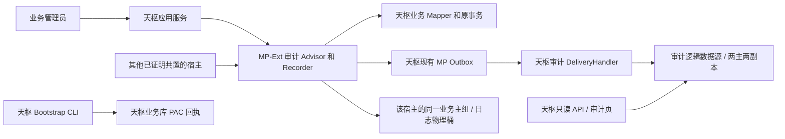
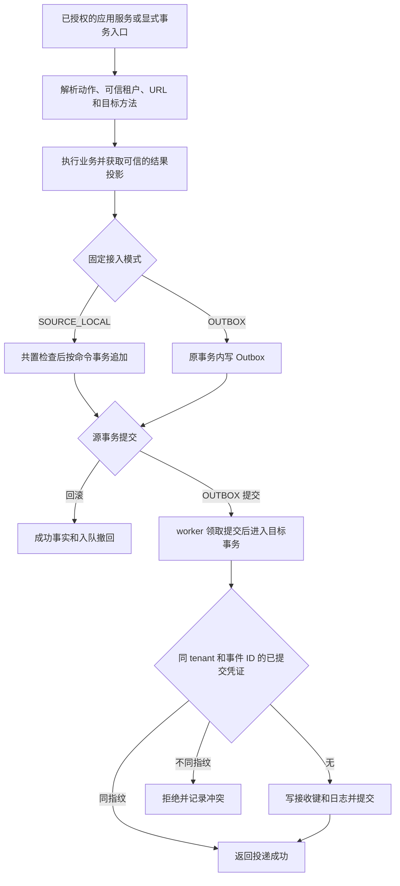
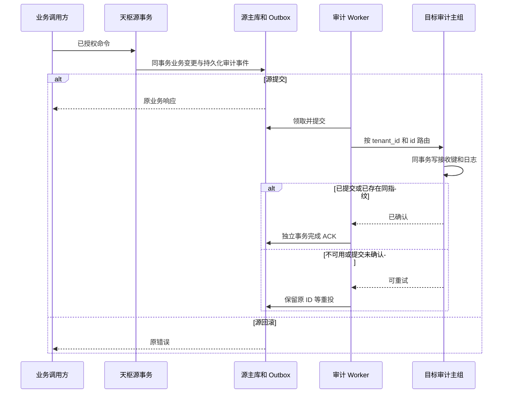
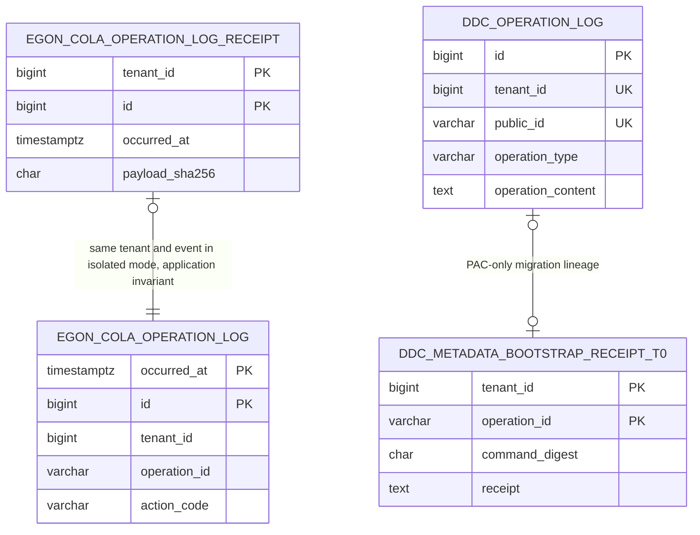

# MP-Ext 分库分表操作日志与天枢切换规格

| Field | Value |
| --- | --- |
| Document | 2026-11-23-03-57-mp-ext-sharded-operation-log.md |
| Template Version | 9 |
| Archetype Cleanup | Not applicable |
| Status | Review |
| Type | Architecture |
| Complexity | Complex |
| Complexity Drivers | 事务 AOP、独立审计库、租户物理路由、分区幂等、天枢旧表退役与权限初始化回执兼容 |
| Created | 2026-11-23 03:57 AST |
| Updated | 2026-11-23 04:11 AST |
| Owner | mario |
| Repository | Stellar-Enclosure-Components，试点 tianshu-service、tianshu-web |
| Scope | MP-Ext 共用审计、天枢本地接入、审计 PostgreSQL、天枢查询页 |
| Change Surface | AOP、可信上下文、Outbox 应用适配、分片表与回执、审计查询、旧表切换 |
| Affected Chapters | §7, §8, §9, §10, §11, §12, §13, §14, §15, §16, §17, §18 |
| Source Requirement | 各模块自己接入，组件提供统一 AOP 放在 MP-Ext。操作日志分库分表，保存 URL 或完整方法名。天枢统一使用新方案，旧操作日志历史不要，直接发布新版本。本次写 Spec |
| Baseline Revision | Components main@5f50797，tianshu-service main@56bafda，tianshu-web main@f7e0a07。静态读取现有源码 |
| Amends | None |
| Supersedes | None |
| Depends On | None |
| Related Specs | [Outbox 多实例队列协调与可靠分发](./2026-11-22-23-41-outbox-coordinated-dispatch.md) |
| Related Plans | [MP-Ext 分库分表操作日志与天枢切换实施计划](../plan/2026-11-23-04-18-mp-ext-sharded-operation-log-implementation.md) |

## 1. Summary

每个可部署服务拥有自己的操作日志。MP-Ext 提供显式的 `@OperationLog`、应用服务入口 AOP、结构化审计记录、分片写入和查询扩展点。天枢使用独立的分库分表 PostgreSQL 审计库，经现有 Outbox 持久化投递。可证明业务与审计同主组的宿主可选择同事务直写。应用审计记录可信 traceId。Cilium 侧已有观测字段包含同一标识时，可跨层关联。

天枢新版本从标准表开始记录，旧普通日志零回填、零双读、零双写。兼有业务幂等用途的 PAC 初始化回执单独迁出，以原始返回内容保留原命令重试语义。新版本切换与旧物理表删除有独立验收门。

## 2. Background and Current State

### 2.1 Business and user context

用户确认各服务按统一组件自接入，强调高数据量、分库分表、URL/完整方法定位，并要求丢弃旧普通操作日志历史，直接使用新版本。此次交付为审核规格。

### 2.2 Repository evidence

下文路径以三仓根为基准。`M` 为 Components 的 `stellar-enclosure-component-common/stellar-enclosure-component-common-mybatis-plus-sharding-jdbc-ext-spring-boot-starter`。`O` 为 Components 的 `stellar-enclosure-component-transactional-outbox-starter`。`A` 为天枢 `stellar-enclosure-tianshu-admin`。`MJ` 为 `M/src/main/java/top/egon/cola/component/common/mybatis`，`AJ` 为 `A/src/main/java/top/egon/cola/component/tianshu/admin`。

| Evidence ID | Classification | Exact path/symbol/decision/command | Observed fact | Design significance | Verification limit/freshness |
| --- | --- | --- | --- | --- | --- |
| EVD-001 | Static repository | AJ/service/config/DdcConfigService.java，update/saveOperation | 现有业务事务写配置版本和旧日志 | 替换写入口，保留业务提交 | 当前源码 |
| EVD-002 | Static repository | AJ/service/publish/DdcPublishService.java，prepare/publish。DdcPendingPublishDispatcher.enqueueNative | TransactionTemplate 内落发布任务、旧记录及 Outbox，异常回读 changeId | 发布受理与执行分开，保留业务回执 | 当前源码 |
| EVD-003 | Static repository | AJ/bootstrap/DdcPermissionMetadataBootstrapRepository.java，initialize/receipt | PAC 初始化在租户 advisory lock 下按 public_id 从旧表读回执，比较 commandDigest、operationId 和 expectedReceipt | 业务回执必须独立迁出 | 当前源码 |
| EVD-004 | Static repository | A/src/main/resources/egon-tianshu-persistence.yml，data-sources/tables。AJ/config/DdcDatabaseReadyValidator.java | 仓内一个业务主库 tianshu_0，旧表标准租户路由且被启动检查 | 独立审计库拓扑，发布切换验证 | 未读取生产覆盖配置 |
| EVD-005 | Static repository | MJ/sharding/strategy/EgonColaComplexTenantThenBusinessShardingStrategy.java，toRoutingProfile。MJ/routing/EgonColaTransactionWriteTarget.java，State.pin | 两级策略按租户选主组、按根键分桶，当前固定两桶。LOCAL 限制单数据源和单物理写组 | 组内分桶和时窗分区，隔离源事务与目标事务 | 当前源码，目标拓扑未部署 |
| EVD-006 | Static repository | O 的 TransactionalOutbox.enqueue、DeliveryHandler 和 MybatisPlusOutboxStore。AJ/config/DdcOutboxConfiguration.java | 已有 MP 事务入队和本地 handler 契约，天枢已声明独立业务 channel | 复用组件，仅增加审计应用协议 | 仓位不等于制品已升级 |
| EVD-007 | Static repository | AJ/security/tenancy/DdcTenantContextFilter.java。AJ/permission/DdcPermissionCodes.java。tianshu-web/src/App.tsx、src/api/client.ts | Spring 已验用户映射租户，现有资源权限、BFF 调用与多语言页面载体 | 只读审计权限和列表/详情 | 当前源码 |
| EVD-008 | User decision | 本会话最终方案和最新历史数据指令 | 统一组件和天枢新表，URL 和方法名，旧普通日志不保留 | 无旧普通数据迁移桥接 | Spec 待审核 |
| EVD-009 | Static repository | MJ/ddl/EgonColaDdlManifestBO.java、EgonColaPostgreDdlRunner.java。A/src/main/resources/db/egon-mp/repository-manifest.json | family 白名单及显式目标版史存在，天枢配置 ddl.enabled=false | 独立 family 与受管发布命令，保持已有 SQL | 当前源码 |

### 2.3 Problem statement and gap

旧 `ddc_operation_log` 使用字符串操作内容和按应用范围取列表。它缺少统一 AOP、可信结构化调用点、查询分页和高量留存机制。新日志用于解释操作和结果，审计库的短暂故障不应撤销已提交的业务。旧表里的 PAC `operation_content` 还承担幂等结果读取，删除前需要保留该业务语义。

### 2.4 Evidence and current-chain map

| Entry/trigger | Current call chain | Data read/written | External dependency | Consumers | Evidence |
| --- | --- | --- | --- | --- | --- |
| 更新配置 | DdcConfigController → DdcConfigService → 版本和操作 Repository | 配置、版本、旧日志 | PostgreSQL | 配置管理员 | EVD-001 |
| 发布操作 | DdcConfigController → publish → prepare → enqueueNative | 发布任务、版本、旧日志、Outbox | PostgreSQL、现有发布 handler | 发布记录与任务页 | EVD-002 |
| 权限元数据初始化 | Bootstrap CLI → initialize → receipt 或首次写入 | 元数据、PAC 回执 | 明确指定的物理主组 | 相同 operationId 的重试调用方 | EVD-003 |
| 日志来源和旧查询 | DdcI18nPageService、DdcI18nSourceImportService、DdcListTemplateService、DdcNamespaceExportService。旧 Mapper selectByScope | 旧日志按租户范围写读 | 原 MP 路由 | 天枢服务 | EVD-004，A/resources/mybatis/mapper/tianshu/DdcOperationLogMapper.xml |

### 2.5 Archetype example cleanup

Cleanup disposition: Not applicable

Reason: 目标是已存在的 Components 通用基础设施和天枢现有 Controller → Service → Repository → Mapper 改造。当前 POM 与调用链是实际模块，没有新业务工程或首次使用生成样例。

## 3. Goals and Non-goals

### 3.1 Goals

可配置启用的通用日志能力，HTTP 记录脱敏实际 URL 和路由模板，所有新写记录记录真实方法签名。保住业务事务、分片隔离、流式恢复和授权查询。天枢新日志从切换起沉淀，旧业务回执仍可重读。

### 3.2 Non-goals

旧普通日志回填、历史双读、全平台中心查询、通用日志导出、网关全量请求采集、改造 Outbox 引擎、修改 Cilium、Rust JNI、其他业务服务接入与生产部署执行均在本 Spec 范围外。

### 3.3 Change Surface and Design Depth

| Area/layer | Disposition | Exact repository evidence | Changed or preserved behavior/contract | Required Spec treatment | Chapter(s) |
| --- | --- | --- | --- | --- | --- |
| MP-Ext 切面、写入、对象和规则 | Affected | EVD-005，MJ/autoconfigure | 显式接入与本地/隔离模式 | 详细事务、对象、架构和测试 | §7, §8, §10, §13, §14, §15, §17, §18 |
| 天枢出站适配和查询 REST/UI | Affected | EVD-001、EVD-002、EVD-006、EVD-007 | 新审计写、复用 Outbox、受权列表详情 | 接口和页面完整设计 | §7, §8, §9, §10, §12, §14, §15, §16 |
| 审计分片数据库与天枢回执、旧表 | Affected | EVD-003、EVD-004、EVD-005、EVD-009 | 新表、目录、回执迁移及旧普通历史清退 | 字段、路由、DDL 和回退 | §7, §8, §11, §14, §15, §16, §17, §18 |
| Outbox 状态和已发布业务命令 | Context-only | EVD-002、EVD-006 | 原动作、发布回执、技术状态保持原协议 | 只引用槽位与状态所有权 | §7, §14 |
| Cilium 与外部身份签发 | Unchanged | platform-deploy/base/mesh/tianshu-app-httproute.yaml。EVD-007 | 现有线路和认证边界 | 只核对审计链路与 traceId | §7 |
| 统一实时流订阅与原生桥接 | Not applicable | EVD-008 | 无此需求和新协议 | N/A | §9 |

## 4. Requirements and Acceptance Criteria

| ID | Atomic requirement | Priority | Observable acceptance criteria | Source |
| --- | --- | --- | --- | --- |
| REQ-001 | MP-Ext 提供宿主 opt-in 的统一显式 AOP | Must | 同一命令入口一条命令事件，禁用时没有 SQL 或入队。代理、显式事务模板可正确采集 | EVD-008 |
| REQ-002 | URL、路由、HTTP 动词与完整方法签名定位 | Must | HTTP 记录脱敏 URL 与重载可区分签名。后台有方法名，没有伪造 HTTP 请求信息 | EVD-008 |
| REQ-003 | 业务提交与审计事实/投递意图同本地事务 | Must | 回滚业务无成功事实。隔离库故障后恢复可补投，回执丢失不导致重复行 | EVD-005、006、008 |
| REQ-004 | 分库、分桶、月分区、定向查读 | Must | 两主两副本实际写入各组各桶。事件精确路由。有界查询裁剪月份。跨月重复去重 | EVD-005、008 |
| REQ-005 | 天枢从新版本开始统一记录 | Must | 新列表空起步，旧普通日志零导入/零读取，旧入口切换同一操作只有一个写者 | EVD-008 |
| REQ-006 | 保留 PAC 的业务幂等回执 | Must | 旧 commandDigest、operationId 和 expectedReceipt 检查不变，重试读取原字节。旧表移除后凭新回执仍成立 | EVD-003 |
| REQ-007 | 可按权限浏览与定位新日志 | Must | 后端租户授权贯穿列表、详情和光标，URL、方法和详情受单独权限，UI 区分无结果与故障 | EVD-007、008 |
| REQ-008 | 受管迁移和容量可验证 | Must | 新版增量 DDL、双主副本回放、失败可续跑。退役前回退演练和生产形态 p99/积压验收 | EVD-004、009、008 |

### 4.1 Scenario matrix

| Scenario | Actor/trigger | Preconditions | Main path | Alternative/failure path | Data/state change | Observable result | Requirements |
| --- | --- | --- | --- | --- | --- | --- | --- |
| SC-01 配置更新 | 已认证管理员 | 有资源写权，源事务正常 | 修改和审计事实入队一起提交 | 元数据缺失或强审计入队失败则事务回滚 | Outbox 待分发 | 原业务响应不附带已投递承诺 | REQ-001/002/003 |
| SC-02 发布 | 发布管理员及现有执行器 | 任务存在且源组正确 | 首次受理写 COMMAND，实际终态写 EXECUTION | 已提交回执不明先查原 changeId | 同 operation_id 不同事件 ID | 发布受理和最终结果分开 | REQ-001/003 |
| SC-03 故障 | 投递 worker | 隔离审计库可暂时失联 | 主库事务写接收凭证和日志，提交后返回 | ACK 丢失重投、时间被改的重复事件冲突、坏组独立退避 | 原事件 ID 不变 | 一条日志与一个已提交凭证 | REQ-003/004/008 |
| SC-04 查询 | 审计角色 | 可信租户、限定范围 | 时窗和光标进入读侧 | 无权限拒绝，缺组/副本错误明确失败 | 无业务写入 | 页面成功空态有区别 | REQ-007 |
| SC-05 切新 | 值班与发布人员 | 新版表、回执、版史和样板就绪 | 关闭旧日志写、启用新写和新读 | 开启前失败恢复旧制品，退役后向前修复 | 历史普通日志无迁入。PAC 回执保留 | 新页只展示切换后数据 | REQ-005/006/008 |

### 4.2 Use-case analysis

#### 4.2.1 Actor inventory

| Actor ID | Actor/role | Goal and responsibility | Entry/channel | Permission/tenant context | Evidence |
| --- | --- | --- | --- | --- | --- |
| ACTOR-001 | 天枢业务管理员 | 提交配置和发布操作并可追溯 | 原配置 API | 现有租户与动作权限 | EVD-001、002 |
| ACTOR-002 | 审计查看人员 | 查询自己租户、查看获授权详情 | 新查询页 | dedicated audit READ/DETAIL | EVD-007、REQ-007 |
| ACTOR-003 | 值班及发布人员 | 发布切换、恢复正常投递、退役 | 主机受管迁移与只读核查 | DBA/发布角色绑定目标 | EVD-009 |
| ACTOR-004 | 权限元数据初始化调用方 | 请求重试获得首次结果 | 原 Bootstrap CLI | 已有目标与操作身份 | EVD-003 |

#### 4.2.2 Use-case artifact

| ID | Use case/goal | Primary actor | Supporting actors/systems | Trigger | Preconditions | Main success outcome | Alternatives/failures | Postconditions | Requirements | Interfaces/pages | Tests |
| --- | --- | --- | --- | --- | --- | --- | --- | --- | --- | --- | --- |
| UC-001 | 可追溯地变更配置及发布 | ACTOR-001 | MP-Ext、Outbox worker | 发起业务命令 | 数据范围已授权 | 命令和执行证据保存 | 回滚或目标库故障 | 无伪成功，投递可恢复 | REQ-001/002/003/004 | INTERNAL-001、EVENT-001 | TEST-001/002/003/004 |
| UC-002 | 浏览本租户操作 | ACTOR-002 | 审计存储 | 筛选或打开详情 | READ 或 DETAIL | 满足权限且限定时窗 | 403、404 或不可用 | 无写、副本有界，页面可重试 | REQ-007 | API-001、API-002 | TEST-007/008 |
| UC-003 | 切换新日志及恢复 | ACTOR-003 | DDL、Outbox、两主两副本 | 受控发布 | 新表和凭证校验通过 | 旧历史零回填，按水位切换唯一写者 | 准入失败则维持旧制品或关闭新能力 | 版史可追溯，旧表可退役 | REQ-004/005/008 | EVENT-001、§16 | TEST-004/005/009 |
| UC-004 | 重试权限初始化 | ACTOR-004 | 天枢业务主库 | 重复有效 operationId | 原请求指纹匹配 | 原结果重读 | 不匹配返回原冲突 | 不重复初始化 | REQ-006 | 原 CLI 协议 | TEST-006 |

## 5. Constraints, Assumptions, and Decisions

### 5.1 Confirmed constraints

组件在 MP-Ext，宿主主动启用。天枢独立审计库，不改变其现有业务分片。丢弃的是旧操作日志历史。作为业务协议的 PAC 回执按最小集合迁出，普通行全部排除。原业务接口不因记录方式换版而改变。

### 5.2 Small-gap assumptions

| ID | Inference | Repository evidence | Why locally reversible | Impact if wrong |
| --- | --- | --- | --- | --- |
| ASM-001 | 审计初始验证拓扑为两主各一副本、每组两桶、UTC 月分区 | EVD-005 支持当前两级策略 | 数值是上线前容量门，启用后按显式路由迁移调整 | 单租户打满单主则停止按此容量放量 |
| ASM-002 | 查询默认最近 24 小时，最大 31 天、每页 50 上限 100 | 现有页面分页模式及分区裁剪 | 属于 API 上限设计，实施前可根据评审定档 | 查询代价和结果展示范围变化 |
| ASM-003 | MVP 审计角色拥有本租户全量审计范围，普通配置角色不可查 | EVD-007 | 角色可单独配置，后续可收窄为明确资源范围 | 细粒度视图仍需独立授权扩展与验证 |

### 5.3 Resolved decisions

| ID | Decision | Decision owner | Evidence and rationale | Requirements |
| --- | --- | --- | --- | --- |
| DEC-001 | MP-Ext 对外共用 AOP 和模型，天枢用 Outbox 投递，已证共置宿主可用同事务直写 | 用户已确认的架构 | EVD-005、006、008，源业务事务无远端调用 | REQ-001/003/004 |
| DEC-002 | HTTP 同时采集 URL 和目标方法签名，非 HTTP 记录方法与入口类型 | 用户已确认的字段 | EVD-008，语义解析不依赖代理名或 Gateway dump | REQ-002 |
| DEC-003 | 新版只看新日志，保留原 PAC 回执业务语义后退役旧表 | 用户的历史范围与 EVD-003 推导出的兼容要求 | 只迁 PAC 回执集合，不读写旧普通日志 | REQ-005/006 |
| DEC-004 | 明确读取权限分层，浏览列表不默认返回详情及 URL | 规格可审核的最小安全默认 | 复用 EVD-007，不扩大原配置权限 | REQ-007 |

### 5.4 Open major decisions

当前没有阻塞设计的开放决定。实际审计保留时长、重投窗口、数据库容量与 p99 预算由发布环境配置及验收确认，启用前必须取到可验证的值。

## 6. Project Technology Context

| Concern | Current choice | Repository evidence | Constraint on design |
| --- | --- | --- | --- |
| Java、Spring 和 Maven | Java 25，Spring Boot 4.x，分仓 reactor | 两仓父 POM，共用 MP-Ext 和 Outbox，EVD-006 | 同一 BOM、不增加新运行时 |
| Persistence | PostgreSQL、MP、ShardingSphere、受管 DDL | EVD-004/005/009 | 逻辑数据源走已选 Mapper 工厂。物理 DDL 逐目标 |
| Web | Spring MVC + 现有 OpenAPI 注解与 Egon ResultRecord，React/TS | DdcPublishTaskController、tianshu-web/src/App.tsx | 复用授权、响应、路由与多语言载体 |

### 6.1 Java architecture profile and capability baseline

| Architecture profile | Archetype/template or base package | Exact evidence and verifier | Existing deviations | Design action |
| --- | --- | --- | --- | --- |
| Traditional Three-Layer | MP-Ext 基础设施包和 AJ 现有 controller/service/repository/dao | 现有 POM 和 EVD-001~007 的实际包与调用 | Components 作为共用基础设施本身没有业务 Controller | 延用现有边界。前端独立仓，无新 Archetype |

| Need | Spring/JDK candidate | Spring Boot Starter candidate | Egon-COLA/module candidate | Proven gap | Decision/dependency impact |
| --- | --- | --- | --- | --- | --- |
| 统一 AOP、事务 | Spring PointcutAdvisor/MethodInterceptor、TransactionSynchronizationManager | MP 已用 Spring 代理 | MJ autoconfigure、事务绑定 | 无审计 advisor 和协议 | MP-Ext 内新增启用条件，无 AspectJ weaving |
| 分片、时间、存储 | 现有 MP、Clock、Jackson | 现有 PostgreSQL/MP | 两级路由、EgonModel、Mapper、受管 DDL | 缺独立审计工厂配置和审计表/receipt | 复用 bootstrapper 的独立具名实例，禁止第二套实现 |
| 投递、身份、API | Jakarta Validation、Spring MVC | 现有天枢安全和文档依赖 | TransactionalOutbox、DeliveryHandler、DdcTenantContextExecutor、ResultRecord | 缺审计 handler、查询和权限 | 宿主适配，MP-Ext 不新增对 Outbox 的依赖 |
| 投影与界面 | 现有 MapStruct、React、现有请求取消 | 现有依赖闭合 | BaseForwardConverter、ddcApi、RequirePermission | 新增列表和详情投影 | 利用当前工程，独立页面状态 |

### 6.2 User-mandated Java rule compliance

| Literal rule | Affected? | Repository evidence | Exact design decision | Files/types/interfaces | Validation/test evidence | Status/blocker |
| --- | --- | --- | --- | --- | --- | --- |
| Rule 1 | Yes | AJ/model、EgonModel 和类型后缀约定 | 行用 PO，跨边界用 Event/DTO/Query/VO，DAO 表示数据访问 | §8/10 类型 | TEST-001/007 | PASS |
| Rule 2 | Yes | DdcGlobalExceptionHandler、MP validator | 代理入口 @Validated、嵌套 @Valid、PO Insert/Persisted、限长和时窗/组合自定义约束 | §9/10 | TEST-001/007 | PASS |
| Rule 3 | Yes | EgonModel 与 BaseForwardConverter | 普通 PO Lombok 与继承等值，跨边界不可变值对象可用 record，PO→VO 单向生成 | §10 | TEST-004/007 | PASS |
| Rule 4 | Yes | MP/BOM Bean 及 lombok.config | 稳定 Bean 名，@Slf4j，final @Qualifier、@RequiredArgsConstructor(onConstructor_ = @Autowired) | §8/15 | TEST-001/004 | PASS |
| Rule 5 | Yes | Spring/AOP/JDK/Jackson 已存在 | JDK 时间、摘要、Spring MVC 路由，采用现有工具链 | §6/7 | TEST-002 | PASS |
| Rule 6 | Yes | ResultRecord、Spring Boot Jackson | 严格事件字段，枚举 @EnumValue/@JsonValue 显式稳定码 | §9/10 | TEST-002/007 | PASS |
| Rule 7 | Yes | egon-tianshu-persistence.yml | 所有环境键结构一致，值按环境变化，部署不暴露密码 | §7/16 | TEST-001/009 | PASS |
| Rule 9 | Yes | 复杂两种写边界 | 模式 Strategy 和投递 Adapter，审批业务结果保留现有状态机 | §7/13 | TEST-003/004 | PASS |
| Rule 10 | Yes | EgonModel.instant 和现有 UTC 语义 | Instant/Duration、显式 UTC 月、查询 HTTP offset 和微秒 | §6.3 | TEST-010 | PASS |
| Rule 11 | Yes | EVD-004~007、009 | 原有三层，DDL MP-SDJ，SOURCE_LOCAL 原事务，天枢真实 Outbox，永久技术唯一键独立语义 | §7/11/16 | TEST-003/005/006 | PASS |

### 6.3 Time semantics and conversion contract

Time contract: Required

| Time ID | Fields/symbols | Semantics | Java/runtime type | Storage policy | Wire policy | Business zone source | Display zone source | Boundary / DST rules | Precision / Clock | Compatibility | Verification |
| --- | --- | --- | --- | --- | --- | --- | --- | --- | --- | --- | --- |
| TIME-001 | occurredAt/occurred_at、create_time、first_seen_at | Occurred instant | Instant，JDBC 复用处理或显式 OffsetDateTime UTC | UTC instant | UTC Z | UTC 固定用于分区 | UI 用户显式时区，缺省浏览器区域 | UTC 月左闭右开。显示区只格式化一次 | 微秒截断后生成指纹，源 Clock／数据库 | 普通旧数据丢弃，PAC 独立转换 | TEST-010 |
| TIME-002 | from/to/beforeTime | Occurred instant | OffsetDateTime 输入后转 Instant | Not persisted | UTC Z | UTC 绝对查询 | 用户 IANA ZoneId 或浏览器后备 | 明确 offset/Z，界面日范围以所选区下一日起点计算，DST 边界保持实际日长 | 同字段微秒精度，光标原文回传 | 新 API | TEST-007、TEST-010 |
| TIME-003 | durationMs/duration_ms | Duration | Duration，System.nanoTime | Duration | Duration | Not applicable: 耗时无时区 | Not applicable: 显示毫秒数 | 非负，执行段耗时 | 毫秒向下取整 | 新字段，ResultRecord.timestamp 保留旧 Unix 毫秒 | TEST-001、TEST-010 |
| TIME-004 | PAC recorded_at | Occurred instant | Instant | UTC instant | Internal | UTC，旧 BO 写入以 ZoneOffset.UTC | Not applicable: 原回执字符串原样返回 | 迁移旧 created_at 显式 AT TIME ZONE 'UTC' | 微秒，返回字节不重新序列化 | 旧 created_at 为无时区的 UTC 约定 | TEST-006、TEST-010 |

## 7. Architecture Design

### 7.0 Minimum-design baseline and element-necessity audit

| Proposed element | Change | Requirements | Existing/direct alternative | Concrete inadequacy of alternative | Added calls/state/coupling/failures/migration/operations | Verdict |
| --- | --- | --- | --- | --- | --- | --- |
| MP-Ext advisor、模型、recorder 和默认审计 DAO | New | REQ-001/002/003 | 每个服务手写日志调用 | 异构行为和上下文采集不可复用 | 一个显式代理入口、稳定投影和写入端口 | Add |
| 天枢现有 Outbox 的审计应用适配 | Expand | REQ-003/004 | 宿主直接写同组 | 当前配置仅一业务主组，独立审计库不能共享源写事务 | 一次源入队，目标接收事务，可观察积压 | Add |
| 标准日志分区表与隔离模式接收键 | New | REQ-004/008 | 复用旧天枢表，或仅分区行唯一 | 不能支撑独立分库与跨月幂等 | 每分片同组的两个逻辑表 | Add |
| PAC 专用回执 | New | REQ-005/006 | 继续混用旧操作日志 | 旧表持续承担业务协议，无法清退 | 只迁回执，复用原锁与响应 | Add |
| 天枢列表/详情 | New | REQ-007 | 旧 Mapper 无界读取 | 缺少时间、游标、字段授权和详情语义 | 一次列表查询，用户打开详情再查询 | Add |
| Cilium 审计和历史拷贝 | Keep/Remove | REQ-002/005 | 流量全采样和旧历史统一 | 业务事实由服务拥有，用户明确不需要旧普通历史 | 接入侧无新过滤器，旧普通记录无需复制 | Remove |

| Path | Network calls | Client states | Server contracts/state | Failure and TOCTOU points | Additional user/business value |
| --- | --- | --- | --- | --- | --- |
| Direct baseline | 一个业务请求 | 现有返回 | 旧日志写在旧事务 | 每服务实现不一致，无法独立分库 | 低成本，保留给可证共置架构 |
| Selected design | 一个原业务请求，后台同进程 worker 执行目标事务，读取按用户动作 | 原命令结果及独立审计列表 | 源事务、现有 Outbox、接收键与日志 | 主组隔离、未知 ACK、时窗裁剪由对应边界处理 | 可共享组件和独立分片，无同步远端服务依赖 |

### 7.1 System Architecture Design

#### 7.1.1 Architecture Mermaid view



#### 7.1.2 Boundary and responsibility table

| Boundary | Owner | Authoritative state | Trust / transaction |
| --- | --- | --- | --- |
| 应用命令 | 当前服务 | 业务记录、发布阶段 | 验证授权、显式业务投影。业务确认前不承诺最终投递 |
| OperationLogRecorder | MP-Ext | 已校验本次事实 | 复用目标模式 Strategy，只允许一条命令记录源 |
| Outbox | 天枢业务逻辑数据源与现有组件 | 本地持久化待投递、租约和技术结果 | 同一源事务。worker 领取先提交 |
| 审计存储 | 天枢独立审计数据源 | 事件事实、稳定去重键 | 独立 `READ_COMMITTED`，每次仅一主组 |
| 审计查询 | 天枢已有 Web 安全边界 | 授权范围内的行和字段 | 当前认证租户，界面无写入 |
| PAC 初始化 | 天枢 Bootstrap CLI 及业务主库 | 原业务回执字符串 | 原 SERIALIZABLE 与租户锁 |

### 7.2 High-Level Design

#### 7.2.1 Critical business/control flowchart



#### 7.2.2 High-level decision and quality matrix

| Concern/use case | Evidence | Decision | Failure bound | Verification |
| --- | --- | --- | --- | --- |
| 紧耦合与性能 UC-001 | EVD-005/006 | 仅一次源入队或同组追加，目标另起事务 | 不在源锁内等待审计库 | TEST-003/009 |
| 重投与未知提交 UC-001 | EVD-006，数据库月分区 | 稳定源事件 ID 与持久指纹 | 独立 TX 覆盖跨月，拒绝不等载荷 | TEST-004/010 |
| 高量查询 UC-002 | EVD-005/007 | 时间窗、确定性游标、两桶上限，无总数 | 单租户同组内有限散读，失败无部分结果 | TEST-007/008/009 |
| 无历史切新 UC-003/004 | EVD-003/008/009 | 只迁业务回执，旧日志不接入 | 锁同一 tenant，避免回执遗漏。旧表删除后向前修 | TEST-005/006 |

### 7.3 Detailed Design

#### 7.3.1 Detailed component collaboration

`@OperationLog(actionCode, resourceType, projector)` 应用服务方法通过 Spring advisor 拦截。Spring 事务 advisor 在外层开启选定的写事务，审计 advisor 在内部执行目标方法并收集投影。启动检查可代理性和顺序，强审计入口的集成测试证明活跃事务、同 DataSource 绑定及回滚行为。自调用、private/final 方法、事务模板的外壳通过受控的显式 Recorder 入口。注解与显式入口以事务内根操作上下文互斥，嵌套调用复用 operationId，入口无真实状态变更的业务重放由明确投影抑制。事务管理由宿主保有。[Spring 事务与 Advisor 顺序](https://docs.spring.io/spring-framework/reference/data-access/transaction/declarative/applying-more-than-just-tx-advice.html)

Web MVC 入口把真实方法、请求动词、匹配模板和经白名单清洗的实际 URL 固化为有界值对象。完整方法签名从目标类最具体的桥接归一方法得到，格式为包名.类名#方法名(参数类型)，区分重载。HTTP 请求的前缀和 origin 取可信应用配置或经边界验证的代理上下文，query、fragment 及 URI 凭据丢弃。实际路径上存在秘密或不可安全解析时使用模板替换该段。背景执行不携带 Servlet 对象，HTTP 字段为空。发布结束事件可以传递受理时已获准的 URL 快照，执行方法与触发类型按实际执行提供。

`SOURCE_LOCAL` 验证事务数据源、SqlSessionFactory、tenant 和物理主组。多组业务按根键路由的宿主必须能证明其日志的路由共置。MP-Ext 不根据表名猜测组。OUTBOX 模式由天枢插入已清洗的 `OperationLogEvent`，保持原业务提交协议。审计 writer 和 reader 复用 MP-Ext bootstrapper，使用独立的具名 `operationLogDataSource`、`operationLogSqlSessionFactory`、`operationLogTransactionManager` 且只扫描审计 Mapper。现有业务的同名 Bean 和原 Outbox DataSource 边界保持。只在选择独立模式的宿主注册第二个 bootstrapper 实例及审计配置，采用相同角色、校验、DDL 组件，实例状态和拓扑指纹独立。

天枢第一批替换配置的现有写日志调用与发布受理，随后同一新版移交通用日志覆盖范围内的 i18n、列表模板和命名空间导出。只对能在现有终态执行点拿到 authoritative outcome 的发布/回滚/推广追加终态事件，既有领域版本和回执继续独立保存。后续扩展动作按同一投影规则注册。导出记录文件已生成，浏览器下载实时状态不在日志合同内。已认证业务拒绝/确定回滚，可由宿主在原事务退出后用独立有界短事务记失败，保留原错误，授权前失败留在安全日志。

#### 7.3.2 Critical-path Mermaid swimlane



#### 7.3.3 Transactions, consistency, concurrency, and idempotency

源事务的 business idempotency 仍由业务对象及 changeId 负责。事件 ID 在事实首次生成时由同一服务的 Egon Snowflake ID 分配，一次投递始终使用相同值。Outbox 的技术 messageId 和事件 ID 分离，idempotency key 按源作用域包含租户、固定审计命名空间和事件 ID，并使用已有分片身份编码。源技术租户 0 仅服务 Outbox 表，目标记录使用已认证的正租户及源可信事件。scope/context 绑定在 writer 外层，离开时恢复旧 MDC，阻止 worker 线程串租户。

目标 handler 在源领取已提交且无源写上下文时打开自己的短事务。相同 tenant/id 路由到同一个物理桶，先在该桶接收键表原子 INSERT ON CONFLICT DO NOTHING。新键插入后追加日志，任一失败整事务回滚。冲突由下一 SQL 主库读取原键，比较归一化发生时间和经过版本化规范 JSON 的 SHA-256。相同返回成功，内容不同时返回永久冲突且保留原件。约束避免竞争，禁止先查再无条件插入。成功投递必须基于目标事务已确认提交或新事务重新确认同一凭证。ACK 使用原 Outbox 所拥有的租约协议。两库以 at-least-once 投递和目标行幂等衔接，业务响应可能早于审计读侧可见。

SOURCE_LOCAL 无跨库 ACK，依赖业务命令幂等且普通追加只发一次。发现错误路由或采集必填字段缺失时受控拒绝并回滚关键业务。AOP 在事务剩余调用失败时成功行跟随回滚，回滚证据来自实际事务结果。提交未知只查权威源，保留诊断而不伪报失败。新审计明确不使用可选 Business StateMachine。Outbox 技术状态、租约、预算与 DEAD 仍归现有引擎。

#### 7.3.4 Failure semantics, recovery, and reconciliation

| Condition | Handling | Durable effect |
| --- | --- | --- |
| 源事务回滚、环绕遇到业务失败 | 主事务回滚。确认失败后可审计失败而保留原响应 | 无伪造成功 |
| 目标连接失败／事务提交未知 | 分类为可重试，限制队列积压与存留时间，重投原事件 | 源已提交及原事件不变 |
| 目标已提交而源 ACK 丢失 | 目标键重读确认，按现有组件确认原消息 | 只有一次目标日志 |
| 错 route、非法 schema、同 ID 不同指纹 | 受控告警、永久投递错误走现行 DEAD 运维，不修改事实 | 无越权或覆盖 |
| 审计查询副本不可用、读失败 | 返回 503，无部分成功列表，无自动提升主库角色 | 无数据写 |
| 分区未就绪、超过允收迟到窗口 | 未就绪可重试和告警，超过政策边界交运维 | 审计原时间保留，消息不会悄悄跳月 |

#### 7.3.5 Observability and operational boundaries

在现有监控基础上记录 audit_accepted、audit_committed、duplicate_same、duplicate_conflict、query_unavailable、partition_missing。标签限服务、入口类型、结果和有限主组。Outbox 跟踪积压行数、最老待投时间、未知 ACK 及 DEAD。错误只记 schema/动作码、traceId 或事件引用。原始正文、Authorization、Cookie、密钥、堆栈和 URL 凭证保留在日志之外。读侧按 replica 监控回放滞后，目标主故障的切换依附宿主运维授权的拓扑。

#### 7.3.6 Conclusion evidence chain

| Conclusion | Evidence | Constraint | Decision | Consequence | Verification |
| --- | --- | --- | --- | --- | --- |
| 独立库仍保证源提交 | EVD-004/005/006 | LOCAL 只写一组 | 天枢同事务入队、目标另事务 | 可补投，读侧可晚到 | TEST-003/004 |
| 跨月重复可证 | EVD-005 及 PostgreSQL 分区唯一约束 | 分区键参与主键 | 同桶独立接收键 | 只对隔离模式增加第二次目标写 | TEST-004/010 |
| 旧表可退役 | EVD-003/008 | 普通历史不迁，业务回执必须稳定 | 迁出 PAC 后直切新写 | 比较原回执字节与 SQL 锁，无旧双读 | TEST-005/006 |

## 8. Package Structure and Code File Tree

### 8.1 Current relevant tree

`MJ` 现有 business、routing、autoconfigure、extension、model、ddl 和 sharding。天枢 `AJ` 已有 controller/config、service/config、service/publish、outbox、bootstrap、repository 和 model。Web 已有 `src/App.tsx` 与 `src/api/client.ts`。所有改动限现有模块和对应包。

### 8.2 Target tree

```text
MJ/
  operationlog/OperationLog.java
  operationlog/OperationLogAdvisor.java
  operationlog/OperationLogRecorder.java
  operationlog/OperationLogProjection.java
  operationlog/OperationLogEvent.java
  operationlog/OperationLogContextDTO.java
  operationlog/OperationLogDestination.java
  operationlog/OperationLogWriteModeEnum.java
  operationlog/OperationLogPhaseEnum.java
  operationlog/OperationLogOutcomeEnum.java
  operationlog/EgonOperationLogAutoConfiguration.java
  operationlog/EgonOperationLogProperties.java
  operationlog/OperationLogConverter.java
  operationlog/OperationLogPO.java
  operationlog/OperationLogReceiptPO.java
  operationlog/OperationLogDAO.java
  operationlog/OperationLogReceiptDAO.java
  operationlog/OperationLogRepository.java
  ddl/EgonColaDdlManifestBO.java

M/src/main/resources/
  META-INF/spring/org.springframework.boot.autoconfigure.AutoConfiguration.imports
  mapper/operationlog/OperationLogMapper.xml
  mapper/operationlog/OperationLogReceiptMapper.xml
  db/egon-operation-log/manifest-slot-0.json
  db/egon-operation-log/manifest-slot-1.json
  db/egon-operation-log/V20261123_001__initialize_operation_log_slot_0.sql
  db/egon-operation-log/V20261123_001__initialize_operation_log_slot_1.sql

AJ/
  config/DdcOperationLogWebConfiguration.java
  config/DdcDatabaseReadyValidator.java
  controller/audit/DdcOperationLogController.java
  service/audit/DdcOperationLogQueryService.java
  model/query/DdcOperationLogPageQuery.java
  model/vo/DdcOperationLogSummaryVO.java
  model/vo/DdcOperationLogDetailVO.java
  model/vo/DdcOperationLogPageResult.java
  model/convertor/DdcOperationLogViewConverter.java
  permission/DdcPermissionCodes.java
  security/tenancy/DdcTenantContextFilter.java
  migration/DdcLegacyTableStrategy.java
  outbox/DdcOperationLogOutboxAdapter.java
  bootstrap/DdcPermissionMetadataBootstrapRepository.java
  service/config/DdcConfigService.java
  service/publish/DdcPublishService.java
  service/publish/DdcNativeConfigRolloutService.java
  service/i18n/DdcI18nPageService.java
  service/i18n/DdcI18nSourceImportService.java
  service/list/DdcListTemplateService.java
  service/list/DdcNamespaceExportService.java

A/src/main/resources/
  egon-tianshu-persistence.yml
  db/egon-mp/repository-manifest.json
  db/egon-mp/V20261123_001__tianshu_metadata_bootstrap_receipt.sql
  db/egon-mp/V20261123_002__retire_tianshu_operation_log.sql

stellar-enclosure-tianshu-starter/src/main/java/top/egon/cola/component/tianshu/
  error/DdcErrorStatus.java

tianshu-web/src/
  App.tsx
  api/operationLog.ts
  pages/OperationLogsPage.tsx
```

### 8.3 Package and file responsibilities

| Paths/symbols | Operation | Responsibility | Requirements |
| --- | --- | --- | --- |
| MJ/operationlog 注解、advisor、投影、Event/DTO、枚举、Recorder 及 Destination | Create | 一个 Bean 代理入口和显式入口，经 host 可信 context 与策略分派。DAO 不能被控制器直接调用 | REQ-001/002/003 |
| MJ/operationlog properties、auto-config、PO/DAO/Repository。M/resources imports/mapper/DDL、EgonColaDdlManifestBO | Create/Modify | 同组写/独立 Factory、append-only Mapper、只读窗口、注册独立 family `component-operation-log` | REQ-003/004/008 |
| AJ/config/DdcOperationLogWebConfiguration、outbox/DdcOperationLogOutboxAdapter | Create | 宿主提供 Servlet context、既有来源权限、已有 Outbox 写适配和一个本地 DeliveryHandler | REQ-001/002/003 |
| AJ 当前 config/publish/i18n/list 服务及真实发布终态换写入口 | Modify | 原有写路径到 Recorder，终态只在条件写入真正改变状态后追加。§2.4 定位原调用链 | REQ-003/005 |
| AJ/controller/audit、service/audit、model/query/vo/convertor、permission/DdcPermissionCodes、security/tenancy/DdcTenantContextFilter、starter/error/DdcErrorStatus。Web App、页面、client | Create/Modify | host 查询权限、API 与类型、双语页面，复用现有权限生成和语言目录 | REQ-007 |
| AJ/bootstrap/DdcPermissionMetadataBootstrapRepository、config/DdcDatabaseReadyValidator、A/resources 受管 SQL/manifest | Modify/Create | 回执独立治理、旧普通历史零复制。退役前保留回退使用的旧 schema | REQ-005/006/008 |
| AJ/dao/DdcOperationLogMapper.java、AJ/repository 下 interface/impl、AJ/model/{po,bo,convertor} 的 DdcOperationLog 三个旧载体、A/resources/mybatis/mapper/tianshu/DdcOperationLogMapper.xml | Remove at retirement | 业务读写与回执迁完后移除旧引擎，检查 DdcLegacyTableStrategy 的输入兼容和所有旧表校验引用 | REQ-005/006 |
| 各 owning module 的同包验证。tianshu-web/src/pages/OperationLogsPage.test.tsx | Create/Modify | 聚焦测试按 §14，验证真实目标与权限，旧业务接口回归 | REQ-001~008 |

## 9. Interface Definitions

### 9.0 API protocol and documentation governance

| Concern | Decision/evidence |
| --- | --- |
| Protocol selection | 两个 Spring MVC REST GET，后台复用已有 Outbox DeliveryHandler |
| CQE application level | 原命令加结构化事实，查询只读，既有 Outbox 持久事件。无新增协议服务 |
| REST source of truth | DdcOperationLogController 的 class/method route、DTO 和实际 ResultRecord |
| GraphQL source of truth | 本次没有 GraphQL schema 或协议调整 |
| Springdoc/OpenAPI compatibility | 沿用 DdcPublishTaskController 对应的现有 springdoc 配置与注解，不增版本 |
| Legacy Swagger/Springfox status | 当前改动只使用 OpenAPI 3 注解，无 Springfox 引入 |
| Security and documentation exposure | 现有 bearer 管理边界、具名审计权限及租户 Header，源码生成并只在既有文档授权下访问 |
| Contract publication and drift gate | 宿主现有 API 产物流程，OpenAPI 与权限 Manifest 两者分别验收，TEST-007 断言 |

### 9.1 Interface Inventory

| ID | Change/necessity verdict | Name/purpose | Kind | API style/CQE role | Consumer | Owner | Method + URL / GraphQL field / symbol / topic | Operation ID/schema source | Input | Output | Auth/tenant | Error model | Idempotency/version | Requirements |
| --- | --- | --- | --- | --- | --- | --- | --- | --- | --- | --- | --- | --- | --- | --- |
| API-001 | Add | 分页查看天枢操作日志 | HTTP | REST Query | OperationLogsPage | DdcOperationLogController | GET /api/v1/tianshu/operation-logs/page | tianshu.ddcOperationLogController.page | DdcOperationLogPageQuery | ResultRecord<DdcOperationLogPageResult> | TIANSHU_OPERATION_LOG_READ | 安全边界错误或 ResultRecord | v1、只读 | REQ-007 |
| API-002 | Add | 查看特定审计事件详情 | HTTP | REST Query | OperationLogsPage | DdcOperationLogController | GET /api/v1/tianshu/operation-logs/{eventId} | tianshu.ddcOperationLogController.detail | eventId、occurredAt | ResultRecord<DdcOperationLogDetailVO> | TIANSHU_OPERATION_LOG_READ 与 TIANSHU_OPERATION_LOG_DETAIL | 安全边界错误或 ResultRecord | v1、只读 | REQ-007 |
| INTERNAL-001 | Add | 统一审计调用 | Spring | Command adjunct | 已授权应用服务 | MP-Ext | OperationLogRecorder.recordInTransaction | Java Event schemaVersion 1 | 可信上下文 + 已验事实 | 追加成功或已入队 | 事务、tenant、管理器匹配 | 拒启或回滚 | 业务命令决定根操作 | REQ-001/002/003 |
| EVENT-001 | Add | 独立存储审计事实 | Outbox | Event | DdcOperationLogOutboxAdapter | 天枢宿主 | tianshu.operation-log | payload schemaVersion 1 | OperationLogEvent | DeliveryResult | 可信源审计通道和 tenant | 可重试/永久错误 | 稳定 eventId，跨月幂等 | REQ-003/004/008 |

### 9.2 Per-interface Detailed Contracts

#### 9.2.1 API-001 — 分页查看天枢操作日志

##### Necessity and interaction-cost decision

| Concern | Decision |
| --- | --- |
| Change classification | 新增天枢只读审计接口，使用 v1 并复用现有安全边界 |
| Independent consumer goal | 列表为操作者提供限定时间范围的主题和结果，允许按租户授权维度展开调查。传输仅包含摘要，密集 details 与完整 URL 按单事件权限读取。 |
| Parameter ownership and derivation | 筛选或定位由页面提供。tenantId 和授权全部由服务器认证派生，不进公共查询模型 |
| Direct/no-new-interface alternative | 历史 selectByScope 需要业务/应用/环境全指定且无界，不满足审计查询或跨桶受控分页。使用现成 PageResultRecord 会耦合 COUNT，新增数据体使用既有 ResultRecord。 |
| Caller use of result | 列表渲染紧凑摘要并保留 ID 和发生时间作为打开详情的定位参数。有 nextCursor 才展示下一页入口。 |
| Round trips and failure points | 一次 GET，每次最多两个物理桶读取并合并。副本失败整次失败，光标可指导后续读但没有一致性快照承诺。 |
| Verdict | Add，依赖审计 schema 就绪和宿主授权，原业务命令路由保持 |

##### API style and CQE semantics

| Concern | Decision/evidence |
| --- | --- |
| Protocol style | REST Query，GET 授权后的审计资源 |
| CQE role | Query，复用天枢资源查询与 ResultRecord |
| Resource/task semantics | 列表为操作者提供限定时间范围的主题和结果，允许按租户授权维度展开调查。传输仅包含摘要，密集 details 与完整 URL 按单事件权限读取。 |
| Read/write and side effects | 对审计存储只读，调用本身不生成操作日志或 Outbox 写入 |
| Consistency and idempotency | 只读幂等。正常使用配置读侧。插入结果和 WAL 回放可造成短暂可见性延后 |
| Why this style | 当前 Spring MVC 与 BFF 可表达独立只读资源，保留既有 REST 和授权 |

##### Identity and purpose

| Concern | Definition |
| --- | --- |
| Endpoint | GET /api/v1/tianshu/operation-logs/page |
| Controller | `DdcOperationLogController` 的 page，来源为现有天枢管理路由 |
| Consumer and permission | OperationLogsPage，要求 TIANSHU_OPERATION_LOG_READ |
| Cache and transport | application/json、Cache-Control: no-store，保持现有认证与 BFF 边界 |

##### Request parameters

| Name | Location | Type / validation / behavior |
| --- | --- | --- |
| from、to | Query | 二者同填或同缺。带 offset 的 RFC 3339，微秒上限。默认 UTC 最近 24 小时。规范化后半开区间 [from,to)，from < to，最长 31×24h |
| limit | Query | 默认 50，整数 1–100。越界或空串为 400 |
| beforeTime、beforeId | Query | 成对出现。beforeTime 时窗内的 ISO instant，beforeId 为正 bigint 的十进制字符串。首屏无游标。次页保留首屏返回的已解析 from/to |
| actionCode、actorId、resourceType、resourceId | Query | 可选等值。长度分别至 96/512/64/128。清除外围空白后非空。ASCII 控制字符拒绝，动作及类型校验宿主注册 |
| bizCode、namespaceCode、env、appCode | Query | 可选等值。各最多 128/128/32/128。仅缩小当前租户的受权结果 |
| outcome | Query | 可选，OutcomeEnum 的 wire code。未知取值 400 |
| X-Egon-Tianshu-Tenant | Header | 沿用天枢预期租户检查。缺失、重复、不匹配按现有安全入口处理。租户来自已认证用户，Header 只核对 |

任何非声明参数拒绝，控制字符与非法格式按 400 处理。授权头、租户头或 Cookie 永不写入审计详情。方法无 body。

##### Success response

HTTP 200，数据体 `DdcOperationLogPageResult`。日期按 TIME-001，主键以字符串序列化。

```jsonc
{
  "success": true, // Egon envelope
  "code": 10000, // ResultCode.SUCCESS
  "status": "SUCCESS", // 稳定状态
  "message": "success", // 原封套消息
  "data": { // 本页及查询锚点
    "from": "2026-11-23T00:00:00Z", // 实际包含起点
    "to": "2026-11-24T00:00:00Z", // 实际排除终点
    "records": [ // 空时为 []
      {
        "eventId": "118230000100000001", // 精确定位用十进制字符串
        "operationId": "cfg-change-102", // 关联受理和执行
        "occurredAt": "2026-11-23T00:05:03.001001Z", // 原始微秒时间
        "sourceService": "tianshu-admin", // 来源
        "moduleCode": "CONFIG", // 业务模块
        "actionCode": "TIANSHU_CONFIG_PUBLISH", // 已注册动作
        "resourceType": "CONFIG", // 公开资源类型
        "resourceId": "config-01", // 公开资源 ID
        "actorType": "USER", // 操作者类别
        "actorId": "user-352", // 审计身份
        "actorName": null, // 可选显示名快照
        "phase": "COMMAND", // 命令事实阶段
        "outcome": "ACCEPTED", // 任务受理
        "routePattern": "/api/v1/tianshu/configs/{id}/publish" // 可为空的路由模板示例
      }
    ],
    "nextCursor": null // 末页为 null，有下一页时为 beforeTime/beforeId 对象
  },
  "traceId": "audit-query-01", // 查询的链路追踪
  "timestamp": 1795392303001 // 原封套响应 Unix 毫秒
}
```

##### Error responses

HTTP 400 使用 TIANSHU_INVALID_REQUEST、56000，404 使用 NOT_FOUND、404000（仅详情），500 使用 TIANSHU_INTERNAL_FAILURE、56999，审计查询目标不可用使用 HTTP 503、TIANSHU_OPERATION_LOG_UNAVAILABLE、56998。封套使用相同七字段。应用层用该 Controller 范围的错误状态映射。下例为 400。

```jsonc
{
  "success": false, // 查询失败
  "code": 56000, // 稳定业务码
  "status": "TIANSHU_INVALID_REQUEST", // 错误枚举
  "message": "invalid Tianshu request", // 安全文本
  "data": null, // 错误无数据
  "traceId": "audit-query-error", // 失败请求追踪
  "timestamp": 1795392303200 // 原封套 Unix 毫秒
}
```

边界认证入口保留既有 HTTP 401/403 的字符串错误体。401 带 WWW-Authenticate: Bearer。安全审计写失败沿用 503 OAUTH_AUDIT_DELIVERY_UNAVAILABLE。两字段的 code 与 message 取同一现有安全代码。

```jsonc
{
  "code": "TIANSHU_ADMIN_CAPABILITY_REQUIRED", // 现有 403 安全代码，租户失配用 TIANSHU_ADMIN_TENANT_MISMATCH
  "message": "TIANSHU_ADMIN_CAPABILITY_REQUIRED" // 同 code 的安全文本
}
```

##### Interface logic for frontend and consumers

1. 从可信认证主体生成租户并验证 READ 权限，页面按钮隐藏只提供交互反馈。
2. 通过 DdcOperationLogPageQuery 验证并归一化时间、枚举、上限、游标及所有过滤字段。
3. 使用实际 from/to、已选过滤器与固定倒序，按路由查询租户所在两桶。每桶读取 limit+1，稳定归并。
4. 页面保留返回的真实 from/to 和微秒原文字段。日期展示格式化不得改写游标。
5. 下一页发送同样筛选及 nextCursor 两字段。筛选或租户变化清空游标与旧请求结果。
6. 成功记录为空显示零结果，503 显示独立失败和重试，401/403 按现有会话处理。
7. 打开某事件需 DETAIL 权限，向详情传递 eventId 和原 occurredAt。分页无需先查其他接口。

##### Documentation contract

| Concern | Decision/evidence |
| --- | --- |
| Documentation authority | 天枢既有 Spring MVC 与 springdoc/OpenAPI 3 生成，延续 DdcPublishTaskController |
| REST OpenAPI operation / GraphQL SDL operation | REST operationId tianshu.ddcOperationLogController.page，GET /api/v1/tianshu/operation-logs/page |
| Annotation/mapping ownership | @Operation、@Parameter、@ApiResponses 和 route-level security 由 controller，@Schema/约束由 DTO 和实际 ResultRecord |
| Generated schema elements | Generated OAS effect 包含路径、字段格式、Bearer 签入、200/400/401/403/503 及 500 的原安全体或 Egon ResultRecord，标明 no-store |
| Compatibility and drift proof | TEST-007 导出 OpenAPI 并断言 code/schema，TEST-008 用消费端约定做真实页面契约 |

##### Compatibility and verification

仅新增当前 API 版本下的路由，原配置、原发布任务和现有安全入口保持形状和错误语义。兼容现有天枢 BFF 预期租户匹配模式，新增路径纳入该过滤器与权限编目。TEST-007 覆盖一致的 OAS、安全错误体、跨租户查询、只读语义及微秒与数字边界，TEST-008 用页面测试校验查询切换和错误态。

#### 9.2.2 API-002 — 查看特定审计事件详情

##### Necessity and interaction-cost decision

| Concern | Decision |
| --- | --- |
| Change classification | 新增天枢只读审计接口，使用 v1 并复用现有安全边界 |
| Independent consumer goal | 授权排障人员查看单次事件的 URL、执行方法、耗时、原因、相关操作和原业务允许公开的细节。严格定位单条记录。 |
| Parameter ownership and derivation | 筛选或定位由页面提供。tenantId 和授权全部由服务器认证派生，不进公共查询模型 |
| Direct/no-new-interface alternative | 列表默认不携带 URL、执行方法和动态详情。按单事件请求控制授权与 payload，同时允许从已有列表跳转。 |
| Caller use of result | 详情抽屉展示脱敏参数、HTTP 及方法和关联操作号。无记录统一显示无法找到，单独拒绝或依赖失败有明确反馈。 |
| Round trips and failure points | 主动打开详情才发一次 GET。事件 ID 与 occurredAt 同时给定，使用单目标只读查询。 |
| Verdict | Add，依赖审计 schema 就绪和宿主授权，原业务命令路由保持 |

##### API style and CQE semantics

| Concern | Decision/evidence |
| --- | --- |
| Protocol style | REST Query，GET 授权后的审计资源 |
| CQE role | Query，复用天枢资源查询与 ResultRecord |
| Resource/task semantics | 授权排障人员查看单次事件的 URL、执行方法、耗时、原因、相关操作和原业务允许公开的细节。严格定位单条记录。 |
| Read/write and side effects | 对审计存储只读，调用本身不生成操作日志或 Outbox 写入 |
| Consistency and idempotency | 只读幂等。正常使用配置读侧。插入结果和 WAL 回放可造成短暂可见性延后 |
| Why this style | 当前 Spring MVC 与 BFF 可表达独立只读资源，保留既有 REST 和授权 |

##### Identity and purpose

| Concern | Definition |
| --- | --- |
| Endpoint | GET /api/v1/tianshu/operation-logs/{eventId} |
| Controller | `DdcOperationLogController` 的 detail，来源为现有天枢管理路由 |
| Consumer and permission | OperationLogsPage，要求 TIANSHU_OPERATION_LOG_READ 与 TIANSHU_OPERATION_LOG_DETAIL |
| Cache and transport | application/json、Cache-Control: no-store，保持现有认证与 BFF 边界 |

##### Request parameters

| Name | Location | Type / validation / behavior |
| --- | --- | --- |
| eventId | Path | 必须提供正 bigint 十进制字符串，最多 19 位且不溢出，禁止前导 + |
| occurredAt | Query | 必填带 offset 的 RFC 3339，精度不超过微秒。验证后保留 Instant 精确值，用于分区裁剪 |
| X-Egon-Tianshu-Tenant | Header | 同列表固定的兼容 Header，可信租户来自认证绑定 |

任何非声明参数拒绝，控制字符与非法格式按 400 处理。授权头、租户头或 Cookie 永不写入审计详情。方法无 body。

##### Success response

HTTP 200，数据体 `DdcOperationLogDetailVO`。日期按 TIME-001，主键以字符串序列化。

```jsonc
{
  "success": true, // Egon envelope
  "code": 10000, // ResultCode.SUCCESS
  "status": "SUCCESS", // 稳定状态
  "message": "success", // 原封套消息
  "data": { // 独立详情
    "eventId": "118230000100000001", // 十进制字符串
    "operationId": "cfg-change-102", // 根操作
    "schemaVersion": 1, // 事件字段版本
    "sourceService": "tianshu-admin", // 来源服务
    "moduleCode": "CONFIG", // 模块
    "occurredAt": "2026-11-23T00:05:03.001001Z", // 分区时间
    "recordedAt": "2026-11-23T00:05:03.014002Z", // 审计库入库时间
    "actionCode": "TIANSHU_CONFIG_PUBLISH", // 稳定动作码
    "resourceType": "CONFIG", // 资源类别
    "resourceId": "config-01", // 公开资源标识
    "bizCode": "internal", // 已授权业务
    "namespaceCode": null, // 该配置没有命名空间
    "env": "prod", // 业务环境
    "appCode": "console", // 归属应用
    "actorType": "USER", // 用户执行
    "actorId": "user-352", // 审计身份
    "actorName": null, // 可选显示名
    "triggerType": "HTTP", // 入口类型
    "phase": "COMMAND", // 命令阶段
    "outcome": "ACCEPTED", // 发布受理
    "reasonCode": null, // 无拒绝原因
    "httpMethod": "POST", // 实际 HTTP 动词
    "requestUrl": "https://tianshu.example.invalid/api/v1/tianshu/configs/01/publish", // 脱敏 URL 示例
    "routePattern": "/api/v1/tianshu/configs/{id}/publish", // 匹配路由示例
    "handlerMethod": "top.egon.cola.component.tianshu.admin.service.publish.DdcPublishService#publish(top.egon.cola.component.tianshu.admin.model.dto.DdcPublishRequest,java.lang.String)", // 目标方法签名示例，运行时取真实 overload
    "traceId": "source-audit-01", // 原操作追踪
    "requestId": null, // 原操作请求 ID 可选
    "durationMs": 11, // 已执行代码耗时，毫秒
    "details": { // 注册白名单结构
      "changeId": "102", // 发布任务关联号
      "targetRevision": "8" // 目标版本，避免 JS 整数精度丢失
    }
  },
  "traceId": "audit-query-02", // 当前查询追踪
  "timestamp": 1795392303100 // 原封套响应 Unix 毫秒
}
```

##### Error responses

HTTP 400 使用 TIANSHU_INVALID_REQUEST、56000，404 使用 NOT_FOUND、404000（仅详情），500 使用 TIANSHU_INTERNAL_FAILURE、56999，审计查询目标不可用使用 HTTP 503、TIANSHU_OPERATION_LOG_UNAVAILABLE、56998。封套使用相同七字段。应用层用该 Controller 范围的错误状态映射。下例为 404。

```jsonc
{
  "success": false, // 查询失败
  "code": 404000, // 稳定业务码
  "status": "NOT_FOUND", // 错误枚举
  "message": "not found", // 安全文本
  "data": null, // 错误无数据
  "traceId": "audit-query-error", // 失败请求追踪
  "timestamp": 1795392303200 // 原封套 Unix 毫秒
}
```

边界认证入口保留既有 HTTP 401/403 的字符串错误体。401 带 WWW-Authenticate: Bearer。安全审计写失败沿用 503 OAUTH_AUDIT_DELIVERY_UNAVAILABLE。两字段的 code 与 message 取同一现有安全代码。

```jsonc
{
  "code": "TIANSHU_ADMIN_CAPABILITY_REQUIRED", // 现有 403 安全代码，租户失配用 TIANSHU_ADMIN_TENANT_MISMATCH
  "message": "TIANSHU_ADMIN_CAPABILITY_REQUIRED" // 同 code 的安全文本
}
```

##### Interface logic for frontend and consumers

1. 验证天枢 READ 与 DETAIL，确认认证租户。列表 READ 单独授权时不输出详情字段。
2. 归一化事件 ID 和 occurredAt，拒绝缺失、错误时间格式或数字溢出。
3. DAO 带 tenant_id、id、occurred_at、deleted_at IS NULL 精确路由主组与桶。没有行统一 404。
4. 服务把 PO 转为公开 VO，从 schemaVersion 和 actionCode 投影已登记的 details。不存在任意 JSON 展示通道。
5. 只有成功后显示详情抽屉，离开页面或切换租户丢弃未完成旧请求。
6. 鉴权失败、未知记录与数据库不可用各有独立反馈。移除过期分区的准确结果是 404。
7. 保留原列表位置、筛选及语言状态。允许按已获权的 changeId 打开已存在的发布任务页链接。

##### Documentation contract

| Concern | Decision/evidence |
| --- | --- |
| Documentation authority | 天枢既有 Spring MVC 与 springdoc/OpenAPI 3 生成，延续 DdcPublishTaskController |
| REST OpenAPI operation / GraphQL SDL operation | REST operationId tianshu.ddcOperationLogController.detail，GET /api/v1/tianshu/operation-logs/{eventId} |
| Annotation/mapping ownership | @Operation、@Parameter、@ApiResponses 和 route-level security 由 controller，@Schema/约束由 DTO 和实际 ResultRecord |
| Generated schema elements | Generated OAS effect 包含路径、字段格式、Bearer 签入、200/400/401/403/503/404 及 500 的原安全体或 Egon ResultRecord，标明 no-store |
| Compatibility and drift proof | TEST-007 导出 OpenAPI 并断言 code/schema，TEST-008 用消费端约定做真实页面契约 |

##### Compatibility and verification

仅新增当前 API 版本下的路由，原配置、原发布任务和现有安全入口保持形状和错误语义。兼容现有天枢 BFF 预期租户匹配模式，新增路径纳入该过滤器与权限编目。TEST-007 覆盖一致的 OAS、安全错误体、跨租户查询、只读语义及微秒与数字边界，TEST-008 用页面测试校验查询切换和错误态。

#### 9.2.3 INTERNAL-001 — 显式与注解共用记录入口

##### Necessity and interaction-cost decision

| Concern | Decision |
| --- | --- |
| Change classification | 新增宿主内部 Java 合同，给事务模板和真实终态提供写入口 |
| Independent consumer goal | 在真实事务边界追加一次审计 |
| Parameter ownership and derivation | 投影构造业务字段，安全上下文取已验源 |
| Direct/no-new-interface alternative | 代理无法进入 TransactionTemplate 内部，所以有明确显式入口 |
| Caller use of result | 返回前已追加或在源事务入队，原命令决定 commit |
| Round trips and failure points | 与原业务同连接加一次写，路由/权限缺失立即失败 |
| Verdict | 将显式入口和 advisor 收敛至同一个 recorder |

##### Identity and purpose

`OperationLogRecorder.recordInTransaction(OperationLogEvent)` 是应用服务与共用组件的契约。advisor 和显式调用都携带同一个根操作上下文。调用方管理实际写事务，schema 版本初始为 1。

##### Request parameters

Event 形状见 EVENT-001 与 §10/11。业务事实的租户与认证上下文和源分片一致，所有时长、时间及动作注册校验在 DAO 前执行。Event 的 ID 在内部创建，宿主输入无法覆盖已绑定的身份或 URL。

##### Success response

Java void，返回代表本事务中的写或 enqueue 已执行成功。commit 结果由原业务事务管理器决断。同步业务提交响应保持原形状。

##### Error responses

当上下文、强制事务、权限、真实目标组或投影不满足时，稳定错误 `OPERATION_LOG_CONTEXT_INVALID` 或 `OPERATION_LOG_ROUTE_MISMATCH`，向原事务抛异常。未知提交不生成新的成功事件，使用业务原权威记录确认。

##### Interface logic for frontend and consumers

应用服务和适配器只生成经 safelist 的结构化事实，每个逻辑入口选择注解或显式。重复业务请求已经存在结果时，按现有业务判断抑制新命令审计。原动作 HTTP 响应不等待审计读侧可见。

##### Compatibility and verification

组件关闭时 advisor 不进入写路径。业务动作码投影按 schemaVersion 围栏，天枢历史业务 API 保持兼容。TEST-001/002/003 检查跨组件与显式入口。

#### 9.2.4 EVENT-001 — 天枢隔离审计事实投递

##### Necessity and interaction-cost decision

| Concern | Decision |
| --- | --- |
| Change classification | 新增现有 Outbox 本地 channel 和应用 handler |
| Independent consumer goal | 在目标审计库独立写入并确认事件 |
| Parameter ownership and derivation | 源可信服务生成事实，目标重验 ID、schema、tenant 和精确路由 |
| Direct/no-new-interface alternative | 跨库直接调用在 LOCAL 事务与一致性要求下不成立 |
| Caller use of result | DeliveryResult 触发已有技术 ACK/重试 |
| Round trips and failure points | 独立主库写、未知 commit、源 ACK 可重试 |
| Verdict | Add，复用 Outbox 技术状态，目标 durable receipt |

##### Identity and purpose

Channel `tianshu.operation-log`，固定逻辑目的地 `tianshu-audit`，schemaVersion 字符串 `1` 为 Outbox 元数据，payload schemaVersion 为数字 1。使用本地专用 DeliveryHandler，无外部接受 HTTP。DeliveryContext.deadline 和现有 ACK 语义延续组件。

##### Request parameters

事件 JSON 如下。§11 字段长度、可空及 §6.3 的规范化规则也用于 wire。拒绝未知根字段，`details` 做按动作白名单与 4 KiB UTF-8 限制。对应租户在源绑定且由可信 adapter 写入，目标在消费时按宿主租户映射重验。outbox 元数据中的来源和 schema 必须匹配。trace 只用于审计关联。

```jsonc
{
  "schemaVersion": 1, // 版本
  "eventId": "118230000100000001", // 首次生成的稳定事件 ID
  "operationId": "cfg-change-102", // 同次操作
  "tenantId": "23", // 源可信映射后的正租户
  "sourceService": "tianshu-admin", // 固定受信来源
  "moduleCode": "CONFIG", // 业务模块
  "actionCode": "TIANSHU_CONFIG_PUBLISH", // 注册动作
  "resourceType": "CONFIG", // 类型
  "resourceId": "config-01", // 公开 ID
  "bizCode": "internal", // 可空范围
  "namespaceCode": null, // 可空范围
  "env": "prod", // 可空环境
  "appCode": "console", // 可空应用
  "actorType": "USER", // 操作者类别
  "actorId": "user-352", // 稳定身份
  "actorName": null, // 可空显示名
  "triggerType": "HTTP", // 来源
  "phase": "COMMAND", // 阶段
  "outcome": "ACCEPTED", // 实际结果
  "reasonCode": null, // 安全原因
  "httpMethod": "POST", // HTTP 可空字段
  "requestUrl": "https://tianshu.example.invalid/api/v1/tianshu/configs/01/publish", // 已清洗 URL 示例
  "routePattern": "/api/v1/tianshu/configs/{id}/publish", // 路由模板示例
  "handlerMethod": "top.egon.cola.component.tianshu.admin.service.publish.DdcPublishService#publish(top.egon.cola.component.tianshu.admin.model.dto.DdcPublishRequest,java.lang.String)", // 实际签名由目标方法获得
  "traceId": "source-audit-01", // 原链路
  "requestId": null, // 可空请求标识
  "occurredAt": "2026-11-23T00:05:03.001001Z", // 原 UTC 时间
  "durationMs": 11, // 实际耗时
  "details": { // 已登记字段
    "changeId": "102", // 可回查的发布任务
    "targetRevision": "8" // 目标版本
  }
}
```

##### Success response

`DeliveryResult.success()` 表示目标日志与凭证事务已提交，或由后续事务查得完全匹配的凭证。这个返回值只授权现有源 ACK。

##### Error responses

连接、可恢复锁/超时、提交未知、缺当前分区映射 retryable，保留原事件。非法身份、未知协议、内容冲突等 permanent，现有组件执行 DEAD 和运维通知。短预算不足不得忙等或吞掉异常。

##### Interface logic for frontend and consumers

worker 原领取事务提交后进入应用 handler。绑定 tenant 后按稳定事件路由调用目标写事务。数据库凭证解决重复与并发，允许已接受的迟到事件按原时间落原月份。页面读取已提交事实并展示源动作与执行结果。

##### Compatibility and verification

新 channel 与原发布、配置和 SI 的 handler 并行不复用消息身份。未升级的 worker 必须在启用新生产以前退出消费域。TEST-003/004/009 覆盖隔离、回执未知、回放和同 ID 非法变形。

### 9.3 OpenAPI 3 and springdoc annotation plan

| Target | Required annotation/configuration | Exact values/source | Generated OAS effect | Verification |
| --- | --- | --- | --- | --- |
| 查询 Controller | @Operation、@Parameter、@ApiResponses、Bearer | §9.2 operationId 和 DdcPublishTaskController 现有配置 | 精确路径和 query 参数、状态、既有安全错误及 Egon ResultRecord | TEST-007 |
| 请求与响应 DTO | @Schema 与 Jakarta 约束 | 页大小、微秒 UTC、BigInt string、空结果 | 精确类型、nullable、上限与错误 | TEST-007/008 |
| 权限及 gateway 声明 | 复用 @PermissionResource、@RequiresPermissions 和业务既有 @EgonGatewayPolicy | 经现有天枢入口暴露，只读 API 和权限编目与回显 | 域内既有认证要求、声明权限 | TEST-007/008 |

### 9.4 API contract generation and blocking gate

| Gate ID | Applicability | Status | Evidence | Finding | Required action/exception |
| --- | --- | --- | --- | --- | --- |
| API-GATE-001 | Applicable | PASS | §9.1 每种 HTTP 操作独立编号 | 列表和详情分别有可观察目标 | 无 |
| API-GATE-002 | Applicable | PASS | §9.2 REST Query、EVENT-001 | Query 纯读，写归属明确 | 无 |
| API-GATE-003 | Applicable | PASS | §9.2 GET/HTTP 状态与 Cache-Control | 资源、方法及边界有定义 | 无 |
| API-GATE-004 | Not applicable | N/A | §9.0 仅 REST 和已有 Outbox | 本次不存在 GraphQL 变更 | 无 |
| API-GATE-005 | Applicable | PASS | §9.2 入参与 JSONC | 字段有来源、验证与错误 | 无 |
| API-GATE-006 | Applicable | PASS | §9.2 认证、权限、body | 列表/详情投影和租户一致 | 无 |
| API-GATE-007 | Applicable | PASS | §9.3 OpenAPI 与现有环境 | 用 TEST-007 实测生成影响，结构满足设计 | 无 |
| API-GATE-008 | Applicable | PASS | §9.2 行为、错误与重试 | Web 消费路径就绪方案明确 | 无 |
| API-GATE-009 | Applicable | PASS | §14、§19 追溯 | 现有接口及新验证证据独立 | 无 |

## 10. POJO and Data Model Design

### 10.1 POJO role classification and class necessity

| Type | Role and shape | Necessity / mapping |
| --- | --- | --- |
| OperationLogContextDTO | 不可变受控值，actor/tenant/HTTP/trace/目标方法 | 由宿主上下文生成，不跨到 UI |
| OperationLogEvent | 独立稳定的 Event 载体，Lombok 普通 POJO，Jackson 控制格式 | 一种结构同时用于 Recorder、源事件和存储投影。传输只含事实，持久化填充字段由目标产生 |
| OperationLogPO、OperationLogReceiptPO | EgonModel 子类，分别对应分区事实和接收键 | 生命周期和物理键不同。引入两 PO 是为跨分区唯一性与真实标准字段 |
| DdcOperationLogPageQuery | 查询参数，校验成对时间/游标和窗口 | 天枢 HTTP Query 与底层 PO 隔离 |
| DdcOperationLogSummaryVO、DdcOperationLogDetailVO、DdcOperationLogPageResult | 独立可见范围，页面列表和详情，分页容器 | 摘要不带长字段，详情字段治理有单独权限。复用 ResultRecord 封套 |
| PAC 回执 | 保持原 CLI command 及原始 JSON 字符串 | 既有物理受控事务使用专用固定 SQL，不暴露通用审计 PO，更不载入外部读模型 |

### 10.2 Persistence objects, ORM entities, and business data objects

两审计 PO 都保留 EgonModel 的 id、tenantId、createUserId、createTime、updateUserId、updateTime、version、deletedAt。去重 Mapper 的 `id` 与事实 `id` 同源且只为定位，并留存按分区键精确查询的 `occurred_at`。所有受管 Mapper Statement 的租户检查、活跃行约束和最终路由检查继续生效。追加记录的 Repository 只暴露 append、accept、page、findDetail，无通用编辑/软删除/恢复接口。

### 10.3 Field design

字段形状以 §11 的数据库合同为准。Event 至 PO 复用同名规范化字段，`eventId ↔ id`，`recordedAt ↔ create_time`。API 只序列化 §9 的字段集。审计身份来自宿主验证后绑定的 tenant 和 actor，actorId 可包括授权系统稳定映射，调用方的自由文本不是可信身份。业务范围从目标资源已验证的快照取得。details 的内容取经脱敏的动作字段白名单，例如配置变更字段名、目标 revision、changeId、导出条数和模板公开 ID。发布执行可带 `details.publishStatus`、`details.publishStage`、`details.attempt`。只保存登记的状态、阶段码与尝试序号。

#### 10.3.1 Representation, construction, and validation

普通类使用 Lombok 的 @Data、@NoArgsConstructor、@AllArgsConstructor、@Accessors(chain = true) 及按需要 @Builder/@SuperBuilder，PO 等值包含父字段。不可变 context 快照可用 record，禁止把 request 或 Entity 携带到异步线程。公开值和持久化枚举采用显示 code，使用 @JsonValue 与 @EnumValue。写入通过 `@Validated`、Event `@Valid`、Insert/Persisted 分组、窗口及条件必填约束。未知动词或严重非法的 http_method 拒绝，HTTP 必须有安全 URL 和 handlerMethod，合法匹配可有 routePattern。非 HTTP 默认 HTTP 属性均空，执行事件若继承受理快照按 §7.3.1 校验。URL、handlerMethod 按允许格式和长度边界。长路径用安全模板降级，不截断可导致伪签名的 handlerMethod。

### 10.4 Object flow and mapping relationships

业务投影 → OperationLogEvent → MP-Ext Event/PO 映射。使用 MapStruct + BaseForwardConverter，字段名和精度对齐，补充该转换器落在 MJ/operationlog/OperationLogConverter.java。审计查询投影使用 DdcOperationLogViewConverter，依类型输出摘要/详情，列表的 Mapper 不选 details、request_url 和 handler_method。JSONB 使用字段级 Jackson type handler，避免更改全局 String 映射。授权发生在组装输出前。PAC 原始 TEXT 迁移和重放原字节，查询端从未返回此字段。

### 10.5 Reuse, inheritance, and composition decisions

PO 继承统一 ORM 技术字段，宿主代码由 advisor、投影器和 Destination 组合。事件形状一个版本一份。不为不同 DAO 层再发明平行 DTO、DO 或父领域服务。

### 10.6 State transitions and lifecycle

| Source state | Evidence / trigger | Target outcome | Append semantics |
| --- | --- | --- | --- |
| COMMAND 未形成 | 真实同步业务成功并提交 | SUCCEEDED | 源事务写事实或入队 |
| COMMAND 未形成 | 发布任务真实创建并提交 | ACCEPTED | 根操作一次 |
| 已受理动作 | 当前发布尝试原子提交新结果 | SUCCEEDED / FAILED / PARTIAL_SUCCESS / UNKNOWN | EXECUTION 新事件，复用 operationId。SUCCESS、PLATFORM_APPLIED 映射 SUCCEEDED，PLATFORM_APPLIED 的阶段码为 PLATFORM_APPLIED。FAILED、TIMEOUT、SUPERSEDED 映射 FAILED 并保留原状态码。PARTIAL_SUCCESS 和 UNKNOWN 原样映射。 |
| 受控拒绝或确认回滚 | 确定业务事实 | REJECTED / ROLLED_BACK | 独立短事务可追加，保留原始业务错误 |
| 重投 | 相同目标凭证 | 保留原 outcome | 目标日志既有记录无 update |
| 到期 | 运维受控 | 数据分区归档/删除 | 不提供业务编辑、软删除、恢复 |

`DdcNativeConfigRolloutService.finish` 在 `updateNativeEvidence` 实际更新一行并达到本合同定义的结果时，从同一业务事务入队。`PENDING`、`PUBLISHING` 无执行结果事件。重复回调若没有新的尝试或结果阶段则抑制。`PLATFORM_APPLIED` 只证明平台应用阶段，后续若有新的已确认状态可单独追加。尝试序号及原状态、阶段取自本事务锁定的发布任务，通过 `details` 白名单投影。

### 10.7 Relational model consistency

事实逻辑行的 id 在服务内由稳定源生成。分区 PK 含时间，独立模式接收键唯一性以原事件 ID 同桶维护。PAC 和事实没有 FK 或公开联查。UTC 月份分布依据原事实时间。既有 Outbox 行是外部技术权威，目标库仅以事件 ID 关联，不跨库加 FK。

## 11. Database Design

### 11.1 Table Inventory

| Table | Disposition | Owner / logic type | Purpose | Requirements |
| --- | --- | --- | --- | --- |
| egon_cola_operation_log | Create | 独立审计逻辑数据源，COMPLEX_TENANT_THEN_BUSINESS。直写使用主组共置 profile | 各桶追加事实，桶内 UTC 月分区 | REQ-001/003/004/007 |
| egon_cola_operation_log_receipt | Create | 独立审计库，同分组/同槽/同桶策略 | 跨月永久技术键及重复回执 | REQ-003/004/008 |
| ddc_metadata_bootstrap_receipt_t0 | Create | 天枢业务 PostgreSQL，物理具名 bootstrap 目标 | PAC 旧回执独立持久化和幂等读取 | REQ-006 |
| ddc_operation_log | Retire | 天枢既有 STANDARD_TENANT_ID，仓内物理 ddc_operation_log_t0 | 旧普通日志禁止复制，仅提取业务回执 | REQ-005/006/008 |

### 11.2 Per-table Detailed Design

#### 11.2.1 egon_cola_operation_log

##### Purpose, ownership, and lifecycle

事实归写入宿主与已认证租户。隔离模式使用两个审计主组各对应一副本的 SHARDING_READWRITE 与 STRATEGY，两级根键 id。物理父表 egon_cola_operation_log_t0_b0、_t0_b1、_t1_b0、_t1_b1 全部按 occurred_at 分区，月叶以 UTC 月起止命名。直写使用部署已证明共置的表规则，目标映射以实际 primary 身份校验。

##### Complete column design

| Column | Native type | Nullable | Constraint / meaning |
| --- | --- | --- | --- |
| id | bigint | N | 源 Snowflake，id > 0 |
| tenant_id | bigint | N | 认证租户 > 0。DB 分片键 |
| operation_id | varchar(64) | N | 根操作稳定标识 |
| schema_version | smallint | N | 固定 1 |
| source_service | varchar(128) | N | 部署服务编码 |
| module_code | varchar(64) | N | 注册模块编码 |
| action_code | varchar(96) | N | 注册动作编码 |
| resource_type | varchar(64) | N | 注册类型 |
| resource_id | varchar(128) | Y | 资源或批次 ID，无目标时为空 |
| biz_code | varchar(128) | Y | 范围快照 |
| namespace_code | varchar(128) | Y | 范围快照 |
| env | varchar(32) | Y | 范围快照 |
| app_code | varchar(128) | Y | 范围快照 |
| actor_type | varchar(16) | N | USER/SERVICE/SYSTEM |
| actor_id | varchar(512) | N | 稳定已验证身份 |
| actor_name | varchar(128) | Y | 安全显示名快照 |
| trigger_type | varchar(16) | N | HTTP/RPC/MESSAGE/JOB |
| phase | varchar(16) | N | COMMAND/EXECUTION |
| outcome | varchar(32) | N | §10.6 稳定枚举 |
| reason_code | varchar(96) | Y | 已登记安全原因 |
| http_method | varchar(16) | Y | 合法服务 HTTP 动词 |
| request_url | varchar(2048) | Y | 去凭证和查询的 URI |
| route_pattern | varchar(512) | Y | 期望 MVC 模板 |
| handler_method | varchar(1024) | N | 真实完整 Java 方法 |
| trace_id | varchar(64) | Y | 源内部追踪 |
| request_id | varchar(128) | Y | 源请求 ID |
| occurred_at | timestamptz(6) | N | 分区与事实发生时间 |
| duration_ms | bigint | N | 非负、单调计时截断 |
| details | jsonb | N | 默认空对象，对象字节 ≤4096 |
| create_user_id | varchar(512) | N | EgonModel 录入主体，源事件 actor 政策不与之混淆 |
| create_time | timestamptz(6) | N | EgonModel 入库 UTC |
| update_user_id | varchar(512) | N | 框架填充为初次录入主体 |
| update_time | timestamptz(6) | N | 框架填充为初次录入时间 |
| version | bigint | N | 0，追加后不变 |
| deleted_at | timestamp(6) without time zone | Y | 始终 NULL |

##### Keys, relationships, and constraints

各时间分区父表使用 PK(occurred_at,id)，覆盖 PostgreSQL 要求的分区列。稳定事件 ID 的跨月幂等由同桶独立接收键确定，无跨库 FK。CHECK id/tenant_id > 0、version=0、deleted_at IS NULL、duration_ms >= 0、details 为 JSON 对象且有字节上限。以 Mapper 及 DB 运行角色保留 INSERT/SELECT，发布角色单独管理归档 DDL。[PostgreSQL 分区唯一约束](https://www.postgresql.org/docs/18/ddl-partitioning.html#DDL-PARTITIONING-DECLARATIVE-LIMITATIONS)

##### Index inventory and per-index justification

| Index | Type/unique | Ordered columns/expressions | Predicate/include | Query and operation | Cardinality/selectivity | Sort/coverage role | Write/storage cost | Decision |
| --- | --- | --- | --- | --- | --- | --- | --- | --- |
| pk_operation_log_t{slot}_b{bucket} | BTREE UNIQUE | occurred_at, id | 分区 PK | 单条精确定位及当前分区约束 | 事件精确 | 两个键标识每条版本 | 一次附加写 | 保留 |
| ix_operation_log_page_t{slot}_b{bucket} | BTREE | tenant_id, occurred_at DESC, id DESC | WHERE deleted_at IS NULL | 列表的 tenant/time/cursor | 先租户后时间裁剪 | 直接满足顺序和限量 | 每行一次额外索引 | 以 TEST-009 验证 |

##### Access patterns and SQL shape

| Operation | Caller | Predicate/join/order | Expected rows | Index/constraint | Lock/isolation | Failure/idempotency |
| --- | --- | --- | --- | --- | --- | --- |
| append | OperationLogRepository | 固定 INSERT 带 tenant_id/id/occurred_at | 1 | PK + 目标凭证 | 同一源或目标主库事务 | 插入失败回滚所在事务 |
| page | DdcOperationLogQueryService | tenant_id=? AND occurred_at >= ? AND occurred_at < ? AND deleted_at IS NULL，加选定等值过滤和复合游标小于，倒序 LIMIT | 每桶 limit+1 | ix_operation_log_page | 已验证读侧只读 | 最多两桶，有错整体不可用 |
| detail | DdcOperationLogQueryService | WHERE tenant_id=? AND id=? AND occurred_at=? AND deleted_at IS NULL | 0 或 1 | PK，精确组/桶/月 | 读侧只读 | 缺失、越权均按规定返回 |

##### Migration and historical-data handling

独立审计使用 §8.2 的两个 manifest 和各自的 SQL 路径，先验证 manifest 目标与数据库身份，再在各自批准的主目标创建该 slot 的两个桶。版本史按目标隔离，逐一登记路径和 SHA-256。初次执行预建当前及后两个 UTC 月份。新表从空开始，旧普通日志从未 SELECT INTO 或离线导入。年龄策略按 §16 归档再移除分区，本 Spec 规定迁移及验收。

##### Transaction, consistency, and recovery

业务同组直写时由 host transaction 同提交。独立库中凭证和事实写入一组一个事务。以后若需扩租户槽/桶，同一时点同一事件仅一个写目标，须以新版本做迁移核对，不改变启用中的映射。

#### 11.2.2 egon_cola_operation_log_receipt

##### Purpose, ownership, and lifecycle

仅独立审计的同服务接收键，非 Outbox 技术状态、非 PAC。与日志的两级策略保持同一 tenant_slot 映射、id 根键及桶数，物理名字按同样的 t 与 b 后缀。物理常规表不按 occurred_at 分区。控制同事件二次进入任意月份的可能。

##### Complete column design

| Column | Native type | Nullable | Constraint / meaning |
| --- | --- | --- | --- |
| id | bigint | N | 事件源 ID > 0，等于 fact.id |
| tenant_id | bigint | N | 可信目标 tenant > 0 |
| occurred_at | timestamptz(6) | N | 记录已确认的原时间，用于定址事实 |
| payload_sha256 | char(64) | N | 版本化确定 JSON 的小写十六进制 SHA-256 |
| create_user_id | varchar(512) | N | EgonModel 录入主体，源事件 actor 政策不与之混淆 |
| create_time | timestamptz(6) | N | EgonModel 入库 UTC |
| update_user_id | varchar(512) | N | 框架填充为初次录入主体 |
| update_time | timestamptz(6) | N | 框架填充为初次录入时间 |
| version | bigint | N | 0，追加后不变 |
| deleted_at | timestamp(6) without time zone | Y | 始终 NULL |

##### Keys, relationships, and constraints

每物理桶 PK(tenant_id,id)。声明 CHECK 正租户、正 ID、64 个小写十六进制符号、version=0 与 deleted_at IS NULL。业务与接收适配保持不可变事件根键。每个凭证在保留期内至多一条事实，没有跨表 FK。

##### Index inventory and per-index justification

| Index | Type/unique | Ordered columns/expressions | Predicate/include | Query and operation | Cardinality/selectivity | Sort/coverage role | Write/storage cost | Decision |
| --- | --- | --- | --- | --- | --- | --- | --- | --- |
| pk_operation_log_receipt_t{slot}_b{bucket} | BTREE UNIQUE | tenant_id, id | 永久技术键 | 幂等冲突与主库回读 | 等值单点 | 覆盖定位键 | 每投递首次写一次 | 保留 |
| ix_operation_log_receipt_gc_t{slot}_b{bucket} | BTREE | create_time, tenant_id, id | 固定物理桶上的维护入口 | 受管候选读取最早接收键 | 保留期之外小部分 | 有限有序扫与断点恢复 | 增加一个索引写 | TEST-009 证明必要性 |

##### Access patterns and SQL shape

| Operation | Caller | Predicate/join/order | Expected rows | Index/constraint | Lock/isolation | Failure/idempotency |
| --- | --- | --- | --- | --- | --- | --- |
| accept | 天枢 handler | INSERT ON CONFLICT (tenant_id,id) DO NOTHING | 0 或 1 | PK | READ_COMMITTED 目标主事务 | 同事务追加 fact，后续失败回滚 |
| confirm | 天枢 handler | tenant_id=? AND id=? 读取 occurred_at、payload_sha256 | 0 或 1 | PK | 目标主库新命令或新事务 | 存在同内容才返回已达成 |
| retention | 受控维护入口 | create_time 范围，按三字段游标小批读取并且只处理已经确认移除事实的时间段 | 每批最多 1000 | ix_operation_log_receipt_gc | 按物理桶单事务 | 至少覆盖目标最长重投与运维修复窗 |

##### Migration and historical-data handling

与事实表同一受管脚本、同一主目标和版本一起创建。部署要求回放两个目标。已提交目标检查原版史后续跑。SOURCE_LOCAL 宿主不需要接收键。

##### Transaction, consistency, and recovery

并发争用被 PK 序列化，目标提交未知在主库重读，不向副本询问幂等。保留期至少覆盖事实期和可接受重投期，删除以已退役事实分区和回放截止一起验证，避免迟到重新造事实。

#### 11.2.3 ddc_metadata_bootstrap_receipt_t0

##### Purpose, ownership, and lifecycle

仅由天枢现行受控 Bootstrap CLI 写读，属于业务库。第一版延用现有 CLI 的 t0 物理选择、租户串行 advisory 锁和同组业务事务。保留 PAC 原始返回，独立于审计的生命周期、权限和查询。后台通用审计不能修改或读出其详情。

##### Complete column design

| Column | Native type | Nullable | Constraint / meaning |
| --- | --- | --- | --- |
| tenant_id | bigint | N | 原正租户 |
| operation_id | varchar(36) | N | 从原 `pac-b0:` 键剥离的小写规范 UUID，与 Bootstrap 命令格式一致 |
| command_digest | char(64) | N | 从原 JSON 命令 digest 对齐校验 |
| receipt | text | N | 原 operation_content 字符串，不转换成 JSONB |
| recorded_at | timestamptz(6) | N | 原 created_at 显式按 UTC 解释，新写 Clock.systemUTC |

##### Keys, relationships, and constraints

PK(tenant_id,operation_id)，拒绝回执缺失、破损、解析出的 operationId 不匹配、指纹非 64 小写十六进制或已有不同结果。检查原回执未超过 `1024 * 1024` 个 Java UTF-16 代码单元，保持旧回执读取的长度语义。终身业务回执语义独立于日志保留。

##### Index inventory and per-index justification

| Index | Type/unique | Ordered columns/expressions | Predicate/include | Query and operation | Cardinality/selectivity | Sort/coverage role | Write/storage cost | Decision |
| --- | --- | --- | --- | --- | --- | --- | --- | --- |
| pk_tianshu_metadata_bootstrap_receipt | BTREE UNIQUE | tenant_id, operation_id | 原幂等协议 | CLI 重试 SELECT FOR UPDATE | 租户和操作精确 | 原回执一条 | 每次初始化一次 | 保留 |

##### Access patterns and SQL shape

| Operation | Caller | Predicate/join/order | Expected rows | Index/constraint | Lock/isolation | Failure/idempotency |
| --- | --- | --- | --- | --- | --- | --- |
| lookup | DdcPermissionMetadataBootstrapRepository.receipt | WHERE tenant_id=? AND operation_id=? FOR UPDATE | 0 或 1 | PK | 原 advisory_xact_lock 和 SERIALIZABLE | 比对原 digest、operationId、expectedReceipt |
| append | DdcPermissionMetadataBootstrapRepository.initialize | 固定 INSERT，原元数据写和回执同连接 | 1 | PK | 原主库事务 | 冲突返回原受控失败 |

##### Migration and historical-data handling

业务库 `V20261123_001__tianshu_metadata_bootstrap_receipt.sql` 创建表并迁移 `operation_type='PAC_BOOTSTRAP_METADATA_B0'` 的有效 PAC 行。双向校验类型与 `pac-b0:` 键前缀相符，已删除或冲突的 PAC 键先阻断并对账，不能迁成成功回执。验收核对候选数量、精确键、原内容等值、回执的 `operationId` 与键后缀一致，以及 `commandDigest` 合法。普通旧日志完全排除。切换窗暂停旧 bootstrap 工具，防止搬移之后出现漏写。

##### Transaction, consistency, and recovery

旧 bootstrap 同组锁和原事务隔离级别保持。如果迁移脚本 commit 未确认，受管 DDL 用独立连接验证版史和迁移结果。切新后的重复初始化以新业务回执为权威，应用审计目标库不作为它的回执 owner。

#### 11.2.4 ddc_operation_log

##### Purpose, ownership, and lifecycle

已有天枢专用旧操作日志，STANDARD_TENANT_ID，默认组物理名 ddc_operation_log_t0。新版泛化事实迁到标准新表。旧记录仅为兼容受控发布窗口暂存，普通行无历史迁移、无新版本读取，无持久化双写。

##### Complete column design

| Column | Native type | Nullable | Constraint / meaning |
| --- | --- | --- | --- |
| id | bigint | N | 原主键 |
| tenant_id | bigint | N | 原正租户 |
| create_user_id、update_user_id | varchar(512) | N | 原 Egon 字段 |
| create_time、update_time | timestamptz(6) | N | 原 Egon 字段 |
| deleted_at | timestamp(6) without time zone | Y | 原逻辑删除 |
| version | bigint | N | 原版本 |
| public_id | varchar(64) | N | PAC keys 等原公开标识 |
| app_code、namespace、biz_code | varchar(128) | Y | 原归属范围 |
| env | varchar(32) | Y | 原环境 |
| config_key | varchar(256) | Y | 原资源 |
| operation_type | varchar(64) | Y | 原动作 |
| operator | varchar(128) | Y | 旧操作者 |
| operator_ip | varchar(64) | Y | 旧 IP |
| operation_content | text | Y | 原内容，只有 PAC 行按原字节迁出 |
| created_at | timestamp(6) without time zone | N | 原 UTC by convention |

##### Keys, relationships, and constraints

现有 pk_operation_log(id)、uk_operation_log_tenant_id(tenant_id,id)、uk_operation_log_public(tenant_id,public_id)。通过新迁移退役。已应用版本文件和 checksum 保留，物理删除不改变新库事件及业务回执。

##### Index inventory and per-index justification

| Index | Type/unique | Ordered columns/expressions | Predicate/include | Query and operation | Cardinality/selectivity | Sort/coverage role | Write/storage cost | Decision |
| --- | --- | --- | --- | --- | --- | --- | --- | --- |
| pk_operation_log | BTREE UNIQUE | id | 旧表 PK | 原单 ID | 原单行 | 旧主键 | 切换时不再产生写入 | 退役 |
| uk_operation_log_tenant_id | BTREE UNIQUE | tenant_id, id | 原技术键 | 旧租户定位 | 单行 | 租户查询 | 同旧维护成本 | 退役 |
| uk_operation_log_public | BTREE UNIQUE | tenant_id, public_id | 原业务回执锁绑定 | 旧 PAC 扫描和校验 | 精确 | 旧键稳定 | 同旧维护成本 | 退役前保留 |
| ix_operation_log_page | BTREE | tenant_id, created_at DESC, id DESC | WHERE deleted_at IS NULL | 原列表 | 租户与时间 | 原读索引 | 退役后释放 | 不复制 |

##### Access patterns and SQL shape

| Operation | Caller | Predicate/join/order | Expected rows | Index/constraint | Lock/isolation | Failure/idempotency |
| --- | --- | --- | --- | --- | --- | --- |
| audit write | 旧 DdcOperationLogRepository.insert | 原按租户写 | 1 | 原 PK 与 unique | 原天枢事务 | 同版本切换后无新调用 |
| PAC extract | V20261123_001，受管发布 | operation_type/pub id/有效行、payload校验 | 仅 PAC | 旧 uk_operation_log_public | 业务库负载下有界受控迁移 | 普通行迁入 0 |
| retire | 受管 DDL | 所有调用、回执、旧制品覆盖和路由确认后逐主组移除 | 目标旧表 | 保留 ddl_history | 物理 target schema lock | 独立新版本追加而非重写历史 |

##### Migration and historical-data handling

第一版新制品直接走新读写。旧表物理保存仅用于发布回退窗，允许按批准的独立退役阶段删除。V20261123_002 仅登记到已验证的退役 manifest，普通日志无备份迁移前置条件。执行前证明权限回执覆盖、旧制品退出和不存在连带删除对象。不得使用无约束 CASCADE。

##### Transaction, consistency, and recovery

切换与物理退役分离。退役后只能向前修复，或者恢复经专门验证的完整旧制品和对应数据库版史。宿主路由变更必须按 §16 检查业务及 Outbox 生效指纹，不绕过旧版史验证。

### 11.3 Entity-relationship diagram



实体名对应 §11.1 的小写表名。ddc_operation_log 默认物理 ddc_operation_log_t0，组合唯一键为 (tenant_id, public_id)。新事实与接收键通过匹配 tenant/id/occurred_at 成对存在于独立模式，SOURCE_LOCAL 事实可无接收键。关系由目标事务保证，图中没有物理 FK。历史 PAC 迁移线仅表示来源，两个业务表没有持续依赖，普通旧日志无迁移关系。

## 12. Frontend Page Design

### 12.1 Route, navigation, permission, and page ownership

天枢管理区新增子路由 operation-logs，资源 tianshu.page.operationLogs，沿用 App.tsx 的 RequirePermission 和 PageLanguageBoundary，语言页 tianshu.operationLogs。权限生产者加入 TIANSHU_OPERATION_LOG_READ 与 TIANSHU_OPERATION_LOG_DETAIL，按现有编目发布。通用配置 READ 无这两个授予。列表与详情 API 在服务器分别校验，前端路由只是界面可见性。

### 12.2 Layout and component tree

现有管理布局下包含时间/等值筛选、按时间倒序的紧凑表格、下一页和已访问页返回。默认列为发生时间、操作者、动作、对象、来源、阶段和结果。打开详情抽屉显示已脱敏 URL、方法签名、耗时和审批过的详情字段。保留筛选，无详情权时不发送详情请求。

### 12.3 User flows, forms, and validation

默认使用服务器返回的实际 24 小时窗。界面日期按选择区转换为明确 offset 的瞬时。筛选变动重新请求第一页与新游标。API 时间按原微秒字符串传回，屏幕格式化不污染定位值。长 URL 和方法名显示为普通文本。

### 12.4 UI state and API/data mapping

| State | Trigger | Interaction |
| --- | --- | --- |
| loading | 首屏或筛选 | 取消旧查询，拒绝套用迟到的旧租户回包 |
| ready/empty | API-001 成功 | 显示列表或明确暂无日志，首个新版本空数据正常 |
| unavailable | 503 或连接失败 | 保留筛选，可重试，错误单独显示 |
| denied | 401/403 | 复用会话/租户重获策略，清空旧租户详情 |
| detail | API-002 成功或失败 | 成功展示详情。404、无权、不可用各自提示 |

### 12.5 Accessibility, responsiveness, and interaction safety

时间带时区提示，状态有文本，表格和按钮可用键盘，关闭抽屉归还焦点。长 URL/方法允许换行与授权复制。迟到请求校验 tenant 和页面查询代次。

## 13. Design Patterns and Architecture Principles

### 13.1 Selected patterns

| Pattern | Participants | Registration and variation | Verification |
| --- | --- | --- | --- |
| Strategy | OperationLogDestination、Recorder、WriteModeEnum | 启动校验当前模式的唯一 writer，运行不因异常换模式 | TEST-001/003 |
| Adapter | DdcOperationLogOutboxAdapter、DeliveryHandler | 固定 channel 和两事务边界，保持旧技术协议 | TEST-003/004 |
| Projection | OperationLogProjection、DdcOperationLogViewConverter | 动作白名单与摘要/详情读权限分别控制 | TEST-002/007 |

### 13.2 Rejected patterns and simpler alternative

使用现有 advisor 和事务模板。通用 HTTP body recorder 无法表达业务结果且成本过高。Query 采用原响应封套及适用索引，生命周期由数据库事实决定。

### 13.3 Architecture principles

已有三层与基础设施依赖方向保留。业务适配使用组合。各服务持有自己的分片库或明确共置的业务主组，内部模块以 module_code 区分，无需各自启动基础设施。

## 14. Test Design

### 14.1 Unit tests

用现有 JUnit Jupiter/AssertJ 测试投影、Advisor 匹配、动作码、UTC 边界、游标归并和错误分类。两主两副本路由由真实 PostgreSQL 和实际 ShardingSphere 数据源验证。

### 14.2 Integration, contract, persistence, component, and end-to-end tests

业务源和独立审计使用隔离的真实 PostgreSQL，审计两主两副本。真实 Spring MP 容器同时装配两个逻辑数据源、目标 Mapper 和现有 Outbox handler，核查实际 write group 和目标版史。HTTP 用 WebMvc、实际权限及生成 OpenAPI，Web 用现有 Vitest 页面测试。生产型压测和退役演练由后续获准的实施验证执行。

### 14.3 Test cases and data

| ID | Scope | Inputs and action | Expected acceptance | Requirements |
| --- | --- | --- | --- | --- |
| TEST-001 | JUnit 与 Spring | 禁用、真实代理、自调用、事务外、嵌套、显式模板、业务回滚 | 禁用零写，每次命令一次，强审计失败随业务回滚 | REQ-001/003 |
| TEST-002 | 单测 | URL 凭证、query、代理类、重载、后台与并发请求 | 真正方法可辨，字段白名单，异步无串租户 | REQ-002 |
| TEST-003 | 真实 PG | 同组直写、跨组拒绝、源入队事务、目标库停机与恢复 | 不出现跨组业务写或伪成功，恢复可补投原事件 | REQ-001/003 |
| TEST-004 | 真实 2×2 PG | 两租户、各桶、跨月、并发原事件、目标 commit 后丢回执以及同 ID 异内容 | 物理归属与两个副本回放正确，每事件一事实，异内容冲突 | REQ-003/004/008 |
| TEST-005 | 受管 DDL / 发布 | 旧表混存普通与 PAC、只迁回执，真实新版本切换 | 目标普通历史为 0、旧普通行零新读写、新写唯一，退役后启动通过 | REQ-005/008 |
| TEST-006 | CLI 与数据库 | 原操作键、相同/不同 digest、expectedReceipt、异常旧行、旧表移除 | 原回执字节与锁不变，异常数据阻断。移除旧表后重试仍幂等 | REQ-005/006 |
| TEST-007 | REST/OpenAPI | 两桶同时间不同 ID、错租户、权限组合、错误体、分页与详情 | 生成 OAS 精确。403/404/503 分别验证，查询无业务写且时窗有界 | REQ-004/007 |
| TEST-008 | Web | 切换租户、授权详情、失败与空首屏、关联发布 | 旧回包丢弃，无 URL 泄漏，错误与空态区分 | REQ-007 |
| TEST-009 | 性能与发布 | 峰值与单租户倾斜，DDL 部分失败与副本暂停，切换和回退 | 命中裁剪，主组互不影响，容量门与回退可核查 | REQ-004/005/008 |
| TEST-010 | 时间/实际 PG | UTC 月末、DST 展示、微秒、合法迟到、过期分区、原 PAC UTC | 同一瞬时保持一致，跨月去重，旧回执正文不变 | REQ-002/004/006/007 |

## 15. Non-functional and Cross-cutting Design

- 租户从已认证服务器上下文绑定。审计 writer 目标部署与租户映射强校验，查询角色按 tenant 限定，PAC 业务回执永不出现在新列表。写角色具备 INSERT/SELECT，归档操作由发布/DBA 权限承担。
- URL 和 JSON 字段级白名单，details 限 4 KiB。账号凭证、原正文、Token、Cookie、未经清洗的 path/query 与堆栈不进入操作日志。日志页面和 API 字段分别授权。
- 预发按峰值事件率、倾斜、实际 Payload 和留存测试。比较同负载源端业务 p99、目标审计落库 p99、每事件 SQL、桶/分区 WAL、积压、pool wait 和副本滞后。发布前由宿主确认各项可复现预算，没有预算或证据保持未启用。
- 源和目标连接池独立。目标事务和读查询具备有界连接、锁等待和 commit 预算。按出站 worker 数、目标池与实际故障响应匹配，不能以 Spring 事务注解单独证明硬延迟预算。
- 维护按批准的物理目标执行。月分区预建窗口可配置，过期数据按已验证留存审批。凭证须覆盖稳定接收/重投窗口，事件超过窗口不得把已过期事实重新写入。

## 16. Compatibility, Migration, Rollout, and Rollback

### 16.1 Direct cutover and history policy

**新版本直接使用空的统一日志表。旧普通操作日志不迁移、不回填、不导入，也不为页面双读。** PAC 仅复制原有业务回执，复制成功才停止旧写路径。受控切换后同一动作有唯一写者，旧版 Outbox worker 退出消费域后才启用新审计 channel。发布任务和业务命令的外部协议不变。

### 16.2 Managed release gates

| Phase | Required evidence | Failure behavior |
| --- | --- | --- |
| 新制品前置 | 宿主目标配置、独立审计按 slot 分开的受管 manifest、实际两主两副本、各桶和分区、天枢已选 Outbox 版本和模式 | 任一目标未就绪保持关闭。已提交物理组按原 prefix 续跑 |
| PAC 业务回执 | 暂停旧 Bootstrap 工具。V20261123_001 只迁 PAC。对账键和原字节并重读原命令 | 异常行不可丢弃，无法验证则不切换 |
| 启用新日志 | 各环境键相同。egon.cola.component.mybatis-plus.operation-log.enabled 与 write-mode。天枢 OUTBOX。先就绪新 handler 再开采集。配置审计具名逻辑数据源、实际角色、留存、重投与读取限额 | 核对积压和提交归属，可暂停新采集或保持就绪状态 |
| 旧表退役 | 所有旧制品/CLI 退出、原回执可重读、新版无普通旧表读写、路由和表依赖核验。V20261123_002 仅进入独立已验证的受管退役版本 | 未证兼容则保留不再读写的旧物理表，新版仍只用新表。执行过的版本和 checksum 保留 |

删除源逻辑表可能改变共享指纹。退役前核对天枢 public.ddl_history 与 egon_outbox.ddl_history 的旧/新路由和真实启动。现有 previous-route-exclusions 为加表的旧指纹表达，不作删表自动依据。工具若不能证明安全退役，可以完成直接切新发布并保留无读写的旧表及其声明，物理移除用单独受管退役变更。禁止改写已执行文件、校验和或跳过 guard。

### 16.3 Rollback and operational constraints

破坏性退役前可暂停新采集，通过兼容版史的原应用制品回退。已持久化的新 Outbox 消息继续保留，并由兼容的审计 handler 排空。禁止旧 worker 意外认领。回退应用制品时继续保留 PAC 新表及制品兼容的回执读取工具。新 CLI 启用后，新表始终是回执权威，旧 CLI 保持暂停。原事件 ID 可在恢复时重投。退役后优先向前修，恢复旧 schema 和制品需要专门的发布/DB 授权。新版不依赖旧普通日志记录。

## 17. Alternatives and Decisions

| Alternative | Fits | Trade-off | Decision |
| --- | --- | --- | --- |
| 扩展旧表同库写 | 共置宿主 | 少一个投递链路，天枢当前单主不足以独立分库 | 同组模式保留给其他宿主 |
| 源同步写隔离库 | 需要独立分片 | 与 LOCAL guard 冲突并引入跨库失败窗 | 拒绝 |
| 业务提交后纯内存异步 | 降低同步开销 | 崩溃丢事件 | 拒绝 |
| MP-Ext + 天枢原 Outbox + 独立审计库 | 天枢 | 多一次目标事务，可靠性依赖去重与容量 | 选定 |
| 切新时迁旧普通记录 | 历史连续查阅 | 用户明确不需要，增加成本 | 拒绝 |

## 18. Risks and Open Questions

| Risk | Trigger / impact | Control and evidence | Owner |
| --- | --- | --- | --- |
| 主组和分桶不一致 | 正确配置看起来像同组但实际写错 | 物理 2×2 加角色/指纹校验，TEST-004/009 | Components 与 DBA |
| 热点租户打满主库 | 每租户两桶仍在同一个主 | 测峰值与倾斜。在单独的后续设计中才扩租户跨组策略 | 发布方 |
| 跨月重复或丢回执 | 单分区 PK 无法保护整个时间线 | 同桶 receipt 和固定事件根，TEST-004/010 | MP-Ext |
| 旧表退役破坏业务回执或 Outbox | 当前三个读取契约互相影响 | PAC 独立、版史指纹验收，直接切新与物理退役分离 | 天枢 |
| 旧制品认领新事件 | 出现永久未知 channel | 新旧消费域切换 gate，未验证不启用 | 发布方 |

## 19. Traceability Matrix

| Requirement | Use case | Affected areas/chapters | Preserved boundary | Interface/data/page | Tests | Acceptance evidence |
| --- | --- | --- | --- | --- | --- | --- |
| REQ-001 | UC-001 | §7/8/10 | 原命令与事务 | INTERNAL-001 | TEST-001/003 | 入口只写一次 |
| REQ-002 | UC-001 | §7/9/10/11 | 现有认证与 Cilium | INTERNAL-001、EVENT-001 | TEST-002/010 | URL 与实际方法安全可读 |
| REQ-003 | UC-001 | §7/9/11 | 现有技术 ACK | EVENT-001、目标 receipt | TEST-003/004 | 同事务入队和可恢复投递 |
| REQ-004 | UC-001、UC-003 | §7/11/15/16 | 现有路由保护 | 标准表、幂等键 | TEST-004/009/010 | 两主两副本、桶与月 |
| REQ-005 | UC-003 | §8/11/16 | 原配置功能 | 空新表、旧表退役 | TEST-005/009 | 普通历史不迁 |
| REQ-006 | UC-004 | §7/8/11/16 | 原 CLI | PAC 专用回执 | TEST-006/010 | 原锁及字节一致 |
| REQ-007 | UC-002 | §9/10/11/12 | 既有认证 | API-001/002 | TEST-007/008 | 列表/详情可区分空与错误 |
| REQ-008 | UC-003 | §11/14/15/16 | 已应用 SQL | 受管迁移 | TEST-004/005/009 | 目标和发布门可证 |

## 20. Review and Acceptance

### 20.1 Original-request fidelity

REQ-001/004/005 覆盖共用组件、分库分表和不迁普通历史。REQ-002 覆盖 URL 与完整方法名。当前交付为审核规格。实际发布与 DDL 属于实施阶段。

### 20.2 Repository and technical fidelity

当前三仓基线保留。静态事实见 EVD-001–009，写入点同业务版本的变化需验证。2×2 拓扑和生产型负载列为实施验证。

### 20.3 Cross-section consistency

表和接口的事件 ID、时间裁剪与幂等键一致。权限、摘要及详情类型区分一致。旧普通日志无读写桥，仅 PAC 原始回执经业务库迁出。配置、退役、索引、分片验证及角色有 §14/16 的明确验收。

### 20.4 Relationship and effective-design review

相关 Outbox 规格用作现有边界描述，不改变其技术生命周期或发布验收状态。所有已应用 SQL 保持原命名/位序和 SHA。

### 20.5 Blocking Manual Check

| Check ID | Applicability | Status | Evidence | Finding | Required action/exception |
| --- | --- | --- | --- | --- | --- |
| MC-ARCH-001 | Applicable | PASS | EVD-001/005/007、§6.1/7 | 现有三层和宿主/组件方向 | TEST-001/003 |
| MC-REUSE-001 | Applicable | PASS | §6.1、API-GATE-007 | 复用 MP/Outbox/Spring MVC | 后续构建核对 |
| MC-DEP-001 | Applicable | PASS | §6.1、现有 POM、API-GATE-007 | 无新的依赖版本或中间件 | 后续构建核对 |
| MC-NAME-001 | Applicable | PASS | §8/10 | 各角色有明确类型后缀 | TEST-001 |
| MC-VALID-001 | Applicable | PASS | §9/10、API-GATE-005/006 | 来源、校验分组和公共错误明确 | TEST-001/007 |
| MC-MODEL-001 | Applicable | PASS | §10/11、EgonModel | 字段与 lifecycle，技术键约束独立 | TEST-004 |
| MC-CONVERT-001 | Applicable | PASS | §10.4、BaseForwardConverter | 两个单向投影分别验证 | TEST-004/007 |
| MC-LOG-001 | Applicable | PASS | §6.2/7.3.5 | 受限字段和日志关联 | TEST-002 |
| MC-BEAN-001 | Applicable | PASS | §6.2/7.3.1 | 具名模式和 Bean qualifier | TEST-001/004 |
| MC-UTIL-001 | Applicable | PASS | §6.1/7.3 | 复用 JDK/Spring/Jackson | 后续源码核对 |
| MC-JSON-001 | Applicable | PASS | §9、API-GATE-005/007 | ResultRecord 和安全错误的字段一致 | TEST-004/007 |
| MC-TIME-001 | Applicable | PASS | §6.3/11/12 | UTC 分区、精度和显示区明确 | TEST-010 |
| MC-CONFIG-001 | Applicable | PASS | §7/16、API-GATE-007 | 配置结构环境一致，默认关闭 | TEST-001/009 |
| MC-PATTERN-001 | Applicable | PASS | §13 | Strategy、Adapter、Projection 可验证 | TEST-001/003 |
| MC-SCOPE-001 | Applicable | PASS | §3.3/8、EVD-008 | 组件和天枢试点，按用户取舍直接切新 | TEST-005 |
| MC-TEST-001 | Applicable | PASS | §14/19、API-GATE-009 | 真实 PostgreSQL、HTTP、UI 各自证据 | 实施阶段测试 |
| MC-BLOCKER-001 | Applicable | PASS | §5.4、§9.4 及本表 | 规格内决策完整，容量和退役归发布证据 | 待用户审核 |

### 20.6 Final verdict

PASS — Ready for user review

## Java / CQE contract review

| Concern | Decision | Verification |
| --- | --- | --- |
| POJO/value-object/enum | EgonModel、不可变上下文、显式枚举码 | TEST-002/004/007 |
| Components / MP starter | bootstrapper、事务与目标实际共置 | TEST-003/004 |
| Annotation-driven validation | Jakarta + @Valid/@Validated、PO 组 | TEST-001/007 |
| Business uniqueness / soft-delete | 既有业务去重保持。审计永久技术键独立 | TEST-004/006 |
| CQE | Event 依赖已持久化 Outbox，Query 纯读 | TEST-003/007 |
| Architecture | 现有三层与基础设施依赖方向 | §6/8 |

## Backend generation and dependency evidence

规格归属既有 MP-Ext 与天枢模块，生成器 native archetype CREATE catalog 工作流无需在本轮启动。未来受管脚本使用实际制品 SHA-256 和逐主组验收。本文编写阶段未操作代码、生成器、数据库与部署。
